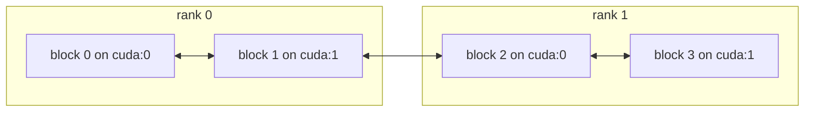

# Communication: distributed parallelism

You need this layer when your data is in pieces: when you split a problem into
parts, spread it over several devices, or run it over MPI ranks. The parts,
called *blocks*, need each other's data. A stencil needs its neighbour's edge
cells, and a particle needs the part that holds its position.
`tack.communication` moves Tack arrays between blocks and combines values over
them. If you contour a dataset on one device, you do not need it. Tack's own
algorithms over a dataset in pieces are written on this layer and use it for
you (see [Data in pieces](../data/pieces.md) and
[Filters over pieces](../visualization/over-pieces.md)).

The layer uses only Tack's core: arrays, devices and kernels. If those are
new, start with [Core](../core/index.md).

## Send a message between blocks

A **block** is one unit of distributed work, such as a part of a grid or a
share of particles. Each block lives on one device and has a **global id**, a
number unique over every process. `exchange` is the call every other pattern
is built on. Here each of four blocks sends its id to the next block in a
ring:

<!-- tack-check: ring -->
```python
import numpy as np

import tack
from tack import communication as tc

tack.set_default_device("cpu")

blocks = tc.Blocks(["cpu"] * 4)                      # four blocks, World() by default

outgoing = {}
for g in blocks.local:
    after = (g + 1) % blocks.count
    outgoing[g] = {after: {"sender": tack.array(np.array([g], np.int32))}}
incoming = blocks.exchange(outgoing)                 # {destination: {source: message}}

for g in blocks.local:
    before = (g - 1) % blocks.count
    assert list(incoming[g]) == [before]
    assert incoming[g][before]["sender"].numpy()[0] == before
print(blocks, {g: list(incoming[g]) for g in blocks.local})
# Blocks(4 blocks, 4 on rank 0) {0: [3], 1: [0], 2: [1], 3: [2]}
```

`exchange` takes `{source: {destination: message}}`, where a message is a
dictionary of names to Tack arrays. It returns `{destination: {source:
message}}` for every block of this process. Each received array is on the
destination block's device.

## One program for one process or many ranks

A **world** is the set of processes the blocks live in. `tc.World()` is this
process alone, as in the example. `tc.World(comm)` spans the ranks of an
mpi4py communicator, where a **rank** is one MPI process. Global ids run over
rank 0's blocks first, then rank 1's, and so on:



An algorithm written on blocks never asks which arrangement it runs on. You
can develop and test it in one process, without `mpiexec`, and run it
unchanged on hundreds of ranks. Collectives combine values in order of global
id, so a floating-point sum over blocks has the same bits however the blocks
are shared out. Every call on blocks is collective: every process makes the
same calls, in the same order.

The model is that of [DIY](https://github.com/diatomic/diy): blocks, links,
exchanges and collectives. Tack uses plain dictionaries in place of DIY's
callbacks.

## Reading path

Read these in order. Each page has a short example you can run in one
process.

1. [Blocks and worlds](blocks-and-worlds.md): global ids, devices, the world,
   and which calls every rank must make.
2. [Exchange data and refresh ghosts with plans](exchange-and-plans.md):
   messages between blocks, neighbours by their boxes, and a `Plan` built once
   and run every step.
3. [Route points to blocks](routing.md): send each point to the block that
   holds it, with values, and get answers back. Particles move this way.
4. [Sort and reduce over blocks](sort-and-reduce.md): sums, gathers and global
   numbering, and a sort that brings every copy of a key to one block.
5. [Run under MPI](mpi.md): mpi4py, a GPU per rank, GPU-aware transfers and
   Slurm.

The API reference for every call is in the
[runtime reference](../reference/api.md#communication-between-blocks).
