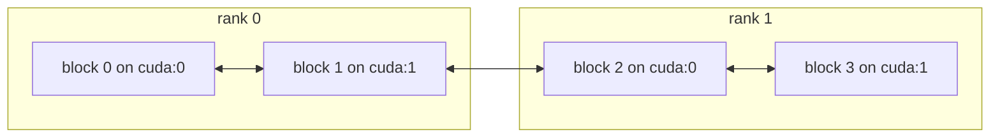

# Communication: distributed parallelism

A problem too large for one device is cut into parts, and the parts need each
other's data. A stencil needs its neighbour's edge cells, a particle needs the
part that holds its position, and a duplicated point needs to find its other
copies. `tack.communication` is the layer of Tack that moves Tack arrays
between such parts, called *blocks*, and combines values over them. This
section is for anyone who writes a computation over several devices or MPI
ranks with Tack arrays: a simulation developer, or the author of a parallel
algorithm. After this page you can write a computation on blocks that runs
unchanged in one process and on many MPI ranks.

The layer uses only Tack's core: arrays, devices and kernels. If those are
new, start with [Core](../core/index.md).

## Refresh ghost cells over six blocks

The example below diffuses heat along a line of 240 cells cut into six
blocks. Each block owns 40 cells and stores one extra *ghost cell* at each end,
a copy of its neighbour's edge cell. Before every step, a `Plan` copies each
block's edge cells into its neighbours' ghosts. Then every block runs the
same kernel on its own array.

The kernel is an ordinary Tack kernel. It replaces each cell by itself plus a
quarter of its discrete second derivative:

```python
--8<-- "docs/examples/comm_ghosts.py:kernel"
```

The blocks, the plan and the time steps follow. In the example file, `arch`
is the device (`"cpu"` by default) and `world` is `tc.World()`, this process
alone. `BLOCKS` is 6, `CELLS` 40 and `STEPS` 200.

```python
--8<-- "docs/examples/comm_ghosts.py:ghosts"
```

After 200 steps, `line` holds exactly the values that the same kernel gives on
one array of 240 cells, bit for bit. The example file checks that when you
run `python docs/examples/comm_ghosts.py --check`.

Three things in it are the whole layer in small:

- `tc.Blocks(devices, world)` makes this process's blocks, one per device
  given. `blocks.local` is the range of their global ids.
- Every argument and result is a dictionary keyed by global id, with an entry
  for each of this process's blocks.
- `Plan` and `all_gather` are *collective*: every process makes the same
  calls, in the same order.

## Blocks on one process and on MPI ranks

A **block** is one unit of distributed work: a part of a domain, a share of
particles, or a piece of a dataset. Each block lives on one device and has a
**global id**, a number unique over every process. A **world** is the set of
processes the blocks live in. `tc.World()` is this process alone.
`tc.World(comm)` spans the ranks of an mpi4py communicator, where a **rank**
is one MPI process.



Global ids run over rank 0's blocks first, then rank 1's, and so on. A process
may hold several blocks, on one device or on several. An algorithm written on
`Blocks` never asks which arrangement it runs on: the ghost example runs on
three ranks with two blocks each and gives the same line.
[Blocks and worlds](blocks-and-worlds.md) explains the numbering, the devices
and the rule that every call is collective.

## Send one message

`exchange` is the call every other pattern is built on. It takes
`{source: {destination: message}}`, where a message is a dictionary of names
to Tack arrays. It returns `{destination: {source: message}}` for every block
of this process. Here each of four blocks sends its id to the next block in a
ring:

<!-- tack-check: ring -->
```python
import numpy as np

import tack
from tack import communication as tc

tack.set_default_device("cpu")

blocks = tc.Blocks(["cpu"] * 4)                      # four blocks, World() by default

outgoing = {}
for g in blocks.local:
    after = (g + 1) % blocks.count
    outgoing[g] = {after: {"sender": tack.array(np.array([g], np.int32))}}
incoming = blocks.exchange(outgoing)                 # {destination: {source: message}}

for g in blocks.local:
    before = (g - 1) % blocks.count
    assert list(incoming[g]) == [before]
    assert incoming[g][before]["sender"].numpy()[0] == before
print(blocks, {g: list(incoming[g]) for g in blocks.local})
# Blocks(4 blocks, 4 on rank 0) {0: [3], 1: [0], 2: [1], 3: [2]}
```

Each received array is on the destination block's device. A block that
receives nothing gets an empty dictionary.
[Exchange data and refresh ghosts with plans](exchange-and-plans.md) covers
messages, neighbours and plans.

## Why algorithms are written on blocks

Writing an algorithm on blocks, rather than on MPI calls, has three
consequences that matter in practice.

- **One code for every arrangement.** The same function runs on one process
  with one block, on one process with a block per GPU, and on hundreds of
  ranks. You can develop and test it in one process, without `mpiexec`.
- **Results that do not depend on the arrangement.** Collectives combine
  values in order of global id. A floating-point sum over blocks therefore has
  the same bits however the blocks are shared out over ranks.
- **Tack arrays as messages.** A message keeps its arrays' element types and
  shapes, vectors and matrices included, and arrives on the receiving block's
  device. There is no packing into bytes and no callback to register.

The model is that of [DIY](https://github.com/diatomic/diy): blocks, links,
exchanges and collectives. Tack uses plain dictionaries in place of DIY's
callbacks.

Tack's own algorithms over a dataset in pieces are written on this layer.
Ghost cells, global ids, probing across pieces and particle tracing all use
the calls on these pages. See also [Data in pieces](../data/pieces.md) and
[Filters over pieces](../visualization/over-pieces.md), in the layers above.

## Result: three ranks, one answer

The ghost example runs under MPI with one flag, `--mpi`, which makes its world
from `MPI.COMM_WORLD`. The six blocks are then shared out over the ranks. On a
laptop with Open MPI 5.0, every run prints the same maximum and the same hash
of the line's bytes:

```console
$ python docs/examples/comm_ghosts.py --check
1 rank(s), 6 blocks: max 0.492189, sha256 4d622496db333f4d
$ mpiexec -n 2 python docs/examples/comm_ghosts.py --mpi --check
2 rank(s), 6 blocks: max 0.492189, sha256 4d622496db333f4d
$ mpiexec -n 3 python docs/examples/comm_ghosts.py --mpi --check
3 rank(s), 6 blocks: max 0.492189, sha256 4d622496db333f4d
$ mpiexec -n 6 python docs/examples/comm_ghosts.py --mpi --check
6 rank(s), 6 blocks: max 0.492189, sha256 4d622496db333f4d
```

`--check` also compares each run with the same kernel on one array of 240
cells, and every run passes. Tack's test suite runs the layer's patterns on
three MPI ranks the same way, both with messages staged through host memory
and with arrays handed to MPI directly.

## Reading path

Read these in order. Each page has a short example you can run in one
process.

1. [Blocks and worlds](blocks-and-worlds.md): global ids, devices, the world,
   and which calls every rank must make.
2. [Exchange data and refresh ghosts with plans](exchange-and-plans.md):
   messages between blocks, neighbours by their boxes, and a `Plan` built once
   and run every step.
3. [Route points to blocks](routing.md): send each point to the block that
   holds it, with values, and get answers back. Particles move this way.
4. [Sort and reduce over blocks](sort-and-reduce.md): sums, gathers and global
   numbering, and a sort that brings every copy of a key to one block.
5. [Run under MPI](mpi.md): mpi4py, a GPU per rank, GPU-aware transfers and
   Slurm.

The API reference for every call is in the
[runtime reference](../reference/api.md#communication-between-blocks).
