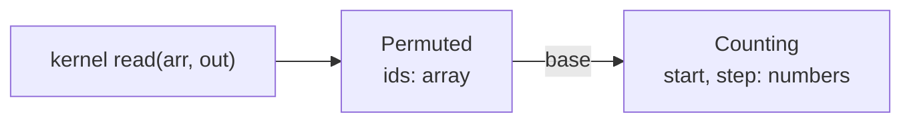

# Device classes

A device class is a Python class whose objects kernels can take as
arguments. An object bundles arrays, numbers and methods, and a kernel
calls its methods as it would in Python. This page is for anyone whose
kernels have grown long argument lists, or who wants one kernel to work
with several data layouts. After it you can write device classes, choose
which of their values are compiled in, nest objects inside objects, make
objects indexable like arrays, and write kernels as methods.

<!-- tack-check: device-classes-first -->
```python
import numpy as np
import tack

tack.set_default_device("cpu")

@tack.device_class
class Stored:
    def __init__(self, values):
        self.values = values                # an array

    @tack.func
    def get(self, i):
        return self.values[i]

@tack.device_class
class Uniform:
    def __init__(self, value):
        self.value = value                  # a number

    @tack.func
    def get(self, i):
        return self.value

@tack.kernel
def add(a, b, out):
    for i in range(out.shape[0]):
        out[i] = a.get(i) + b.get(i)

x = tack.arange(5, dtype=tack.f32)
out = tack.empty((5,))
add(Stored(x), Uniform(10.0), out)
np.testing.assert_allclose(out.numpy(), [10, 11, 12, 13, 14])
add(Stored(x), Stored(x), out)
np.testing.assert_allclose(out.numpy(), [0, 2, 4, 6, 8])
```

`add` does not know whether `a` holds an array or a single number. Each
combination of classes compiles to its own version of the kernel. In that
version, `a.get(i)` is replaced by the method's body, so `Uniform(10.0)`
costs no memory read at all.

## What an object brings to a kernel

Decorate the class with `@tack.device_class` and its methods with
[`@tack.func`](device-functions.md). Tack recognizes the object by its type
when you pass it, so the kernel's parameter needs no annotation. Tack then
reads the object's attributes and turns each one into part of the kernel:

| Attribute | Example | In the kernel |
|---|---|---|
| a number on the class | `corners = 4` in the class body | a constant, compiled in |
| a number on the object | `self.nx = nx` in `__init__` | a run-time argument |
| an array on the object | `self.values = values` | an array argument |
| a `@tack.func` method | `def get(self, i)` | inlined where it is called |
| another device-class object | `self.base = base` | its attributes, in turn |
| a `@tack.func` function | `self.profile = linear` | inlined where it is called |

Inlining means that the method's body replaces each call when the kernel
compiles. A method call therefore costs nothing at run time, and methods
can call each other through `self`.

The **specialization** of a kernel is everything a compiled version
depends on. For device classes, it includes which classes are passed, the
values of their class constants, which functions their attributes hold,
the element types of their arrays, and any array dimensions the kernel
compiles in, as [Kernels](kernels.md) explains. A new combination compiles a new
version. Run-time values, such as the numbers on an object, change nothing
that is compiled, so new values reuse the compiled kernel.

## Choose constants or run-time values

Put a number on the **class** when the compiler needs it: a size, a count
of corners, a fixed tile width. Put it on the **object** when it changes
from call to call: a grid's dimensions, a coefficient, a threshold.

A size given to `tack.local_array` or `tack.shared` must be a constant, so
it belongs on the class. This kernel averages the corner values of each
cell of a structured grid of quadrilaterals. The corner count is a class
constant, and the grid's dimensions are run-time values:

<!-- tack-check: device-classes-constants -->
```python
import numpy as np
import tack

tack.set_default_device("cpu")

@tack.device_class
class QuadGrid:
    corners = 4                                    # on the class: compiled in

    def __init__(self, nx, ny):
        self.nx, self.ny = nx, ny                  # on the object: run-time values

    @tack.func
    def point(self, cell, k):                      # corner k of a cell, counterclockwise
        i = cell % self.nx + (1 if k == 1 or k == 2 else 0)
        j = cell // self.nx + (1 if k >= 2 else 0)
        return i + (self.nx + 1) * j

@tack.kernel
def cell_average(cells, point_values, cell_values):
    for c in range(cell_values.shape[0]):
        ids = tack.local_array(tack.i32, cells.corners)    # needs a constant size
        total = 0.0
        for k in range(cells.corners):
            ids[k] = cells.point(c, k)
            total += point_values[ids[k]]
        cell_values[c] = total / cells.corners

for nx, ny in [(3, 2), (5, 4)]:                    # one compiled kernel for both grids
    point_values = tack.arange((nx + 1) * (ny + 1), dtype=tack.f32)
    cell_values = tack.empty((nx * ny,))
    cell_average(QuadGrid(nx, ny), point_values, cell_values)
    p = np.arange((nx + 1) * (ny + 1)).reshape(ny + 1, nx + 1)
    expected = (p[:-1, :-1] + p[:-1, 1:] + p[1:, :-1] + p[1:, 1:]) / 4
    np.testing.assert_allclose(cell_values.numpy(), expected.ravel())
```

The loop `range(cells.corners)` compiles to `range(4)`, which the compiler
can unroll. The two grid sizes reuse one compiled kernel, because `nx` and
`ny` are run-time values.

A tuple works the same way, one number per entry. On the object,
`self.shape = (nx, ny)` gives two run-time values, read as `obj.shape[0]`
and `obj.shape[1]`. On the class, `tile = (4, 4)` gives two constants. The
index must be a literal number, and `len(obj.shape)` is a constant.

## Write kernels as methods

A kernel can be a method of the class. Called on an object, it receives the
object as `self`, so it reaches the object's arrays, numbers and methods
with nothing passed in. This rasterizer draws a triangle into an RGB image:

<!-- tack-check: device-classes-rasterizer -->
```python
import numpy as np
import tack

tack.set_default_device("cpu")

@tack.device_class
class Rasterizer:
    def __init__(self, n, width, height):
        self.n = n
        self.width, self.height = width, height
        self.vertices = tack.empty((n, 3), tack.vec2())
        self.pixels = tack.zeros((height, width), tack.vec3())

    @staticmethod
    @tack.func
    def edge(p, a, b):                     # uses nothing of the object
        return (p.x - a.x) * (b.y - a.y) - (p.y - a.y) * (b.x - a.x)

    @tack.func
    def inside(self, p, t):
        a, b, c = self.vertices[t, 0], self.vertices[t, 1], self.vertices[t, 2]
        return self.edge(p, a, b) >= 0.0 and self.edge(p, b, c) >= 0.0 \
            and self.edge(p, c, a) >= 0.0

    @tack.kernel
    def draw(self, shade):
        for row, column in tack.ndindex(self.height, self.width):
            for t in range(self.n):
                if self.inside([column + 0.5, row + 0.5], t):
                    self.pixels[row, column] = [shade, shade, shade]

raster = Rasterizer(1, 32, 32)
tack.copyto(raster.vertices, np.array([[[8, 8], [8, 24], [24, 8]]], dtype=np.float32))
raster.draw(0.8)
image = raster.pixels.numpy()
np.testing.assert_allclose(image[10, 10], [0.8, 0.8, 0.8])
np.testing.assert_array_equal(image[0, 0], [0.0, 0.0, 0.0])
```

`raster.draw(0.8)` is the same call as `Rasterizer.draw(raster, 0.8)`. The
kernel compiles once per class and is shared by all its objects. A device
function that needs nothing from the object can be a `@staticmethod`. Put
`@staticmethod` above `@tack.func`, and call it through `self` as usual.

## Derive classes and hold functions

A device class can derive from another. The subclass has its base's
methods and class constants, and it may override either. A class can also
hold a device function as an attribute and call it, which lets one class
work with several interchangeable functions.

<!-- tack-check: device-classes-inheritance -->
```python
import numpy as np
import tack

tack.set_default_device("cpu")

@tack.device_class
class Fluid:
    rho_0 = 1000.0

    def __init__(self, stiffness):
        self.stiffness = stiffness

    @tack.func
    def pressure(self, rho):
        return self.stiffness * (rho / self.rho_0 - 1.0)

@tack.device_class
class Tait(Fluid):
    gamma = 7.0

    @tack.func
    def pressure(self, rho):                       # overrides Fluid.pressure
        return self.stiffness * ((rho / self.rho_0) ** self.gamma - 1.0)

@tack.kernel
def pressures(fluid, rho, p):
    for i in range(rho.shape[0]):
        p[i] = fluid.pressure(rho[i])

rho = tack.array(np.array([1000.0, 1010.0], dtype=np.float32))
p = tack.empty((2,))
pressures(Tait(100.0), rho, p)
np.testing.assert_allclose(p.numpy(), [0.0, 100 * (1.01**7 - 1)], rtol=1e-5, atol=1e-5)

@tack.func
def linear(r):
    return 1.0 - r

@tack.func
def quadratic(r):
    return (1.0 - r) * (1.0 - r)

@tack.device_class
class Smoothing:
    def __init__(self, profile, h):
        self.profile = profile                     # a device function
        self.h = h

    @tack.func
    def weight(self, r):
        return self.profile(r / self.h)

@tack.kernel
def weights(smoothing, r, w):
    for i in range(r.shape[0]):
        w[i] = smoothing.weight(r[i])

r = tack.array(np.array([0.0, 0.5], dtype=np.float32))
w = tack.empty((2,))
weights(Smoothing(linear, 1.0), r, w)
np.testing.assert_allclose(w.numpy(), [1.0, 0.5])
weights(Smoothing(quadratic, 1.0), r, w)
np.testing.assert_allclose(w.numpy(), [1.0, 0.25])
```

Which function an attribute holds is part of the specialization, like a
class constant. `Smoothing(linear, ...)` and `Smoothing(quadratic, ...)`
each compile once.

## Put objects inside objects

An object may hold other device-class objects as attributes, to any depth.
Its methods reach theirs through the attribute, as in `self.base.get(k)`,
and a kernel can reach in too, as in `arr.base.step`.



<!-- tack-check: device-classes-nested -->
```python
import numpy as np
import tack

tack.set_default_device("cpu")

@tack.device_class
class Counting:
    def __init__(self, start, step):
        self.start, self.step = start, step

    @tack.func
    def get(self, k):
        return self.start + self.step * k

@tack.device_class
class Permuted:
    def __init__(self, ids, base):
        self.ids = ids                             # an array of indices
        self.base = base                           # any object with get(k)

    @tack.func
    def get(self, k):
        return self.base.get(self.ids[k])

@tack.kernel
def read(arr, out):
    for i in range(out.shape[0]):
        out[i] = arr.get(i)

ids = tack.array(np.array([4, 3, 2, 1, 0], dtype=np.int32))
out = tack.empty((5,))
read(Permuted(ids, Counting(10.0, 5.0)), out)          # out[i] = 10 + 5 * ids[i]
np.testing.assert_allclose(out.numpy(), [30, 25, 20, 15, 10])
read(Permuted(ids, Permuted(ids, Counting(0.0, 1.0))), out)
np.testing.assert_allclose(out.numpy(), [0, 1, 2, 3, 4])
```

The whole tree is one argument. Every object's arrays and numbers become
kernel arguments, every class constant is compiled in, and every method is
inlined. So `Permuted(ids, Counting(10.0, 5.0))` compiles to
`10 + 5 * ids[i]`, the code you would write by hand. Which classes the tree
holds, and where, is part of the specialization. New values reuse the
compiled kernel, while another nesting compiles anew.

## Pass objects to device functions

A device-class object, or one it holds, can be passed to a `@tack.func` or
to another object's method. The callee then uses it as it would use
`self`, so `mean_of_two(arr, k)` may call `arr.get(k)` or index `arr[k]`.
Each such call gets its own copy of the callee with the object built in, so
it costs nothing at run time. A method may pass on `self`, as in
`helper(self, k)`, or a held object, as in `helper(self.base, k)`. The
callee cannot keep the object in a local variable or return it. The
indexable example below passes an object to a device function.

## Make objects indexable

A class becomes indexable in kernels when it defines Python's indexing
methods as device functions: `__getitem__` to read, `__setitem__` to store
and `__len__` for `len`. A kernel then indexes the object as it would an
array, and the same kernel accepts both:

<!-- tack-check: device-classes-indexable -->
```python
import numpy as np
import tack

tack.set_default_device("cpu")

@tack.device_class
class Ramp:
    def __init__(self, n, start, step):
        self.n, self.start, self.step = n, start, step

    @tack.func
    def __getitem__(self, k):
        return self.start + self.step * k

    @tack.func
    def __len__(self):
        return self.n

@tack.func
def mean_of_two(arr, k):                           # arr: an array or an object
    return 0.5 * (arr[k] + arr[k + 1])

@tack.kernel
def midpoints(a, out):
    for i in range(len(a) - 1):
        out[i] = mean_of_two(a, i)

out = tack.empty((4,))
midpoints(tack.arange(5, dtype=tack.f32), out)     # a stored array
np.testing.assert_allclose(out.numpy(), [0.5, 1.5, 2.5, 3.5])
midpoints(Ramp(5, 1.0, 0.5), out)                  # an indexable object
np.testing.assert_allclose(out.numpy(), [1.25, 1.75, 2.25, 2.75])

@tack.device_class
class Image:
    def __init__(self, values, nx, ny):
        self.values = values
        self.shape = (nx, ny)                      # two run-time values

    @tack.func
    def __getitem__(self, k):                      # k is a vector of two indices
        return self.values[k[0] + self.shape[0] * k[1]]

    @tack.func
    def __setitem__(self, k, v):
        self.values[k[0] + self.shape[0] * k[1]] = v

@tack.kernel
def bump(image):
    for i, j in tack.ndindex(image.shape[0], image.shape[1]):
        image[i, j] += float(i + 10 * j)

values = tack.zeros((6,))
bump(Image(values, 3, 2))
np.testing.assert_allclose(values.numpy(), [0, 1, 2, 10, 11, 12])
```

The two calls of `midpoints` compile to two versions of one kernel. One
reads the array directly, and the other inlines `__getitem__`. Nothing in
the kernel marks `a` as either.

Several indices, as in `image[i, j]`, arrive as one vector, so
`__getitem__(self, k)` reads `k[0]` and `k[1]`. `image[i, j] = v` calls
`__setitem__`. `image[i, j] += v` calls `__getitem__` and then
`__setitem__`, and evaluates the index once. `len(obj)` may be the
parallel loop's bound; it is evaluated when the kernel launches, like an
array's length. An object held by another is indexed the same way, as in
`self.base[k]`.

The implicit arrays of `tack.arrays` are built this way, which is why every
kernel can index them. See [Arrays and types](arrays-and-types.md).

## Loop over an object

A class can say what a loop over it runs through. `__tack_iterate__` names
one to three of its numbers on the object, fastest first, and a kernel then
loops over the object itself:

<!-- tack-check: device-classes-iterate -->
```python
import numpy as np
import tack

tack.set_default_device("cpu")

@tack.device_class
class Grid:
    __tack_iterate__ = ("nx", "ny")

    def __init__(self, nx, ny):
        self.nx, self.ny = nx, ny

    @tack.func
    def flat(self, c):
        return c[0] + self.nx * c[1]

@tack.kernel
def label(cells, out):
    for c in cells:                                # c[0] runs fastest
        out[cells.flat(c)] = 100 * c[1] + c[0]

out = tack.empty((6,), tack.i32)
label(Grid(3, 2), out)
np.testing.assert_array_equal(out.numpy(), [0, 1, 2, 100, 101, 102])
```

With one name, `for c in cells` is `for c in range(cells.nx)`, and `c` is
an integer. With two or three names, it is a `tack.ndindex` over them, and
`c` is the vector of indices with `c[0]` running fastest. As the kernel's
parallel loop, it launches in that shape, so recovering the indices costs
no division. Because the object's methods receive `c` as it comes, one
kernel can serve a class that loops in one dimension and another that
loops over a grid.

## Organize an application around state

Use a device class when several kernels share the same arrays and
parameters. The [Physarum tutorial](../users-guide/tutorials/physarum.md)
gathers its agents' positions and headings into one object, initializes
them with a kernel written as a method, and passes the object to three
simulation stages. Class constants describe the sensing model, and the
object's numbers and arrays describe one particular simulation.

The `QuadGrid` example above shows the other common use: one algorithm,
several storage layouts. A second class with the same `point` method,
reading an explicit connectivity array, would run the same `cell_average`
kernel on an unstructured mesh. See also
[Data](../data/index.md), whose mesh views follow this pattern.

## Details

**Instance numbers that shadow class constants.** A number set on the
object with the same name as a class constant replaces it, and stays
compiled in. Setting anything other than a number under that name removes
the constant, as a subclass attribute does.

**Allocation sizes.** A run-time value as a `tack.local_array` size may
compile on the CPU, but GPU compilers refuse it. Use a class constant, a
literal, a `tack.constant` or an array dimension so the kernel runs on
every device.

**Function attributes.** Assigning another function to an existing
object's attribute takes effect at the next call, which compiles a version
for it if needed.

**Rules for nesting.** An object may not hold itself, directly or through
others.

**Rules for indexable objects.** A store into an object without
`__setitem__` is refused when the kernel compiles. So is an atomic on an
indexable object, which has no memory of its own to update. The methods run
only in kernels. On the host, Python calls `__len__` to decide whether an
object is true, so test an indexable object with `is None`, not `if obj:`.

**Define classes once.** Define device classes at module level. A class
defined inside a function is a new class on every call, so each call
compiles anew. Its compiled versions are released when the class is
garbage-collected.

**Host cost.** Each call walks the object tree on the host to gather its
arguments. Each level of nesting adds a few microseconds to a call, about
4 µs a level on the CPU backend of an M1 Max. The compiled code pays
nothing. [Specialization and caching](../design/specialization-and-caching.md)
explains what a call costs and why.

## Where to go next

- [Reductions, scans and sorts](reductions-scans-sorts.md) are the library
  algorithms that accept arrays and indexable objects alike.
- [Memory and parallel correctness](memory-and-correctness.md) explains what
  kernels may safely read and write when many iterations run at once.
- The [Physarum tutorial](../users-guide/tutorials/physarum.md) builds a
  whole simulation around one device class.
