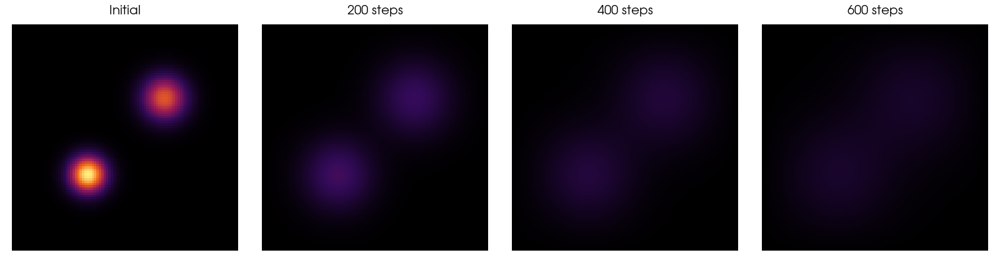
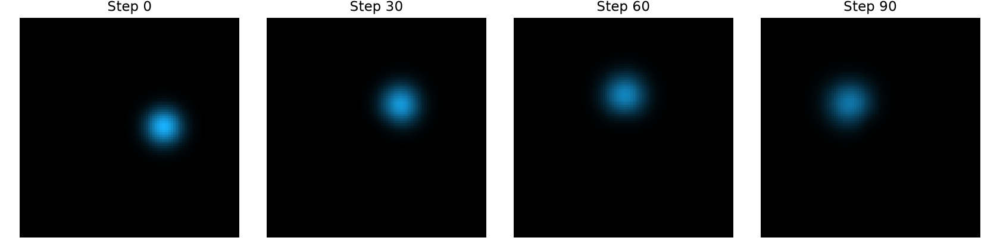
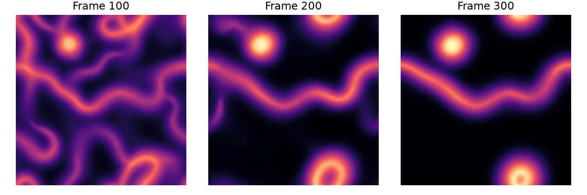
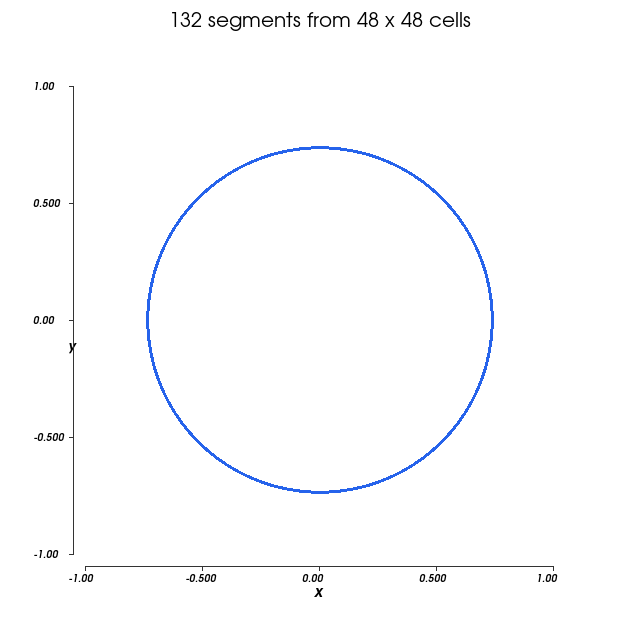
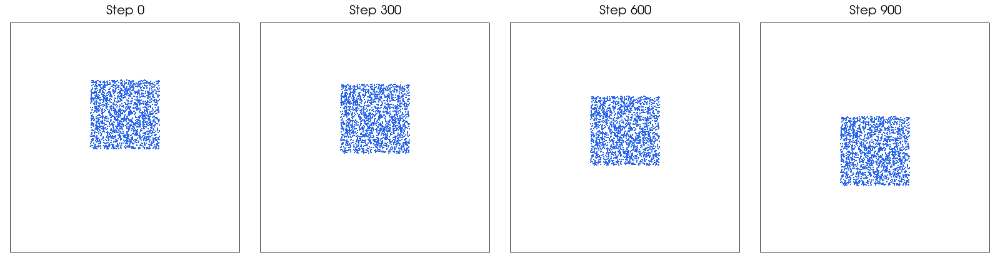
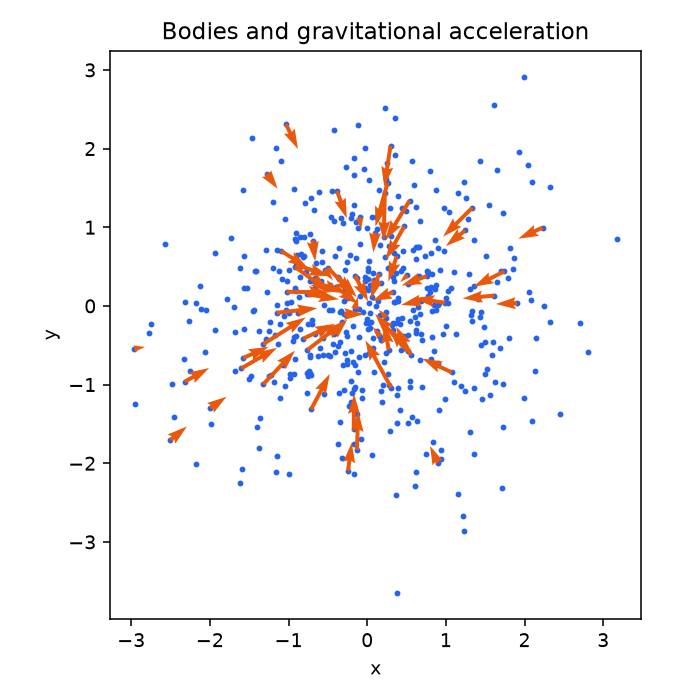

# Core examples

These six tutorials each build a complete program with Tack's core: arrays,
kernels, device functions and classes, atomics, scans and workgroups. Once a
first kernel works, they show the pieces working together in a real program.
Each one opens with the question it answers,
develops the program from its data layout to its host loop, and ends with a
check of the result. None needs datasets or visualization.

Every tutorial runs on the CPU and on any GPU, and checks itself against an
independent reference:

```bash
uv run python docs/examples/heat.py --arch cpu --check
uv run python docs/examples/heat.py --arch cuda --check      # or metal, hip, level_zero
```

## Heat diffusion on a plate

[](../users-guide/tutorials/heat.md)

**How do you step a simulation on a grid, when each cell's new value depends on
its neighbours' old ones?** Two hot spots on a cold plate spread and fade.
Each time step is one stencil kernel that reads an old array and writes a new
one, and the host swaps the two between steps. This is the first simulation to
read: it needs only [kernels](kernels.md) and two-dimensional arrays.
[Read the tutorial](../users-guide/tutorials/heat.md).

## Advecting coloured dye

[](../users-guide/tutorials/dye.md)

**How do you move a field through a flow, sampling between grid points?** A
blob of coloured dye rotates in a velocity field. Every output cell traces back
along the flow to where its colour came from and interpolates the old colours
there. It uses arrays of RGB vectors and a [device function](device-functions.md)
for the interpolation. [Read the tutorial](../users-guide/tutorials/dye.md).

## Agents that follow a trail

[](../users-guide/tutorials/physarum.md)

**How do many agents read and write one shared grid without racing each
other?** Agents sense a trail, turn toward it, move, and deposit more of it,
while the trail diffuses and fades. The agents are a
[device class](device-classes.md), their starting places and turns come
from [random numbers](workgroups-atomics-textures.md#draw-random-numbers),
and their deposits are atomic adds. Moving, depositing and diffusing are
separate kernels, so no kernel reads the trail while another writes it.
[Read the tutorial](../users-guide/tutorials/physarum.md).

## Marching squares: count, scan, write

[](../users-guide/tutorials/contours.md)

**How does a kernel write an output whose size it does not know in advance, in
a fixed order?** A contour of a circle comes out of a grid of samples, with
zero, one or two segments per cell. One kernel counts each cell's segments, an
exclusive scan turns the counts into offsets, and a second kernel writes each
cell's segments at its offset. The pattern fits any output with a count known
per input item. It uses a [scan](reductions-scans-sorts.md) and local arrays.
[Read the tutorial](../users-guide/tutorials/contours.md).

## A particle-to-grid simulation

[](../users-guide/tutorials/mpm.md)

**How do particles hand their momentum to a grid and take it back?** A block of
fluid falls under gravity, simulated with the material point method. Particles
carry the material's state, and a temporary grid exchanges momentum between
them each step. It uses arrays of 2×2 [matrices](vectors-and-matrices.md),
weights over a 3×3 stencil, and
[atomic adds](workgroups-atomics-textures.md#update-a-grid-cell-or-a-vector)
into a two-dimensional grid. [Read the tutorial](../users-guide/tutorials/mpm.md).

## Tiled N-body forces

[](../users-guide/tutorials/nbody.md)

**How do GPU threads share data through fast memory, while the same program
still runs on the CPU?** Each body sums the gravitational pull of every other
body. A plain kernel does it on every device. A tiled kernel loads positions
into [shared memory](workgroups-atomics-textures.md#cooperate-in-a-workgroup)
256 at a time and uses barriers, and the program picks it on devices with
workgroups. [Read the tutorial](../users-guide/tutorials/nbody.md).

## Run the tutorials

Each script is shown in full at the end of its tutorial and can be downloaded
from there. Run them from the repository root, after
[installing Tack](../install.md) from source:

- `--arch` names the device: `cpu`, `metal`, `cuda`, `hip` or `level_zero`.
  The device must start. The scripts never fall back to another.
- `--check` runs a smaller problem and compares it with a NumPy reference or
  with properties the answer must have. It is a correctness check, not a
  benchmark.
- `--output heat.png` saves the tutorial's figure. Figures need VTK, which
  `uv sync --extra interop` installs, or add it for one run with
  `uv run --with vtk python docs/examples/heat.py --output heat.png`.

`uv run python docs/examples/validate.py --arch cpu` runs every tutorial's
check on one device. The figures on this page were made on the CPU. A GPU
draws the same pictures, though its numbers can differ in the low bits, as
[Debug and time a kernel](debug-and-time.md#choose-a-tolerance) explains.

The heat example adapts one of Tack's own examples. Dye, the trail-following
agents, marching squares and MPM adapt public Taichi examples, and N-body
adapts NVIDIA Warp's tile example. Each tutorial links its original and says
what it changed. The adapted Taichi and Warp scripts keep their Apache-2.0
license, and the others use Tack's BSD-3-Clause license. See the
[notices](../examples/NOTICE.txt).

## Where to go next

- [Kernels](kernels.md), if a tutorial uses something you have not met yet.
- [Debug and time a kernel](debug-and-time.md), to check and measure your own
  version of a tutorial.
- For examples on meshes and fields, see the Visualization layer's
  [examples](../visualization/examples.md).
