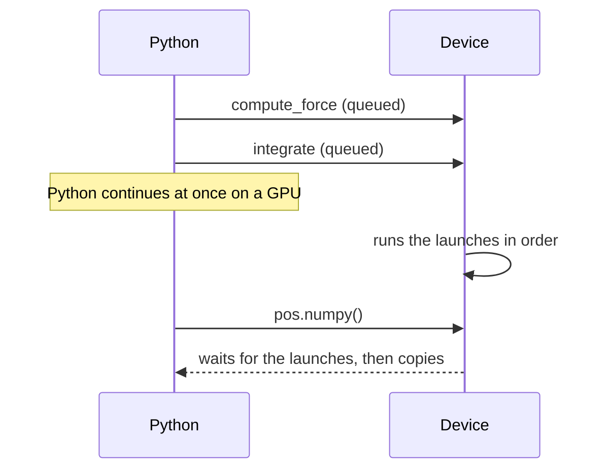

# How a Tack program runs

A Tack program is a Python program in which some functions are compiled for a
device. This page explains where each part of a program runs, how a
calculation splits into kernels, in what order the device runs them, and what
makes Tack compile a kernel again. It is for anyone turning NumPy code into
kernels. After reading it you can structure a simulation's time loop, give a
kernel the values it needs, and predict when a call will be slow because it
compiles.

## Host code and device code

A program has two kinds of code. *Host code* is ordinary Python. It makes
arrays, prepares input with NumPy, decides which kernels to call, runs the time
loop and reads the results. *Device code* is the body of a `@tack.kernel`
function, or of a `@tack.func` function a kernel calls. Tack reads that source
and compiles it for the device. On the CPU, device code is compiled too. It
does not run in the Python interpreter.

<!-- tack-check: host-and-device -->
```python
import numpy as np
import tack

tack.set_default_device("cpu")

@tack.kernel                                   # device code: compiled
def scale(x, out, factor):
    for i in range(x.shape[0]):
        out[i] = factor * x[i]

rng = np.random.default_rng(0)                 # host code: Python and NumPy
values = rng.random(1000, dtype=np.float32)
x = tack.array(values)
out = tack.empty_like(x)
for factor in (0.5, 2.0):
    scale(x, out, factor)                      # one launch per call
    assert np.allclose(out.numpy(), factor * values)
```

Device code is a part of Python made for numbers. It has arithmetic,
`if`, `for` and `while`, math functions, small vectors and matrices, and
calls to other device functions. It has no Python objects, lists or
dictionaries, no NumPy calls and no file operations. Do those in host code
and hand the kernel arrays. [Kernels](kernels.md) and
[Control flow and math](control-flow-and-math.md) describe what device code
can contain. The [kernel language contract](../reference/language-contract.md)
gives the exact rules.

| Task | In host code | In device code |
|---|---|---|
| Make storage | `tack.empty`, `tack.zeros`, `tack.array` | Small scratch arrays with `tack.local_array` |
| Read values | `a.numpy()`, or `a[i]` for one element | `a[i]`, `grid[row, column]` |
| Write values | `tack.copyto(a, values)`, `a.fill(value)` | `a[i] = value` |
| Repeat work | A Python loop that calls kernels | One parallel `for` per kernel, with ordinary loops inside |
| Reuse code | A Python function | A `@tack.func` function |
| Wait for the device | `tack.sync()`; reading an array also waits | Not needed |

## A call is one launch over a range

A kernel has exactly one parallel loop: a `for` directly in its body. Calling
the kernel *launches* it. The device runs every iteration of that loop, each
on its own thread on a GPU, or spread over the cores on a CPU. Iterations run
in any order, and many at once.

That is why each iteration must write its own outputs. In the first example,
iteration `i` writes `out[i]` and nothing else, so no order of the iterations
gives a different answer. Two iterations that write the same element, or one
that reads what another writes, give answers that depend on timing.
[Memory and parallel correctness](memory-and-correctness.md) shows the
patterns that stay correct: one writer per output, reading neighbours from a
separate array, and gathering instead of scattering.

Loops inside the parallel loop are ordinary loops. They run in order, within
one iteration. A row sum gives each row an iteration and walks the columns
inside it:

```python
@tack.kernel
def row_sums(matrix, sums):
    for row in range(matrix.shape[0]):         # parallel: one iteration a row
        total = 0.0
        for column in range(matrix.shape[1]):  # in order, within the row
            total += matrix[row, column]
        sums[row] = total
```

A local variable such as `total` belongs to its iteration. It does not carry
values between iterations.

## Split dependent stages into separate kernels

Many calculations have stages: compute every force from the current
positions, then move every particle. The second stage needs the first one
finished everywhere. Within one launch nothing guarantees that, because the
iterations run in any order. Put each stage in its own kernel and call them in
order:

<!-- tack-check: stages -->
```python
import numpy as np
import tack

tack.set_default_device("cpu")

@tack.kernel
def compute_force(pos, force):
    for i in range(pos.shape[0]):
        force[i] = -pos[i]                     # a spring pulling toward zero

@tack.kernel
def integrate(pos, vel, force, dt):
    for i in range(pos.shape[0]):
        vel[i] += dt * force[i]
        pos[i] += dt * vel[i]

n = 1000
pos = tack.array(np.linspace(-1.0, 1.0, n, dtype=np.float32))
vel = tack.zeros((n,))
force = tack.empty((n,))

for step in range(100):                        # Python runs the time loop
    compute_force(pos, force)
    integrate(pos, vel, force, 0.01)

assert np.abs(pos.numpy()).max() < 1.0          # every particle swung back
```

Tack keeps calls in program order. Each launch sees everything the launches
before it wrote. Each host access to an array, such as `numpy()`,
`tack.copyto`, reading one element or a sum, sees everything launched before
it. So `integrate` sees the whole force array, and the check after the loop
sees the last step.



On the CPU, a call returns when the kernel has finished. On a GPU, a call
returns as soon as the launch is queued, and Python goes on while the device
works. Reading an array waits for the launches before it. The program above
behaves the same either way, and you manage no streams or events. Call
`tack.sync()` to wait for every launch on every device. You need it to time a
kernel, and when another library reads memory Tack wrote.
[Choose a device](choose-a-device.md) says how each device queues and waits,
and [Wait without blocking](asyncio.md) shows how to wait from an `asyncio`
event loop.

GPU programmers may know `tack.barrier()`, which waits for the other threads
of one workgroup. It does not wait for the whole launch, so it cannot replace
a second kernel. See
[Workgroups, atomics, textures and random numbers](workgroups-atomics-textures.md).

## Give a kernel the values it needs

A kernel sees only its arguments, the constants you declare, and the device
functions it calls. It does not see the Python variables around it. Reading a
module-level `gravity = 9.8` in a kernel raises `NameError`, with the line and
a suggestion. Choose how to supply each value by how often it changes:

| Kind of value | How to supply it | Example |
|---|---|---|
| A number that changes between calls | A scalar argument | `integrate(pos, vel, force, dt)` |
| A number fixed for the program | `tack.constant` | `GRAVITY = tack.constant(9.8)` |
| State the kernels read and write | An array argument | positions, a grid, a counter |
| Several arrays and parameters that belong together | A device class | a particle system object |

A scalar argument is a runtime value: a new value runs the same compiled
code. A constant is compiled in, like a literal. Rebinding its Python name
later does not change a kernel already compiled. [Kernels](kernels.md#declare-constants)
shows constants, and [Device classes](device-classes.md) shows how an object
gathers arrays and parameters for a solver.

## What compiles once and what compiles again

The first call of a kernel compiles it, and later calls reuse the compiled
code. Tack keeps one compiled form, a *variant*, for each combination of the
things the generated code depends on. A call that differs in one of them
compiles another variant. A call that differs only in values reuses one.

| Compiles a new variant | Reuses the variant |
|---|---|
| An array of another element type (`f32` to `f64`, `f32` to `vec3`) | New values in the same arrays |
| An argument that was a scalar becomes an array, or the reverse | A new scalar value of the same type |
| A scalar of another type, such as an integer too large for `i32` | Another length of a one-dimensional array used as the loop's bound |
| An array dimension the kernel uses inside its body, such as a row length | Another number of rows in a two-dimensional array |
| A device class's class constants or its structure | A device class's instance numbers |

The dimensions are the case to watch. A dimension that sets only the
parallel loop's range is passed to the launch. A dimension used inside the
body becomes a number in the generated code. Indexing `grid[row, column]`
uses the row length to find the element, so grids of different widths compile
separately. [Kernels](kernels.md#array-dimensions-inside-a-kernel) shows how
to avoid this when it matters.

For a simulation this means: allocate the working arrays once, before the
time loop, and update them in place. The first step compiles every kernel, and
every later step only launches. Tack also keeps compiled variants on disk, so
the next run of the program starts warm. Editing a kernel, a device function
it calls, or a constant compiles it again. See
[Keep compiled kernels between runs](kernel-cache.md).

## Details

**The compilation steps.** On the first call with a new combination of
argument kinds, Tack takes five steps.

1. It reads the decorated function's source and checks it uses only what device
   code supports.
2. It translates it into Tack's intermediate representation, inlining every
   device function it calls.
3. It fills in the argument types and the array dimensions the body uses, and
   works out the type of every expression.
4. It generates code for the device: LLVM IR on the CPU, Metal Shading Language,
   CUDA C, HIP C, or OpenCL C for Level Zero.
5. It compiles it with the device's compiler, and launches it.

LLVM and the vendors' compilers optimize the generated code.
`tack.inspect` shows the intermediate representation and the generated code
without running the kernel. See [Kernels](kernels.md#see-the-generated-code). The design notes explain
[the compilation pipeline](../design/compilation-pipeline.md) and
[what goes into a variant](../design/specialization-and-caching.md).

**Threads on the CPU.** The CPU backend decides per kernel whether a launch
is worth spreading over its threads, by timing the kernel on the ranges it
runs. Small launches of cheap kernels run on the calling thread. The first
few calls of a kernel include this measuring. The
[CPU threading design note](../design/cpu-threading.md) describes the policy.

**Overlapping arrays on the CPU.** When no array a kernel writes overlaps
another of its arrays, the CPU compiles a variant that lets LLVM assume so.
A call that passes overlapping arrays, such as two views of one buffer, uses a
second variant that does not. Both give the same results.

## Where to go next

- [Arrays and types](arrays-and-types.md) explains the arrays every kernel
  reads and writes, and the types of scalar arguments.
- [Kernels](kernels.md) covers the parallel loop in full: several
  dimensions, inner loops and returning a value.
