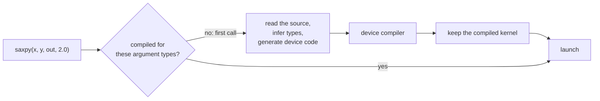

# Core: GPU computing in Python

Tack's core, the `tack` package, lets you write parallel numerical code as
ordinary Python functions and run it on a CPU or a GPU: Apple's through
Metal, NVIDIA's through CUDA, AMD's through HIP and Intel's through Level
Zero. If you know NumPy, and perhaps CuPy or PyTorch, but have never written
GPU code, start here. You will run a kernel on your own machine and see what
happens the first time you call it and every time after.

## Run your first kernel

A *kernel* is a Python function decorated with `@tack.kernel`. Tack compiles
it for a device and runs its outermost loop in parallel. Save this program in a
`.py` file and run it:

<!-- tack-check: first-kernel -->
```python
import numpy as np
import tack

tack.set_default_device("cpu")

@tack.kernel
def saxpy(x, y, out, alpha):
    for i in range(x.shape[0]):
        out[i] = alpha * x[i] + y[i]

x = tack.array(np.arange(8, dtype=np.float32))    # copy NumPy values to the device
y = tack.ones((8,))
out = tack.empty((8,))

saxpy(x, y, out, 2.0)

result = out.numpy()                              # copy the result back to NumPy
print(result)                                     # [ 1.  3.  5.  7.  9. 11. 13. 15.]
np.testing.assert_array_equal(result, 2.0 * np.arange(8) + 1.0)
```

The program has three parts. First it makes *arrays*: `tack.array` copies a
NumPy array onto the default device, and `tack.ones` and `tack.empty`
allocate new ones there. Then it calls the kernel, which computes one element
of `out` per iteration of its `for` loop. Finally `out.numpy()` copies the
result back into a NumPy array.

The kernel says what happens to one element, and the loop says over which
range. NumPy would write `out = alpha * x + y` and make a temporary array for
`alpha * x`. Tack runs the loop's iterations in parallel, in no particular
order, and makes no temporaries. The iterations are independent because
iteration `i` writes only `out[i]`.

Tack reads the function's source code to compile it, so define kernels in a
file: a script or a module works. Code typed at the interactive Python prompt
does not, because Python keeps no source for it.

## Run the same kernel on a GPU

To run on a GPU, change one line. Install the extra for your GPU first, as
[Install](../install.md) explains.

| Hardware | Line to use |
|---|---|
| Any CPU | `tack.set_default_device("cpu")` |
| Apple silicon GPU | `tack.set_default_device("metal")` |
| NVIDIA GPU | `tack.set_default_device("cuda")` |
| AMD GPU | `tack.set_default_device("hip")` |
| Intel GPU | `tack.set_default_device("level_zero")` |

Nothing else in the program changes. The kernel is the same Python function,
and Tack generates different code for each device.

Set the default device before you make arrays. An array is made on the
default device and stays there. A kernel runs where its arrays are, so
arrays made on the CPU keep running on the CPU after you change the default.
[Choose a device](choose-a-device.md) explains devices, several GPUs and
moving arrays between them.

Devices differ in what they support. The most common difference is
precision: Apple GPUs have no double precision (`f64`). Start with single
precision (`f32`, Tack's default) if you want code that runs everywhere.
[Choose a device](choose-a-device.md) lists the other differences.

## What happens on the first call and the next

The first call of a kernel compiles it. Tack reads the function's source,
translates it into its own intermediate form, works out every variable's type
from the arguments you passed, and generates code for the device. On the CPU
that code is LLVM IR. On GPUs it is Metal's shading language, CUDA C, HIP C or
OpenCL C. The device's own compiler turns it into machine code, and Tack
launches it.



Later calls with arguments of the same kinds reuse the compiled kernel and
only launch it. Changing a scalar argument's value, such as `alpha`, reuses
it. So does changing the length of the arrays here. Changing an array's
element type, say from `f32` to `f64`, compiles a second version.
[How a Tack program runs](how-programs-run.md#what-compiles-once-and-what-compiles-again)
says exactly what makes a new version.

Tack also keeps compiled kernels on disk, so the next run of your program
loads them instead of compiling again. On an Apple M1 Max's CPU, for the
kernel above on a million elements, the first call took 30 ms and later calls
0.2 ms. In the next run, with the kernel on disk, the first call took 0.9 ms.
[Keep compiled kernels between runs](kernel-cache.md) explains the disk cache.

## How fast one kernel runs

The example file `docs/examples/core1_throughput.py` times the same kernel on
16.8 million `f32` elements, warm, against the NumPy expression `2.0 * x + y`.
It counts 12 bytes moved per element: two reads and a write. Here is the part
that times the kernel:

```python
--8<-- "docs/examples/core1_throughput.py:time"
```

`tack.sync()` waits for the device. On a GPU a call returns as soon as the
launch is queued, so a timer without it would measure only the queueing.

Measured on an Apple M1 Max, on its CPU, on 2026-11-03, while other programs
were running:

| | warm call (ms) | GB/s |
|---|---|---|
| Tack, CPU | 1.45 | 139 |
| NumPy | 4.2 | 47 |

Tack's CPU kernel is about three times faster than NumPy here. It runs on all
eight performance cores and makes no temporary array. Run the script with
`--arch metal`, `--arch cuda`, `--arch hip` or `--arch level_zero` to measure
your GPU. A kernel this simple is limited by memory bandwidth, so the speedup
you see on a GPU depends mostly on the GPU's memory. The
[performance page](../performance.md) has measured results of whole
algorithms, on CPUs and GPUs.

## What the core layer gives you

The core layer is everything below datasets and visualization. It has no
notion of meshes or fields, and you can use it on its own.

| You want to | Read |
|---|---|
| Make arrays, move data to and from NumPy, choose element types | [Arrays and types](arrays-and-types.md) |
| Write a parallel loop over one, two or three dimensions | [Kernels](kernels.md) |
| Use conditions, inner loops and math functions in a kernel | [Control flow and math](control-flow-and-math.md) |
| Factor code into reusable compiled helpers | [Device functions](device-functions.md) |
| Compute with small vectors and matrices | [Vectors and matrices](vectors-and-matrices.md) |
| Group arrays and parameters into objects kernels take | [Device classes](device-classes.md) |
| Sum, scan and sort arrays | [Reductions, scans and sorts](reductions-scans-sorts.md) |
| Share memory with NumPy, PyTorch, CuPy or VTK | [Share arrays](share-arrays.md) |

The [examples](examples.md) are complete programs, from heat diffusion to
particle simulation, each checked against NumPy.

## Read the core layer in this order

1. [How a Tack program runs](how-programs-run.md): which code runs in Python
   and which is compiled, why a calculation splits into several kernels, and
   what compiles again.
2. [Arrays and types](arrays-and-types.md): making arrays, element types,
   scalar arguments and casts.
3. [Kernels](kernels.md): the parallel loop, several dimensions, inner loops
   and returning a value.
4. [Control flow and math](control-flow-and-math.md): conditions, loops,
   math functions and how arithmetic behaves.
5. [Device functions](device-functions.md): helpers that kernels call.
6. [Heat diffusion](../users-guide/tutorials/heat.md): a complete simulation
   that puts these together.

## Where to go next

Start with [How a Tack program runs](how-programs-run.md). It explains the
idea that matters most when you turn NumPy code into kernels: how the work
splits between Python and the device.
