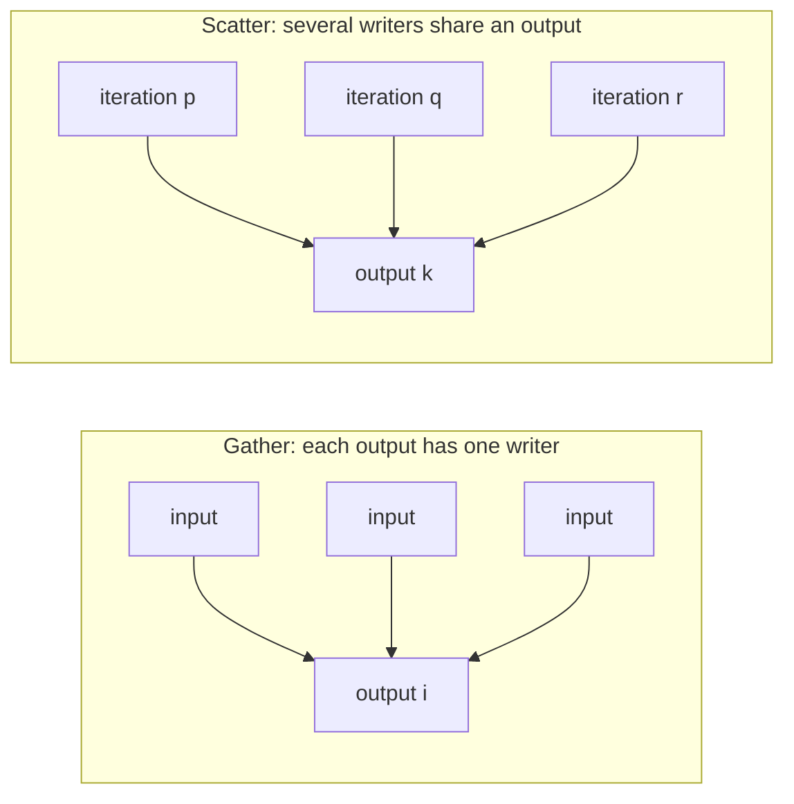
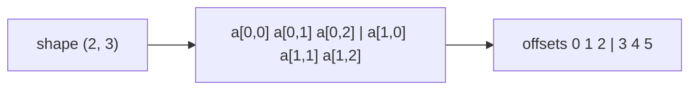

# Memory and parallel correctness

A kernel's iterations run at the same time, in no promised order. This
page explains how to write kernels whose answer does not depend on that
order. It is for anyone moving from NumPy, where every operation finishes
before the next begins, to kernels, where thousands of iterations share
the same arrays. After it you can tell which iteration owns each output,
when a kernel needs a second array, an atomic or a scan, and what Tack
checks for you and what it leaves to you.

The question to ask of every kernel is this: **which iteration writes each
output, and what can it read while other iterations are writing?** This
smoothing step answers it with two arrays. Every iteration reads only the
old array and writes only its own element of the new one:

<!-- tack-check: memory-first -->
```python
import numpy as np
import tack

tack.set_default_device("cpu")

@tack.kernel
def smooth(old, new):
    for i in range(old.shape[0]):
        left = old[i - 1] if i > 0 else old[i]
        right = old[i + 1] if i < old.shape[0] - 1 else old[i]
        new[i] = 0.25 * left + 0.5 * old[i] + 0.25 * right

start = np.array([0, 0, 4, 0, 0], dtype=np.float32)
old = tack.array(start)
new = tack.empty_like(old)
for step in range(2):
    smooth(old, new)
    old, new = new, old                 # swap the names, not the data

expected = start.copy()
for step in range(2):
    padded = np.concatenate([expected[:1], expected, expected[-1:]])
    expected = 0.25 * padded[:-2] + 0.5 * padded[1:-1] + 0.25 * padded[2:]
np.testing.assert_allclose(old.numpy(), expected)
```

Had `smooth` written into `old` itself, iteration `i` might read a
neighbour that another iteration had already smoothed, and the result would
change from run to run.

## Ownership decides correctness

There are two shapes of parallel work, and they need different tools.



In a **gather**, an iteration reads as many inputs as it likes and writes
one output that no other iteration writes. A row sum, a stencil and a
particle interpolating from a finished grid are gathers. They need no
synchronization, only inputs that do not change during the launch.

In a **scatter**, several iterations add into the same output. Particles
depositing mass onto a grid are a scatter. They need an atomic update, or a
reorganization, such as a sort, that turns the scatter into a gather.

Tack does not prove that a kernel is free of such conflicts. A kernel that
compiles may still have two iterations write the same element. The
sections below are the patterns that keep it correct.

## Know where each element is

A scalar array of shape `(height, width)` stores `height * width` values in
**row-major** order: the last index varies fastest, as in NumPy's default.
In a kernel, `image[row, column]` is the same value as
`image[row * width + column]`.



A vector or matrix array stores each element's components together, and
then moves to the next element. An RGB image is stored `R, G, B` of pixel
`(0, 0)`, then of pixel `(0, 1)`, and so on. Its `shape` counts pixels, and
`numpy()` appends the component dimension.

| Allocation | One element is | `numpy()` gives |
|---|---|---|
| `tack.empty((h, w))` | one `f32` per pixel | `(h, w)` |
| `tack.empty((h, w), tack.vec3())` | one RGB vector per pixel | `(h, w, 3)` |
| `tack.empty((n,), tack.mat2())` | one 2×2 matrix per particle | `(n, 2, 2)` |

Choose one indexing convention and keep it. The introductory grid examples
use `(height, width)` and `[row, column]`. The
[dye tutorial](../users-guide/tutorials/dye.md) uses `(width, height)` and
`[x, y]` to match its coordinate arithmetic, and transposes for image
output. Both are valid, but data written in one convention and read in the
other comes out transposed.

## Give each output one writer

This kernel is correct even though it updates its input in place:

<!-- tack-check: memory-one-writer -->
```python
import numpy as np
import tack

tack.set_default_device("cpu")

@tack.kernel
def scale(data, factor):
    for i in range(data.shape[0]):
        data[i] *= factor

data = tack.array(np.arange(4, dtype=np.float32))
scale(data, 2.0)
np.testing.assert_allclose(data.numpy(), [0, 2, 4, 6])
```

Iteration `i` reads and writes only element `i`, so no other iteration can
see its work half done. The same reasoning covers a velocity update in which
each particle reads finished forces and writes only its own velocity.

## Read neighbours from a stable input

A stencil reads the old values around each element. Updating the same
array lets one iteration read a neighbour that another has already changed.
Use two arrays, as in the first example, and swap them between steps with
`old, new = new, old`. The swap changes which Python name refers to which array; it copies
nothing. Both arrays need the same shape and element type.

Write every element that the next step will read, the boundary included. A
new array's contents are unspecified, so an element no kernel wrote holds
whatever was in memory. If a kernel writes only the interior, fill the
border of **both** arrays first. `tack.zeros` makes an array that starts
at zero, and `fill` sets an existing one. The
[heat tutorial](../users-guide/tutorials/heat.md) develops this pattern in
two dimensions.

Some in-place numerical schemes are valid, such as red-black updates in
two separate calls. They need an argument specific to the algorithm, and
two arrays are the safe default.

## Remember that views share storage

`reshape` returns a **view**, a second array over the same memory. `copy`
makes independent storage:

<!-- tack-check: memory-views -->
```python
import numpy as np
import tack

tack.set_default_device("cpu")

grid = tack.zeros((4, 4))
flat = grid.reshape((16,))              # the same memory, seen as 16 elements
independent = grid.copy()               # new memory

@tack.kernel
def number(a):
    for i in range(a.shape[0]):
        a[i] = float(i)

number(flat)
np.testing.assert_allclose(grid.numpy()[1], [4, 5, 6, 7])       # written through the view
np.testing.assert_allclose(independent.numpy()[1], [0, 0, 0, 0])
```

Passing `grid` and `flat` as two arguments does not give a kernel two
buffers. Tack keeps each iteration's own reads and writes in program order,
even through two views of one memory. That does not make two iterations'
conflicting accesses safe. A stencil's output must be a separate
allocation, not a view of its input. Arrays shared with other libraries
can overlap in the same way; [Share arrays](share-arrays.md) covers them.

## Scatter with atomics

When several iterations add into one element, a plain `+=` can lose
contributions. Two iterations may both read the old value, add, and store,
so one addition disappears. `tack.atomic_add` makes each such update
indivisible:

<!-- tack-check: memory-scatter -->
```python
import numpy as np
import tack

tack.set_default_device("cpu")

@tack.kernel
def deposit(cell_of, mass, grid_mass):
    for p in range(cell_of.shape[0]):
        tack.atomic_add(grid_mass, cell_of[p], mass[p])

cell_of = tack.array(np.array([0, 2, 2, 1, 2], dtype=np.int32))
mass = tack.array(np.array([1, 2, 3, 4, 5], dtype=np.float32))
grid_mass = tack.zeros((3,))                # atomics add to what is there
deposit(cell_of, mass, grid_mass)
np.testing.assert_allclose(grid_mass.numpy(), [1, 4, 10])
```

An atomic makes one update indivisible. It does not order the rest of the
kernel, and it does not make other reads see the update. So finish the
scatter in one kernel and read the grid in the next. The
[Physarum](../users-guide/tutorials/physarum.md) and
[MPM](../users-guide/tutorials/mpm.md) tutorials separate their stages this
way.

Floating additions arrive in whatever order the iterations run, so a
floating sum built by atomics can change in its last bits from run to run.
Integer sums are exact. When you need the same bits every run, sort by
destination and reduce each run instead, with `sort_by_key` and
`reduce_by_key` from [Reductions, scans and sorts](reductions-scans-sorts.md).

## Claim slots, or count, scan and write

An atomic's return value is the element's value just before the update.
That lets each iteration claim a unique slot in an output list:

<!-- tack-check: memory-claim-slots -->
```python
import numpy as np
import tack

tack.set_default_device("cpu")

@tack.kernel
def append_large(values, out, count):
    for i in range(values.shape[0]):
        if values[i] > 2.5:
            slot = tack.atomic_add(count, 0, 1)     # the old count is this iteration's slot
            out[slot] = values[i]

values = tack.array(np.array([1, 2, 3, 4, 5], dtype=np.float32))
out = tack.empty((5,))                              # room for every input
count = tack.zeros((1,), tack.i32)
append_large(values, out, count)
length = count[0]                                   # reads one element
np.testing.assert_allclose(np.sort(out.numpy()[:length]), [3, 4, 5])
```

The order of the appended items is not specified, which is why the check
sorts them. The counter must start at zero, and the output must have room
for every item that might be appended. An atomic neither allocates memory
nor checks the index it produces.

When the order matters, or the output size is not known in advance, use
**count, scan and write** instead. One kernel counts each input's outputs,
`exclusive_scan` turns the counts into offsets and returns the exact total,
and a second kernel writes each input's outputs at its offset.
[Reductions, scans and sorts](reductions-scans-sorts.md#turn-counts-into-offsets-with-a-scan)
shows it, and the
[marching squares tutorial](../users-guide/tutorials/contours.md) builds an
algorithm on it.

## Move data between the host and a device

Every array belongs to the device it was made on, shown by `a.device`. A
kernel runs on its arrays' device. Changing the default device does not move
existing arrays, and they keep working where they are. `a.to_device(d)`
copies one to another device. [Choose a device](choose-a-device.md) explains
devices.

`tack.copyto` and `numpy()` copy whole arrays between NumPy and Tack. They
copy even on the CPU and Metal, where the host can address the memory. On
the host, `a[i]` reads one element. On CUDA, HIP and Level Zero that is one
transfer per read, so keep it out of inner loops. Host code cannot write an
element; use `tack.copyto`, `fill` or a kernel.

On a GPU a kernel call returns once the launch is queued. Every host read
first waits for the launches before it, so reads always see finished work.
[How a Tack program runs](how-programs-run.md) explains the queue.

Arrays borrowed from another library through `array_from_ptr` or DLPack
share that library's memory. Keep the owner alive while Tack uses the
memory. Read-only memory cannot be passed to a kernel that may write it.
[Share arrays](share-arrays.md) has the rules.

## What Tack checks, and what it leaves to you

| Mistake | What happens |
|---|---|
| two iterations write one element without an atomic | not detected; the result may change from run to run |
| an index outside an array | not checked; the result is undefined, except in debug mode |
| reading an element no one wrote | not detected; the value is whatever was in memory |
| a read-only array passed where the kernel stores | refused at the call |
| arrays on two devices in one call | refused at the call |

**Debug mode** finds bad indices. `tack.set_debug(True)`, or the
environment variable `TACK_DEBUG=1`, compiles every kernel with a check on
each array access. A call with an access outside its array raises
`IndexError` naming the first one. [Debug and time a kernel](debug-and-time.md)
shows how to use it.

## Details

**Negative indices.** On the host, a negative index counts from the end, as
in NumPy. In a kernel it does not: an index must lie within the array.

**Vector atomics.** An atomic on a vector or matrix element updates each
component with its own atomic. The element is not updated as one
indivisible whole.

**Atomic types.** Not every device supports atomics of every element type.
Metal and Level Zero support atomics on `i32`, `u32` and `f32`. CUDA and
HIP add `i64`, `u64` and `f64`, and the CPU supports every type. Support for `f64` arrays does not imply `f64`
atomics. [Workgroups, atomics and textures](workgroups-atomics-textures.md)
has the table.

**Atomics are not fences.** Atomics are relaxed. They make one update
indivisible among the iterations of a launch on one device, and order
nothing else.

The [language contract](../reference/language-contract.md#memory-and-aliasing)
states these rules precisely, and the
[memory and aliasing notes](../design/memory-and-aliasing.md) explain why
they are what they are.

## Where to go next

- [Reductions, scans and sorts](reductions-scans-sorts.md) has the scans
  and sorts that replace atomics when order matters.
- [Workgroups, atomics and textures](workgroups-atomics-textures.md) covers
  atomics in full, and the shared memory of GPU workgroups.
- The [heat tutorial](../users-guide/tutorials/heat.md) applies two-array
  stencils to a full simulation.
