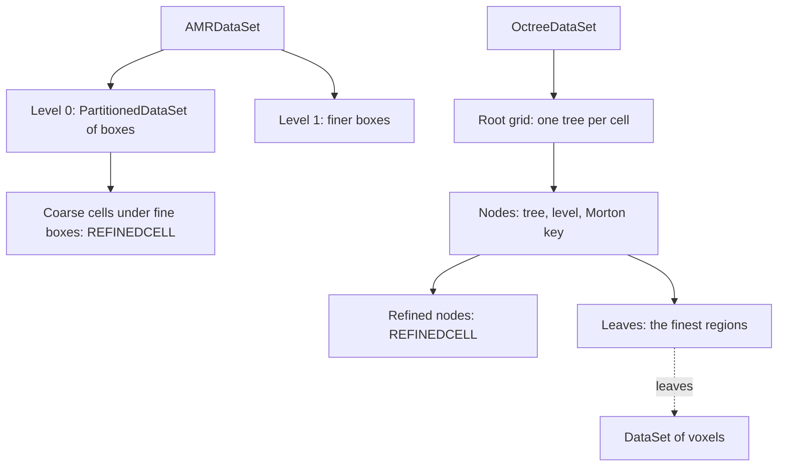

# AMR hierarchies and octrees

Adaptive mesh refinement (AMR) puts fine cells where a simulation needs
them and coarse cells elsewhere. Codes do it in two ways. Block-structured
codes such as AMReX, Chombo and Enzo cover regions with finer boxes, level
after level. Tree-based codes such as RAMSES, and the CEA codes ParaView
reads as HyperTreeGrids, split single cells into children wherever more
resolution is needed. Tack holds the first as an `AMRDataSet` and the second
as an `OctreeDataSet`. This page explains both: how each is described, what
Tack checks when you make one, and how ghost marks make every region count
once. After reading it you can build either from a code's output and know
which of its values a reduction counts. It assumes
[Data in pieces](pieces.md), whose ghost marks both use.

## Two ways to refine

| | `AMRDataSet` (block-structured) | `OctreeDataSet` (tree-based) |
|---|---|---|
| refines | boxes of cells, by a ratio per level | single cells, into 2 along each axis |
| holds | levels, each a `PartitionedDataSet` of structured boxes | a grid of root cells and every node of its trees |
| a fine region | a finer box over coarse cells | a node's children |
| the covered coarse data | marked `REFINEDCELL` and `REFINEDPOINT` | the node marked `REFINEDCELL` |
| fields | any, on each box | cell data, one value per node |
| VTK | `vtkOverlappingAMR` | `vtkHyperTreeGrid` |



In both, a coarse value that a finer one covers stays stored and valid, but
is *superseded*: a reduction over the whole leaves it out. That is the one
rule to remember, and the ghost marks carry it.

## Block-structured AMR

An `AMRDataSet` is a list of levels. Each level is a `PartitionedDataSet`
of boxes, or a plain list of datasets, and each box is a dataset with a
`StructuredTopology`. `ratios[l]` is how much finer level `l + 1` is than
level `l`: one whole number, or one per axis.

<!-- tack-check: amr-build -->
```python
import tack
import tack.dataset as td
from tack.dataset import Ghosts

tack.set_default_device("cpu")


def box(lo, cells, spacing):
    """An image box of ``cells`` cells whose first cell is at index ``lo`` of its level."""
    corner = tuple(i * spacing for i in lo)
    image = td.uniform_grid(tuple(n + 1 for n in cells), origin=corner, spacing=(spacing,) * 2)
    return td.DataSet(td.StructuredTopology(tuple(n + 1 for n in cells), offset=lo),
                      image.geometry.values)


# Two 4 x 8 boxes at level 0, and one box at level 1 across their seam, twice as fine.
amr = td.AMRDataSet([[box((0, 0), (4, 8), 1.0), box((4, 0), (4, 8), 1.0)],
                     [box((4, 4), (8, 8), 0.5)]], ratios=[2])
print(amr)

found = []
for level, piece in amr:                  # this rank's boxes, coarsest level first
    cells, points = piece.ghosts.cells.numpy(), piece.ghosts.points.numpy()
    found.append((level, int((cells & Ghosts.REFINEDCELL != 0).sum()),
                  int((points & Ghosts.REFINEDPOINT != 0).sum()),
                  int((points & Ghosts.DUPLICATEPOINT != 0).sum())))
    print(f"level {found[-1][0]}: {found[-1][1]} refined cells, {found[-1][2]} refined "
          f"points, {found[-1][3]} points a sibling owns")
assert found == [(0, 8, 15, 0), (0, 8, 15, 9), (1, 0, 0, 0)]
```

The fine box covers four by four coarse cells, half in each coarse box, so
each coarse box has 8 refined cells. The 15 refined points in each are the
points of those cells, the edge of the refined region included. The second
coarse box shares its left column of 9 points with the first, which owns
them.

### The hierarchy lives in index space

A box is placed in its level by cell indices alone. Its topology's `offset`
is the index of its first cell in the level, and its point dimensions give
its extent. Level 1's box above starts at cell `(4, 4)` of level 1, which is
cell `(2, 2)` of level 0. Because the hierarchy needs nothing but indices, a
box's geometry can be an image, a rectilinear grid or a curvilinear grid.
`domain` is level 0's index box, `(lo, hi)` with `hi` exclusive; by default
it is the bounding box of level 0's boxes.

Tack checks the hierarchy when it is made, and refuses:

- boxes of one level that overlap;
- a fine box that, coarsened by the ratio, is not inside its coarser level's
  boxes (*proper nesting*);
- image boxes of one level that do not share one spacing, one origin and one
  orientation, which is VTK's model (rectilinear and curvilinear boxes have no
  such constraint);
- boxes that already have ghost cells.

### Each region once

Making the hierarchy computes each box's ghost marks:

- `REFINEDCELL` on each cell a finer box covers.
- `REFINEDPOINT` on each point at whose location a finer level has a point,
  the edge of the refined region included. VTK has no such point bit; Tack
  adds it.
- `DUPLICATEPOINT` on each point two sibling boxes share, owned by the
  lower-numbered box.

So every region and every location belongs to exactly one box, at the
finest level that holds it. Reductions over the hierarchy count each once.
Filters run per box and leave refined cells out of what they make. The
boxes the hierarchy holds are copies of those you gave, with these marks,
sharing their topology, geometry and fields.

Over MPI ranks, each rank passes its own boxes of each level and a `world`
(see [Blocks and worlds](../communication/blocks-and-worlds.md)). The
hierarchy gathers every rank's box extents when it is made, so the marks are
right across ranks. `amr.boxes(level)` gives the index boxes of a level on
every rank, each as its `(lo, hi)` cell indices.

`vtk_to_dataset` reads a `vtkOverlappingAMR`, and `dataset_to_vtk` writes one
back for images and rectilinear boxes. A hierarchy with curvilinear boxes
goes to VTK as a `vtkPartitionedDataSetCollection` with one partitioned
dataset per level. `td.amr_gaussian_pulse` makes VTK's Gaussian-pulse test
hierarchy. In a VTK pipeline, Tack's AMR filters take a `vtkOverlappingAMR`
whole (see [VTK](../visualization/vtk.md)).

## Tree-based AMR

An `OctreeDataSet` holds a grid of trees. The *roots* are an image or a
rectilinear grid, 2D or 3D, and each of its cells is the root of one tree.
A node splits into 2 along each axis: 8 children in 3D, 4 in 2D.

Tack stores the trees as a *linear octree*, a form suited to GPUs. Every
node is three numbers: its tree, its level (0 at the root), and its *Morton
key*, its integer coordinates within the tree at its level interleaved bit
by bit, x in the lowest bit. A child's key is its parent's key shifted left
by the dimension, plus the child's index, x fastest. Tack sorts the nodes so
that each subtree is one contiguous run, parents before their children. A
node is a leaf when the next node is not its child. Positions and sizes are
computed from the keys and the roots; nothing about position is stored.

<!-- tack-check: octree-build -->
```python
import numpy as np

import tack
import tack.dataset as td

tack.set_default_device("cpu")

# Two root cells side by side. The first is refined once, and its last child
# (child 7, at the far corner) is refined again.
roots = td.uniform_grid((3, 2, 2))
tree = [0] + [0] * 8 + [0] * 8 + [1]
level = [0] + [1] * 8 + [2] * 8 + [0]
key = [0] + list(range(8)) + [(7 << 3) | child for child in range(8)] + [0]
octree = td.OctreeDataSet(roots, tree, level, key,
                          fields={"level": np.array(level, np.float32)})
print(octree)                             # 2 trees, 18 nodes, 16 leaves

leaf = octree.is_leaf
assert leaf.sum() == 16 and octree.finest == 2
assert np.isclose(octree.measures()[leaf].sum(), 2.0)    # the leaves fill both roots

leaves = octree.leaves()                  # the leaves as a mesh of voxels
print(leaves.num_cells, "cells,", leaves.num_points, "points")
assert leaves.num_cells == 16 and leaves.num_points == 27 + 19 + 4
```

The leaves tile the two unit cubes, so their volumes sum to 2. The nodes
that are not leaves, the first root and its seventh child, are marked
`REFINEDCELL`. So reductions count each region once, over the leaves.

### Values on every node

An octree holds cell data, one value per node, refined nodes included, as
the codes store them. `fields` maps names to one value per node in the
order you give the nodes; Tack sorts them with the nodes. `mask=`, one value
per node, hides the nodes where it is nonzero (`HIDDENCELL`). `units=` gives
the fields' units, and the spatial unit is the roots'.

Codes often write only cells, not the tree.
`OctreeDataSet.from_cells(roots, level, position, fields)` takes each cell's
level and a position inside it, as a RAMSES reader or yt gives them, over a
grid of root cells. It adds the ancestors no cell gives, with NaN values.

### Leaves as a mesh

`octree.leaves()` is the leaves as an unstructured `DataSet` of voxels, or
pixels in 2D, with every field as cell data. Cell `c` is the `c`-th leaf in
the nodes' order, and hidden leaves are marked `HIDDENCELL`. Corners that
coincide are one point, so the cells are connected. A corner that lies on a
finer neighbour's face stays where it is, a *hanging* point, as the tree has
it. Every filter that reads cell data works on the leaves.

Over MPI ranks, each rank holds whole trees, and `world=` says where the
others are. `vtk_to_dataset` reads a `vtkHyperTreeGrid` with branching
factor 2, and `dataset_to_vtk` writes one back, a mask as hidden cells.

## Counting and weighting

Both kinds of data count a region once, but their cells differ in size. An
octree's leaves differ in volume by a factor of 8 a level, and so do an AMR
hierarchy's levels by the cube of the ratio. A plain mean over the cells
weighs a tiny cell as much as a huge one. A volume-weighted mean answers a
different question, and a density's volume-weighted sum is a mass. The
reductions take `weights=` for this; [Reduce](../visualization/reduce.md)
shows them.

## Details

### What the marks leave out

| Mark | Set on | Kept? | Counted by reductions? |
|---|---|---|---|
| `REFINEDCELL` | coarse AMR cells under a finer box; octree nodes with children | yes, valid data | no |
| `REFINEDPOINT` | coarse AMR points where a finer level has a point | yes, valid data | no |
| `DUPLICATEPOINT` | AMR points a lower-numbered sibling also holds | yes | no |
| `HIDDENCELL` | masked octree nodes; cells whose data is not valid | yes | no, and filters skip them |

`Ghosts.MASKED_CELLS` (hidden and refined) is what filters that make cells
leave out. `Ghosts.SKIPPED_CELLS` and `Ghosts.SKIPPED_POINTS` are what
reductions leave out.

### Limits

AMR: contours across levels are not joined crack-free, and periodic
domains, tagging, regridding and conservative interpolation are not part of
Tack. Octrees: point data, coarse values computed from the leaves (what
HyperTreeGrid calls `EvaluateCoarse`) and contours on the dual grid are not
there yet.

## Where to go next

- [Adaptive data](../visualization/adaptive-data.md) grows AMR boxes by ghost
  cells, averages fine levels down, and probes and resamples both kinds.
- [Data in pieces](pieces.md) explains the ghost marks and owners these
  hierarchies build on.
- [VTK](../visualization/vtk.md) converts `vtkOverlappingAMR` and
  `vtkHyperTreeGrid` both ways.
