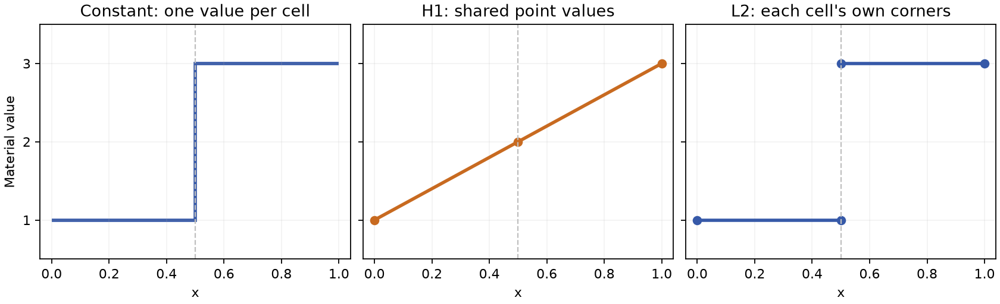

# Fields and where values live

A field is a dataset's data array together with its meaning: where the
values live and what they mean between those places. This page is for
readers who know VTK's point data and cell data. It shows how Tack holds
both, how it holds values on faces and edges and values that jump between
cells, and how to find a field by name. After it you can choose the space
for each of your arrays and put them on a dataset.

## Point data, cell data and face data on one mesh

The example below makes two hexahedra side by side, which share one face.
It attaches a temperature to the points, a material number to the cells and
a flux to the faces. It also gives a point array and a cell array the same
name, as VTK allows.

<!-- tack-check: three-associations -->
```python
import numpy as np

import tack
import tack.dataset as td

tack.set_default_device("cpu")

data = td.uniform_grid((3, 2, 2), spacing=(0.5, 1.0, 1.0))   # 12 points, 2 cells
xyz = data.positions()

# Point data: one value per point.
temperature = tack.array(xyz[:, 0] + 2 * xyz[:, 1] + 3 * xyz[:, 2], dtype=tack.f32)
data.fields["temperature"] = td.Field(td.H1(data), temperature, unit="K")

# Cell data: one value per cell.
data.fields["material"] = td.Field(td.Constant(data), tack.array([1.0, 3.0], dtype=tack.f32))

# Face data: one value per face, signed along each face's normal.
faces = td.Values(data, "faces", oriented=True)
data.fields["flux"] = td.Field(faces, tack.zeros((faces.size,)))

# A point array and a cell array that share a name.
data.fields["p", td.H1] = td.Field(td.H1(data), tack.array(xyz[:, 2], dtype=tack.f32))
data.fields["p", td.Constant] = td.Field(td.Constant(data), tack.array([0.0, 1.0], dtype=tack.f32))

for key, field in data.fields.items():
    print(key, field.space.size)
# temperature 12
# material 2
# flux 11
# ('p', H1(order=1)) 12
# ('p', Constant()) 2
assert data.fields["p", td.Constant].space.size == data.num_cells
```

Each field names its own space: `td.H1(data)` for the points,
`td.Constant(data)` for the cells and `td.Values(data, "faces")` for the
faces. The space decides how many values the field holds. The rest of this
page explains each one.

## A field is a space, values and a unit

`td.Field(space, values, unit=None)` makes a field from three parts:

- The **space** says where the values live and how they define a value
  anywhere in a cell. It is the part VTK expresses by putting an array in
  point data or cell data.
- The **values** are any Tack array, stored or implicit, of scalars or of
  vectors. A velocity is an array of 3-vectors, made with
  `dtype=tack.vec3()`.
- The **unit** is optional. It is a string such as `"K"` or `"m/s"`, and
  [Coordinates, units and time](units-coordinates-time.md) explains it.

A space belongs to one dataset's topology and knows how many values it
holds, `space.size`. A field refuses an array of another length, and a
dataset refuses a field whose space is on another topology. Allocate a
field's array with `field.space.size`, not with the number of points, since
the two differ for every space but point data.

## Point data and cell data

The two spaces VTK users know best are these:

| VTK | Tack space | Values | Between the values |
|---|---|---|---|
| point data | `H1(data)`, an `H1` field of order 1 | one per point, shared by the cells around it | linear in a triangle or tetrahedron, bilinear in a quad, trilinear in a hexahedron |
| cell data | `Constant(data)`, a `Constant` field | one per cell | the same value everywhere in the cell |

Tack's cells use VTK's interpolation functions, so a value interpolated
inside a cell is the value VTK computes. `H1` is the finite-element name for fields that are
continuous across cells, and its order is the polynomial order inside a
cell. Order 1, the default, is point data.

A space says how to read values, not where they came from. A simulation's
cell averages and samples at cell centres are different quantities. Both are
stored as cell data, and the space does not turn one into the other. The
same holds for point data, which interpolates linearly whether or not the
simulation did.

## Values with no interpolation

Some arrays are data about each entity, not samples of a function: a
global id, a label, a quality measure. `Values(data, on)` holds one value
per point, cell, face or edge, with no rule for values in between. `on` is
`"points"`, `"cells"`, `"faces"` or `"edges"`.

Filters that need values between the points, such as a contour or a
gradient, read point values as point data and cell values as cell data. Use
`Values` when the difference matters to your own code, or to say plainly
that interpolating the array means nothing.

## Values on faces and edges

VTK has no association for faces or edges. Finite-volume codes need one,
for normal velocities and fluxes, and so do edge-based schemes.
`Values(data, "faces")` holds one value per face and `Values(data, "edges")`
one per edge. The faces and edges are the ones the topology derives, so a
face field's size is `data.topology.faces().num_faces`.
[Topology and geometry](topology-and-geometry.md#faces-and-edges) explains
how they are numbered.

A face value may have a direction. A normal velocity or a flux is positive
along the face's stored normal, which points out of the face's side 0, and
negative against it. Declare such a field with `oriented=True`. A filter
that turns a face around, as a threshold must when it keeps only the cell on
side 1, then negates it. Leave areas, pressures and labels unoriented. The
flag records your convention. It cannot check that an imported solver
used the same one. A flux that must also be interpolated inside the cells is
an `HDiv` field, and an integral along edges an `HCurl` field. Both are
described in [Higher-order and finite-element data](higher-order.md).

`SideTraces(data)` holds two values at each corner of each face, one from
each side. It holds a field's values on both sides of every face, from which
a jump across the faces can be computed. The
[finite-volume page](../visualization/finite-volume.md) uses face fields and
traces in full.

## Fields that jump between cells

A discontinuous Galerkin (DG) field gives each cell values of its own, so
two cells may disagree at a shared face. `L2(data)` holds such a field. At
order 1 it has one value at each corner of each cell, so a corner shared by
two cells has two values. `L2(data, order=0)` has one value per cell, like
`Constant`.

The table counts the values on the two-cell mesh of the first example:

| Space | Values | At the shared face |
|---|---:|---|
| `H1(data)` | 12 | four point values, used by both cells |
| `Constant(data)` | 2 | one value on each side |
| `L2(data)` | 16 | four corner values on each side |

The figure plots a material number of 1 and 3 along x through the two cells,
in each space. Cell data jumps at the shared face. Point data must have one
value there, so averaging the two cells gives 2 at the face, and
interpolation makes a ramp across both cells. The ramp comes from that
averaging, not from the data. The `L2` field keeps both values at the face.



`H1` and `L2` also come in higher orders, with values on edges, faces and
inside the cells as well as at the corners. On the two hexahedra,
`H1(data, order=2)` holds 45 values and `L2(data, order=3)` holds 128. The
mesh still has 12 points: the extra values are not new points or new cells.
[Higher-order and finite-element data](higher-order.md) explains these
spaces, their bases and which cell types have them.

## Find a field by name and space

`data.fields` is a mapping from names to fields, like VTK's point data and
cell data combined. Most names are used once, and `data.fields["temperature"]`
returns the field. A name may be used in two spaces, as VTK may have a point
array and a cell array called `p`. Then `data.fields["p"]` raises a
`KeyError` naming both, because Tack never guesses. Give the space as well:

<!-- tack-check: shared-names -->
```python
import tack
import tack.dataset as td

tack.set_default_device("cpu")

data = td.uniform_grid((3, 2, 2))
data.fields["p", td.H1] = td.Field(td.H1(data), tack.zeros((data.num_points,)))
data.fields["p", td.Constant] = td.Field(td.Constant(data), tack.ones((data.num_cells,)))

cell_p = data.fields["p", td.Constant]            # by the kind of space
same = data.fields["p", td.Constant(data)]        # or by the space itself
assert cell_p is same

try:
    data.fields["p"]
except KeyError as error:
    print(error)    # 'p' names 2 fields, in H1(order=1) and Constant(): give the space, ...

print(list(data.fields))     # [('p', H1(order=1)), ('p', Constant())]
copy = td.DataSet(data.topology, data.geometry, fields=dict(data.fields))
assert len(copy.fields) == 2
```

The mapping's keys are the names, except that a shared name is listed as
`(name, space)`. So every key looks up one field, and `dict(data.fields)`
loses nothing when it builds another dataset. Setting `data.fields["p"] = f`
replaces every field called `p`, as a dict would. Setting
`data.fields["p", space] = f` puts `f` beside the fields of that name in
other spaces. Filters take a field the same ways: a `Field`, a name, or a
`(name, space)` pair.

## Details

**Spaces are made once per topology.** Asking for the same space twice gives
the same object, so `td.H1(data) is td.H1(data)`. Many fields may share one
space and keep their own values and units. A space is made from a dataset or
from its topology alike.

**`Constant` and `ConstantArray` differ.** `Constant(data)` is a space, one
value per cell. `tack.arrays.ConstantArray` is an implicit array, one value
repeated. A field of point data whose every value is 5 is an `H1` field
whose values are a `ConstantArray`.

**Reading values.** `field.values.numpy()` copies a stored array to the
host, and `tack.arrays.to_host(field.values)` does the same for any array,
implicit or not. On a GPU both wait for the work that computes the values.

**Integer fields.** Fields may hold integers, as a material id or a label
does. Filters that compute with a field, such as a magnitude or statistics,
work in floating point.

## Where to go next

- [Coordinates, units and time](units-coordinates-time.md) explains a
  field's unit and the dataset's origin and time.
- [Build meshes and fields](build-meshes-and-fields.md) makes fields from
  arrays, functions and solver memory.
- [Higher-order and finite-element data](higher-order.md) covers `H1` and
  `L2` above order 1.
