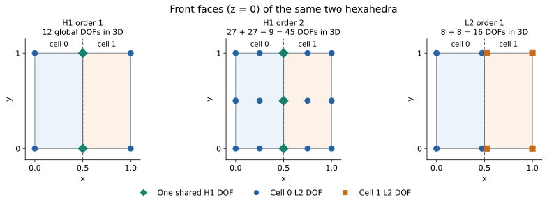

# Higher-order and finite-element data

Simulation codes increasingly write fields that are polynomials inside each
cell, not just values at its corners: VTK's Lagrange and Bézier cells, the
quadratic cells of Exodus and Abaqus, MFEM's grid functions, discontinuous
Galerkin (DG) solutions. Their meshes may be curved too. This page explains
how Tack holds such data without resampling it. It is written for a
visualization expert who knows point data and cell data, not for a
finite-element specialist. After reading it you can choose the space that
matches your data, know how many values it holds and how they are numbered,
and give a dataset a curved geometry. It builds on
[Fields and where values live](fields.md), which introduces spaces.

## An order-3 field in a few lines

The function below is a cubic. An `H1` field of order 3 (cubic point data)
holds it exactly, so probing anywhere in the mesh gives it back. The same
function as ordinary point data, an `H1` field of order 1, is off by a
sixth.

<!-- tack-check: higher-order-first -->
```python
import numpy as np

import tack
import tack.dataset as td

tack.set_default_device("cpu")


@tack.func
def blob(x):
    return x.x * x.x * x.x - x.y * x.z + 0.5 * x.y * x.y


data = td.uniform_grid((3, 3, 3), spacing=(0.5, 0.5, 0.5))   # 8 hexahedra, 27 points
cubic = td.H1(data, order=3)
data.fields["cubic"] = td.interpolate(data, blob, cubic)
data.fields["linear"] = td.interpolate(data, blob, td.H1(data))
print(data.num_points, "points;", cubic.size, "values in the cubic field")

points = np.random.default_rng(0).uniform(0.0, 1.0, (200, 3))
exact = points[:, 0] ** 3 - points[:, 1] * points[:, 2] + 0.5 * points[:, 1] ** 2
probed = td.probe(data, points)
assert np.abs(probed.fields["cubic"].values.numpy() - exact).max() < 1e-5
assert np.abs(probed.fields["linear"].values.numpy() - exact).max() > 0.1
assert data.num_points == 27 and cubic.size == 7 ** 3
```

The mesh has 27 points, but the cubic field has 343 values. Most of them sit
on the cells' edges and faces and inside the cells, not at points of the
mesh. The rest of this page explains where those values are and what they
mean. `td.interpolate` fills any space from a function of position (see
[Build meshes and fields](build-meshes-and-fields.md)), and `probe` is a
[sampling](../visualization/sample-and-trace.md) algorithm.

## A field is coefficients times functions

Inside a cell, a higher-order field is a sum of known functions, each
scaled by a stored number:

```text
u(ξ) = Σ U_a φ_a(ξ)
```

Here `ξ` is a position in the cell's reference element (the unit cube for a
hexahedron), `φ_a` are the *basis functions* and `U_a` are the stored
numbers. Finite-element codes call those numbers *degrees of freedom*, or
DOFs. Tack calls them the field's values.

In most of Tack's spaces each basis function is 1 at one point of the cell,
its *node*, and 0 at the others. Then each value is simply the field at its
node. Point data is the simplest case: the nodes are the cell's corners and
the basis functions are the familiar linear or trilinear ones. At higher
order the cell has more nodes, on its edges, on its faces and inside it.

The nodes are not points of the mesh. The topology still has only the
cells' corners, and `data.num_points` counts those. A field's own count is
`field.space.size`. Three separate things describe a higher-order dataset:

| Question | What answers it |
|---|---|
| Which cells meet, and which corners each cell has | the topology |
| Where each position of a reference cell is in space | the geometry, itself a field |
| Which values make up a given field in a given cell | that field's space, and its values |

## Three choices: family, order and basis

A space is three choices. The *family* says whether values are shared
between cells. The *order* says how rich the polynomials in each cell are.
The *basis* says which polynomials of that order the values are the
coefficients of. A fourth choice, how the values are stored, is separate
and belongs to the array, not the space (see
[Storage and layouts](storage-and-layouts.md)).

| Choice | Options | It controls |
|---|---|---|
| family | `H1`, `L2`, `Constant`, `Values`; `HDiv`, `HCurl` | whether neighbouring cells share values, and so whether the field is continuous |
| order | 1, 2, 3, ... (`L2` from 0) | the degree of the polynomial in each cell |
| basis | `"gauss_lobatto"`, `"equispaced"`, `"gauss_legendre"`, `"bernstein"`, `"serendipity"` | which polynomials, and so where the nodes are |

A space is made on a dataset: `td.H1(data, order=3, basis="equispaced")`.
Spaces are kept per topology, so asking for the same space twice gives the
same object.

### `H1`: continuous fields, values shared

An `H1` field shares each value between all the cells that hold its node.
Cells that meet at an edge read the same values on that edge, so the field
is continuous across it. Its gradient may still jump from cell to cell.

At order 1 the nodes are the corners, one value per point: this is point
data. On triangles and tetrahedra the order-1 field is linear. On quads and
hexahedra it is bilinear or trilinear, which is linear along each reference
axis but not in general. Order 2 adds nodes on the edges and, on quads and
hexahedra, on the faces and inside the cells. Higher orders add more of
each. A shared edge or face keeps its values once, whatever order it is.

### `L2`: each cell's own values

An `L2` field gives every cell its own values, so it may jump between
cells. This is how DG solutions are stored. `L2` of order 0 is one value per
cell, which means the same as cell data (`Constant`). `L2` of order 1 has a
value at each corner of each cell, so a point shared by four cells has four
values. Higher orders have a cell's full lattice of nodes. The order may
also differ per cell, given as an array, for orders 0 and 1.

### What the names mean

The names come from mathematics and describe smoothness, not degree. `L2`
fields need only be integrable, so they may jump. `H1` fields have
integrable first derivatives, which for these polynomial fields means they
are continuous. `H1(data, order=2)` is a quadratic `H1` field, not an "H2"
field: its first derivatives still jump between cells. Tack has no `H2`
family.

## Count values, not corners

Take two hexahedra side by side. They share a face, and the topology has 12
corners. Each space holds a different number of values on them:

| Space | Values | Why |
|---|---:|---|
| `H1` order 1 | 12 | one per point |
| `H1` order 2 | 45 | each hexahedron has 27 nodes, and the shared face's 9 count once |
| `H1` order 2, serendipity | 32 | the points and one per edge (20 edges) |
| `L2` order 1 | 16 | each cell's own 8 corners |
| `L2` order 2 | 54 | each cell's own 27 nodes |
| `Constant`, `L2` order 0 | 2 | one per cell |

<!-- tack-check: higher-order-counts -->
```python
import tack
import tack.dataset as td

tack.set_default_device("cpu")

data = td.uniform_grid((3, 2, 2), spacing=(0.5, 1.0, 1.0))     # two hexahedra
counts = {space: space.size for space in (
    td.H1(data), td.H1(data, order=2), td.H1(data, order=2, basis="serendipity"),
    td.L2(data, order=1), td.L2(data, order=2), td.Constant(data))}
for space, size in counts.items():
    print(f"{space!r:40} {size}")
assert list(counts.values()) == [12, 45, 32, 16, 54, 2]
assert data.num_points == 12                    # the topology is unchanged
```



The picture shows the front faces of the two hexahedra. The green diamonds
are single `H1` values that both cells share. The `L2` markers on the shared
face are drawn slightly apart so both show; they are at the same place.

One mesh can hold all of these at once. The fields share the topology, not a
space: a geometry of order 1, a temperature of order 2 and a DG pressure of
order 1 can live side by side.

## Bases

Above order 1 a space names its basis. Three of the bases are Lagrange
bases, whose values are the field at nodes. They differ in where the nodes
are along each edge. The other two store something else.

| Basis | Its values | Where it is native | Spaces and shapes |
|---|---|---|---|
| `"gauss_lobatto"` | the field at Gauss–Lobatto nodes, which include the ends | MFEM's `H1`, Nek5000, deal.II | `H1`, `L2`; segments, quads, hexahedra |
| `"equispaced"` | the field at evenly spaced nodes | VTK's Lagrange cells, Exodus, gmsh | `H1`, `L2`; every shape with a basis |
| `"gauss_legendre"` | the field at Gauss–Legendre nodes, inside the cell only | MFEM's `L2` | `L2` from order 1; segments, quads, hexahedra |
| `"bernstein"` | Bernstein coefficients, control points for a geometry | VTK's Bézier cells, MFEM's positive bases | `H1`, `L2` from order 2; every shape with a basis |
| `"serendipity"` | order 2 without face centres and cell interiors | VTK's quad8, hex20, wedge15; Exodus, Abaqus | `H1` order 2 |

Pixels count as quads here, and voxels as hexahedra. "Every shape with a
basis" means segments, triangles, quads, tetrahedra, hexahedra and wedges.

Without `basis=`, a space above order 2 is equispaced on a mesh that has
triangles, tetrahedra or wedges, which have no other nodes, and
Gauss–Lobatto otherwise. At order 2 and below, Gauss–Lobatto and equispaced
nodes are the same, so the choice does not matter there.

**Gauss–Lobatto nodes** cluster toward a cell's edges. At high order they
make the polynomials far better conditioned than evenly spaced nodes do,
which is why solvers choose them. **Gauss–Legendre nodes** lie strictly
inside the cell, with none on its boundary. Shared values need nodes on the
boundary, so this basis is for `L2` alone.

### Bernstein: coefficients that bound the field

A Bernstein space stores coefficients instead of values at nodes. The
polynomial lies inside the range of its coefficients, so the coefficients
bound the field in each cell, and a geometry's coefficients are control
points whose hull holds the cell. Tack's algorithms use these bounds to skip
cells a contour or a clip cannot cross. A corner's coefficient is the
field's value there. An edge's or a face's coefficients depend on that
entity alone, so cells share them just as they share nodal values.

A Bernstein space holds the same polynomials as the equispaced Lagrange
space of its order, and every algorithm sees it that way. `interpolate`
fills it from values at the equispaced nodes.

<!-- tack-check: higher-order-bernstein -->
```python
import numpy as np

import tack
import tack.dataset as td

tack.set_default_device("cpu")


@tack.func
def wave(x):
    return x.x * x.x * x.x - 2.0 * x.x * x.y + 0.5 * x.y


data = td.uniform_grid((3, 3), spacing=(0.5, 0.5))           # four quads
data.fields["lagrange"] = td.interpolate(data, wave, td.H1(data, order=3))
data.fields["bernstein"] = td.interpolate(data, wave, td.H1(data, order=3, basis="bernstein"))

points = np.random.default_rng(0).uniform(0.0, 1.0, (500, 3)) * [1, 1, 0]
probed = td.probe(data, points)
lagrange = probed.fields["lagrange"].values.numpy()
bernstein = probed.fields["bernstein"].values.numpy()
coefficients = data.fields["bernstein"].values.numpy()
assert np.abs(lagrange - bernstein).max() < 1e-5          # the same polynomial
assert coefficients.min() <= bernstein.min() and bernstein.max() <= coefficients.max()
print(f"field from {bernstein.min():.3f} to {bernstein.max():.3f}, "
      f"coefficients from {coefficients.min():.3f} to {coefficients.max():.3f}")
```

### Serendipity: quadratic cells without centres

VTK's quad8, hex20 and wedge15 cells, and the quadratic elements of Exodus
and Abaqus, store values at the corners and edge midpoints only. That is
`H1(data, order=2, basis="serendipity")`. The full order-2 space also has
values at quad faces' centres and inside the cells; serendipity leaves them
out and its basis functions determine the field there from the corners and
edges. On triangles and tetrahedra, whose order-2 space has no such values,
serendipity is the full space. On straight cells it holds every quadratic
function of position exactly.

<!-- tack-check: higher-order-serendipity -->
```python
import numpy as np

import tack
import tack.dataset as td

tack.set_default_device("cpu")


@tack.func
def quadratic(x):
    return x.x * x.x + 2.0 * x.y * x.z - x.z


data = td.uniform_grid((3, 2, 2), spacing=(0.5, 1.0, 1.0))   # two hexahedra, as hex20
hex20 = td.H1(data, order=2, basis="serendipity")
data.fields["t"] = td.interpolate(data, quadratic, hex20)

points = np.random.default_rng(1).uniform(0.0, 1.0, (50, 3))
probed = td.probe(data, points).fields["t"].values.numpy()
exact = points[:, 0] ** 2 + 2 * points[:, 1] * points[:, 2] - points[:, 2]
assert hex20.size == 32 and np.abs(probed - exact).max() < 1e-5
print(hex20.size, "values; every quadratic exact")
```

## How values are numbered

An `H1` space above order 1 numbers its values by the entity that holds
them. First come the points' values, by point id, exactly as at order 1.
Then each edge's values, by edge id, then each face's, then each cell's
interior values. So a field of order 2 or more begins with ordinary point
data. A value on a shared edge or face is stored once, and every cell
holding that entity reads it in an orientation the entity fixes, so cells
turned any way agree on it. An `L2` field numbers each cell's values
together, one cell after another.

Solvers often number their values another way, with an *element-to-DOF
table*: one row per cell, listing the value index of each of the cell's
nodes. MFEM and VTK's cell grids store fields so. `H1(data, order=p,
dofs=table)` uses such a table as it comes, without renumbering. A row lists
the cell's nodes in Tack's lattice order (the first axis fastest, given by
`td.bases.lattice_ijk`). A row's corner entries must be the cell's points,
so that a corner's value is its point's. The other nodes may be numbered
freely.

<!-- tack-check: higher-order-table -->
```python
import numpy as np

import tack
import tack.dataset as td

tack.set_default_device("cpu")


@tack.func
def temperature(x):
    return x.x * x.x + 2.0 * x.y * x.z


data = td.uniform_grid((3, 2, 2), spacing=(0.5, 1.0, 1.0))   # two hexahedra

# A solver's own numbering: the corners are the points, and every other node
# gets the next number the first time a cell meets it.
others, table = {}, []
for cell in range(2):
    row = []
    for i, j, k in td.bases.lattice_ijk(td.shapes.Hexahedron, 2):   # 27 nodes, i fastest
        if i % 2 == 0 and j % 2 == 0 and k % 2 == 0:                # a corner: its point
            row.append(cell + i // 2 + 3 * (j // 2 + 2 * (k // 2)))
        else:                                                       # by its place in the mesh
            row.append(others.setdefault((2 * cell + i, j, k), 12 + len(others)))
    table.append(row)

space = td.H1(data, order=2, dofs=np.array(table))
data.fields["t"] = td.interpolate(data, temperature, space)

points = np.array([[0.3, 0.4, 0.7], [0.8, 0.9, 0.2]])
probed = td.probe(data, points).fields["t"].values.numpy()
assert space.size == 45                                     # shared nodes counted once
assert np.allclose(probed, points[:, 0] ** 2 + 2 * points[:, 1] * points[:, 2], atol=1e-6)
print(space, space.size)
```

The two numberings hold the same polynomials, so every algorithm reads a
table-numbered field. A filter's output numbers its values by entity again.
The exact place of every value, in every space, is on
[Storage and layouts](storage-and-layouts.md).

## Geometry is a field too: curved cells

A dataset's positions are a field like any other, with a space and an
order. Straight cells have a geometry of order 1: one position per point.
A geometry of order 2 or more curves the cells. Its extra nodes sit on the
edges, faces and insides, and the cells bend through them. Tack locates,
probes, measures, integrates and cuts curved cells as they are, not as their
corners would make them.

Here a 2 × 2 grid of quads is mapped onto a quarter of the ring between radii
1 and 2. With straight cells the area is that of a polygon. With a geometry
of order 4 it is the ring's, to seven digits.

<!-- tack-check: higher-order-curved -->
```python
import math

import tack
import tack.dataset as td

tack.set_default_device("cpu")


@tack.func
def ring(x):
    # The unit square onto a quarter of the ring between radii 1 and 2.
    r = 1.0 + x.x
    angle = 0.5 * math.pi * x.y
    return [r * tack.cos(angle), r * tack.sin(angle), 0.0]


square = td.uniform_grid((3, 3), spacing=(0.5, 0.5))         # 2 x 2 quads
straight = td.DataSet(square.topology,
                      td.interpolate(square, ring, td.H1(square), dtype=tack.vec3()))
curved = td.DataSet(square.topology,
                    td.interpolate(square, ring, td.H1(square, order=4), dtype=tack.vec3()))

area = 0.75 * math.pi
straight_area, curved_area = td.integrate(straight).measure, td.integrate(curved).measure
print(f"straight {straight_area:.6f}, curved {curved_area:.6f}, ring {area:.6f}")
assert abs(curved_area - area) < 1e-6 < abs(straight_area - area)
```

`integrate` is a [Derive](../visualization/derive.md) algorithm. The
geometry is given here when the dataset is made; assigning
`data.geometry = ...` replaces it on an existing dataset.

A field's order may differ from its geometry's. An order-3 field on an
order-2 geometry is fine: its nodes are placed where the curved geometry
puts them, and every piece of a mesh in pieces places a shared node at the
same bits. A geometry may also be `L2`, for cells that do not meet, such as
a mesh displaced by a DG field or a periodic mesh. Then each cell has its own
corner positions, while the topology still says which cells are neighbours.

## Vector fields: `HDiv` and `HCurl`

Two families hold vector fields whose meaning is a flux or a circulation.
`HDiv` (Raviart–Thomas) holds each face's integrated flux along the face's
normal, and interpolates inside each cell so that the flux through every
face is its value. `HCurl` (Nédélec, first kind) holds each edge's
tangential integral, and interpolates so that the integral along every edge
is its value. Both are on hexahedra, voxels and tetrahedra at order 1, and of
any order on hexahedra and voxels. `interpolate` and `project` do not fill
them yet; a kernel writes their values, and `td.hdiv_value` and
`td.hcurl_value` read them back as vectors in space. The
[data model reference](../vis-guide/reference/data-model.md) has their exact
layouts.

## What each shape supports

| Shape | `H1` order 1 | `H1` order 2 and up | `L2` order 0, 1 | `L2` order 2 and up | Curved geometry |
|---|---|---|---|---|---|
| Line, triangle, quad, pixel | yes | yes | yes | yes | yes |
| Tetrahedron, hexahedron, voxel, wedge | yes | yes | yes | yes | yes |
| Vertex | yes | no | yes | no | no |
| Pyramid | yes | no | yes | no | no |
| Polyline, polygon, polyhedron | yes, linear on pieces | no | `Constant` only | no | no |

There is no fixed upper order; Tack's tests go to order 6. An
`UnstructuredTopology` may mix shapes, and every space applies to the mix: a
mesh of hexahedra and wedges holds one `H1` field of order 3. Polyhedra,
polygons and polylines have no reference element and are explained on
their [own page](polyhedra.md).

## How algorithms see these fields

Every algorithm evaluates a field through its space, so it sees the
polynomial in each cell, not only the values at the points. The cutting
filters (contour, slice, clip, threshold) cut cells into linear
sub-cells on a lattice as fine as the field's order, and only where the cut
can pass. The [Extract](../visualization/extract.md) page explains how to
control that refinement, and [VTK](../visualization/vtk.md) and
[MFEM and others](../visualization/mfem-warp-and-others.md) how such data
come in and go out.

## Details

### The MFEM model

MFEM separates a mesh, a finite-element space on it and a grid function of
coefficients in that space. Tack follows the same separation:

| MFEM | Tack | Responsibility |
|---|---|---|
| `Mesh`, its elements and vertices | `data.topology` | which corners each cell has, and the faces and edges derived from them |
| finite-element collection and space | a field's `space` | family, order, basis, and which value each cell reads |
| `GridFunction` | `td.Field(space, values)` | the coefficients, read through the space |
| the mesh's nodes | `data.geometry`, itself a `td.Field` | the map from reference cell to space |

This is a correspondence of concepts. Tack does not implement all of MFEM's
families, nor its parallel true-DOF and constraint machinery.

### Constant, `ConstantArray` and `tack.constant`

Three things have similar names. `Constant(data)` is a space: one value per
cell, constant inside it, different from cell to cell. `ConstantArray(value,
n)` is an implicit array that returns one value at every index; it can back
any field (see [Storage and layouts](storage-and-layouts.md)).
`tack.constant` declares a number for compiled kernel code and has nothing
to do with fields.

### Limits

Not supported today: higher-order pyramids and rational Bézier cells (VTK's
Bézier cells with weights other than 1, which are refused when read);
Gauss-point bases on triangles, tetrahedra and wedges, which are resampled
into equispaced ones when read; an order per axis, as VTK's
quadratic-linear cells have, which are embedded in the full order; and
serendipity for `L2`. An `L2` order per cell is limited to 0 and 1.

## Where to go next

- [Storage and layouts](storage-and-layouts.md) gives the exact place of
  every value, and how `L2` values are laid out for GPUs.
- [Cells and meshes](cells-and-meshes.md) lists the cell shapes and their
  corner orders, which these spaces are built on.
- [Extract](../visualization/extract.md) cuts higher-order and curved data
  with contours, slices and clips.
