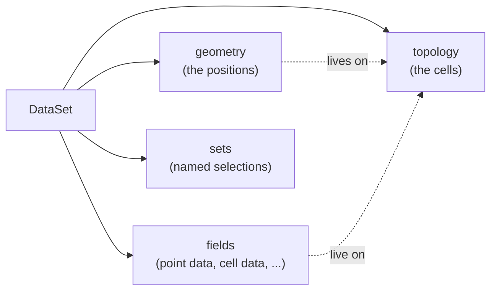

# Data: a dataset in five minutes

This page starts the Data layer of Tack, the data model that holds meshes,
particles and refined grids on any device. It is written for readers who
know VTK. In five minutes you build a mesh, attach point data and cell data
to it, and see how Tack names the parts VTK users already know. You also
attach a third kind of field that VTK has no association for, and move the
whole dataset to a GPU. The later pages of the layer explain each part in
depth.

## Build a grid with point data and cell data

The example below makes a grid of 5 x 4 x 3 points, the same object as a
`vtkImageData`. It attaches each point's height as point data and a material
number as cell data. Both arrays come from NumPy, as they would in VTK.

<!-- tack-check: five-minute-grid -->
```python
import numpy as np

import tack
import tack.dataset as td

tack.set_default_device("cpu")

# A grid of 5 x 4 x 3 points, like a vtkImageData.
data = td.uniform_grid((5, 4, 3), spacing=(0.25, 0.25, 0.5))
print(data.num_points, "points,", data.num_cells, "cells")     # 60 points, 24 cells

# Point data: one value per point, here each point's height.
xyz = data.positions()
height = tack.array(xyz[:, 2], dtype=tack.f32)
data.fields["height"] = td.Field(td.H1(data), height)

# Cell data: one value per cell, here a material number.
material = tack.array(np.arange(data.num_cells) % 2, dtype=tack.i32)
data.fields["material"] = td.Field(td.Constant(data), material)

print(list(data.fields))                                        # ['height', 'material']
assert data.fields["height"].space.size == data.num_points
assert data.fields["material"].space.size == data.num_cells
```

In VTK you would write `image.point_data["height"] = height` and
`image.cell_data["material"] = material`. Tack puts both arrays in one
mapping, `data.fields`, and each array carries its own association. The rest
of this page explains the three objects in the example: the dataset, the
field, and the space that says where a field's values live.

## What a dataset holds

A `vtkDataSet` has points, cells, point data and cell data. A Tack dataset,
`td.DataSet`, holds the same information in four parts:

- The **topology** is the cells: which points each cell connects. It holds no
  positions. A `vtkUnstructuredGrid`'s cell array is a topology, and so is an
  image's extent.
- The **geometry** is the points' positions. It plays the part of
  `vtkPoints`, or of an image's origin and spacing.
- The **fields** are the data arrays, each with its meaning attached. Point
  data and cell data are both fields.
- The **sets** are named selections of points, cells, faces or edges, as a
  VTK selection would hold.



Keeping the topology apart from the geometry lets you move points without
touching the cells. It also lets an image or a rectilinear grid compute its
positions instead of storing them. In the example, `uniform_grid` made a
structured topology and a geometry that computes each position from the
origin and spacing. `data.positions()` gives you the positions as a NumPy
array, however they are stored.
[Topology and geometry](topology-and-geometry.md) explains both parts.

## Point data and cell data are fields in a space

A VTK array is point data or cell data according to where you put it. A Tack
field instead names where its values live, with a **space**. The space also
says what a value means between the points: whether it is interpolated
across a cell or constant over it. A field is a space and an array, and
optionally a physical unit.

The two spaces in the example are the ones VTK users know:

| VTK | Tack | One value per | Between the values |
|---|---|---|---|
| point data | `td.H1(data)`, an `H1` field of order 1 | point | linear in each cell, trilinear in a hexahedron, as VTK interpolates |
| cell data | `td.Constant(data)`, a `Constant` field | cell | the same value everywhere in the cell |

`H1` is the name finite-element codes give to fields that are continuous
from cell to cell. Its order is the polynomial order inside each cell, and
order 1 is VTK's point data. `Constant` is VTK's cell data.

A space knows how many values it holds, so `field.space.size` is the length
of the array a field needs. A `Field` refuses an array of the wrong length.
The same name can be used in two spaces, as VTK allows a point array and a
cell array called `p`. [Fields and where values live](fields.md) covers the
other spaces and how to look up fields by name.

## Build an unstructured mesh as VTK stores one

An unstructured mesh in Tack is described with the arrays of a
`vtkUnstructuredGrid`: a VTK cell type per cell, offsets, and the
connectivity. This mesh has a hexahedron (VTK type 12) with a pyramid
(VTK type 14) on top. The corners of each cell are in VTK's order.

<!-- tack-check: five-minute-unstructured -->
```python
import numpy as np

import tack
import tack.dataset as td

tack.set_default_device("cpu")

positions = np.array([[0, 0, 0], [1, 0, 0], [1, 1, 0], [0, 1, 0],
                      [0, 0, 1], [1, 0, 1], [1, 1, 1], [0, 1, 1],
                      [0.5, 0.5, 1.6]], np.float32)
cells = td.UnstructuredTopology(types=[12, 14], offsets=[0, 8, 13],
                                connectivity=[0, 1, 2, 3, 4, 5, 6, 7,    # the hexahedron
                                              4, 5, 6, 7, 8])            # the pyramid
mesh = td.DataSet(cells, positions)

mesh.fields["height"] = td.Field(td.H1(mesh), tack.array(positions[:, 2]))
mesh.fields["material"] = td.Field(td.Constant(mesh), tack.array([1.0, 2.0], dtype=tack.f32))

print(mesh.num_points, "points,", mesh.num_cells, "cells")    # 9 points, 2 cells
assert mesh.fields["material"].space.size == 2
```

The offsets have one more entry than there are cells. Cell `c` uses the
connectivity entries from `offsets[c]` up to `offsets[c + 1]`. Giving
`DataSet` a NumPy array of positions makes its geometry, one 3-vector per
point. [Cells and meshes](cells-and-meshes.md) lists the cell types and the
kinds of mesh Tack holds.

## Add a field VTK has no association for

Simulations often store fields that are neither point data nor cell data. A
discontinuous Galerkin (DG) solver keeps a polynomial in each cell. Each
cell has values of its own, which need not match its neighbour's at a shared
face. Tack holds such a field in an `L2` space, the finite-element name for
fields that may jump from cell to cell. Its order is the polynomial order in
each cell.

The example below puts all three kinds of field on one grid: point data,
cell data and a cubic DG field. `td.interpolate` fills the DG field from a
function of position, evaluated where each cell's values sit. The function
is a device function, which [Device functions](../core/device-functions.md)
introduces. A cubic in a
hexahedron has 4 x 4 x 4 = 64 values, so this field has 64 values a cell.

<!-- tack-check: five-minute-dg -->
```python
import numpy as np

import tack
import tack.dataset as td

tack.set_default_device("cpu")

data = td.uniform_grid((5, 4, 3), spacing=(0.25, 0.25, 0.5))
height = tack.array(data.positions()[:, 2])
material = tack.array(np.arange(data.num_cells) % 2, dtype=tack.i32)


@tack.func
def cubic(x):
    return x.x * x.x * x.x - x.y * x.z


dg = td.L2(data, order=3)                              # a cubic in each cell
data.fields["height"] = td.Field(td.H1(data), height)              # point data
data.fields["material"] = td.Field(td.Constant(data), material)    # cell data
data.fields["cubic"] = td.interpolate(data, cubic, dg)             # DG, order 3

for name, field in data.fields.items():
    print(f"{name:9} {field.space!r:36} {field.space.size} values")
# height    H1(order=1)                          60 values
# material  Constant()                           24 values
# cubic     L2(order=3, basis='gauss_lobatto')   1536 values
assert dg.size == 64 * data.num_cells
```

Each field has its own space, and none of them changes the mesh.
Higher-order fields, curved cells and the bases they use have a page of
their own, [Higher-order and finite-element data](higher-order.md).

## Run on a GPU

A dataset lives on one device, as a Tack array does. Everything made while a
device is the default goes there. `to_device` copies a dataset, with its
topology, geometry, fields and sets, to another device. The code that builds
and uses the dataset does not change.

<!-- tack-check: five-minute-device -->
```python
import tack
import tack.dataset as td

tack.set_default_device("cpu")

target = "cpu"          # "cuda", "hip", "metal" or "level_zero" on a GPU

data = td.uniform_grid((5, 4, 3), spacing=(0.25, 0.25, 0.5))
data.fields["height"] = td.Field(td.H1(data), tack.array(data.positions()[:, 2]))

moved = data.to_device(target)
print(moved.device)                                   # cpu
assert moved.fields["height"].device == tack.device(target)
```

On a GPU, `positions()` and `values.numpy()` copy values back to the host.
Use them to inspect results, not inside a loop.
[Choose a device](../core/choose-a-device.md) explains devices, and
[Data on devices](devices.md) explains where each part of a dataset lives.

## A preview: contour the grid

The Visualization layer runs filters on these datasets. As a preview, this
example contours the height at 0.75, which makes a flat sheet of triangles.
The filter returns a new dataset and leaves its input unchanged.

<!-- tack-check: five-minute-contour -->
```python
import tack
import tack.dataset as td

tack.set_default_device("cpu")

data = td.uniform_grid((5, 4, 3), spacing=(0.25, 0.25, 0.5))
data.fields["height"] = td.Field(td.H1(data), tack.array(data.positions()[:, 2]))

surface = td.contour(data, "height", 0.75)
print(surface.num_cells, "triangles")                 # 24 triangles
assert surface.num_cells == 24
```

[Visualization: filters you know](../visualization/index.md) starts that
layer.

## VTK's terms and Tack's

The table pairs the VTK names you know with Tack's. The
[glossary](../reference/glossary.md) defines every term.

| VTK | Tack |
|---|---|
| `vtkDataSet` | `td.DataSet`: a topology, a geometry, fields and sets |
| `vtkDataArray` | `tack.Array`, or an implicit array from `tack.arrays` |
| `vtkPoints` | the geometry, `data.geometry`, a field of positions |
| the cells of a dataset | the topology, `data.topology` |
| point data | an `H1` field of order 1: `td.Field(td.H1(data), values)` |
| cell data | a `Constant` field: `td.Field(td.Constant(data), values)` |
| Lagrange and Bézier cells, cell grid attributes | `H1` and `L2` fields of higher order |
| `vtkImageData` | `td.uniform_grid` |
| `vtkRectilinearGrid` | `td.rectilinear_grid` |
| `vtkStructuredGrid` | `td.StructuredTopology` with positions per point |
| `vtkUnstructuredGrid` | `td.UnstructuredTopology` |
| `vtkPolyData` | `td.PolygonalTopology`, `td.PolylineTopology`, or an `UnstructuredTopology` of triangles and quads |
| `vtkSelection` | a `td.Set` in `data.sets` |
| `vtkPartitionedDataSet` | `td.PartitionedDataSet` |
| `vtkOverlappingAMR` | `td.AMRDataSet` |
| `vtkHyperTreeGrid` | `td.OctreeDataSet` |
| `vtkGhostType` | ghost marks, `data.ghosts` |
| `UNITS_LABEL` | a field's unit, `field.unit` |

Tack has no field data, the arrays VTK attaches to a whole dataset. A
dataset does carry its time, its origin and its spatial unit, which
[Coordinates, units and time](units-coordinates-time.md) explains.

## Where to go next

Read the next four pages in order. Together they explain everything this
page used.

1. [Topology and geometry](topology-and-geometry.md): cells, corners,
   positions, and arrays that are computed instead of stored.
2. [Fields and where values live](fields.md): point data, cell data, values
   on faces and edges, and finding fields by name.
3. [Coordinates, units and time](units-coordinates-time.md): the origin,
   physical units and a dataset's time.
4. [Cells and meshes](cells-and-meshes.md): the cell types, grids and
   unstructured meshes.

Then go to the page for your data: [polyhedra](polyhedra.md),
[higher-order fields](higher-order.md), [particles](particles.md),
[AMR hierarchies and octrees](amr-and-octrees.md) or [data in pieces](pieces.md).
