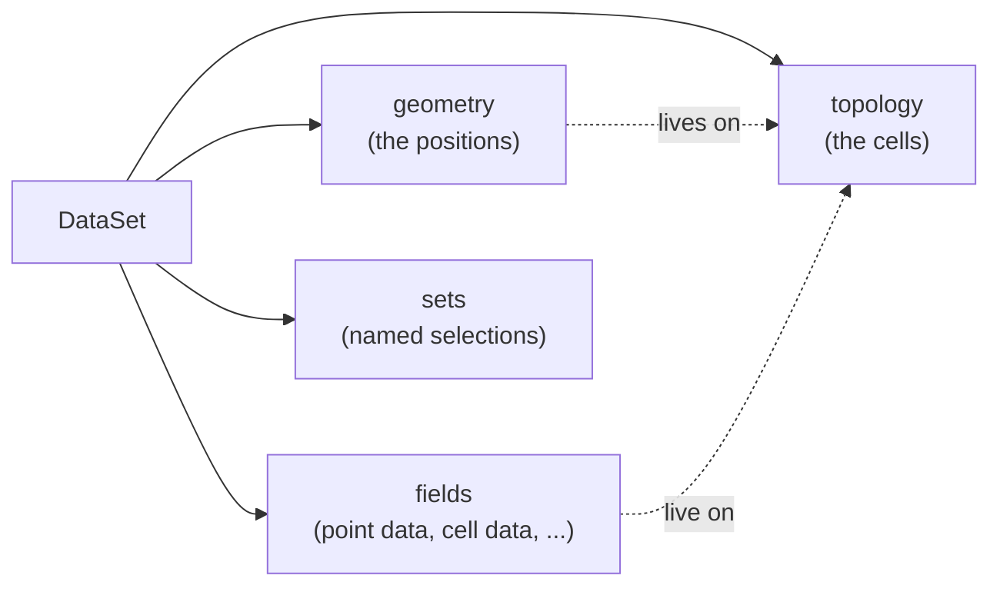

# Data: datasets, fields and spaces

A Tack dataset is VTK's dataset in other words: cells, points, point data and
cell data, on whichever device you compute on. The one new idea is the
*space*, which says where a field's values live and what they mean between
them. Point data and cell data are two spaces; the same idea holds the
discontinuous and higher-order fields simulations write, which VTK has no
association for.

## Build a grid with point data and cell data

The example below makes a grid of 5 x 4 x 3 points, the same object as a
`vtkImageData`. It attaches each point's height as point data and a material
number as cell data. Both arrays come from NumPy, as they would in VTK.

<!-- tack-check: five-minute-grid -->
```python
import numpy as np

import tack
import tack.dataset as td

tack.set_default_device("cpu")

# A grid of 5 x 4 x 3 points, like a vtkImageData.
data = td.uniform_grid((5, 4, 3), spacing=(0.25, 0.25, 0.5))
print(data.num_points, "points,", data.num_cells, "cells")     # 60 points, 24 cells

# Point data: one value per point, here each point's height.
xyz = data.positions()
height = tack.array(xyz[:, 2], dtype=tack.f32)
data.fields["height"] = td.Field(td.H1(data), height)

# Cell data: one value per cell, here a material number.
material = tack.array(np.arange(data.num_cells) % 2, dtype=tack.i32)
data.fields["material"] = td.Field(td.Constant(data), material)

print(list(data.fields))                                        # ['height', 'material']
assert data.fields["height"].space.size == data.num_points
assert data.fields["material"].space.size == data.num_cells
```

In VTK you would write `image.point_data["height"] = height` and
`image.cell_data["material"] = material`. Tack puts both arrays in one
mapping, `data.fields`, and each array carries its own association. The rest
of this page explains the three objects in the example: the dataset, the
field, and the space that says where a field's values live.

## What a dataset holds

A `vtkDataSet` has points, cells, point data and cell data. A Tack dataset,
`td.DataSet`, holds the same information in four parts:

- The **topology** is the cells: which points each cell connects. It holds no
  positions. A `vtkUnstructuredGrid`'s cell array is a topology, and so is an
  image's extent.
- The **geometry** is the points' positions. It plays the part of
  `vtkPoints`, or of an image's origin and spacing.
- The **fields** are the data arrays, each with its meaning attached. Point
  data and cell data are both fields.
- The **sets** are named selections of points, cells, faces or edges, as a
  VTK selection would hold.



Keeping the topology apart from the geometry lets you move points without
touching the cells. It also lets an image or a rectilinear grid compute its
positions instead of storing them. In the example, `uniform_grid` made a
structured topology and a geometry that computes each position from the
origin and spacing. `data.positions()` gives you the positions as a NumPy
array, however they are stored.
[Topology and geometry](topology-and-geometry.md) explains both parts.

## Point data and cell data are fields in a space

A VTK array is point data or cell data according to where you put it. A Tack
field instead names where its values live, with a **space**. The space also
says what a value means between the points: whether it is interpolated
across a cell or constant over it. A field is a space and an array, and
optionally a physical unit.

The two spaces in the example are the ones VTK users know:

| VTK | Tack | One value per | Between the values |
|---|---|---|---|
| point data | `td.H1(data)`, an `H1` field of order 1 | point | linear in each cell, trilinear in a hexahedron, as VTK interpolates |
| cell data | `td.Constant(data)`, a `Constant` field | cell | the same value everywhere in the cell |

`H1` is the name finite-element codes give to fields that are continuous
from cell to cell. Its order is the polynomial order inside each cell, and
order 1 is VTK's point data. `Constant` is VTK's cell data.

A space knows how many values it holds, so `field.space.size` is the length
of the array a field needs. A `Field` refuses an array of the wrong length.
The same name can be used in two spaces, as VTK allows a point array and a
cell array called `p`. [Fields and where values live](fields.md) covers the
other spaces and how to look up fields by name.

## Other kinds of data, and other devices

The same parts hold every kind of data the layer covers. An unstructured mesh
of mixed cells is a topology built from a `vtkUnstructuredGrid`'s arrays
([Cells and meshes](cells-and-meshes.md)). A discontinuous Galerkin field,
with a polynomial in each cell that may jump at the faces, is a field in an
`L2` space ([Fields and where values live](fields.md#fields-that-jump-between-cells),
[Higher-order and finite-element data](higher-order.md)). A dataset lives on
one device, as an array does, and `data.to_device("cuda")` copies it to another
([Data on devices](devices.md)).

## VTK's terms and Tack's

The table pairs the VTK names you know with Tack's. The
[glossary](../reference/glossary.md) defines every term.

| VTK | Tack |
|---|---|
| `vtkDataSet` | `td.DataSet`: a topology, a geometry, fields and sets |
| `vtkDataArray` | `tack.Array`, or an implicit array from `tack.arrays` |
| `vtkPoints` | the geometry, `data.geometry`, a field of positions |
| the cells of a dataset | the topology, `data.topology` |
| point data | an `H1` field of order 1: `td.Field(td.H1(data), values)` |
| cell data | a `Constant` field: `td.Field(td.Constant(data), values)` |
| Lagrange and Bézier cells, cell grid attributes | `H1` and `L2` fields of higher order |
| `vtkImageData` | `td.uniform_grid` |
| `vtkRectilinearGrid` | `td.rectilinear_grid` |
| `vtkStructuredGrid` | `td.StructuredTopology` with positions per point |
| `vtkUnstructuredGrid` | `td.UnstructuredTopology` |
| `vtkPolyData` | `td.PolygonalTopology`, `td.PolylineTopology`, or an `UnstructuredTopology` of triangles and quads |
| `vtkSelection` | a `td.Set` in `data.sets` |
| `vtkPartitionedDataSet` | `td.PartitionedDataSet` |
| `vtkOverlappingAMR` | `td.AMRDataSet` |
| `vtkHyperTreeGrid` | `td.OctreeDataSet` |
| `vtkGhostType` | ghost marks, `data.ghosts` |
| `UNITS_LABEL` | a field's unit, `field.unit` |

Tack has no field data, the arrays VTK attaches to a whole dataset. A
dataset does carry its time, its origin and its spatial unit, which
[Coordinates, units and time](units-coordinates-time.md) explains.

## Where to go next

Read the next four pages in order. Together they explain everything this
page used.

1. [Topology and geometry](topology-and-geometry.md): cells, corners,
   positions, and arrays that are computed instead of stored.
2. [Fields and where values live](fields.md): point data, cell data, values
   on faces and edges, and finding fields by name.
3. [Coordinates, units and time](units-coordinates-time.md): the origin,
   physical units and a dataset's time.
4. [Cells and meshes](cells-and-meshes.md): the cell types, grids and
   unstructured meshes.

Then go to the page for your data: [polyhedra](polyhedra.md),
[higher-order fields](higher-order.md), [particles](particles.md),
[AMR hierarchies and octrees](amr-and-octrees.md) or [data in pieces](pieces.md).
