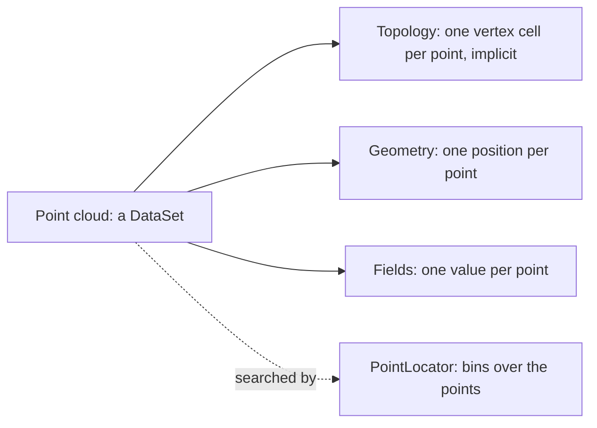

# Particles and point clouds

LiDAR returns, SPH particles, N-body particles and flow tracers are points
with values and no mesh between them. This page explains how Tack holds
them: as a dataset whose cells are the points themselves, with fields on the
points, positions kept precise far from zero, and a locator for the
neighbourhood questions a mesh would answer through its cells. After
reading it you can make a point cloud from your arrays, attach fields with
units, find each point's neighbours, work in a periodic box, and know what
changes when a cloud is split into pieces. It assumes
[Topology and geometry](topology-and-geometry.md) and
[Fields and where values live](fields.md).

## A cloud of particles in a few lines

`td.point_cloud` takes positions and a dictionary of per-point fields. Here
2,000 particles fill a 10 m periodic box, each with a velocity and a mass.
A `PointLocator` finds every particle within 1 m of each one, measuring
across the box's faces, and the counts match a brute-force search.

<!-- tack-check: particles-first -->
```python
import numpy as np

import tack
import tack.dataset as td

tack.set_default_device("cpu")

rng = np.random.default_rng(2)
x = rng.uniform(0.0, 10.0, (2000, 3))                   # positions in a 10 m box
particles = td.point_cloud(
    x, fields={"velocity": rng.normal(0.0, 1.0, (2000, 3)), "mass": np.full(2000, 0.5)},
    unit="m", units={"velocity": "m/s", "mass": "kg"})
print(particles.num_points, "points,", particles.num_cells, "vertex cells")
print(particles.fields["velocity"].space, particles.fields["velocity"].unit)

locator = td.PointLocator(particles, periodic=10.0)    # a box 10 m on a side
offsets, ids = locator.neighbors(1.0)                    # within 1 m of each point
counts = np.diff(offsets.numpy())

d = x[:, None, :] - x[None, :, :]
d -= 10.0 * np.round(d / 10.0)                           # to the nearest image
assert np.array_equal(counts, ((d ** 2).sum(-1) <= 1.0).sum(1) - 1)
print(f"{counts.mean():.1f} neighbours on average")
```

The cloud is an ordinary `DataSet`, so it moves between devices, carries
units and goes through filters like any other dataset. Its fields are `H1`
fields (point data) of order 1, one value per point.

## A point cloud is a dataset of vertex cells

A point cloud has one cell per point, a vertex cell holding just that
point. That makes every point a cell as well, so algorithms that walk cells
work on a cloud unchanged. The topology costs nothing to store. Its cell
types are one constant, its offsets and connectivity count up from zero, and
all three are [implicit arrays](storage-and-layouts.md), computed when read.



The fields hold one value per point: scalars, or rows of components, which
become vectors. Floating-point fields take the cloud's floating-point type,
single precision unless you pass `dtype=tack.f64` on a device that has it.
Integer fields, such as a LAS classification or an intensity, keep their
type. `units=` gives each field its unit, and `unit=` the unit of the
positions (see [Coordinates, units and time](units-coordinates-time.md)).

Points imply no surface or volume between them. A surface reconstructed
from the points, or a density deposited onto a grid, is a further choice and
a new dataset, made by the algorithms on
[Points and particles](../visualization/points-and-particles.md).

## Positions far from zero

A survey in projected coordinates sits hundreds of kilometres from zero.
Single precision has about seven digits, so at 4,580,000 m the numbers it
can represent are half a metre apart. Tack stores a dataset's positions relative to an
*origin*, three double-precision numbers kept on the host, and the
positions themselves in the dataset's precision.

`point_cloud` chooses the origin for you. Given double-precision positions
more than 100 times farther from zero than the cloud is wide, it takes the
lower corner of their box, rounded down to whole units. The stored positions
are then offsets no larger than the cloud, and keep millimetres in single
precision. `world_positions()` adds the origin back in double precision.

<!-- tack-check: particles-origin -->
```python
import numpy as np

import tack
import tack.dataset as td

tack.set_default_device("cpu")

rng = np.random.default_rng(1)
local = rng.uniform(0.0, 100.0, (5000, 3))               # a 100 m survey tile
world = local + [431000.0, 4580000.0, 120.0]            # in UTM metres
tile = td.point_cloud(world)

print(tile.origin, tile.dtype)                           # (431000.0, 4580000.0, 120.0) tack.f32
assert tile.origin == (431000.0, 4580000.0, 120.0)
assert np.abs(tile.world_positions() - world).max() < 1e-4    # well under a millimetre
```

Pass `origin=` to choose it yourself, for instance to give several tiles one
frame. Anything you give in world coordinates later, such as a probe point,
a query point or a grid's corner, is moved into the cloud's frame in double
precision before any kernel sees it.

## Neighbours are spatial queries

A mesh finds neighbours through shared points and faces. A cloud has none,
so its neighbours are spatial questions: which points lie within a radius,
and which are the k nearest. `PointLocator(data)` answers both. It sorts the
points into uniform bins of about four points each, once, and then answers
any number of queries.

- `locator.neighbors(radius)` gives every point within `radius` of each
  query, as two arrays in compressed sparse row form. The neighbours of
  query `q` are `ids[offsets[q]:offsets[q + 1]]`.
- `locator.nearest(k)` gives the `k` nearest points to each query and their
  squared distances, each an array of shape `(queries, k)`, nearest first.
  Where there are fewer than `k` points, the rest are -1.

Without query points, the queries are the cloud's own points, and each
leaves itself out. With `points=`, they are other positions: a host array of
world positions, or a Tack array of positions already in the cloud's frame.
`bin_size=` or `points_per_bin=` change the bins.

<!-- tack-check: particles-nearest -->
```python
import numpy as np

import tack
import tack.dataset as td

tack.set_default_device("cpu")

x = np.random.default_rng(3).uniform(0.0, 1.0, (3000, 3))
cloud = td.point_cloud(x)
locator = td.PointLocator(cloud)

ids, d2 = locator.nearest(5)                             # each point's 5 nearest others
ids, d2 = ids.numpy(), d2.numpy()
brute = ((x[:, None, :] - x[None, :, :]) ** 2).sum(-1)
np.fill_diagonal(brute, np.inf)
assert np.array_equal(ids, np.argsort(brute, axis=1, kind="stable")[:, :5])

probes = np.array([[0.5, 0.5, 0.5], [0.0, 0.0, 0.0]])
offsets, within = locator.neighbors(0.1, points=probes)  # other query points
print(np.diff(offsets.numpy()), "points within 0.1 of each probe")
```

The answers do not depend on the device or on timing. Each bin lists its
points in index order, the searches use no atomic operations, ties go to
the lower index, and every distance that decides something is computed the
same way on every backend. So a query gives the same bits on a GPU as on
the CPU.

A locator is derived state, like a mesh's derived faces. It records the
positions it was built from, and the filters that take one refuse it once
Tack has written those positions since. Filters given no locator use the
one the dataset's topology keeps, and build it on first use. So several
filters on one cloud bin it once, and a cloud whose particles moved is
binned again. `locator.grid()` gives your own kernels the bins (see
[Views](../visualization/views.md)).

## Periodic boxes

Cosmological and molecular simulations run in a periodic box: a particle
leaving through one face comes back through the opposite one. A
`PointLocator(data, periodic=box)` measures every distance to the nearest
image of each point. `box` is a side (a cube from zero), three sides, or the
box's two corners, in world coordinates. The bins then tile the box exactly,
and points outside it are wrapped in.

A radius of half the box or more is refused, since a point's nearest image
would no longer be the only one within it. The periodic box changes
distances, not the data. Positions stay as they are, and fields stay on
their points. The point filters that search neighbours take the same
`periodic=` argument.

## Particles over time

Particles move. A simulation that writes a step at a time makes a new
cloud each step, or new positions for the same cloud. Each dataset carries
its own time (see [Coordinates, units and time](units-coordinates-time.md)),
and a cached locator notices that the positions changed. Tracers advected
through a velocity field, and the pathlines and streaklines they trace,
are the Visualization layer's (see [Over time](../visualization/over-time.md)).

## Clouds in pieces

A large cloud is often split, as survey tiles or one share per MPI rank.
The pieces are datasets in a `PartitionedDataSet` (see
[Data in pieces](pieces.md)). Unlike a mesh's pieces, a cloud's pieces share
no points. So a question about a point's neighbours needs copies of the
points near it that other pieces hold.

`td.ghost_points(pieces, radius=r)` appends to each piece every point of the
others within `r` of the piece's box. `td.ghost_points(pieces, k=k)` appends
exactly the points among its own points' `k` nearest, wherever they are.
Each copy is marked as a duplicate (`DUPLICATEPOINT`, and `DUPLICATECELL`
on its vertex cell) owned by the piece it came from, after the piece's own
points. So per-piece neighbour filters give each owned point the whole
cloud's answer, and reductions count each point once. In a periodic box the
copies across a face are images, moved by the box's side, and the filters
then run on the pieces without `periodic`.

Clusters, statistical outliers, voxel downsampling, deposition onto a grid
and halo catalogues need every piece at once, so those algorithms take the
pieces themselves. [Filters over pieces](../visualization/over-pieces.md)
shows them.

## Where to go next

- [Points and particles](../visualization/points-and-particles.md) runs the
  point filters: outliers, thinning, normals, deposition, SPH and halos.
- [Data in pieces](pieces.md) explains owners and ghost marks, which clouds
  in pieces use.
- [Coordinates, units and time](units-coordinates-time.md) covers origins,
  units and a dataset's time in full.
