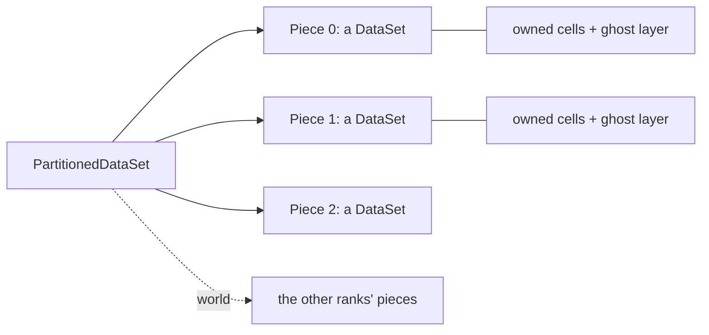

# Data in pieces

Large data often comes in pieces: a reader's partitions, a simulation's
blocks, the share of each GPU or MPI rank. Tack keeps each piece a whole
dataset and adds three things to the model: a container for the pieces,
ghost marks that say which cells and points another piece owns, and global
ids that name a point or cell the same way in every piece that holds it.
This page explains those three. After reading it you can hold your data's
pieces, mark what each owns, and know why per-piece work then adds up to the
whole's answer. Running filters over pieces is the Visualization layer's
[Filters over pieces](../visualization/over-pieces.md); moving data between
ranks is the [Communication](../communication/index.md) layer's.

## A grid in four pieces

`td.split` cuts a structured grid into pieces, here with one layer of each
neighbour's cells around every piece. Each piece then holds more cells than
it owns, but the owned cells and points of the four pieces are exactly the
whole grid's.

<!-- tack-check: pieces-split -->
```python
import numpy as np

import tack
import tack.dataset as td
from tack.dataset import Ghosts

tack.set_default_device("cpu")

whole = td.wavelet(10)                          # 21^3 points, 8000 cells
pieces = td.split(whole, 4, ghost_layers=1)     # a PartitionedDataSet
print(pieces)

owned_cells = owned_points = 0
for piece in pieces:
    cells, points = piece.ghosts.cells.numpy(), piece.ghosts.points.numpy()
    mine = int((cells & Ghosts.SKIPPED_CELLS == 0).sum())
    owned_cells += mine
    owned_points += int((points & Ghosts.SKIPPED_POINTS == 0).sum())
    print(f"{piece.num_cells} cells held, {mine} owned")
assert (owned_cells, owned_points) == (whole.num_cells, whole.num_points)

# Global ids name a shared point the same way in both pieces that hold it.
numbered = td.generate_global_ids(pieces)
first, second = (p.global_ids.points.numpy() for p in numbered[:2])
shared = np.intersect1d(first, second)
where = {g: i for i, g in enumerate(second)}
x0, x1 = numbered[0].positions(), numbered[1].positions()
assert all(np.array_equal(x0[i], x1[where[g]]) for i, g in enumerate(first) if g in where)
print(len(shared), "points shared by the first two pieces")
```

Each piece holds 2,420 cells and owns 2,000. The other 420 are its *ghost
layer*, copies of the cells next to it that its neighbours own.

## A container of whole datasets

A `PartitionedDataSet` is an ordered list of datasets, as VTK's
`vtkPartitionedDataSet` is. Each piece is a complete `DataSet`, with its own
topology and numbering, its own geometry, fields and sets, and its own
device. A piece may have no cells. The container is not a dataset itself:
you iterate over it (`for piece in pieces`), index it (`pieces[i]`) and take
its length. `td.PartitionedDataSet(list_of_datasets)` makes one.



Work on one piece takes the piece. Filters, analyses and your own kernels
take a `DataSet`, and you loop over the pieces. There is no wrapper that
applies a function to every piece, because the loop already says what it
does. Only algorithms whose answer needs more than one piece take the
container: reductions such as statistics and integrals, probes, particle
tracing, connected regions, ghost generation, and the point-cloud filters
that need neighbours.

## Owners and ghosts

Pieces overlap where they meet. Neighbouring pieces of a mesh share the
points on their common boundary, and with ghost layers they also hold
copies of each other's cells. Tack's rule is that **every cell and point that
several pieces hold has exactly one owner**. In every other piece that holds
it, its copy is a *ghost*, and a mark says so.

Reductions count only what each piece owns. So the statistics of the pieces
are the whole's, with every shared point counted once.

A ghost layer is what lets work on one piece be right near its edge. A point
gradient at the edge of a piece averages over every cell around the point,
and the ghost layer supplies the cells across the cut. With at least one
layer, the piece that owns a point holds every cell around it. Filters carry
the marks to what they make, so the owned part of a filter's output, over
all pieces, is the whole's output. [Filters over
pieces](../visualization/over-pieces.md) shows this and its rules.

## Ghost marks

`data.ghosts` is a `td.Ghosts`, or `None` for data that is not in pieces.
It holds one `u8` per cell (`ghosts.cells`) and one per point
(`ghosts.points`). Either may be `None`. The bits are VTK's `vtkGhostType`
bits, so they map one to one to VTK's ghost arrays:

| Bit | Value | Means |
|---|---|---|
| `Ghosts.DUPLICATECELL` | 1 | a copy of a cell another piece owns |
| `Ghosts.REFINEDCELL` | 8 | a cell a finer AMR level covers: valid data, superseded (see [AMR](amr-and-octrees.md)) |
| `Ghosts.HIDDENCELL` | 32 | a cell whose data is not valid here, such as a blanked cell |
| `Ghosts.DUPLICATEPOINT` | 1 | a copy of a point another piece owns |
| `Ghosts.HIDDENPOINT` | 2 | a point whose data is not valid here |
| `Ghosts.REFINEDPOINT` | 8 | a point where a finer AMR level has one; Tack's bit, not VTK's |

VTK's other cell bits (`HIGHCONNECTIVITYCELL`, `LOWCONNECTIVITYCELL`,
`EXTERIORCELL`) are carried along but not read. Three masks combine the
bits. `Ghosts.SKIPPED_CELLS` and `Ghosts.SKIPPED_POINTS` are what reductions
leave out: duplicates, hidden and refined entities. `Ghosts.MASKED_CELLS`,
hidden and refined cells, is what filters that make cells leave out.

The marks are kept apart from the fields, as the geometry is, so no
algorithm mistakes them for data. `to_device` moves them with the dataset,
and the VTK interop maps them to and from `vtkGhostType` arrays. You can set
them yourself; marks of the wrong length or type are refused.

### Hidden cells

A hidden cell is one whose data is not valid, such as a blanked cell of a
structured grid or a cell outside the domain. Filters never process hidden
cells, and reductions leave them out. Algorithms whose output is on the same
cells, such as gradients and projections, still compute there, and the marks
stay on those cells.

<!-- tack-check: pieces-hidden -->
```python
import numpy as np

import tack
import tack.dataset as td
from tack.dataset import Ghosts

tack.set_default_device("cpu")

data = td.uniform_grid((5, 5, 2))                          # 16 cells
data.fields["c"] = td.Field(td.Constant(data), tack.arange(16.0))

marks = np.zeros(16, np.uint8)
marks[:4] = Ghosts.HIDDENCELL                              # blank the first row
data.ghosts = td.Ghosts(cells=tack.array(marks))

summary = td.statistics(data, "c")                         # leaves the hidden cells out
assert summary.n == 12 and summary.mean == 9.5
print(summary.n, "cells counted, mean", summary.mean)
```

## Global ids

Each piece numbers its points and cells from zero, so a shared point has a
different index in each piece. *Global ids* name each point and cell
across all the pieces: one `i64` per point and per cell, the same wherever
the entity is held, and unique otherwise. They are `data.global_ids`, a
`td.GlobalIds` with `points` and `cells` arrays, either of which may be
`None`.

VTK's `GlobalIds` arrays come in as global ids. `td.generate_global_ids`
makes them, as `vtkGenerateGlobalIds` does. Filters keep the ids of the
points and cells they keep, as `threshold` and `extract_cells` do. What a
filter makes new has none. Global ids let algorithms match pieces exactly
rather than by position, and some algorithms, such as connected regions and
the splitting of shared faces into tetrahedra, use them to decide alike in
every piece.

## Where pieces come from

- **A structured grid** is cut by `td.split(data, n, ghost_layers=k)`. Each
  piece is a structured grid whose topology's `offset` is the grid index of
  its first point in the whole grid, VTK's extent start.
- **VTK** gives pieces as a `vtkPartitionedDataSet`, which `vtk_to_dataset`
  turns into a `PartitionedDataSet`, ghost arrays and global ids included.
  A `vtkPartitionedDataSetCollection` becomes a dictionary of names to
  partitioned datasets.
- **A simulation** gives you its blocks. Make a dataset of each and put them
  in a container (see [Connect a simulation's data](connect-simulation-data.md)).

Pieces without ghost cells can get them from `td.ghost_cells(pieces)`,
which finds the neighbours by their shared points and adds a layer, as VTK's
`vtkGhostCellsGenerator` does. [Filters over
pieces](../visualization/over-pieces.md) covers it, along with
`td.remove_ghosts` and `td.merge_pieces`, which turn pieces back into a
single dataset.

## Pieces on devices and ranks

A piece is a dataset, so it lives on a device of its own. One container can
hold pieces on two GPUs and the CPU, and each piece's work runs where the
piece is (see [Data on devices](devices.md)).

Over MPI, each rank holds its own pieces, and the container also holds a
`world`, a `tack.communication.World` made from an mpi4py communicator
(see [Blocks and worlds](../communication/blocks-and-worlds.md)). The
algorithms that take the container then communicate with the other ranks.
The per-piece loops do not change. A rank makes its container from its own
pieces as `td.PartitionedDataSet(mine, tc.World(MPI.COMM_WORLD))`, with
`tc` being `tack.communication` and `MPI` mpi4py's module. The
[MPI](../communication/mpi.md) page shows a whole run.

Pieces of one dataset must agree on their frame. Algorithms that compare or
move positions between pieces refuse pieces on two origins, in two spatial
units, or at two times (see
[Coordinates, units and time](units-coordinates-time.md)).

## Details

### Pieces without ghost cells

Without ghost layers, a piece cannot tell what its neighbours make or keep
from the cells, faces and edges they share. A contour point on a shared edge
belongs to the owner of the edge's lower end, by position, and that piece
may have no cell holding the edge. Tack does not guess. The outputs of such filters
record that they lost the marks, and reductions refuse them, naming the
cause. `generate_global_ids` of those outputs matches their points by
position and decides the owners again. Filters that keep the cells and
points as they are, and selections of points by their own values, need no
ghost cells.

### Fields whose owners are not decided

An `L2` field goes by its cells' marks. A field on faces or edges, or an
`H1` field of order 2 or more, is refused by reductions on a dataset with
marks, because who owns those values is not decided yet.

## Where to go next

- [Filters over pieces](../visualization/over-pieces.md) runs filters and
  reductions over pieces, generates ghost cells and merges pieces back.
- [AMR hierarchies and octrees](amr-and-octrees.md) uses the same marks for
  refinement.
- [Communication](../communication/index.md) explains blocks, worlds and the
  exchanges these algorithms are written on.
