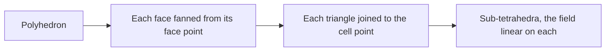

# Polyhedra, polygons and polylines

Most cells are maps of a fixed reference cell: a hexahedron is a bent unit
cube, a triangle a bent unit triangle. Some meshes hold cells with no fixed
shape. Finite-volume codes such as OpenFOAM and MPAS write polyhedra with
any number of faces. Surfaces and contours are made of polygons with any
number of points, and streamlines are polylines. Tack stores these cells and
computes inside them. Without a reference cell, what a field means inside one
needs a definition of its own, and a cell must meet a few conditions for Tack
to work in it. Some work also costs more on them than on shaped cells.
[Cells and meshes](cells-and-meshes.md) explains the shaped cells, and this
page builds on it.

## A polyhedron in a few lines

A polyhedron is a list of faces, and each face is a ring of point ids.
`PolyhedralTopology.from_cell_faces` takes one list of rings per cell and
matches the faces that cells share. This cell is a unit cube whose top is
pushed in: four triangles meet at a point at height 0.6.

<!-- tack-check: polyhedra-build -->
```python
import numpy as np

import tack
import tack.dataset as td

tack.set_default_device("cpu")

# A unit cube whose top is pushed in: four triangles down to a point at z = 0.6.
xyz = np.array([[0, 0, 0], [1, 0, 0], [1, 1, 0], [0, 1, 0],
                [0, 0, 1], [1, 0, 1], [1, 1, 1], [0, 1, 1], [0.5, 0.5, 0.6]])
faces = [[0, 3, 2, 1], [0, 1, 5, 4], [1, 2, 6, 5], [2, 3, 7, 6], [3, 0, 4, 7],
         [4, 5, 8], [5, 6, 8], [6, 7, 8], [7, 4, 8]]
topology = td.PolyhedralTopology.from_cell_faces([faces], num_points=9)
data = td.DataSet(topology, xyz)

# Point data: one value per point, here a linear function of position.
f = 1 + 2 * xyz[:, 0] - xyz[:, 1] + 3 * xyz[:, 2]
data.fields["f"] = td.Field(td.H1(data), tack.array(f))

print(data.num_cells, "cell,", data.num_points, "points,",
      topology.faces().num_faces, "faces")
assert topology.faces().num_faces == 9

# The point below the dent is inside the cell, and the linear field comes
# back exactly there. The point in the dent is outside.
probed = td.probe(data, np.array([[0.5, 0.5, 0.55], [0.5, 0.5, 0.8]]))
assert probed.fields["valid"].values.numpy().tolist() == [1, 0]
assert np.isclose(probed.fields["f"].values.numpy()[0], 1.5 + 3 * 0.55, rtol=1e-6)
```

The result is an ordinary `DataSet`: a topology, a geometry with one
position per point, and fields. The field `f` is an `H1` field (point data).
`probe`, a [sampling](../visualization/sample-and-trace.md) algorithm,
evaluates it inside the cell.

## Three topologies without a reference element

Tack has one topology for each kind of cell without a reference element.
Each holds cells of one dimension only.

| Topology | Its cells | Built from | VTK |
|---|---|---|---|
| `PolyhedralTopology` | polyhedra | each cell's faces, each face a ring of points | `VTK_POLYHEDRON` (42) |
| `PolygonalTopology` | polygons | each polygon's loop of points | `VTK_POLYGON` (7) |
| `PolylineTopology` | polylines | each line's chain of points | `VTK_POLY_LINE` (4) |

A polygonal topology takes `loop_offsets` and `loop_points`: polygon `c` is
`loop_points[loop_offsets[c]:loop_offsets[c + 1]]`, in order around it. A
polyline topology takes `line_offsets` and `line_points` the same way, with
at least two points a line. Triangles and quads can be polygons too, and
two-point lines can be polylines.

<!-- tack-check: polygon-polyline -->
```python
import numpy as np

import tack
import tack.dataset as td

tack.set_default_device("cpu")

# A unit square and a pentagon that share the edge from point 1 to point 2.
xyz = np.array([[0, 0, 0], [1, 0, 0], [1, 1, 0], [0, 1, 0],
                [2, 0, 0], [2.5, 0.5, 0], [2, 1, 0]], np.float32)
loops = td.PolygonalTopology(loop_offsets=[0, 4, 9],
                             loop_points=[0, 1, 2, 3, 1, 4, 5, 6, 2])
surface = td.DataSet(loops, xyz)
assert surface.num_cells == 2 and loops.faces().num_faces == 8   # 8 distinct edges
areas = td.cell_geometry(surface).measure.values.numpy()
assert np.allclose(areas, [1.0, 1.25])

# A path through three points: one polyline.
chain = td.PolylineTopology(line_offsets=[0, 3], line_points=[0, 1, 2])
path = td.DataSet(chain, xyz[:3])
assert path.num_cells == 1 and chain.dimension == 1
print(surface.num_cells, "polygons of areas", areas, "and", path.num_cells, "polyline")
```

A polyhedral topology stores each face once. A face's points run in the
order that winds it out of its first cell, which Tack calls the face's
*side 0*. The cell on its other side, side 1, reads it backwards. Face ids
are the input's, so data a code stores per face, such as MPAS's normal
velocity or an OpenFOAM flux, lines up with the faces as they come.
Everything else is derived when something first needs it, and then kept:
the two cells of each face (`faces()`), each cell's distinct points
(`cell_points()`, which is what VTK keeps as a polyhedron's connectivity),
and the edges (`edges()`).

A polygonal topology works the same way one dimension down. Its faces are
the polygons' edges, matched when first needed. A polyline topology's faces
are the points where lines end.

Converting shaped cells takes one call. `td.as_polyhedra(data)` turns a 3D
mesh of shapes into polyhedra and keeps its face numbering.
`td.as_polygons(data)` turns triangles, quads and pixels into polygons.
`vtk_to_dataset` reads VTK's polyhedra, polygons and polylines into these
topologies (see [VTK](../visualization/vtk.md)).

## What a field means inside the cell

A shaped cell gets its fields' values inside from its reference element's
shape functions (see [higher-order data](higher-order.md)). A polyhedron has
no reference element. So Tack cuts each cell into simple pieces and makes a
field linear on each piece:

- **A polyhedron** is cut into sub-tetrahedra. Each face is fanned into
  triangles from its *face point*, the mean of the face's points. Those
  triangles are joined to the *cell point*, the mean of the cell's distinct
  points. Each sub-tetrahedron is the cell point, a face point and the two
  ends of one edge of that face.
- **A polygon** is fanned into triangles from its cell point.
- **A polyline** is its segments.



The field's values at the points are the stored values. The face point and
the cell point get the mean of their points' values, just as they sit at the
mean of their points' positions. Two properties follow, and they are the
ones that matter:

- **A linear field is exact.** The extra points get exactly the values a
  linear field has there, so the pieces reproduce it. Gradients, averages,
  probes and integrals of a linear field are exact on every cell Tack
  accepts.
- **The field is continuous.** A face is stored once, and both of its cells
  fan it from the same face point. So the two cells agree on the face, even
  where the face is not planar.

In the terms of [higher-order data](higher-order.md), this is an `H1` field
of order 1 on a finer mesh whose extra nodes are not free: they are means of
the cell's points. That decides which fields these cells can hold.

| Field | On polyhedra, polygons and polylines | Why |
|---|---|---|
| `H1` of order 1 (point data) | yes | the pieces' values at the points |
| `Constant` (cell data) | yes | one value a cell needs no basis |
| `Values` on points, cells, faces or edges | yes | data attached to entities, with no basis |
| `L2`, `H1` above order 1, `SideTraces` | refused | each needs nodes inside the cell, on a reference element |

A refused space raises `NotImplementedError` naming the missing reference
element. Projecting between point data and cell data works in both
directions (see [Derive](../visualization/derive.md)).

## What a cell must be

Tack checks what it can, and refuses cells it cannot work in. Three
conditions matter.

**Faces are wound outward.** Each face's points run counterclockwise seen
from outside the cell, as VTK specifies. A cell wound inward has a negative
volume, and its normals and fluxes point the wrong way.
`from_cell_faces(..., positions=xyz, orient=True)` makes the winding
consistent and turns each connected part of the mesh outward; it needs the
positions for that last step. Without `orient`, two cells that run a shared
face the same way are refused. `td.check_winding(data)` returns the cells
whose faces do not wind consistently, and `td.orient(topology)` turns around
each face wound into its only cell. `vtk_to_dataset` warns about inside-out
cells when it reads them, and its `orient=True` repairs them.

**The cell is star-shaped from its cell point.** Every face must be visible
from the mean of the cell's points. Otherwise some sub-tetrahedra turn
inside out and overlap the others. Concave cells are fine as long as this
holds, as the dented cube shows. A C-shaped prism, whose points' mean lies
in its notch, is not. The cell locator refuses such cells, and so do
`probe` and advection, which use it.

**A warped face is its fan.** A face whose points do not lie in one plane is
taken as the fan of triangles from its face point. Volumes, normals and
fluxes are those of that surface.

## A concave cell, checked

The dented cube again, with the answers worked out by hand. Its volume is
the cube's less a pyramid of height 0.4. For the linear field
`1 + 2x - y + 3z`, the gradient is exact, the cell average is the field at
the centroid, and the value at the cell point is the field at the points'
mean. The algorithms used here are on the [Derive](../visualization/derive.md)
page.

<!-- tack-check: polyhedra-checked -->
```python
import numpy as np

import tack
import tack.dataset as td

tack.set_default_device("cpu")

xyz = np.array([[0, 0, 0], [1, 0, 0], [1, 1, 0], [0, 1, 0],
                [0, 0, 1], [1, 0, 1], [1, 1, 1], [0, 1, 1], [0.5, 0.5, 0.6]])
faces = [[0, 3, 2, 1], [0, 1, 5, 4], [1, 2, 6, 5], [2, 3, 7, 6], [3, 0, 4, 7],
         [4, 5, 8], [5, 6, 8], [6, 7, 8], [7, 4, 8]]
data = td.DataSet(td.PolyhedralTopology.from_cell_faces([faces], num_points=9), xyz)
data.fields["f"] = td.Field(td.H1(data), tack.array(1 + 2 * xyz[:, 0] - xyz[:, 1] + 3 * xyz[:, 2]))

volume = td.cell_geometry(data).measure.values.numpy()[0]
gradient = td.gradients(data, "f").values.numpy()[0]
average = td.project(data, "f", td.Constant(data)).values.numpy()[0]
at_cell_point = td.values_at_centers(data, "f").values.numpy()[0]
print(f"volume {volume:.4f}, gradient {gradient}, average {average:.4f}, "
      f"at the cell point {at_cell_point:.4f}")

assert np.isclose(volume, 1 - 0.4 / 3, rtol=1e-6)                 # the cube less a pyramid
assert np.allclose(gradient, [2, -1, 3], atol=1e-5)                # exact for a linear field
centroid_z = (0.5 - 0.9 * 0.4 / 3) / (1 - 0.4 / 3)
assert np.isclose(average, 1.5 + 3 * centroid_z, rtol=1e-6)        # f at the centroid
assert np.isclose(at_cell_point, 1.5 + 3 * 4.6 / 9, rtol=1e-6)     # f at the points' mean
```

A cell's average and its value at the cell point are different numbers. The
average is the field's integral over the cell divided by its volume. For a
linear field it is the value at the centroid. The cell point is the mean of
the cell's points, which is not the centroid. `project(..., average="nodes")`
gives the points' mean instead, as VTK's `vtkPointDataToCellData` does.

## What works on these cells

The algorithms work on these cells through their pieces. Measures come from
the divergence theorem over the fanned faces. Gradients are Green–Gauss sums
over the fanned faces. Probing and advection find the sub-tetrahedron,
triangle or segment holding a point and evaluate the field there. Integrals
are exact on the pieces, and cell quality is measured on them.

Contours, slices and thresholds work on polyhedra and polygons. Clipping
works on polyhedra and makes polyhedra. Polygons and polylines cannot be
clipped yet. The [Extract](../visualization/extract.md) page lists what each
filter takes.

## Details

### How this differs from VTK

VTK's `vtkPolyhedron` interpolates with *mean value coordinates*. They are
smooth inside the cell, exact for linear fields and defined on non-convex
cells. Tack's fields are linear on pieces instead. So inside a cell the two
give different values for anything but a linear field. At the points, and
for linear fields everywhere, they agree.

In VTK 9.7.1 several polyhedron operations are wrong, so VTK is not a
reference for these cells:

- `vtkCellSizeFilter` measures a concave polyhedron as its convex hull. The
  dented cube measures 1.0, not 0.8667.
- `vtkProbeFilter` takes points outside a polyhedron as inside. The point in
  the dent comes back valid, with the value 3.58.
- `vtkPolyhedron::Derivatives` is wrong in each direction whose parametric
  coordinate is 1, so `vtkGradientFilter`'s point gradients are wrong at the
  corners of a box.
- VTK accepts inside-out polyhedra without a word, and `vtkCellValidator`
  flags correctly oriented concave cells.

Tack's tests hold polyhedra to closed forms, to the same cells stored as
shapes, and to brute force instead.

### What polyhedra cost

A hexahedron reads its eight corners by id. A polyhedron reaches each point
through its faces, and its gradient walks every face. Stored as polyhedra,
the same moved hexahedra cost this many times their time as hexahedra
(64³ cells, warm medians on an M1 Max, measured by
`benchmarks/polyhedra_compare.py`):

| Algorithm | CPU | Metal |
|---|---:|---:|
| `gradients` (on cells) | 4.9× | 2.6× |
| `cell_centers`, `values_at_centers` | 0.9–1.1× | 1.3–1.4× |
| `probe` | 1.3× | 1.3× |
| `advect` | 1.4× | 1.7× |
| `streamlines` | 1.3× | 1.6× |

So keep shaped cells as shapes where you can. A VTK grid that mixes shapes
and polyhedra can be read as two pieces over the same points with
`vtk_to_dataset(grid, polyhedral="split")`: the shaped cells in one piece,
the polyhedra in the other, each on its fastest path.

### Limits

Polyhedra, polygons and polylines hold fields of order 1 and cell data, and
nothing of higher order. Higher-order polygons and polyhedra, such as VTK's
quadratic polygon, are not planned.

## Where to go next

- [Higher-order and finite-element data](higher-order.md) explains the
  reference elements and bases that these cells do without.
- [Data in pieces](pieces.md) covers meshes split over pieces, as OpenFOAM
  writes polyhedral meshes per processor.
- The [polyhedra design record](../vis-guide/design/polyhedra.md) gives the
  reasoning and the measurements behind these choices.
