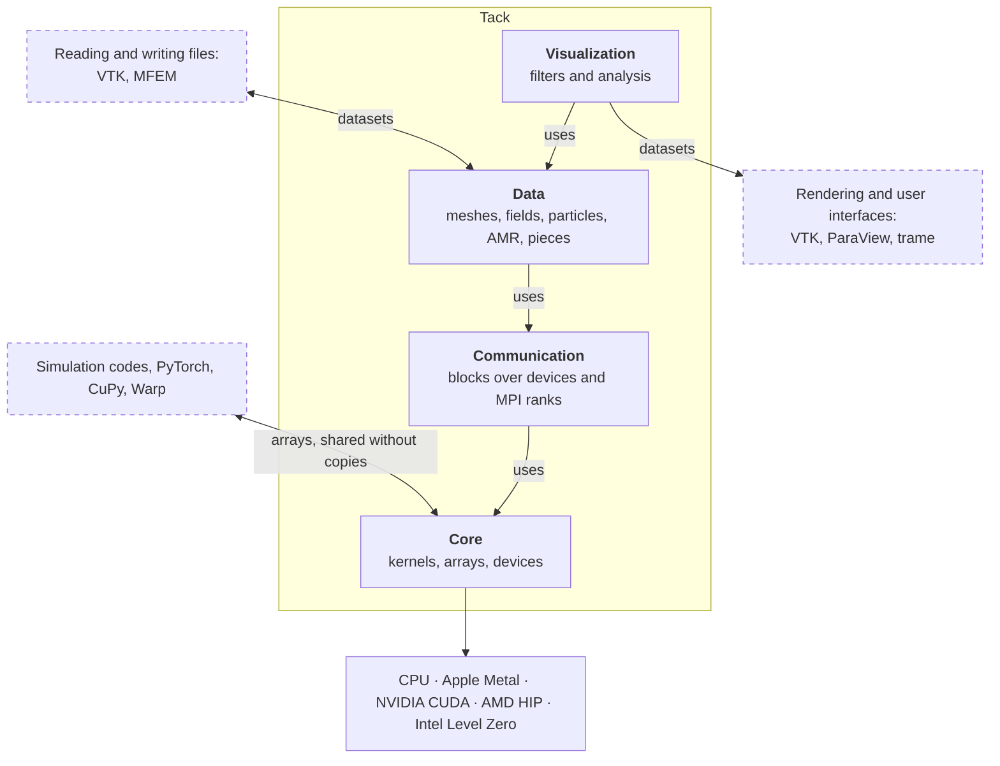

# What Tack is

Tack is a Python framework for parallel computing on CPUs and GPUs, and a
toolkit for scientific data analysis and visualization built on it. You write
a kernel as an ordinary Python function, and Tack compiles it for the device
your arrays are on: the CPU, an Apple GPU (Metal), an NVIDIA GPU (CUDA), an
AMD GPU (HIP) or an Intel GPU (Level Zero). The same filters, written that
way, contour, probe and trace a simulation's data on whichever of those
devices you have.

<!-- tack-check: intro-saxpy -->
```python
import numpy as np
import tack

tack.set_default_device("cpu")          # or "metal", "cuda", "hip", "level_zero"


@tack.kernel
def saxpy(a, x, y, out):
    for i in range(x.shape[0]):         # the parallel loop: one thread per i
        out[i] = a * x[i] + y[i]


x = tack.array(np.arange(1_000_000, dtype=np.float32))
y = tack.ones(1_000_000)
out = tack.empty_like(x)                # on the same device as x
saxpy(2.0, x, y, out)
assert out[3] == 7.0
```

Only the first call of `saxpy` compiles; later calls reuse the compiled code.

## Where to start

Start from what you want to do. Each path begins with one short page and then
points to the chapters it needs.

<div class="grid cards" markdown>

-   **Write GPU code in Python**

    ---

    Kernels, arrays and devices, from a first kernel to running it on a GPU.

    [Start with the core](core/index.md) · then
    [kernels](core/kernels.md), [choosing a device](core/choose-a-device.md)
    and [complete examples](core/examples.md)

-   **Analyze or visualize a dataset**

    ---

    Contour, slice, clip, probe and trace a dataset you already have. For
    readers who know VTK or ParaView.

    [Start with visualization](visualization/index.md) · then
    [extracting parts](visualization/extract.md) and
    [deriving quantities](visualization/derive.md). New to datasets and
    filters? [Read the data model's first page](data/index.md) first.

-   **Connect a simulation's data**

    ---

    Run filters on a simulation's own arrays, on its devices, without copies.

    [Start with connecting a simulation's data](data/connect-simulation-data.md)
    · then [sharing arrays](core/share-arrays.md) and
    [building meshes and fields](data/build-meshes-and-fields.md)

-   **Scale across devices or MPI ranks**

    ---

    Data in pieces, with ghost cells and global ids, over several GPUs or MPI
    ranks.

    [Start with data in pieces](data/pieces.md) · then
    [filters over pieces](visualization/over-pieces.md) and
    [communication](communication/index.md)

</div>

[Use cases](use-cases.md) shows these at more length, with the pages that
show how.

## How Tack is built

Tack is four layers, each using only the layers below it. The guide describes
them in that order, but it is not a course: start where your path starts, and
follow its links down when you need them.



- **[Core](core/index.md)** (`tack`) is the programming model: kernels with one
  parallel loop, device functions and device classes, arrays of scalars,
  vectors and matrices, reductions, scans and sorts. Arithmetic follows one
  [written contract](reference/language-contract.md) on every backend.
- **[Communication](communication/index.md)** (`tack.communication`) splits
  work into blocks, each on one device, and moves arrays between them, in one
  process or over MPI ranks.
- **[Data](data/index.md)** (`tack.dataset`) holds what simulations and
  instruments produce: grids and unstructured meshes, polyhedra, curved cells
  and fields of any order, point clouds, AMR hierarchies and octrees, and
  datasets in pieces.
- **[Visualization](visualization/index.md)** is about eighty filters written
  on the layers below. They keep VTK's names and meaning, tests compare their
  output with VTK's, and every one runs on every backend.

The dashed boxes are other software. Tack reads no file formats and draws
nothing: VTK's readers bring data in, and VTK, ParaView or a trame application
draws what Tack computes.

<div class="grid cards" markdown>

-   { loading=lazy width=320 height=280 }

    Polyhedra

-   { loading=lazy width=320 height=280 }

    Tetrahedra

-   { loading=lazy width=320 height=280 }

    An order-4 field

-   { loading=lazy width=320 height=280 }

    Curved cells of order 3

</div>

These are contours of one function on four kinds of cells. The cuts curve
inside the order-4 and curved cells, because Tack cuts the field itself rather
than a straight line between its values at the corners
([gallery](vis-guide/gallery.md)).

## How fast it is

Tack's filters are Tack kernels, and they are fast on both kinds of processor.
On 20 million hexahedra, point gradients take 760 ms on Tack's CPU and 23 ms on
an NVIDIA RTX 6000 Ada, against 4,228 ms for VTK on the same 28 CPU threads. On
that GPU, Tack is ahead of Viskores' C++ on 13 of the 14 filters compared. Tack
is not ahead everywhere: on 5 million hexahedra, VTK's contour on the CPU is
faster. [Performance](performance.md) has the measurements.

## How Tack fits with other tools

| Tool | How Tack relates to it |
|---|---|
| VTK's filters | Tack's filters replace VTK's where Tack has them. A VTK dataset converts to a Tack dataset and back, sharing memory where it can, and many of Tack's filters also run as VTK algorithms in a VTK pipeline. VTK still reads the files and renders. |
| Viskores | Tack takes Viskores' approach to data-parallel algorithms, written in Python instead of C++ templates. Tack also runs on Apple GPUs. |
| ParaView and trame | They draw what Tack computes, as VTK datasets. A trame application can wait for Tack's GPU work without blocking its event loop. |
| Simulation codes | Tack works on a simulation's own arrays, on its devices, through DLPack or a raw pointer, and over its MPI ranks. |
| MFEM | Tack imports MFEM meshes and solutions of any order, checked against MFEM's own evaluation of them. |
| NumPy, PyTorch, CuPy, Warp | Arrays pass both ways, through DLPack on GPUs. Tack kernels can also run on NVIDIA Warp, through a prototype backend. |

## What Tack does not do

Tack does not render, provide a user interface, or read and write file formats
itself; it leaves those to VTK, ParaView and their readers. It is not a drop-in
replacement for NumPy, and it has no automatic differentiation. Kernels are
written in a subset of Python. Tack is not on PyPI yet, so you
[install it](install.md) from a clone of its repository.

## Where to go next

- [Install](install.md) gets Tack running on your device.
- [Where to start](#where-to-start) above picks the first page for what you
  want to do.
