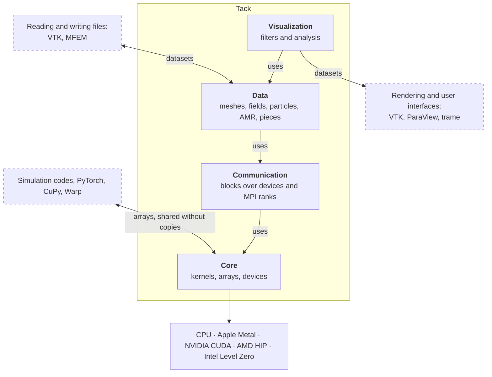
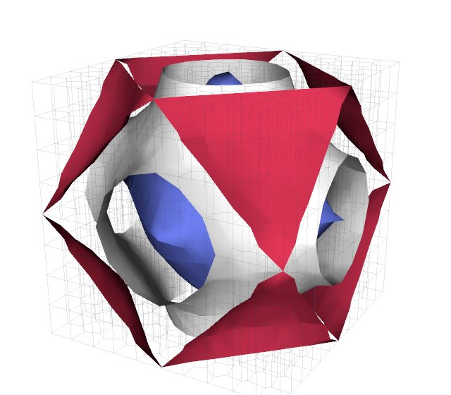
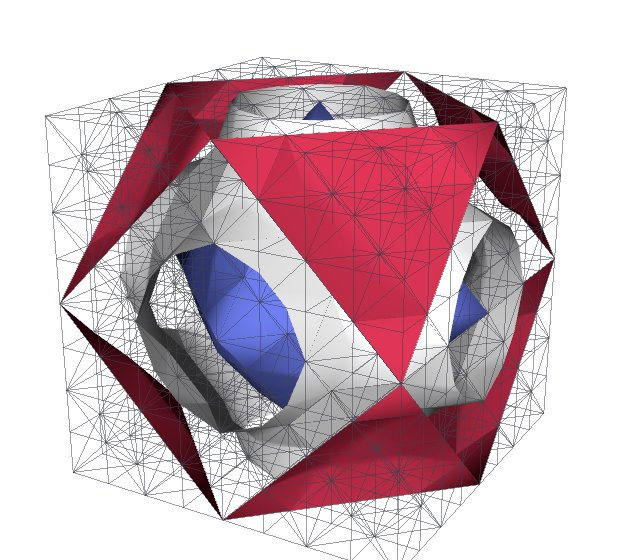
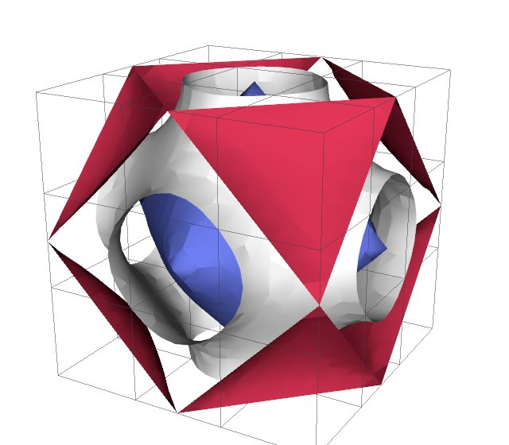
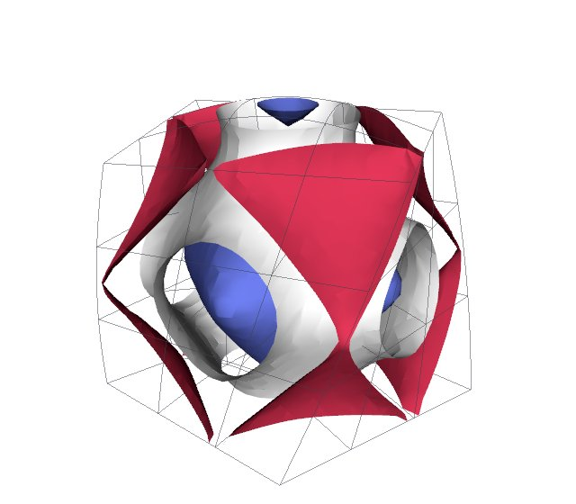

# What Tack is

Tack is a Python framework for parallel computing on CPUs and GPUs, and a
toolkit for scientific data analysis and visualization built on it. You write
a kernel as an ordinary Python function, and Tack compiles it for the device
your arrays are on: the CPU, an Apple GPU (Metal), an NVIDIA GPU (CUDA), an
AMD GPU (HIP) or an Intel GPU (Level Zero). This page is for anyone deciding
whether to use Tack. In five minutes it shows what Tack gives, how fast it is,
how it fits with VTK, Viskores, ParaView and simulation codes, and what it
leaves to others.

Here is a complete program. Only the first call of `saxpy` compiles; later
calls reuse the compiled code.

<!-- tack-check: intro-saxpy -->
```python
import numpy as np
import tack

tack.set_default_device("cpu")          # or "metal", "cuda", "hip", "level_zero"


@tack.kernel
def saxpy(a, x, y, out):
    for i in range(x.shape[0]):         # the parallel loop: one thread per i
        out[i] = a * x[i] + y[i]


x = tack.array(np.arange(1_000_000, dtype=np.float32))
y = tack.ones(1_000_000)
out = tack.empty_like(x)                # on the same device as x
saxpy(2.0, x, y, out)
assert out[3] == 7.0
```

## Four layers, and what Tack leaves to others

Tack is built as four layers. Each layer uses only the layers below it, so a
program can stop at any of them: a simulation may use the core alone, and a
visualization script uses all four. The documentation follows the same order.



The dashed boxes are other software. Tack reads no file formats itself and
draws nothing. VTK's readers bring data in, and VTK, ParaView or a trame
application draws what Tack computes. Arrays pass between Tack and other
libraries through DLPack or a raw pointer, usually without a copy.

## Core: GPU computing in Python

The core (the `tack` module) is a programming model for writing parallel code
in Python that runs on every device. A kernel is a function with one parallel
loop. Inside it you use loops, conditionals, math functions, vectors and small
matrices, and atomic operations. Device functions (`@tack.func`) are inlined
into kernels. Device classes (`@tack.device_class`) are objects whose data and
methods a kernel takes as an argument, so one kernel can serve many data
structures. Arrays hold scalars, vectors or matrices on one device. Implicit
arrays compute their values from an index instead of storing them.

Arithmetic follows one [written contract](reference/language-contract.md) on
every backend. Integer division rounds as Python's does, integers wrap at their
width, and no backend takes fast-math shortcuts. The core also has the building
blocks of data-parallel programs: reductions, scans, radix sorts and segmented
operations. The scans, sorts and segmented operations use no atomics, so their
results do not depend on how threads were scheduled. Compiled kernels are kept
on disk, so a later run starts without compiling.

How fast is GPU code written in Python? Tack's visualization filters are Tack
kernels. On an NVIDIA RTX 6000 Ada they are ahead of Viskores' C++ on 13 of
the 14 filters compared, by up to 5.4 times
([performance](performance.md#linux-amd-epyc-7453-and-nvidia-rtx-6000-ada)).

Two limits apply. Apple GPUs have no double precision, so Metal has no `f64`.
The CPU has no workgroups, so shared memory and barriers are for GPUs only.

[Start with the core](core/index.md).

## Communication: distributed parallelism

The communication layer (`tack.communication`) splits work into *blocks*, each
on one device, and moves Tack arrays between them. The same code runs in one
process, with blocks on several devices, and over MPI ranks. An algorithm
written on blocks never asks which. The layer gives you exchanges of arrays
between blocks, plans that are built once and run every step (to refresh ghost
values), routing of points to the blocks that hold them, and a distributed
sort. Sums over blocks are combined in a fixed order, so floating-point results
have the same bits however the blocks are placed. On CUDA and HIP, MPI can send
device memory directly.

Tack's own algorithms over data in pieces are written on this layer. On 512
pieces of a simulation's output, numbering every point and cell across the
pieces takes 9.0 s against VTK's 10.4 s, and adding a layer of ghost cells
takes 28.7 s against VTK's 27.3 s
([performance](performance.md#real-data-against-vtk)).

[Start with communication](communication/index.md).

## Data: one model for many kinds of data

The data layer (`tack.dataset`) is a data model built from the ground up to
hold the data that simulations and instruments produce. A *dataset* is a
topology (how points join into cells), a geometry (where the points are) and
fields (values with a meaning). A dataset can be any of these:

- an image, a rectilinear or curvilinear grid, or an unstructured mesh of mixed
  cells, polyhedra, polygons or polylines;
- a mesh of curved cells with fields of any polynomial order, as
  finite-element codes such as MFEM write them;
- a point cloud of particles;
- a block-structured AMR hierarchy or an octree;
- a dataset in pieces, with ghost cells and global ids, over devices and MPI
  ranks.

A field says how its values define a function. Point data and cell data are
two cases, and discontinuous (DG) fields of any order are others, so one mesh
can carry all three. Fields keep their physical units through filters, and a
dataset keeps its time. Positions are stored relative to an origin, so
coordinates far from zero stay accurate in single precision on a GPU.

<div class="grid cards" markdown>

-   { loading=lazy width=320 height=280 }

    Polyhedra

-   { loading=lazy width=320 height=280 }

    Tetrahedra

-   { loading=lazy width=320 height=280 }

    An order-4 field

-   { loading=lazy width=320 height=280 }

    Curved cells of order 3

</div>

These are contours of one function on four kinds of cells. The cuts curve
inside the order-4 and curved cells, because Tack cuts the field itself rather
than a straight line between its values at the corners
([gallery](vis-guide/gallery.md)).

[Start with the data model](data/index.md).

## Visualization: analysis and algorithms

The visualization layer is about eighty algorithms written on the three layers
below. They cover contour, slice, clip and threshold; surfaces and feature
edges; gradients, flow quantities, cell quality and integrals; probes,
streamlines, pathlines and voxelization; statistics and connected regions;
point-cloud cleaning, SPH and halo finding; and work on AMR, on data in pieces
and on steps over time. They keep VTK's names and meaning, and tests compare
their output with VTK's. Because they are Tack kernels, every one runs on every
backend.

<!-- tack-check: intro-contour -->
```python
import tack
import tack.dataset as td

tack.set_default_device("cpu")

data = td.wavelet(extent=10)                     # VTK's wavelet source: 21^3 points
surface = td.contour(data, "RTData", 157.0)      # an isosurface of triangles
print(surface.num_cells, "triangles")            # 5504 triangles
assert surface.num_cells == 5504
```

The filters are fast on both kinds of processor. On 20 million hexahedra,
point gradients take 760 ms on Tack's CPU and 23 ms on an NVIDIA RTX 6000 Ada,
against 4,228 ms for VTK on the same 28 CPU threads. On real simulation data,
on an Apple M1 Max's CPU, Tack computes the ONERA M6 wing's pressure gradients
14.6 times faster than VTK. Streamlines on the GPU are 12 to 54 times faster
than Viskores'. Tack is not ahead everywhere: on 5 million hexahedra, VTK's
contour on the CPU is faster ([performance](performance.md)).

A filter of your own sees a mesh through the same public views the built-in
filters use, so it can be as fast and as correct as theirs.

[Start with visualization](visualization/index.md).

## Use Tack for...

- [analyzing simulation output on the GPU you have](use-cases.md#analyze-simulation-output-on-the-gpu-you-have),
  whether it is NVIDIA, AMD, Intel or Apple;
- [running filters in situ](use-cases.md#run-filters-in-situ-on-a-simulations-own-arrays),
  on a simulation's own device arrays, without copies;
- [writing your own visualization algorithm](use-cases.md#write-your-own-visualization-algorithm-in-python)
  in Python, running on every device;
- [higher-order and finite-element data](use-cases.md#work-with-higher-order-and-finite-element-data),
  such as MFEM's, without resampling;
- [big data in pieces](use-cases.md#process-big-data-in-pieces-over-mpi-ranks),
  over MPI ranks;
- [GPU computing in Python beyond visualization](use-cases.md#compute-on-gpus-in-python-beyond-visualization).

## How Tack fits with other tools

Tack replaces some tools, complements others, and runs inside others still.

| Tool | How Tack relates to it |
|---|---|
| VTK's filters | Tack's filters replace VTK's where Tack has them. A VTK dataset converts to a Tack dataset and back, sharing memory where it can. Many of Tack's filters are also VTK algorithms (`tack.interop.vtk.algorithms`), which sit in a VTK pipeline beside VTK's own and run on the CPU. VTK still reads the files and renders. |
| Viskores | Tack takes Viskores' approach to data-parallel algorithms, written in Python instead of C++ templates. Tack also runs on Apple GPUs, which Viskores does not. |
| ParaView and trame | They draw what Tack computes, as VTK datasets. A trame application, or any other asyncio program, can wait for Tack's GPU work without blocking its event loop. |
| Simulation codes | Tack works on a simulation's own arrays, on its devices, through DLPack or a raw pointer. A dataset in pieces runs over the simulation's MPI ranks. |
| MFEM | Tack imports MFEM meshes and solutions of any order. Its values are checked against MFEM's own evaluation of them. |
| NumPy, PyTorch, CuPy, Warp | Arrays pass both ways, through DLPack on GPUs. Tack kernels can also run on NVIDIA Warp, through a prototype backend. |

## What Tack does not do

Tack does not render, provide a user interface, or read and write file formats
itself. It leaves those to VTK, ParaView and their readers. It is not a drop-in
replacement for NumPy, and it has no automatic differentiation. Kernels are
written in a subset of Python, which Tack reads as source and compiles. The
Warp backend is a prototype. Tack is not on PyPI yet, so you
[install it](install.md) from a clone of its repository.

## Where to go next

- [Use cases](use-cases.md) shows what Tack is good at, with the pages that
  show how.
- [Install](install.md) gets Tack running on your device.
- [The core's first page](core/index.md) is where to start writing kernels.
  [The visualization layer's first page](visualization/index.md) is where to
  start if you have a dataset and filters in mind.
