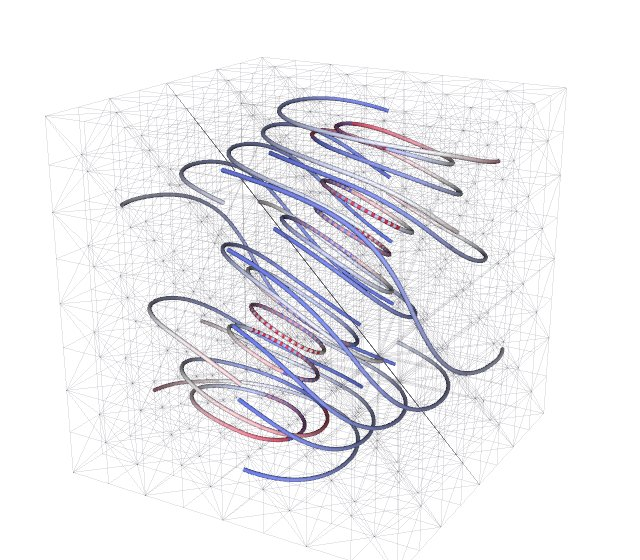
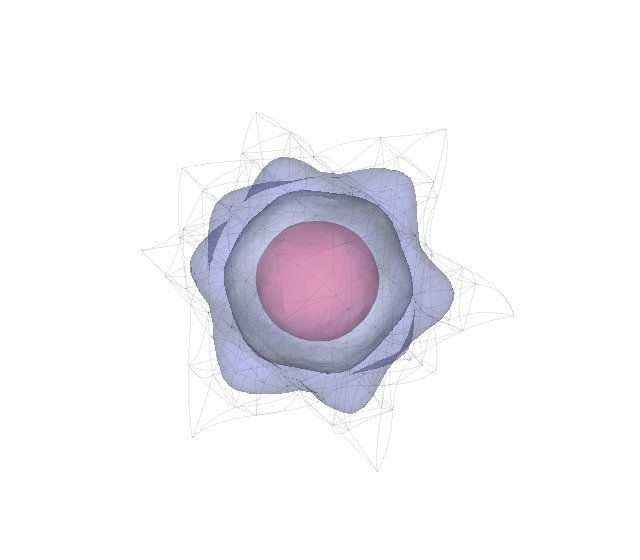
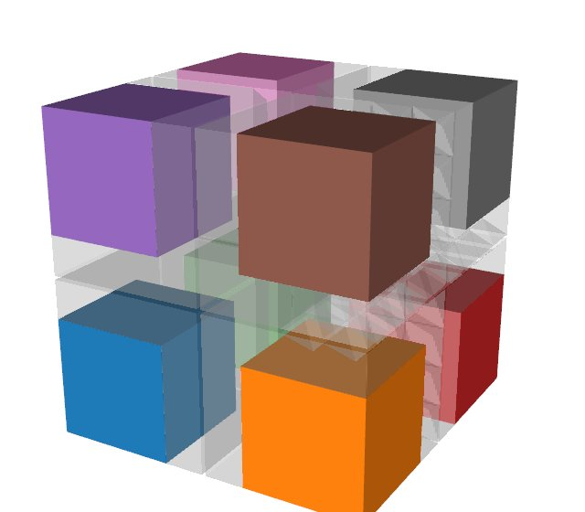
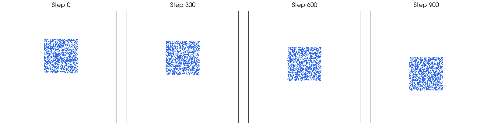

# Use cases

This page is for readers deciding what to use Tack for. It describes six jobs
Tack does well. Each section says why Tack is good at the job, gives a measured
result where one exists, and links to the pages that show how. The
[front page](index.md) describes Tack as a whole.

## Analyze simulation output on the GPU you have

{ loading=lazy width=280 align=right }

Tack's filters run on NVIDIA, AMD, Intel and Apple GPUs, and on the CPU, from
the same Python script. Only the device changes: VTK reads the file, Tack
filters it on the device, and VTK or ParaView draws the result. You need no
build for your GPU and no second version of your script.

On an Apple M1 Max, Tack's filters on the Metal GPU are 1.5 to 154 times
faster than VTK's on the CPU, on every filter compared but one. On an NVIDIA
RTX 6000 Ada, Tack's filters on CUDA are 11 to 2,269 times faster than VTK's on
28 CPU threads. On real simulation data on the M1 Max's CPU, Tack computes the
ONERA M6 wing's pressure gradients 14.6 times faster than VTK, and a wildfire
simulation's gradients 33 times faster
([performance](performance.md)).

To do it, see [the visualization layer's first page](visualization/index.md),
[VTK](visualization/vtk.md) for reading and drawing data, and
[choose a device](core/choose-a-device.md).

## Run filters in situ, on a simulation's own arrays

A filter that runs inside a simulation, on its memory while it runs, is *in
situ*. Tack works on a simulation's arrays where they already are. On the CPU
or a GPU, `tack.array_from_ptr` wraps an existing allocation, and
`tack.from_dlpack` takes a tensor from PyTorch, CuPy or any other library that
speaks DLPack. Neither copies. A field made from such an array is read by
every filter in place.

<!-- tack-check: intro-in-situ -->
```python
import numpy as np
import tack
import tack.dataset as td

tack.set_default_device("cpu")

data = td.uniform_grid((33, 33, 33), origin=(0, 0, 0), spacing=(1 / 32, 1 / 32, 1 / 32))
temperature = np.zeros(data.num_points, dtype=np.float32)    # the simulation's own array
values = tack.array_from_ptr(temperature, temperature.shape, tack.f32)
data.fields["temperature"] = td.Field(td.H1(data), values)

temperature[:] = data.positions()[:, 0]          # the simulation writes a step
surface = td.contour(data, "temperature", 0.5)   # Tack reads the same memory
assert np.allclose(surface.positions()[:, 0], 0.5)
```

On CUDA, Tack works in the same GPU context that PyTorch, CuPy and NVIDIA Warp
use, so the libraries take turns on one device without switching. With Warp,
Tack exchanges whole datasets with NVIDIA's warp-simdata, sharing most of their
arrays. A simulation in pieces over MPI ranks keeps its pieces, and Tack runs
over the same ranks. No in situ run has been timed for these pages yet.

To do it, see [share arrays](core/share-arrays.md),
[connect a simulation's data](data/connect-simulation-data.md) and
[MFEM, Warp and others](visualization/mfem-warp-and-others.md).

## Write your own visualization algorithm in Python

Tack's built-in filters are written with the same public pieces you use. A
kernel of your own visits a mesh's cells, faces or points with `for_each`, and
reads them through *views*, which give a cell's points and their positions, and
a field's value anywhere inside a cell. `carry` then moves fields, ghost marks and ids from the
input to your output, as the built-in filters do. Your algorithm is a Python
function, so it runs on every device and needs no build.

The built-in filters show what this gives. They are Tack kernels written in
Python, and on an NVIDIA RTX 6000 Ada they are ahead of Viskores' C++ filters
on 13 of the 14 compared, by up to 5.4 times
([performance](performance.md#linux-amd-epyc-7453-and-nvidia-rtx-6000-ada)).
One of the documentation's examples rewrites six built-in filters with public
names only, and checks each result against the built-in's.

To do it, see [views](visualization/views.md),
[write a mesh algorithm](visualization/write-a-mesh-algorithm.md) and
[write a filter](visualization/write-a-filter.md).

## Work with higher-order and finite-element data

{ loading=lazy width=280 align=right }

Finite-element codes store fields as polynomials inside each cell, often on
curved cells. Tack keeps such data as it is. A field is continuous (`H1`) or
discontinuous (`L2`) of any order, in a Lagrange, Bernstein or serendipity
basis, on a geometry that may itself be curved. Filters work on the field
itself. A contour or slice cuts each cell on sub-cells and places every
crossing on the polynomial, so nothing is resampled onto a linear mesh first.

Tack reads MFEM meshes and solutions, and VTK's Lagrange and Bézier cells. The
pictures in the [MFEM gallery](vis-guide/mfem-gallery.md) are MFEM's examples
run through Tack. Tack's values there are checked against MFEM's own: values at
random points in every element, gradients, the jumps of DG fields across faces,
and integrals.

To do it, see [higher-order and finite-element data](data/higher-order.md) and
[MFEM, Warp and others](visualization/mfem-warp-and-others.md).

## Process big data in pieces, over MPI ranks

{ loading=lazy width=280 align=right }

A dataset too large for one device is split into pieces, one or more on each
device or MPI rank. Tack's filters run on each piece. Tack adds layers of ghost
cells, numbers points and cells across pieces with global ids, and gathers
pieces into one. Statistics, connected regions and streamlines work across
pieces. With ghost cells in place, each piece's output is exactly its share of
the output for the whole dataset. The same script runs in one process and on
many ranks.

On 512 pieces of a simulation's output, numbering every point and cell takes
9.0 s against VTK's 10.4 s, and a layer of ghost cells 28.7 s against VTK's
27.3 s ([performance](performance.md#real-data-against-vtk)). One limit: ghost
cells do not yet carry continuous fields above order 1.

To do it, see [data in pieces](data/pieces.md),
[filters over pieces](visualization/over-pieces.md) and
[run under MPI](communication/mpi.md).

## Compute on GPUs in Python, beyond visualization

{ loading=lazy width=280 align=right }

Tack's core is a general programming model, and the visualization layer is one
program written on it. You can write simulations, image processing or data
analysis the same way. Kernels hold vectors and small matrices. Device classes
let one kernel serve many data structures. Scans, sorts and segmented
reductions are ready to use, and arithmetic follows one contract on every
backend. The examples include heat diffusion, a particle-to-grid (MPM)
simulation and tiled n-body forces, each checked against an independent
reference.

Every filter on the [performance page](performance.md) is built from these
same kernels, scans and sorts.

To do it, see [the core's first page](core/index.md),
[reductions, scans and sorts](core/reductions-scans-sorts.md) and
[the core's examples](core/examples.md).

## Where to go next

- [Install](install.md) gets Tack running on your device.
- [What Tack is](index.md) describes the four layers and what Tack leaves to
  other software.
