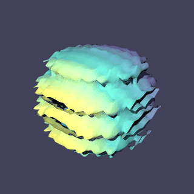

# Datasets and visualization

`tack.data` holds meshes and the fields on them, and the algorithms that work
on both: contour, slice, clip, threshold, external faces, gradients,
projections between spaces, streamlines and the rest. Like VTK and Viskores,
it works on structured grids, unstructured meshes of the linear cells,
polyhedra, polygons and polylines. Unlike them, the algorithms are ordinary
Tack kernels, so they run on every backend, and the kernels you write
yourself see a mesh the way the built-in ones do.

```bash
pip install 'tack-core[cpu]' tack-vis
```

This chapter is a tour. The [Dataset API reference](../reference/dataset-api.md)
has every class and algorithm, and what each topology supports.

## Quick start

```python
import tack
import tack.data as td

tack.init(arch=tack.cpu)

data = td.wavelet(extent=10)                    # VTK's wavelet: 21^3 points
surface = td.contour(data, "RTData", 157.0)     # an isosurface, as triangles
print(surface.num_cells, "triangles,", surface.num_points, "points")
print(td.statistics(data, "RTData")["mean"])
```

Every algorithm takes the dataset first and returns something new: a
dataset, a field, or Python values. Nothing changes its input.

Fields passed to an algorithm belong to that dataset's topology. `dot`,
`cross` and `composite` require matching value types; an explicit
`td.Cast(field.values, tack.f32)` converts values when needed. Integer
inputs to magnitude, logarithms and statistics compute in floating point.

## The model

A `DataSet` is four things:

| Part | What it is | Example |
|---|---|---|
| `topology` | the cells and how they connect | `UnstructuredTopology`, `StructuredTopology`, `PolyhedralTopology` |
| `geometry` | where the points are: a field of 3-vectors | positions per point, or the implicit coordinates of a grid |
| `fields` | named fields, each a *space* and its values | `Field(H1(data), values)` |
| `sets` | named selections of points, cells or faces | the boundary faces |

A *space* says where a field's values live and how they are read between
them. `H1` is point data, continuous and interpolated in each cell;
`Constant` is cell data; `L2` holds each cell's own corner values, a
discontinuous field. `Values(data, on)` is data about points, edges, faces or
cells with no interpolation. A field's values are a `tack.field`, a
`tack.Vector.field`, or an implicit array that computes them on demand: a
grid's coordinates take no memory.

Geometry may also live in L2, giving each cell its own positions. Contour and
slice preserve the resulting gaps; clipping requires shared H1 geometry.
Changing an L2 geometry's values refreshes subsequent face-geometry results.

## Building a dataset

Grids come from `uniform_grid` and `rectilinear_grid`, and the test sources
from `wavelet` and `tangle`. A grid size of 1 adds no cells, in any
position: `uniform_grid((1, 3))` is a line of three points. A grid with no
axis of two or more points, such as `(1, 1, 1)` or any grid with a size of
0, has no cells. An unstructured mesh takes VTK's cell types, offsets and
connectivity:

```python
--8<-- "docs/examples/datasets.py:build"
```

The other topologies are built from their own arrays:
- `PolyhedralTopology.from_cell_faces` takes each cell's faces as VTK and
  most readers give them;
- `PolygonalTopology` takes each polygon's loop of points;
- `PolylineTopology` takes each polyline's chain.

`vtk_to_dataset` and `tack.interop.mfem` bring datasets in from VTK and MFEM.
Neither library is a dependency of `tack-vis`: install `vtk` and `mfem`
(PyMFEM) yourself, or, in a checkout of the repository, add the `interop`
extra (`uv sync --extra cpu --extra interop`), which installs both from the
lock and keeps them through later syncs with the same extras. PyMFEM has
wheels only for macOS on Apple silicon and Linux x86_64, so elsewhere the
extra leaves MFEM out.

## Algorithms

Every algorithm is in `tack.data.algorithms`, re-exported from `tack.data`,
and they share one set of conventions:

- the dataset comes first;
- a field argument is a `Field` or the name of one of the dataset's fields;
- an algorithm that makes a dataset takes `fields=` (all by default, a name,
  a list, or `[]`) and carries those fields onto its output;
- one that computes a field returns a `Field`, or a named tuple of them;
- summaries (`statistics`, `entropy`) return Python values.

```python
--8<-- "docs/examples/datasets.py:pipeline"
```

Fields come along by how the output's entities come from the input's. Point
data is interpolated onto a contour's points, and cell data goes to the
pieces each cell was cut into. A kept cell keeps its values.

## Moving fields between spaces

`project(data, field, space)` gives a field in another space of the same
mesh. `to_points`, `to_cells` and `discontinuous` are shortcuts for it.

```python
--8<-- "docs/examples/datasets.py:spaces"
```

Projecting into a space that can hold the field exactly gives it back
exactly: a linear point field into `L2`, or into order-2 `H1`. Otherwise
`project` averages the way VTK does: a point takes the mean of the cells
around it, and a cell the mean of its corners.

## Sets

A `Set` selects points, cells or faces. Builders such as `boundary_faces`
return one; name it in `data.sets` to keep it. Filters carry sets the way
they carry fields:

```python
--8<-- "docs/examples/datasets.py:sets"
```

The name of a cell or face set is also a place to run a kernel, as the next
section shows.

## Writing your own algorithm

`for_each(kernel, data, domain, *args)` runs a kernel over `"cells"`,
`"faces"`, `"edges"` or a named set. A mesh may mix shapes, so it runs the
kernel once per shape. Each launch gets that shape's *view* of the cells,
and every `Field` argument becomes its view for the same cells. The kernel
is compiled for each shape, so a hexahedron's loop knows it has eight
corners.

```python
--8<-- "docs/examples/datasets.py:kernel"
```

A view's methods follow one naming rule per kind of answer, so a name says
what comes back:

| Ends in | Gives | Examples |
|---|---|---|
| `_id` | a global id | `entity_id(c)`, `point_id(c, j)`, `face_id(c, k)`, `side_point_id(c, k, j)` |
| `_position` | a position | `position(c, pc)`, `corner_position(c, j)`, `side_position(c, k, j)` |
| `_corner` | a shape's local corner number | `edge_corner(e, k)`, `face_corner(f, k)` |
| `num_` (prefix) | a count | `num_points`, `num_faces(c)`, `side_num_points(c, k)` |

A field view gives `value(c, pc)` at parametric coordinates,
`parametric_gradient(c, pc)` and `corner_value(c, j)`.

Face-based kernels walk each cell's faces outward, and the same code serves
every kind of cell. They need the faces, which are derived on first use, so
ask for them before the launch:

```python
--8<-- "docs/examples/datasets.py:faces"
```

## Polyhedra, polygons and lines

A polyhedral cell has no reference element: no shape functions and no
parametric coordinates. Algorithms that need one (gradients, probing,
advection) refuse a polyhedral mesh and say so. The ones that work from
points and faces run on both kinds: contour (by López's face walk), slice,
threshold, external faces, cell and face geometry, divergence, and moving
data between points and cells. A 2D mesh contours into lines, and
streamlines are polylines, one per seed:

```python
--8<-- "docs/examples/datasets.py:lines"
```

The [reference](../reference/dataset-api.md#algorithms-and-filters) has a
table of which algorithm runs on which topology.

## 64-bit ids

A topology keeps its ids in `i32` unless it is too large or asked for `i64`
(`id_dtype=tack.i64`). Kernels specialize on the id type, so a small mesh
pays nothing for large ones. VTK's 64-bit ids come in as the narrowest type
that holds them.

## Rendering a result

`tack.rendering` draws triangles from flat point and connectivity fields. A
field of 3-vectors is stored interleaved, so `reshape` gives that flat view
without a copy:

```python
--8<-- "docs/examples/datasets.py:render"
```



The whole example is [`docs/examples/datasets.py`](../examples/datasets.py).
`--check` runs its assertions, and `--output image.png` saves the picture.

## VTK interop

`tack.interop.vtk` converts whole datasets:
- `vtk_to_dataset` reads a `vtkUnstructuredGrid`, `vtkRectilinearGrid` or
  `vtkImageData`, including polyhedra and polylines;
- `dataset_to_vtk` writes the matching VTK type back.

```python
from tack.interop.vtk import dataset_to_vtk, vtk_to_dataset

data = vtk_to_dataset(grid)               # point data -> H1, cell data -> Constant
grid = dataset_to_vtk(td.contour(data, "pressure", 0.5))
```

Arrays exchange through DLPack, sharing storage where the device allows:

```python
from tack.interop.vtk import field_to_vtk, vtk_to_field

field = vtk_to_field(vtk_array)
vtk_array = field_to_vtk(field)
```

VTK's tuples and components become a field shape: a `(1000, 3)` scalar field
represents 1000 tuples of three components. `vtk_to_field(array,
flatten=True)` and `field_to_vtk(field, n_components=3)` use the flat
interleaved layout instead. This requires a VTK build exposing
`vtkmodules.util.dlpack_support`. Not every VTK installation provides device
arrays. See [Sharing arrays with other libraries](16-interoperability.md) for
lifetime and read-only rules.

### Level Zero

Level Zero device pointers need a shared allocation context. With a compatible
VTK/Viskores Kokkos-SYCL build, initialize before allocating fields:

```python
from tack.interop.vtk import init_level_zero

init_level_zero()                       # instead of tack.init(arch=tack.level_zero)
```

The VTK DLPack support must provide `level_zero_handles()`. Fields created in a
separate Tack context cannot be exchanged through this path. For another library,
`tack.init(arch=tack.level_zero, external_context={"driver": ..., "device": ...,
"context": ...})` adopts its context; Tack never destroys an adopted context.

## Earlier algorithms

The first vis worklets, `flying_edges`, `compute_normals`, `cell_to_point`
and `amr_blanking`, and the finite-element helpers in `tack.fe` are kept
for reference in `tack.deprecated`. `tack.data` supersedes them:
- `contour` replaces `flying_edges`;
- `to_points` replaces `cell_to_point`;
- `gradients` and `project` replace the finite-element helpers.

Some examples still use the old modules until they are ported.
