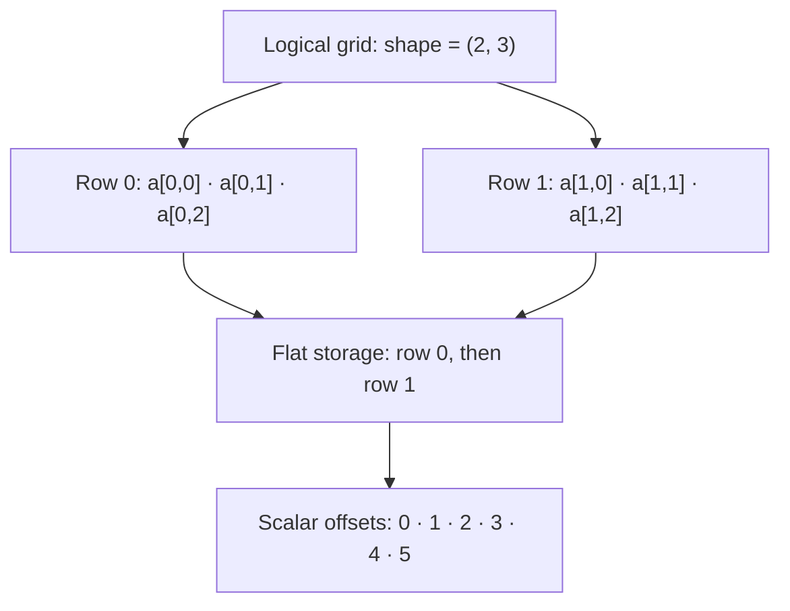

# Memory and parallel correctness

The most useful question when writing a parallel kernel is: **which iteration
owns each output, and what can it read while other iterations are writing?**
Start with independent writes. Add sharing only when the algorithm requires it.

## Describe your layout explicitly

A scalar array with `shape=(height, width)` stores `height * width` values in
row-major order: the last index varies fastest. `image[row, column]` is the same
scalar as `image[row * width + column]` in a kernel.

For a two-row, three-column array, the last index runs fastest:



A vector array adds components to each logical element:

| Allocation | Logical element | `to_numpy()` |
|---|---|---|
| `tack.empty(f32, shape=(h, w))` | One scalar per pixel | `(h, w)` |
| `tack.empty(dtype=tack.vec3(), shape=(h, w))` | One RGB vector per pixel | `(h, w, 3)` |
| `tack.empty(dtype=tack.mat2(), shape=(n,))` | One 2×2 matrix per particle | `(n, 2, 2)` |

Every row uses the same constructor and download method. The dtype determines
the component dimensions, which are appended to the array shape in NumPy.
Host indexing reads a logical element; flat component indexing is an internal
storage convention.

For an RGB array, the flat order is `R00, G00, B00, R01, G01, B01, …`:
components stay together, then the column advances, then the row.

The introductory grid examples use `(height, width)` and `[row, column]`.
The [dye tutorial](tutorials/dye.md) instead uses `(width, height)` and `[x, y]`
to match its coordinate arithmetic; it transposes for image output. Both
conventions are valid, but conversions must respect which one was used.
Uniform-grid visualization uses x-fast flat indexing:
`i + nx_points * (j + ny_points * k)`. That is a different convention from a
scalar array with shape `(nx_points, ny_points, nz_points)`; do not interchange
the layouts without arranging the data accordingly.

## One writer per output

This kernel is safe even when it updates its input in place:

```python
@tack.kernel
def scale(data, factor):
    for i in range(data.shape[0]):
        data[i] *= factor
```

Iteration `i` only accesses its own element. The same reasoning applies to
per-particle velocity updates when each iteration reads completed forces and
writes only its own particle.

Tack does not establish race freedom for you. A kernel compiling successfully
does not mean two iterations cannot interfere. Array accesses are not
bounds-checked either: keep indices within the storage you allocated.
[Debug mode](15-debugging-and-timing.md#check-every-index-with-debug-mode)
(`tack.init(..., debug=True)` or `TACK_DEBUG=1`) checks every array and array
index and raises `IndexError` naming the access, for finding such a bug.
Negative host indices count from the end; do not assume that rule for kernel
array loads.

## Neighbour reads need a stable input

A smoothing stencil reads the old values around every cell. Updating the same
array allows one iteration to see a neighbour already changed by another.
Use distinct input/output arrays:

```python
@tack.kernel
def smooth(old, new, n):
    for i, j in tack.ndrange(n, n):
        if 0 < i < n - 1 and 0 < j < n - 1:
            new[i, j] = 0.25 * (old[i - 1, j] + old[i + 1, j]
                               + old[i, j - 1] + old[i, j + 1])
        else:
            new[i, j] = 0.0

for step in range(steps):
    smooth(old, new, n)
    old, new = new, old
```

The swap changes Python references and costs no array copy. Both buffers must
have the same layout. Write every output that the next step will read, including
the boundary. When using an interior-only `ndrange`, initialize or explicitly
maintain the unwritten border of **both** buffers: a new array's contents are
unspecified, and `tack.zeros` is the allocation that starts at zero.

The [heat tutorial](tutorials/heat.md) develops this pattern. In-place numerical
schemes can be valid when they have an explicit ordering strategy, such as
red-black updates in separate calls, but that needs an algorithm-specific argument.

## Views still share storage

`reshape` is a view; `copy` makes independent storage:

```python
grid = tack.empty(dtype=tack.f32, shape=(8, 8))
view = grid.reshape((64,))                 # same allocation
independent = grid.copy()                 # another allocation
```

Passing `grid` and `view` as two arguments does not provide two independent
buffers. Tack preserves valid aliasing within each iteration; overlapping
arguments do not make concurrent conflicting accesses safe. Use a separate
allocation for a stencil output.

## Gather and scatter

In a **gather**, one iteration reads several inputs and owns its destination.
A row sum or a particle interpolating a completed grid is a gather. No atomic
is needed for its output.

In a **scatter**, several iterations may contribute to the same destination.
Particles depositing mass to a grid need atomic addition:

```python
@tack.kernel
def deposit(cell_ids, mass, grid_mass, n):
    for p in range(n):
        tack.atomic_add(grid_mass, cell_ids[p], mass[p])

grid_mass.fill(0.0)                        # reset once on the host
deposit(cell_ids, mass, grid_mass, n)
```

Plain `grid_mass[cell_ids[p]] += mass[p]` can lose contributions. An atomic makes
that one update indivisible. It does not make a whole algorithm ordered. A vector
atomic performs one update per component, rather than one indivisible update of
the vector as a whole. Floating additions can arrive in different orders, so
their low bits may differ between runs.

Finish depositing before starting a kernel that reads the grid. The
[Physarum](tutorials/physarum.md) and [MPM](tutorials/mpm.md) tutorials show this
separation explicitly. Check the backend's supported atomic dtypes; `f64`
storage support alone does not imply `f64` atomic support.

## Claiming slots and allocating output

An atomic return value can claim a unique slot in a preallocated buffer:

```python
@tack.kernel
def append_positive(values, out, count, n):
    for i in range(n):
        if values[i] > 0.0:
            slot = tack.atomic_add(count, 0, 1)
            out[slot] = values[i]

count.fill(0)
append_positive(values, out, count, n)      # out needs capacity for at least n items
length = count[0]
```

The order of appended items is unspecified. The counter must be initialized,
and capacity is the caller's responsibility. An atomic does not allocate storage
or check the resulting index.

When order matters or capacity is unknown, **count → scan → write** gives each
input its own output interval and tells Python the exact allocation size. See
[Marching squares](tutorials/contours.md) for a complete example.

## Host access and ownership

Allocate arrays after `tack.init`. Arrays belong to the backend that created
them; selecting another backend does not migrate their storage. Start a fresh
set of arrays when changing the backend.

`from_numpy` and `to_numpy` transfer complete arrays. On CPU and Metal storage is
host-addressable, but these methods still copy values. A host read `array[i]`
reads one logical element; CUDA, HIP and Level Zero copy just that range, one
transfer per read. Avoid making it the inner loop of an application. On
GPU backends launches are queued, and each of these reads first waits for
the launches before it; see [When a call returns](08-backends.md#when-a-call-returns).

For shared storage, `array_from_ptr` and DLPack have distinct lifetime and
writability rules. Keep an external pointer's owner alive for as long as its
Tack view is used. See [Interoperability](16-interoperability.md).
