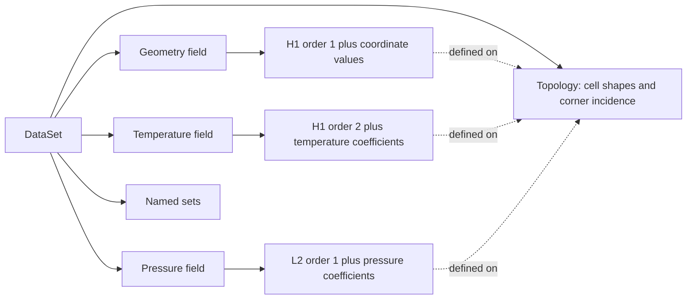

# Understand a dataset

A scientific visualization pipeline starts with a mesh and values that mean
something on that mesh: temperature at points, material per cell, flux through
faces. `tack.dataset` keeps those relationships explicit so the same field can be
interpolated, filtered and sampled without each stage inventing its
own connectivity and indexing rules.

Start with the [visualization quick start](../09-visualization.md#quick-start)
if you want to run a filter first. This chapter explains the objects it uses.
The [function-space fundamentals](00-function-spaces.md) explain H1, L2,
polynomial order and degrees of freedom before the code examples below.

## Four parts of one dataset



**Topology** describes cell shapes, their corner vertices and how cells meet.
It does not prescribe one coefficient array shared by every field. Faces,
edges and incidence tables are derived when needed and retained for later use;
spaces can use these entities to construct their own DOF layouts.

**Geometry** maps reference-cell coordinates to physical positions through
its own space and coordinate values. A structured topology alone does not
imply equally spaced or axis-aligned coordinates. A uniform grid can compute
its nodal positions from dimensions, origin and spacing; a curved mesh can
store coordinate coefficients at additional geometry nodes. Even a planar
mesh uses 3-vectors for positions.

**Fields** combine a space with values. The space determines which entities own
the values and how to evaluate them between sample locations. **Sets** name
selections such as a boundary or a material region, without creating another
mesh. A cell or face set can also be a kernel's iteration domain.

## Array storage and field meaning

| Object | Responsibility | Example |
|---|---|---|
| `tack.Array` | Storage on a backend | A buffer of temperatures or velocities |
| `td.Field` | Meaning of values on a topology | Temperature in `td.H1(data)` |

Here `td` is the conventional alias for `tack.dataset`. A raw buffer knows its
element dtype and shape; it does not know whether its entries are point
temperatures or cell averages. For example, `tack.empty((space.size,),
tack.vec3())` allocates one vector per DOF. `td.Field(td.H1(data), values)` supplies that information.

A NumPy array is useful input, but it is not itself a valid `td.Field` value
array: use `tack.array(host, dtype=...)` to copy it into backend storage.
The `DataSet` constructor also accepts a host array of positions and creates
H1 geometry for you. [Build Meshes](02-meshes.md) first constructs topology
and geometry explicitly, then explains this shorter form.

## The MFEM model: mesh, space, grid function

In MFEM, a `Mesh` supplies elements and their incidence. A finite-element
collection specifies a family, order and basis; a `FiniteElementSpace` on the
mesh determines the local-to-global DOF maps and component layout. A
`GridFunction` couples that space with coefficients. This is why an MFEM field
is more than an array of values attached to the mesh's vertices. See
[MFEM's grid-function explanation](https://mfem.org/pri-dual-vec/).

Tack follows that separation for the supported parts of its data model:

| MFEM concept | Tack counterpart | Responsibility |
|---|---|---|
| Mesh element types and vertex connectivity | `data.topology` | Corner incidence and derived entities |
| Finite-element family, order and layout on the mesh | Each field's `space` | Basis, DOF ownership and local-to-global addressing |
| Grid function | `td.Field(space, values)` | Coefficients interpreted through that space |
| Mesh nodes describing geometry | `data.geometry`, itself a `td.Field` | Reference-to-physical coordinate mapping |

This is a conceptual correspondence, not a claim that Tack implements all
MFEM finite-element families or its parallel true-DOF and constraint machinery.
The present importer supports the H1/L2 families and orders described below.

### Corners are not all of a field's nodes

A linear hexahedron's topology names eight corners. A quadratic H1 field on
that same cell needs 27 nodal coefficients: corners, edge midpoints, face
centers and a cell-interior node. Its space obtains shared edge and face
incidence from the topology and builds the field's DOF map. The topology still
has the original eight corners for that cell; the field has not refined it.

Consequently, `data.num_points` counts topological vertices. It need not equal
`field.space.size`, and it need not be the number of geometry coefficients
on a curved or discontinuous mesh. Use the field's space when allocating its
values or interpreting their layout.

## Each field has its own space

One mesh can carry all of the following at once:

| Field on two adjacent hexahedra | Space | Logical values |
|---|---|---:|
| Geometry | H1 order 1, 3-vector positions | 12 vectors |
| Temperature | H1 order 2 | 45 scalars |
| Pressure | L2 order 1 | 16 scalars |
| Material parameter | Constant | 2 scalars |

The fields share **topology**, not necessarily a space, order, coefficient
count or storage representation. Compatible fields may deliberately share
one interned space object; “each field has its own space” means that the
choice belongs to the field, rather than being fixed once for the dataset.

For step-by-step recipes and node diagrams, see
[Construct an L2 field](03-fields-and-spaces.md#construct-an-l2-field) and
[Construct a quadratic H1 field](03-fields-and-spaces.md#construct-a-quadratic-h1-field).
The program below combines them on one dataset, using `uniform_grid` as a
shortcut for the mesh setup so we can focus on independent field spaces.
Temperature represents
`x² + 2y + 3z`; pressure is `x` in cell 0 and `x + 2` in cell 1, with a jump
at their shared face. Geometry remains an implicit uniform coordinate array
in first-order H1:

```python
--8<-- "docs/examples/data_spaces.py:sample"
```

```python
--8<-- "docs/examples/data_spaces.py:l2-kernel"
```

```python
--8<-- "docs/examples/data_spaces.py:spaces"
```

`interpolate` evaluates the temperature function at the **physical positions
of that space's interpolation nodes**, through the geometry; it does not
replace `data.geometry`. The original geometry, temperature and pressure
continue to use their separate spaces.

An evaluation combines two maps. The geometry gives physical position from
reference coordinates, while the solution field uses its own basis and DOFs
at those reference coordinates. A field view supplied to `for_each` preserves
that distinction even when geometry and solution orders differ.

```python
--8<-- "docs/examples/data_spaces.py:evaluate"
```

The quadratic field's center values are `[2.5625, 3.0625]`. Replacing it by an
order-1 projection gives `[2.625, 3.125]`: the topology and geometry are unchanged,
but the field approximation changed. The complete example also checks the
physical gradients against `[0.5, 2, 3]` and `[1.5, 2, 3]`.

```bash
uv run python docs/examples/data_spaces.py --arch cpu --check
```

[Download the independent-spaces program](../../examples/data_spaces.py).

## Geometry is a field, too

The coordinate mapping has a family, order and values just as a solution does.
Straight cells can use order-1 H1 geometry with explicit corner positions or
implicit coordinates. A supported curved mesh uses H1 order-2 coordinate
coefficients; a solution on it may still use a different order.

With L2 geometry, neighbouring cells can assign separate positions to their
local corners while sharing corner ids in the topology. This can represent
gaps or detached cells without changing the incidence. Contour and slice
respect each cell's geometry; not every algorithm supports that representation.

The geometry's values can be a `UniformCoordinates`, a `CartesianProduct`,
or explicit position storage. Those are **value-array representations**, not
different finite-element spaces. Image and rectilinear geometry are explained
in [Build Meshes](02-meshes.md#image-rectilinear-and-curvilinear-data).

## Importing MFEM preserves the separation

`mfem_to_dataset(mesh, fields={...})` constructs topology from the elements'
corner lists, then converts geometry and each supplied grid function through
their own spaces. It does not flatten every solution onto the mesh vertices.

| MFEM input | Current Tack mapping |
|---|---|
| Straight geometry | H1 order-1 coordinate field |
| Supported order-2 curved mesh nodes | H1 order-2 coordinate field |
| H1 order-1 grid function | H1 order 1 |
| H1 order-2 grid function | H1 order 2, evaluated at supported quadratic nodes |
| L2 order-0 grid function | Constant |
| L2 order-1 grid function | L2 order 1, evaluated at each cell's corners |
| Element attributes | An integer Constant field named `attribute` |

Basis conversion matters: MFEM's L2 interpolation nodes need not be its cell
corners. The importer evaluates the MFEM field to obtain Tack's corner-based
coefficients rather than treating the source coefficient vector as corner
data. The supported order-1 spaces agree on tetrahedra, hexahedra and wedges;
on pyramids the corner representation interpolates MFEM's different basis.
Unsupported collections or orders are refused. Current order-2 pyramid bases
and geometry above order 2 are not imported.

The [pipeline chapter](06-pipelines.md#exchange-whole-datasets-with-vtk) and
[reference](../../reference/dataset-api.md#interoperability) describe the entry points.

## A simpler first-order field

The smaller `data_fields.py` example uses the same two adjacent half-width
cubes, but temperature is now the affine function `x + 2y + 3z` in order-1
H1. The two cells carry material values 1 and 3. This is the example used
for the projection and discontinuity figures later in the guide.

The following kernel evaluates temperature directly from the grid's implicit
coordinates. No host coordinate array is needed for this step:

```python
--8<-- "docs/examples/data_fields.py:sample"
```

Allocate the values and attach them to their spaces:

```python
--8<-- "docs/examples/data_fields.py:build"
```

`H1` shares one value at a point among its incident cells. `Constant` gives
each cell its own value, constant throughout that cell. They refer to the
topology of `data`, so a field from another dataset's topology is rejected even
when it has the same number of values. The field length must also match the
space's size; matching a shape alone does not establish the association.

The example assumes the imports `numpy as np`, `tack`, and `tack.dataset as td`,
with `tack.set_default_device("cpu")` before construction. The complete source below
includes them and runs independently.

## Inspect without losing track of transfers

| Expression | What you get |
|---|---|
| `data.num_points`, `data.num_cells` | Counts for the mesh |
| `data.fields["temperature"]` | The associated `td.Field` |
| `data.fields["temperature"].space` | Its space, including the topology |
| `data.fields["temperature"].values` | The stored or implicit value array |
| `data.positions()` | A host array of corner positions for H1 geometry |
| `tack.arrays.to_host(field.values)` | A host snapshot; vectors have one row per value |
| `tack.arrays.materialize(field.values)` | Device storage; computes implicit values if necessary |

`positions()` returns the topological corners, including when H1 geometry has
higher-order nodes; it refuses L2 geometry. Use
`tack.arrays.to_host(data.geometry.values)` to inspect all of geometry's
coefficients in their space's ordering.

Use host snapshots for diagnostics, independent checks and file output. Keep
values in fields between filters and kernels. On GPU backends a host read waits
for the queued work it needs, so repeated inspection in a timestep loop can
dominate its cost.

## What a pipeline changes

Algorithms return new datasets, fields or summaries; they do not edit the input
dataset in place. A returned dataset may share topology or value storage with
its input when no copy is needed. Treat it as a new pipeline result, not as a
deep copy of every buffer. Editing an existing values buffer can therefore be
visible through more than one dataset that refers to it.

For a time-dependent simulation, retain the mesh and update its working fields.
Run the analysis stages again for the new values; an old contour is a previous
result, not a live view that recomputes itself. Rebuild spatial locators after
moving geometry.
The [pipeline chapter](06-pipelines.md) makes these boundaries explicit.

## Run and check

```bash
uv run python docs/examples/data_fields.py --arch cpu --check
```

The check compares point values with the analytic formula, cell temperatures
with `[2.75, 3.25]`, and gradients with `[1, 2, 3]`. It also checks projection
and face jumps, developed in [Fields and Spaces](03-fields-and-spaces.md).

[Download the complete example](../../examples/data_fields.py).
Continue with [Building Meshes](02-meshes.md), or move directly to
[Fields and Spaces](03-fields-and-spaces.md) if your mesh already comes from a reader.
