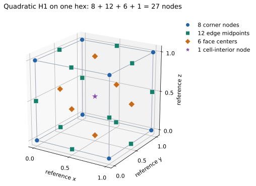
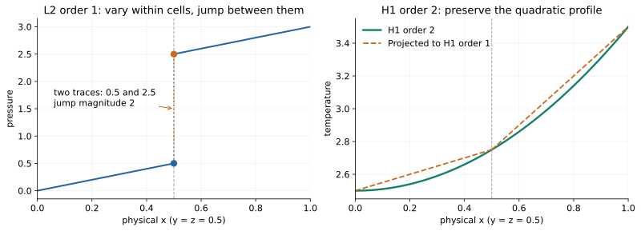
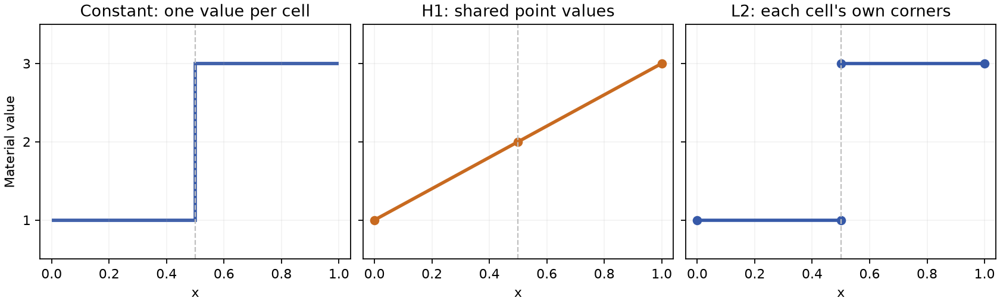

# Fields, spaces and implicit arrays

A field's space determines which values can disagree and how to evaluate them
inside a cell. Moving between spaces changes that interpretation. It can
introduce averaging even when the geometry and topology remain the same.
Start with [Function Spaces and Degrees of Freedom](00-function-spaces.md)
for the meaning of H1, H2, L2 and polynomial order. This chapter applies those
ideas to Tack's field and array representations.

For construction recipes, jump to [L2 fields](#construct-an-l2-field) or
[quadratic H1 fields](#construct-a-quadratic-h1-field). Both use the same
mesh and have runnable examples below.

## Choose where values live

| Space | Ownership | Use it for |
|---|---|---|
| `td.H1(data, order=1)` | One shared value per corner vertex | A continuous first-order nodal temperature or velocity |
| `td.H1(data, order=2)` | Shared corner, edge and supported face/interior nodes | A higher-order H1 approximation; not an H2 space |
| `td.Constant(data)` | One value per cell | Cell averages, material parameters |
| `td.L2(data)` | Each cell's own corner values | Discontinuous solution fields |
| `td.Values(data, "faces")` | One value per face, without an interpolation basis | Face areas, labels or fluxes |
| `td.Values(data, "points" / "cells" / "edges")` | One value per named entity kind | Entity attributes that need no basis |
| `td.SideTraces(data)` | Values per face, per side, per face corner | Two-sided evaluation, by projecting into it |

For `L2(order=0)` the value is constant per cell; `L2(order=1)` uses each
cell's own corners. `H1(order=2)` adds higher-order degrees of freedom on
supported shapes. `Values` describes association without promising any
interpolation between entities.

`tack.empty((field.space.size,), tack.vec3())` allocates one
3-vector per DOF; `td.Field(field.space, values)` gives those values their
mesh meaning. The array has shape `(field.space.size,)` and downloads as
`(field.space.size, 3)`.

The field's coefficient count is `field.space.size`. It agrees with
`data.num_points` for H1 order 1, but not generally for other spaces. A
vector field has one vector per space DOF, so the scalar component storage
has that count times the vector width.

`Constant` means a separate constant function in each cell. `ConstantArray`
means an array with one repeated value, regardless of space. These two
independent choices can be combined: an H1 field with a `ConstantArray` is
a spatially constant H1 function, while a `Constant` field backed by an
ordinary array can assign different values to every cell.

Spaces belong to a topology and are interned there: repeated `td.H1(data)`
uses the same layout. A field with a matching length on another topology is
still a different association. Wrap values with the correct space when they
are created; do not repair an association by guessing from array length later.

## Construct an L2 field

The [complete independent-spaces example](../../examples/data_spaces.py) builds
L2 pressure and quadratic H1 temperature on the same two hexes. This section
constructs pressure directly; [the next section](#construct-a-quadratic-h1-field)
constructs temperature. The snippets assume NumPy, Tack and `tack.dataset`
imported as `np`, `tack` and `td`, with a default device set.

Use `uniform_grid` as a shortcut for the mesh setup here; [Build Meshes](02-meshes.md)
shows its explicit topology and geometry construction:

```python
--8<-- "docs/examples/data_spaces.py:mesh"
```

Each hex has eight corners. `td.L2(data, order=1)` assigns a separate value
to each of them: 16 coefficients, even though the topology has only 12 vertices.
The four corners on the shared face each have **two** pressure coefficients.
They occupy the same physical positions and may have different values. See
[the node-sharing diagram](00-function-spaces.md#count-dofs-separately-from-corners).

### Initialize each cell's coefficients

Construct pressure as `p = x` in cell 0 and `p = x + 2` in cell 1.
It varies inside both cells and has a jump of 2 at x = 0.5. An L2 field need
not be constant inside a cell.

The space supplies `offsets`: coefficient `j` of cell `c` is stored at
`offsets[c] + j`. For these two hexes, the offsets are `[0, 8, 16]`:

| Cell | Storage slots | Meaning |
|---|---|---|
| 0 | 0 through 7 | Its own corner values, in the cell's local corner order |
| 1 | 8 through 15 | Its own corner values, including its side of the shared face |

The initialization kernel walks each cell's corners and writes its block.
Every coefficient has one writer. Using offsets also works when cells have
different corner counts; multiplying the cell id by eight would not.

```python
--8<-- "docs/examples/data_spaces.py:l2-kernel"
```

Allocate the values and attach their space:

```python
--8<-- "docs/examples/data_spaces.py:l2-build"
```

`td.for_each` supplies the geometry-aware cell view, so `corner_position`
returns physical coordinates. The resulting `Field` contains the original
cell-local coefficients; no shared-point averaging is involved.

### Copy coefficients from an existing solver array

If you already have nodal DG coefficients in this order, upload them directly.
For this particular pair of hexes, this constructs the same pressure field:

```python
--8<-- "docs/examples/data_spaces.py:l2-upload"
```

The two eight-value rows describe the cells' local nodes, not eight globally
unique points each. Flattening these rows preserves both interface values.
For a mixed-cell mesh, use `pressure_space.offsets` and the appropriate local
corner order to assemble the blocks; a rectangular `(num_cells, 8)` array is
specific to the all-hex example. Coefficients in another basis need conversion
before this upload, as in [MFEM import](01-datasets.md#importing-mfem-preserves-the-separation).

### A constant inside each cell: L2 order 0

Choose order 0 for one independent coefficient per cell:

```python
--8<-- "docs/examples/data_spaces.py:l2-constant"
```

Here `cell_space.size` is two. Values 1 and 3 are constant inside their own
cells and differ across the interface. `td.Constant(data)` is another
representation of that piecewise-constant function meaning; it also supports
topologies without reference elements.

### Evaluate and check the discontinuity

```python
--8<-- "docs/examples/data_spaces.py:l2-check"
```

For the varying order-1 pressure, the cell centers hold `[0.25, 2.75]` and
both physical gradients are `[1, 0, 0]`. The one interior face has jump
magnitude 2; `jump`'s sign follows its side ordering. The runnable check
compares the uploaded coefficients with the kernel-initialized ones as well.
These are cell-interior gradients; the interface discontinuity is represented
separately by the jump.

## Construct a quadratic H1 field

On the same mesh, construct `T = x² + 2y + 3z` using `td.H1(data, order=2)`.
The geometry stays first-order H1 and still has 12 corner positions.
Temperature has 45 global nodal coefficients, including nodes away from corners.



A single quadratic hex uses three nodes per reference coordinate direction:
the tensor-product layout has `3 × 3 × 3 = 27` nodes. Two adjacent hexes share
nine on their common face: its four corners, four edge midpoints and face center. Thus
`27 + 27 - 9 = 45` global DOFs. Count the two-cell mesh by entity as follows:

| Location | Global temperature DOFs |
|---|---:|
| Topological corner vertices | 12 |
| Edge midpoints | 20 |
| Face centers | 11 |
| Cell interiors | 2 |
| **Total** | **45** |

These are field nodes on the original two cells. They do not subdivide the
mesh, change corner connectivity, or make its geometry quadratic.

### Sample at the field's nodes

First define the function to sample:

```python
--8<-- "docs/examples/data_spaces.py:sample"
```

Project **geometry** into the temperature space to obtain physical positions
at all of its interpolation nodes. Then allocate by `temperature_space.size`
and evaluate the function once per global DOF:

```python
--8<-- "docs/examples/data_spaces.py:h1-build"
```

The space builds local-to-global addressing for shared corners, edges and
faces. Its node numbering is not simply 27 consecutive entries per cell.
The node-wise kernel initializes a shared DOF once, rather than writing it
from both adjacent cells.

Projecting geometry locates the interpolation nodes; it does not change
`data.geometry`. It also differs from projecting a first-order **solution**
into a quadratic space: that conversion retains the original first-order
function. To represent this quadratic, initialize its values at the new
nodes as above, or supply the original quadratic coefficients in Tack's
nodal basis and ordering.

### Evaluate through the quadratic basis

```python
--8<-- "docs/examples/data_spaces.py:evaluate"
```

At the two cell centers, quadratic evaluation gives `[2.5625, 3.0625]` and
physical gradients `[0.5, 2, 3]` and `[1.5, 2, 3]`. Projecting this temperature
down to H1 order 1 gives center values `[2.625, 3.125]`. The latter keeps the
corner values but changes the function between them.



Both profiles are evaluated through the fields' actual bases along
`y = z = 0.5`, including the two separate L2 traces at x = 0.5. The dotted
vertical pressure segment marks the jump, not an interpolated connection.
The geometry and topology are identical for every curve. Quadratic H1
enforces shared values; it does not generally enforce matching derivatives
or [H² conformity](00-function-spaces.md#h2-is-different-from-second-order-h1).

Run the complete program and reproduce all three diagrams:

```bash
uv run python docs/examples/data_spaces.py --check
uv run --with matplotlib python docs/examples/data_spaces.py --check --figures /tmp/tack-space-figures
```

The optional plotting step writes standalone SVG and PNG files. The numerical
checks run without Matplotlib.

## A material interface exposes the difference

The [two-cell example](01-datasets.md) has material 1 on the left and 3 on the
right. Converting it to shared point data gives value 2 on the common face.
Converting it to `L2` preserves both sides of the discontinuity:



The figure is generated from the example's values along the bottom front edge;
the dashed line is the shared face at x = 0.5. The middle ramp is an effect of
projection and interpolation, not an interface resolved by the original data.
H1 and L2 both use order 1 in this figure.

```python
--8<-- "docs/examples/data_fields.py:spaces"
```

The returned objects are fields. Assign one to `data.fields[name]` if later
filters should carry it. Computing `point_material` alone does not add it to
the dataset's named fields.

## Projection is an algorithmic choice

`project(data, field, target_space)` is the one operation: `td.H1(data)`,
`td.Constant(data)` and `td.L2(data)` are the common target spaces.

| Conversion | Meaning | What to check |
|---|---|---|
| H1 → Constant | Mean of each cell's corner values | Not a general volume integral |
| Constant → H1 | Mean of incident cell values at each point | Material discontinuities become shared values |
| H1 → L2 of sufficient order | Evaluate the continuous field at each cell's local nodes | Values remain equal on shared interfaces |
| L2 → H1 | Evaluate from adjacent cells, then average | Jumps can be smoothed |
| Constant → L2(order=1) | Repeat a cell's value at its own corners | Discontinuities remain |

For the affine temperature `x + 2y + 3z` on the two regular cells, corner
means are `[2.75, 3.25]`, the exact center values. That convenient property
does not establish conservation for general fields or distorted cells.

Polyhedral, polygonal and polyline topologies support point/cell projection.
`L2`, higher-order projection and traces require the shape-based path. In
particular, being able to attach point values to a polyhedron does not imply
that it supplies shape-function evaluation for every algorithm.

## Read both sides of a face

```python
--8<-- "docs/examples/data_fields.py:traces"
```

Projecting into `SideTraces` evaluates each cell at its faces' corners, keeping the two sides
separate and aligned in the face's ordering. `jump` evaluates a difference
at each face center: side 1 minus side 0, or zero at a boundary.

The material has one nonzero jump of magnitude 2. The affine H1 temperature
has zero jump. The sign of a material jump depends on the face's side ordering;
its magnitude does not. A face normal points out of side 0. These conventions
matter when assembling a flux and are developed in [Mesh Kernels](05-mesh-kernels.md).

For a normal-oriented face quantity, use `Values(data, "faces", oriented=True)`.
A filter that reverses a carried face then negates the value. Area and labels
are ordinary, unoriented face values and should not change sign.

## Values can be computed instead of stored

Uniform-grid coordinates need only dimensions, origin and spacing; allocating
three scalars for every point would be redundant. An implicit value array
provides a `get(k)` expression that Tack inlines into the consuming kernel.

### Geometry's space and its implicit array are different layers

Both an image and a rectilinear grid have an order-1 H1 geometry field. Its
space says how a cell's nodal positions define a coordinate mapping; its
implicit value array says how to obtain each nodal position. The two layers
can change independently:

| Geometry values | Information retained | How one nodal position is obtained |
|---|---|---|
| `UniformCoordinates` | Dimensions, origin, spacing and direction | Evaluate the uniform-grid coordinate formula |
| `CartesianProduct` | Three backend axis arrays | Gather one coordinate from each axis |
| Explicit `tack.Array` with dtype `tack.vec3(...)` | One stored 3-vector per geometry DOF | Read the vector |

Calling `materialize` on image coordinates changes their storage into an
explicit value array; it does not change H1 order, add cells, or turn
`StructuredTopology` into `UnstructuredTopology`. Calling `to_host` creates
a host snapshot without replacing the geometry's value representation.
See the [geometry formulas and topology combinations](02-meshes.md#image-rectilinear-and-curvilinear-data).

Do not infer a function space from an array class. A `CartesianProduct`
describes a way to compute 3-vectors; `H1` describes how coefficients are
associated and interpolated on a topology. `td.Field` couples these two
choices, with a check that the value count matches the space.

### Other implicit coefficient arrays

```python
--8<-- "docs/examples/data_fields.py:implicit"
```

Here `ConstantArray` stores the constant and count, not 12 separate values.
`materialize` computes storage on the default device. `to_host` evaluates and
downloads a snapshot. Neither changes the original field's representation.

| Implicit array | Useful when |
|---|---|
| `UniformCoordinates`, `CartesianProduct` | Coordinates follow a uniform or rectilinear grid |
| `ConstantArray`, `CountingArray` | Values are constant or a sequence |
| `Permutation`, `View`, `Strided` | Values are selected or reorganized without a new value buffer |
| `ExtractComponent`, `Components` | Scalar components and vector values need to be connected |
| `Transform`, `Function`, `Cast` | A device function or conversion can compute values on demand |

Operands can themselves be implicit arrays. This keeps intermediates out of
storage, but the expression still does work whenever it is read. Materialize
an expensive expression if reuse makes that worthwhile, then measure the whole
pipeline. An implicit wrapper around a mutable buffer observes its current
values; a materialized result is a previous computation until recomputed.

## Know the present higher-order limits

Order-2 H1 is supported on tetrahedra, hexahedra, voxels and wedges. L2 can
vary its order by cell, which the dispatcher handles by launching groups of
compatible order. This does not make every filter a higher-order geometric
algorithm: point-data propagation through extraction can use corner values,
and higher-order subdivision remains open work. The
[reference](../../reference/dataset-api.md#spaces) records the supported layouts
and [filter propagation rules](../../reference/dataset-api.md#algorithms-and-filters).

## Run and reproduce the figure

```bash
uv run python docs/examples/data_fields.py --check
uv run --with matplotlib python docs/examples/data_fields.py --check --output spaces.png
```

[Download the complete program](../../examples/data_fields.py).
Continue with [Filtering and Analysis](04-filters.md).
