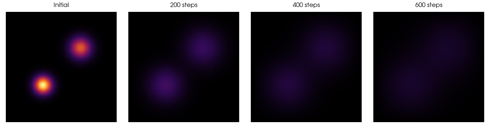
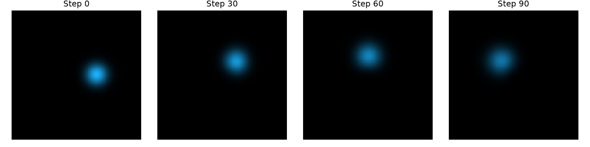
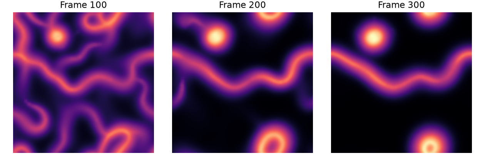
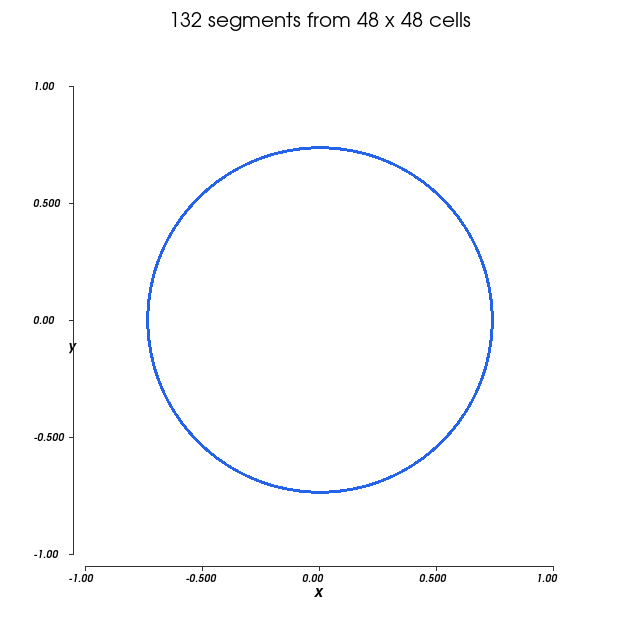
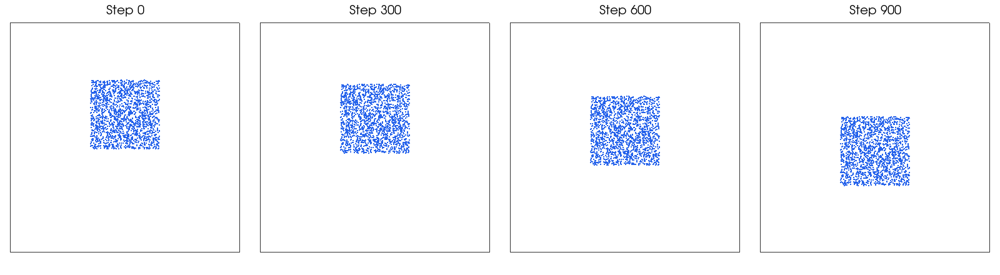
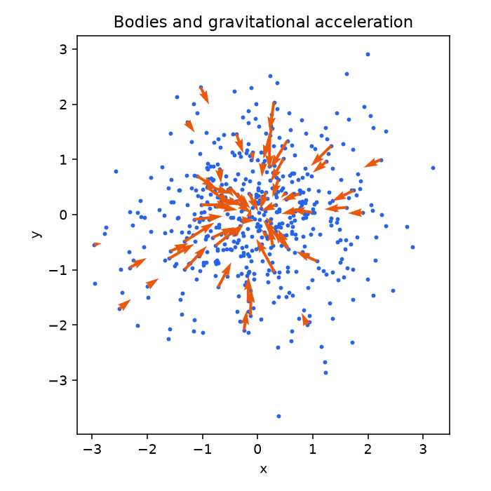

# Worked examples

These examples develop a complete application from its data layout to the host
loop and a check of the result. Start with the data examples below for scientific
analysis, or heat diffusion for a first simulation. Every script is included with
its explanation and available
as a download; it needs no separate examples repository.

The scripts target the current Tack checkout. They use NumPy and the selected
backend. The simulation tutorials use VTK for optional figures;
the new data comparisons use Matplotlib. Install from source as in
[Getting Started](../01-getting-started.md), then run from the repository root:

```bash
uv run python docs/examples/heat.py --arch cpu --check
uv run --with vtk python docs/examples/heat.py --output heat.png
```

In a checkout, `uv sync --extra cpu --extra interop` (with your other extras)
installs VTK from the lock instead, and `uv run python ... --output` then needs
no `--with vtk`.

With an installed Tack environment, download a script and use `python heat.py`.
Install VTK separately if you want its figure. `--check` uses smaller
inputs and checks a numerical reference or independent properties; it is not
a performance benchmark. `--arch` requires the named backend to initialize.

If you use a local VTK build, make its Python site-packages directory available
through `PYTHONPATH` and use `uv run python ...` without `--with vtk`. The build
must match your Python version. These figures use ordinary VTK image, geometry,
rendering and PNG-writing modules; they do not require DLPack support. Offscreen
geometry and image-panel rendering needs a working VTK rendering backend.

| Example | What you will learn | Prerequisites |
|---|---|---|
| [Heat diffusion](heat.md) | Stencils, boundaries, two buffers, host timesteps | Fields and kernels |
| [Advecting dye](dye.md) | Vector fields, interpolation, device functions | Vectors and loops |
| [Trail-following agents](physarum.md) | Random state, templates, scatter and diffusion | Vectors and atomics |
| [Marching squares](contours.md) | Count, scan, allocation and ordered output | Local arrays and scans |
| [Particle-to-grid simulation](mpm.md) | Matrix fields, interpolation and atomic scatter | Vectors, matrices and atomics |
| [Tiled N-body forces](nbody.md) | Shared memory and barriers, with a CPU path | Sequential loops and workgroups |

## Datasets and visualization examples

These programs develop the dataset API with analytic answers, independently of
a simulation solver. They run with NumPy and a Tack backend; figures are optional.

| Example | Numerical check | Chapter |
|---|---|---|
| [data_spaces.py](../../examples/data_spaces.py) | Construct L2 and quadratic H1 fields; node diagrams, a DG jump and basis profiles | [Field construction](../data/03-fields-and-spaces.md#construct-an-l2-field) |
| [data_meshes.py](../../examples/data_meshes.py) | Grid counts, cube volume, polygon area and chain length | [Build Meshes](../data/02-meshes.md) |
| [data_fields.py](../../examples/data_fields.py) | Point/cell projection, a material jump and exact affine gradients | [Fields and Spaces](../data/03-fields-and-spaces.md) |
| [data_analysis.py](../../examples/data_analysis.py) | Threshold/clip volumes, contour area, sampled values and analytic rotation | [Filter and Analyze](../data/04-filters.md) |
| [data_mesh_kernels.py](../../examples/data_mesh_kernels.py) | A selected-cell output and an oriented face flux balance | [Write Mesh Algorithms](../data/05-mesh-kernels.md) |

[](../data/03-fields-and-spaces.md)

[](../data/04-filters.md)

```bash
uv run python docs/examples/data_analysis.py --arch cpu --check
uv run --with matplotlib python docs/examples/data_analysis.py --output filters.png
```

The [pipeline chapter](../data/06-pipelines.md) connects these operations to
probing, streamline integration and external tools.

## Images from the examples

[](heat.md)

[](dye.md)

[](physarum.md)

[](contours.md)

[](mpm.md)

[](nbody.md)

These figures were generated by running the scripts on CPU. GPU results may
differ in low floating-point bits, random-direction transcendental rounding, or
long simulation trajectories. See [Numerical checks](../15-debugging-and-timing.md#choose-a-tolerance-for-the-computation).

VTK displays the downloaded image and geometry snapshots.
For an example sharing storage between Tack and VTK, see the
[complete CPU exchange](../16-interoperability.md#a-complete-cpu-exchange).

## Origins and licenses

The heat example adapts an existing Tack example. Dye, Physarum,
marching squares and MPM adapt public Taichi examples; N-body adapts NVIDIA Warp's
tile example. Each page links to the original source and explains the teaching
changes. The adapted Taichi and Warp scripts retain Apache-2.0; other scripts
use Tack's BSD-3-Clause license. See the [notices](../../examples/NOTICE.txt) and
[Apache license text](../../examples/LICENSE-APACHE-2.0.txt).
