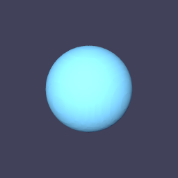

# From a scalar field to an image

Generate a scalar field on a uniform grid, extract its zero level set, and pass
the retained geometry fields to the renderer. A sphere makes the calculation
easy to check independently before trying more complicated implicit shapes.



**Origin:** adapted from [Tack's isosurface/path-tracing example](https://github.com/berkgeveci/tack/blob/main/examples/32_pathtrace.py),
Copyright © 2026 Kitware, Inc., BSD-3-Clause. This version replaces the gyroid with
an analytic sphere and adds geometric and rendered-depth checks.

## Sample an analytic field

The level set `x² + y² + z² - 0.7² = 0` is a sphere of radius 0.7. The kernel
evaluates it at every point of a grid:

```python
--8<-- "docs/examples/isosurface.py:scalar"
```

`xyz` is the grid's geometry: a `UniformCoordinates` array, which stores
nothing per point and computes point `p`'s position in `get(p)`. A kernel
takes it like a field, and the call inlines to the arithmetic of origin
plus index times spacing.

## Extract the level set

```python
--8<-- "docs/examples/isosurface.py:extract"
```

`uniform_grid` takes point dimensions, origin and spacing, and the field of
sphere values goes into the dataset as point data (`H1`). `contour` returns a
new dataset of triangles, with `s` interpolated onto its points. If the
isovalue misses the field, the surface is empty rather than `None`, so check
`num_cells`.

The contour runs on the device. It reads only counts on the host (how many
triangles and points to allocate); the triangles and points stay in device
fields.

## Build a scene and render

```python
--8<-- "docs/examples/isosurface.py:render"
```

`Actor` expects interleaved `f32` positions and `i32` triangle indices. The
surface's positions are a field of 3-vectors, whose storage is already
interleaved: `reshape` makes a flat view of the same memory, so nothing is
copied between extraction and rendering. A topology this small keeps its ids
in `i32`; a very large one would need `connectivity.astype(tack.i32)`. A scene
combines geometry and lighting; the camera defines rays; the canvas holds the
image and depth. `smooth=True` computes vertex normals for a smoother appearance.

More samples reduce path-tracing noise. Grid resolution controls geometric
approximation; image resolution controls pixel detail. These are independent
choices. Reading `canvas.to_numpy()` downloads the final image on a device-memory
backend and returns an `(height, width, 4)` `uint8` RGBA array.

## Run and check

```bash
uv run python docs/examples/isosurface.py --check
uv run --with vtk python docs/examples/isosurface.py --output sphere.png
```

The small check verifies that the output is triangles with valid indices, and
a sphere residual bounded by the grid's interpolation error. It also requires a substantial
number of visible depth hits. That catches a blank scene even when rendering
returns without an exception.

Try replacing the sphere expression with the gyroid
`sin(x)*cos(y) + sin(y)*cos(z) + sin(z)*cos(x)` on a larger domain. Keep the
check for an empty surface for isovalues outside the scalar range. See
[Datasets and visualization](../09-visualization.md) for the rest of
`tack.dataset`, and
[Rendering](../10-rendering.md) for materials, volumes and scalar colouring.

## Complete program

[Download isosurface.py](../../examples/isosurface.py).

```python
--8<-- "docs/examples/isosurface.py"
```
