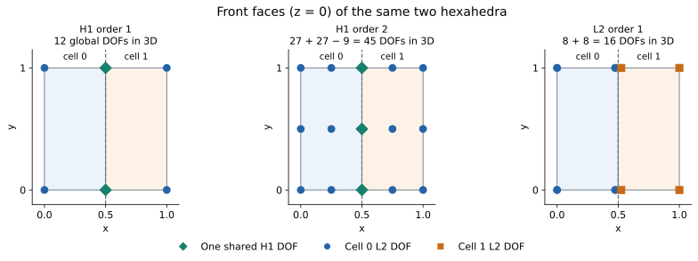

# Function spaces and degrees of freedom

Before choosing an array layout, decide what kind of function the data should
represent. A continuous temperature, a pressure that may jump between cells,
and a material label can live on the same mesh without using the same sample
locations, number of values or interpolation rule. A **space** makes that
choice explicit for each field.

This chapter introduces the finite-element vocabulary used by Tack. You do
not need to assemble a finite-element system to use it: the same choices
determine what a contour, probe or gradient can mean.

## An array becomes a function through a basis

On a cell, a finite-element field is evaluated from coefficients and basis
functions. Schematically, in reference coordinates `xi`:

```text
u_h(xi) = sum_a U_a * phi_a(xi)
```

`U_a` are the stored coefficients, also called degrees of freedom (DOFs).
`phi_a` are the basis functions. The space supplies the basis and the map
from a cell's local coefficient numbers to the field's coefficient array.
The geometry maps `xi` to a physical position.

In Tack's nodal H1 and L2 representations, these coefficients are values at
the space's interpolation nodes. An interpolation node need not be a mesh
corner. Other finite-element families can use integral or flux DOFs instead;
the term DOF does not universally mean a point sample. MFEM explains this
distinction in its [discussion of grid functions and coefficients](https://mfem.org/pri-dual-vec/).

Separate three questions:

| Question | What answers it |
|---|---|
| Which cells meet, and which corner ids belong to each cell? | Topology |
| Where is a point of a reference cell in physical space? | Geometry field |
| Which coefficients determine a particular field in that cell? | That field's space and values |

## What L2, H1 and H2 mean

The names come from mathematical function spaces. They describe regularity,
not the degree of a polynomial:

| Mathematical space | Requirement | Consequence for common finite elements |
|---|---|---|
| L² | The function is square-integrable | Cellwise functions may have jumps |
| H¹ | The function and its first weak derivatives are square-integrable | Standard conforming nodal elements match field traces across shared interfaces; gradients may jump |
| H² | The function and weak derivatives through order two are square-integrable | A conforming piecewise-smooth construction must also control first-derivative matching |

A weak derivative extends differentiation beyond functions with a classical
derivative everywhere. A continuous piecewise-linear function can have a
different slope on each cell and still belong to H¹. A jump in the function
itself generally prevents that H¹ conformity. MFEM's
[weak-form introduction](https://mfem.org/fem_weak_form/) explains why this
distinction matters for finite-element derivatives.

Mathematically, H² is contained in H¹, which is contained in L². Thus “an L2
field” in finite-element software means the representation **permits** jumps;
it does not mean that every represented function must be discontinuous.
Likewise, the general mathematical definition of H¹ is not simply “a
classically continuous function everywhere”; matching nodal values is the
construction used by the finite elements discussed here.

### H2 is different from second-order H1

`td.H1(data, order=2)` is a quadratic **H1** space. It has more coefficients
per cell than order 1, but only H1 continuity is enforced between cells.
Its first derivatives can still jump there. It is not an H2-conforming space.
Tack currently has no `td.H2` family.

Use `order=2` when you mean a higher-degree approximation. Use the name H²
when you mean the stronger mathematical regularity. Differentiating a
polynomial twice inside one cell does not, by itself, establish H² conformity
across the mesh.

## Family, polynomial order and value width are separate choices

| Choice | Examples | What it controls |
|---|---|---|
| Family | H1, L2 | Sharing of DOFs and continuity between cells |
| Order | 0, 1, 2 | Richness of the local polynomial basis |
| Value width | Scalar, 3-vector | Number of components at each DOF |
| Storage | `tack.Array`, implicit array | How the coefficient values are supplied |

An H1 velocity with three components and an H1 scalar temperature can use
the same scalar nodal layout, with three coefficients per node for velocity.
A vector of H1 components does not automatically become an H(div) or H(curl)
finite-element field; those families have different continuity and mapping
rules. MFEM supports those families, but Tack's present dataset spaces do not
provide their finite-element bases.

### H1: share nodal values between adjacent cells

`td.H1(data)` defaults to order 1: one coefficient at each topological vertex.
Adjacent cells read the same coefficient on a shared vertex. Their compatible
shape functions give a matching field trace across the common interface.

On triangles and tetrahedra the order-1 basis is linear. On quadrilaterals
and hexahedra it is bilinear or trilinear: linear in each reference coordinate.
Consequently, “order 1” does not mean an affine function on every cell shape.

Order 2 adds nodes on edges and, where required by the shape, faces and cell
interiors. A shared edge's extra DOF is shared too. Adding those field DOFs
does not add corner ids to the topology or subdivide its cells.

### L2: keep each cell's coefficients separate

`td.L2(data, order=1)` gives every cell its own values at its corners.
Two neighbouring cells can therefore assign different values to the same
physical interface location. This is the representation used for linear
discontinuous Galerkin data in Tack.

With `order=0`, one coefficient supplies a constant value inside each cell.
L2 order 0 can still jump from one cell to the next. Tack currently supports
L2 orders 0 and 1, including an order chosen per cell on supported topologies.

### Constant: one independent constant per cell

`td.Constant(data)` is Tack's direct representation of piecewise-constant
cell data, with the same local function meaning as L2 order 0. It is useful
for cell averages and material parameters and works on topologies that do
not have reference elements.

This is different from `tack.arrays.ConstantArray(value, size)`, which is a storage
representation returning the **same value at every index**. A field in
`Constant(data)` can have different values in every cell. Conversely, a
`ConstantArray` can supply all coefficients of an H1 field or an L2 field
without changing either field's space.

`tack.constant` is a third concept: a numerical constant declared for compiled
kernel code. It does not define a dataset field or a function space.

### Values: association without a finite-element basis

`td.Values(data, "faces")` describes one attribute per face, such as its area,
id or an already-integrated flux. It supplies no interpolation basis in the
cell interior. The analogous point, cell and edge associations work the same
way. A `Values` field on cells and a `Constant` field can have the same length
while supporting different operations: only the latter declares a function
that is constant inside each cell.

## Count DOFs separately from corners

Consider two line cells with three corner vertices, at x = 0, 0.5 and 1.
The topology's cells reference corner pairs `(0, 1)` and `(1, 2)`.

| Space | Scalar DOFs | Sharing |
|---|---:|---|
| H1 order 1 | 3 | The middle vertex is shared |
| H1 order 2 | 5 | Add one midpoint per cell; keep the shared vertex |
| L2 order 1 | 4 | Each cell has its own two endpoint values |
| L2 order 0 / Constant | 2 | One value per cell |

The H1 order-2 row illustrates the counting principle; Tack's current
order-2 implementation supports the 3D shapes listed below, not line cells.

For the supported example of **two hexahedra sharing one face**, the topology
has 12 corners. An order-2 hex has 27 nodes; the shared face contributes nine
shared nodes, giving `27 + 27 - 9 = 45` global H1 order-2 DOFs. L2 order 1
instead has `8 + 8 = 16` independent coefficients. Constant has two.
Geometry can stay in H1 order 1 throughout.



This is a front-face view (`z = 0`) of the **3D hex mesh**, not a 2D
quadratic-element example. The counts include nodes on the other z layers.
Green diamonds are single H1 DOFs shared by both cells. The L2 markers at
the interface are drawn slightly apart for visibility; their physical
positions coincide and the geometry remains connected.

Follow [Construct an L2 field](03-fields-and-spaces.md#construct-an-l2-field)
and [Construct a quadratic H1 field](03-fields-and-spaces.md#construct-a-quadratic-h1-field)
for allocation, initialization, node ordering and checked evaluations.

The [independent-spaces program](01-datasets.md#each-field-has-its-own-space)
checks these counts and evaluates a genuinely quadratic temperature through
its own basis. `data.num_points` remains 12; use `field.space.size` to allocate
that field's coefficient array.

## What Tack currently implements

| Representation | Current scope |
|---|---|
| H1 order 1 | Point values; basis evaluation on shape-based cells |
| H1 order 2 | Tetrahedra, hexahedra, voxels, wedges, triangles, quads and pixels |
| H1 and L2 of any order | Segments, quads, pixels, hexahedra and voxels; Gauss–Lobatto, equispaced or (L2) Gauss–Legendre nodes |
| L2 orders 0 and 1 | Shape-based cells; order may vary by cell |
| Constant | Cell data on the supported topology families |
| Values | Entity-associated data, without a basis |
| SideTraces | Two-sided face evaluations on supported 3D shape-based cells |
| H2, H(curl), H(div) bases | Not currently provided |

Point/cell association can exist on polyhedra without a reference-element
basis. Always check the particular algorithm's support. Tack uses a subset
of [MFEM's finite-element concepts](https://mfem.org/tutorial/examples/), not
its full collection of spaces, discretization orders or solver machinery.

Continue with [Understand a Dataset](01-datasets.md) for how these pieces fit
together, or [Fields and Spaces](03-fields-and-spaces.md) for projection and traces.
