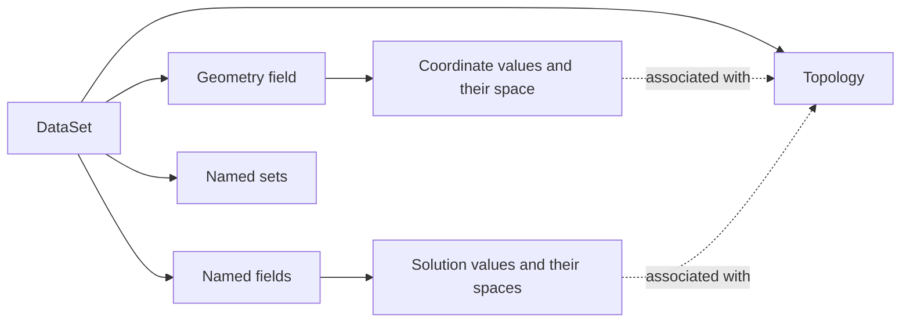

# Understand a dataset

A dataset connects numbers to places. A temperature array alone does not say
whether its entries belong to points, cells or faces, or how to evaluate a
temperature between them. Tack keeps that meaning with the values so filters
can use it consistently.

The [Data Model Overview](data-model-overview.md) maps mesh families and
numerical methods. This chapter follows one ordinary mesh in detail.

Start with the [quick start](introduction.md#quick-start) to run a contour.
This chapter explains its objects. The next chapters develop topology and
geometry, fields, then coordinates, units and time.

## Four parts of one dataset

| Part | Question it answers | Example |
|---|---|---|
| Topology | Which entities exist and how do they connect? | Two cells share four vertices and one face |
| Geometry | Where are those entities? | Coordinates of the twelve vertices |
| Fields | What do values mean on those entities? | Temperature at points; material per cell |
| Sets | Which entities form a named selection? | The boundary faces |



Geometry is a field too: its values are coordinates and its space says how
to obtain positions inside cells. For the first example, one coordinate
vector at each corner is enough. You can understand the model before learning
the mathematics of higher-order coordinate mappings.

## A simpler first-order field

Two half-width cubes fill the unit cube. They share a face, so together they
have twelve vertices, rather than sixteen. Give them point temperature
`x + 2y + 3z`, a material value of 1 or 3 per cell, and a boundary selection:

<!-- tack-check: first-dataset -->
```python
import numpy as np

import tack
import tack.dataset as td

tack.set_default_device("cpu")

data = td.uniform_grid((3, 2, 2), spacing=(0.5, 1.0, 1.0), unit="m")
xyz = data.positions()  # Explicit host snapshot for this small example.
temperature = tack.array(xyz[:, 0] + 2 * xyz[:, 1] + 3 * xyz[:, 2], dtype=tack.f32)
data.fields["temperature"] = td.Field(td.H1(data), temperature, unit="K")
data.fields["material"] = td.Field(td.Constant(data), tack.array([1.0, 3.0]))
data.sets["boundary"] = td.boundary_faces(data)

assert data.num_points == 12 and data.num_cells == 2
assert data.fields["temperature"].space.size == 12
assert data.fields["material"].space.size == 2
np.testing.assert_allclose(td.gradients(data, "temperature").values.numpy(),
                           np.tile([1, 2, 3], (2, 1)))
print(data.num_points, "points,", data.num_cells, "cells")
```

`H1(data)` chooses shared first-order point values. `Constant(data)` chooses
an independent constant in each cell. Material can jump across the shared
face while temperature remains continuous. Both use the same mesh.

The grid factory assembles topology and geometry. [Build Meshes](02-meshes.md)
shows their explicit construction. The [complete field program](../examples/data_fields.py)
fills temperature in a kernel directly from implicit coordinates, without
downloading positions.

## Array storage and field meaning

`tack.Array` supplies values on a backend. `td.Field(space, values, unit=...)`
adds their association and interpretation. Matching lengths on two meshes
do not establish matching associations. A field's topology and coefficient
count must match its space.

The temperature's count equals `data.num_points` here because it is H1 order 1.
Allocate other fields using `field.space.size`, which need not be the number
of mesh corners. Scalar/vector width, space and storage are separate choices.

## Inspect without changing the representation

Counts, names and spaces describe data without copying its values.
`field.values` is its stored or implicit array. `values.numpy()` on stored
arrays and `tack.arrays.to_host(values)` produce host snapshots; a GPU read
waits for the work it needs. `data.positions()` is a host snapshot too.
Use readbacks at inspection or output checkpoints.

An implicit array computes values rather than storing every entry. This
grid computes coordinates from dimensions and spacing. Downloading them
does not replace that representation. [Arrays, Storage and Layouts](field-storage.md)
explains inspection and materialization in detail.

## Continue through the model

1. [Topology and Geometry](topology-and-geometry.md): connectivity and positions.
2. [Fields and Spaces](03-fields-and-spaces.md): associations and reconstruction.
3. [Coordinates, Units and Time](12-units.md): frames and physical quantities.

Then choose a [representation](collections-and-partitions.md) or
[task](introduction.md#choose-a-task). The optional
[independent-spaces example](00-function-spaces.md#each-field-has-its-own-space)
adds quadratic temperature and discontinuous pressure to this same mesh.

??? info "Related detailed sections"
    These topics are developed in their own chapters.

    <span id="the-mfem-model-mesh-space-grid-function" data-guide-forward="../00-function-spaces/#the-mfem-model-mesh-space-grid-function"></span>
    [The MFEM model: mesh, space, grid function](00-function-spaces.md#the-mfem-model-mesh-space-grid-function).

    <span id="corners-are-not-all-of-a-fields-nodes" data-guide-forward="../00-function-spaces/#corners-are-not-all-of-a-fields-nodes"></span>
    [Corners are not all of a field's nodes](00-function-spaces.md#corners-are-not-all-of-a-fields-nodes).

    <span id="each-field-has-its-own-space" data-guide-forward="../00-function-spaces/#each-field-has-its-own-space"></span>
    [Each field has its own space](00-function-spaces.md#each-field-has-its-own-space).

    <span id="geometry-is-a-field-too" data-guide-forward="../00-function-spaces/#geometry-is-a-field-too"></span>
    [Geometry is a field, too](00-function-spaces.md#geometry-is-a-field-too).

    <span id="importing-mfem-preserves-the-separation" data-guide-forward="../connect-simulation-data/#import-mfem-fields"></span>
    [Importing MFEM preserves the separation](connect-simulation-data.md#import-mfem-fields).

    <span id="what-a-pipeline-changes" data-guide-forward="../connect-simulation-data/#keep-a-simulations-state-in-the-pipeline"></span>
    [What a pipeline changes](connect-simulation-data.md#keep-a-simulations-state-in-the-pipeline).

    <span id="inspect-without-losing-track-of-transfers" data-guide-forward="../field-storage/#inspect-without-losing-track-of-transfers"></span>
    [Inspect without losing track of transfers](field-storage.md#inspect-without-losing-track-of-transfers).

    <span id="run-and-check" data-guide-forward="../create-fields/#run-and-reproduce-the-figure"></span>
    [Run and check](create-fields.md#run-and-reproduce-the-figure).
