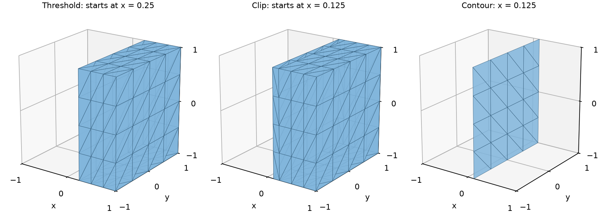

# Filter and analyze datasets

Choose a filter by what should happen to the cells. Keeping a whole cell,
cutting a cell, and extracting its intersection with a surface answer different
questions, even when all three use the same scalar threshold.

The running example samples `x` and the velocity `[-y, x, 0]` on a grid covering
`[-1, 1]³`. The simple analytic fields make the results independently checkable.

## Prepare named inputs

```python
--8<-- "docs/examples/data_analysis.py:sample"
```

```python
--8<-- "docs/examples/data_analysis.py:build"
```

The complete script supplies the imports and initializes the backend.
All following fragments use this dataset. A field argument can be its name
or the `td.Field` itself; a raw value buffer needs a space wrapper first.

## Select cells, cut cells, or extract a surface

| Goal | Operation | Output |
|---|---|---|
| Keep cells whose scalar lies in an interval | `threshold` | Whole cells, preserving their shapes |
| Keep cells inside a region described by a function | `extract_geometry` | Whole cells |
| Keep a named or explicit cell selection | `extract_cells` | Whole cells in input order |
| Keep the part on one side of a level | `clip` | Whole cells and pieces of cut cells |
| Extract a scalar level set, or several | `contour` | Triangles in 3D; line cells in 2D; with several values, all of them, each cell's in `contour_value` |
| Intersect with a plane or another implicit function, or several parallel ones | `slice_plane`, `slice` | Intersection geometry |
| Keep original points by scalar or region | `threshold_points`, `extract_points` | Vertex cells, without cell connectivity |

For point data, `threshold` checks every corner by default. With
`all_points=False`, one in-range corner suffices. Neither option interpolates
a cut boundary. For cell data, the cell's one value makes the selection.

```python
--8<-- "docs/examples/data_analysis.py:filter"
```



At x = 0.125, no grid plane coincides with the requested boundary. The threshold
keeps 48 cells starting at x = 0.25, with total volume 3. The clipped region
starts at x = 0.125 and has volume 3.5. The contour is a plane of area 4.
`all_points=False` keeps 64 whole cells, including a layer that crosses the
threshold. These different measures are intentional.

## Understand the sign of an implicit function

`Plane`, `Sphere`, `Cylinder`, `Box` and `Planes` expose a `value(position)`
that is negative inside, zero on the boundary and positive outside. For the
plane in the example it is `x - 0.125`.

`clip(data, plane)` keeps values **at or above zero**, here the positive-x
side. Pass `inside=True` to keep the other side, inside the function's
region. `extract_geometry` instead defaults to `inside=True`, the negative
side, and keeps whole cells. State
which region you mean before choosing flags; the words “inside” and “keep”
do not by themselves specify the same default for both functions.

## Decide which fields follow the geometry

Filters creating datasets accept `fields=`: all named fields by default, a
name or list to select them, and `[]` for geometry alone. Geometry is always
handled separately. An unknown requested name raises `KeyError`.

| Input association | Typical propagation |
|---|---|
| Floating point data | Gathered for kept points; interpolated onto edge crossings |
| Cell data | Copied to each retained cell or each piece of an input cell |
| L2 data | Retained cell by cell when whole cells survive on a shape-based output |
| Face values | Retained only when the filter has a face map; on an extracted surface, mapped to output cells where supported |
| Side traces or entities with no propagation map | Left behind |

For example, the contour above carries only velocity, interpolated at its
new points; the clip carries only `x`. Computing a derived field does not
automatically name it: put it in `data.fields` before extraction if it should
travel with the result.

Integer point labels are not interpolated as continuous data. Use cell labels
when that is the intended association. To preserve provenance of cell pieces,
attach `td.cell_ids(data)` as a named cell field before filtering; its ids then
refer to the source mesh, while output cell ids refer to the new mesh.

## Sets follow provenance, not geometric guesses

Cell sets survive selections and follow pieces of selected cells. A face set
can become a cell set when its faces become surface cells. Newly generated
points do not automatically inherit a point set merely because they lie near
an old selected point. The result follows the filter's entity maps.

The mixed-mesh example names a roof cell and a boundary face set, then filters:

```python
--8<-- "docs/examples/datasets.py:sets"
```

Its returned roof id is zero after thresholding because the output cells have
been renumbered. Use the returned set with the returned dataset.

## Derived fields and summaries

```python
--8<-- "docs/examples/data_analysis.py:derived"
```

`magnitude` returns a field in the velocity's space. `gradients` returns cell
gradients by default; `at="points"` evaluates and averages onto points.
For a 3-vector field its gradient has nine components, in row order
`d(u_i)/d(x_j)`. `flow_quantities` derives divergence, vorticity and Q from it.
The solid rotation in this example has divergence 0, vorticity `[0, 0, 2]`
and Q = 1 in every cell.

`statistics` summarizes **stored field samples**, not a volume integral.
An arithmetic mean of point temperatures is not a volume-weighted mean on
a stretched mesh. Choose cell measures and a suitable quadrature when the
quantity you need is a physical integral. The function returns Python values
and therefore waits for the device work it reads.

## Cell quality

`cell_quality(data, measures)` measures how well shaped each cell is, a cell
field per measure, each 1 on the ideal cell of its shape (equilateral; a cube,
a regular tetrahedron):

| Measure | What it says |
|---|---|
| `scaled_jacobian` | the worst corner's edges' determinant, edges scaled to unit length, relative to the ideal cell's: 1 ideal, 0 flat, negative inverted |
| `jacobian_ratio` | the least corner determinant over the greatest: 1 for every simplex, below 1 as a cell tapers |
| `condition` | the worst corner's condition number against the ideal cell's: 1 ideal, growing as it distorts, the largest float when inverted |
| `edge_ratio`, `min_edge`, `max_edge` | the longest edge over the shortest; the shortest and longest, in the spatial unit |

They are Verdict's definitions (VTK's `vtkMeshQuality`), matched to VTK where
it defines them, and extended to every shape Tack has: the corners' edges are
the geometry's Jacobian applied to the reference cell's edge directions, so
order-2 cells are measured along their curved edges, and wedges and pyramids
get every measure. Polyhedra and polygons, which have no reference cell, are
measured by the fan tetrahedra and triangles Tack evaluates them in.

<!-- tack-check: cell-quality -->
```python
import numpy as np

import tack
import tack.dataset as td

tack.set_default_device("cpu")

mesh = td.tetrahedralize(td.uniform_grid((4, 4, 4)))
quality = td.cell_quality(mesh, ["scaled_jacobian", "condition", "edge_ratio"])
sj = quality["scaled_jacobian"].values.numpy()
print(f"scaled Jacobian {sj.min():.3f} to {sj.max():.3f}")
mesh.fields["sj"] = quality["scaled_jacobian"]
worst = td.threshold(mesh, "sj", -1.0, 0.75)          # the right-corner tetrahedra
assert np.isclose(sj.max(), 1.0) and np.isclose(sj.min(), 1 / np.sqrt(2))
assert worst.num_cells == np.count_nonzero(sj < 0.75)
```

## Check algorithm support before building a pipeline

| Task | Shape-based | Polyhedral / polygonal | Polyline |
|---|---|---|---|
| Select whole cells; measure cells | Yes | Yes | Yes |
| Extract boundaries | Yes, subject to line-cell limitations | Yes | Chain ends |
| Contour or slice | Yes, of order-1 and `L2` fields (an order-2 `H1` field is refused) | Yes | Currently unsupported |
| Clip cells | H1 geometry required | Currently unsupported | Currently unsupported |
| Project between point and cell data | Yes | Yes | Yes |
| Gradients and flow quantities | Yes | Yes: Green–Gauss over each polyhedron's faces (exact for linear fields); zero on polygons | Yes (zero) |
| Locate cells and probe | Yes | Yes: in sub-tetrahedra or fanned triangles; cells must be star-shaped from their points' mean | Yes, on segments |
| Advection and streamlines | Yes, 2D and 3D cells | Yes, as probing locates | Currently unsupported |
| Carry ghost marks over pieces | Yes | Yes | Yes |

An empty supported filter result is a valid dataset. Check `num_cells` before
assuming an extraction contains visible geometry. Algorithms requiring a
reference element reject unsupported topologies; storing H1 values alone
does not change that support. The
[reference matrix](reference/dataset-api.md#algorithms-and-filters) has the details.

## Run and check

```bash
uv run python docs/examples/data_analysis.py --arch cpu --check
uv run --with matplotlib python docs/examples/data_analysis.py --check --output filters.png
```

The checks include counts, independently calculated volumes and areas,
interpolated velocity, flow derivatives, probe validity and analytic rotation.
[Download the complete program](../examples/data_analysis.py).

Continue with [Mesh Kernels](05-mesh-kernels.md) to implement an operation,
or [Sample and Connect Simulations](06-pipelines.md) to connect stages.
