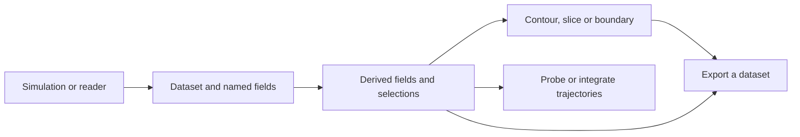

# Sample and connect simulations

A useful visualization pipeline connects a simulation's fields to a scientific
question and an output. Keep the data's space and lifetime explicit at each
stage: a streamline needs an interpolated velocity, and a file writer needs
host-accessible data in its format.



## Sample at physical positions

`probe` evaluates a source dataset's fields at positions in world coordinates.
The example asks for two points in the mesh and one outside it:

```python
--8<-- "docs/examples/data_analysis.py:probe"
```

The returned dataset contains the query positions as vertex cells, sampled
fields as point data, and `valid` as a point attribute. Invalid samples are
zero-filled. Always consult `valid`: zero may also be a valid physical result.
The example checks that valid scalar samples equal the query x coordinates.

Passing a target dataset instead of a point array preserves that target's
topology and geometry, samples at its point positions, and adds the source
fields. This is a way to resample onto another grid. A name collision is
resolved by the sampled field replacing the target's field of that name.

Without a locator, `probe` uses the one the mesh's topology keeps, so probing
the same mesh again does not rebuild its search bins. A `CellLocator` of your
own serves any dataset of the same cells and positions. Both follow the
positions: after Tack writes them (a kernel, `fill` or `copyto`), the kept
one is rebuilt, and one of your own is refused, since its bins describe the
mesh as it was. Positions changed through memory shared with another library
(DLPack) are not seen: make a new locator then. Where a query lies in more than one cell, the smallest cell
id wins (a query on a face, edge or vertex that cells share is in all of them);
a cell the query is only within the tolerance of counts only where no cell
holds it. At a discontinuity that choice can determine which side is
sampled; it is not an average across the interface.

Probing takes shape-based cells, polyhedra (located in sub-tetrahedra), polygons
(in the triangles fanning each from its points' mean) and polylines (on their
segments). A `Values` field on faces is not a
continuous field that can be sampled arbitrarily through the volume.

## Voxelize onto a uniform grid

`probe` onto an image samples one point per image point. `voxelize(data,
grid)` gives each **voxel** (an image cell) the share of its volume the data
covers, `fraction`, and each field's mean over that share, as cell data:
what a simulation's fields are on a uniform grid, for analysis or for
learning. Each voxel is sampled at `samples` points a side (4 by default, so
64 in 3D) through `probe`, so `fraction` is right to about one sample's share
and a mean is the samples' mean; voxels the data does not reach are hidden.
It takes anything `probe` takes: datasets, pieces over MPI ranks, AMR
hierarchies and octrees.

<!-- tack-check: voxelize -->
```python
import numpy as np

import tack
import tack.dataset as td

tack.set_default_device("cpu")

# A ball of tetrahedra, cut from a cube, with a temperature rising along x.
mesh = td.tetrahedralize(td.uniform_grid((11, 11, 11), spacing=(0.1, 0.1, 0.1)))
x = mesh.positions().astype(np.float64)
mesh.fields["r"] = td.Field(td.H1(mesh), tack.array(np.linalg.norm(x - 0.5, axis=1)))
mesh.fields["T"] = td.Field(td.H1(mesh), tack.array(300.0 + 10.0 * x[:, 0]), unit="K")
ball = td.clip(mesh, "r", 0.4, inside=True)

voxels = td.uniform_grid((6, 6, 6), spacing=(0.2, 0.2, 0.2))
v = td.voxelize(ball, voxels, samples=6)
covered = v.fields["fraction"].values.numpy().sum() * 0.2 ** 3
volume = td.cell_geometry(ball).measure.values.numpy().sum()
print(f"covered {covered:.4f} of the ball's {volume:.4f}")
assert abs(covered - volume) < 0.02 * volume
assert v.fields["T"].unit == "K"
```

## Integrate a steady velocity field

```python
--8<-- "docs/examples/data_analysis.py:flow"
```

`advect` returns the particles where they stop, with `steps`, `time` and
`status`. `streamlines` returns the paths as a polyline per seed that moved,
with `seed` on cells and `time` on points. It also keeps a point for a seed
that did not move, without inventing a line.

The default integrator is fixed-step RK4; Euler is also available. The step
is in the integration parameter for `dx/dt = velocity`, so its spatial length
depends on speed.

`integrator="rk45"` adapts the step to the flow, as VTK's `vtkStreamTracer`
does with its RK45 (Cash-Karp): `step_size` is the first step, a step whose
error estimate passes `tolerance` (a distance, 1e-6 by default) is tried
again smaller, and each step taken proposes the next, between `min_step` and
`max_step` (by default a fiftieth of `step_size` and twice it, VTK's ratios).
Smooth stretches take long steps and sharp turns short ones; on a swirl, at
VTK's settings, it takes about half of fixed RK4's points and lies as close
to the path as VTK's RK45. Where the flow turns back at a wall, a particle
whose step cannot get past it ends there (`SPATIAL_BOUNDS`), as in VTK. Its
step control makes yes-or-no choices, so where paths diverge (a recirculation,
a wall) a rounding-sized change can send two runs, or two devices, along
paths of other lengths, each within the tolerance; a looser `tolerance` makes
that rarer (on the aneurysm in f64, paths of other lengths from seeds 1e-13
apart: 4,899 of 20,000 at 1e-7, 721 at 1e-6, none at 1e-5). `max_length`
stops a path that has gone that far, whatever the integrator.

`streamlines(..., step_unit="length")` steps a fixed arc length instead,
following the velocity's direction as VTK's `vtkStreamTracer` does by
default: slow flow takes steps as long as fast flow, and `steps * step_size`
is the longest path. `time` on the points is still the time the particle
takes. Where speeds vary widely, a time step sized for the fastest makes
tiny steps elsewhere, so length steps reach as far in far fewer steps.

**Choose the device by the number of seeds.** Each particle is one thread
that takes all its steps, so a few seeds use a few threads of a GPU built
for thousands, and a single GPU thread is slower than a CPU core. Below a
few thousand seeds the CPU is usually faster; above, the GPU. On a
28-core EPYC against an RTX 6000 Ada (ms, warm):

| mesh | seeds | CPU | CUDA |
|---|---|---|---|
| aneurysm, 8.7M tetrahedra | 25 | 8.4 | 32.0 |
| | 2,000 | 57.2 | 75.8 |
| | 20,000 | 871 | 331 |
| ONERA M6 wing, 46.9M cells | 17 | 41.7 | 84.4 |
| | 1,024 | 92.9 | 149 |
| | 16,384 | 1,190 | 108 |

On an Intel Data Center GPU Max 1100 the gap is wider: the M6's 17 seeds
took 708 ms against its host CPU's 24.5. For a few seeds on a mesh that
lives on a GPU, advect a CPU copy of it (`data.to_device("cpu")`); the
locator is built where the mesh is.

**Choose the locator by the mesh.** Each step finds the particle's cell
among the candidates its bin holds. The default locator bins the cells on
two levels, as Viskores' `CellLocatorTwoLevel` does, so a mesh graded toward
a body in a large far field (the M6 wing's cells span a millionfold in size)
is not all in a few bins. On a small mesh of cells of about one size, one
uniform grid of bins, as Viskores' `CellLocatorUniformBins` and VTK's
`vtkStaticCellLocator` have, holds fewer candidates a bin: in tack-examples'
fire room (10,462 hexahedra) a search scans 6.6 cells against 12. Build it
and pass it in:

```python
locator = td.CellLocator(data, levels=1)
paths = td.streamlines(data, "velocity", seeds, 0.02, 2500, locator=locator)
```

`probe` and `advect` take it the same way. Both locators find the same cells,
so the paths are the same bit for bit; only the time differs.

The example's `[-y, x, 0]` velocity rotates a point at unit angular speed.
Twenty steps of 0.05 reach time 1. The program checks the final positions
against sine and cosine, and checks path lengths against the radii times
elapsed time, allowing for polyline chord approximation.

Particles stop at the step limit, zero velocity, or domain bounds; an outside
seed does not move. Inspect status and time before treating a short path as
evidence of low speed. These functions sample one steady field. A pathline
through a changing simulation requires a time-dependent integration strategy;
repeating a steady streamline calculation does not by itself provide one.

## Keep a simulation's state in the pipeline

A common pattern is to retain topology and geometry, attach each working field
once, update its values with simulation kernels, and run the analysis stages
at selected timesteps. Intermediate datasets hold results of those stages;
they are not a graph that recomputes automatically when an input changes.

| What changed | What needs attention |
|---|---|
| Values in an existing simulation field | Re-run dependent filters, samples and summaries |
| A field was replaced by a new buffer | Update the named `td.Field` attachment |
| Point positions changed | Rebuild locators |
| Connectivity changed | Construct a corresponding topology, spaces and associations |

Prefer kernels that compute through `data.geometry.values` to downloading all
positions just to form a derived field on the host. Keep readback at checkpoints
or output boundaries. A named field holding simulation storage can share its
allocation: follow the same ownership and synchronization rules as any other
shared buffer.

## Exchange whole datasets with VTK

With `tack-vis` and VTK installed, `vtk_to_dataset` reads VTK image, rectilinear,
structured, unstructured or polygonal (`vtkPolyData`) data. Point fields become H1, cell fields Constant; geometry
and connectivity are converted into the dataset model. `dataset_to_vtk` creates
the matching VTK dataset for visualization or writing to a file.

For a contour, the VTK result is an unstructured triangle mesh. The following
fragment assumes `surface` was produced by `td.contour`:

```python
from tack.interop.vtk import dataset_to_vtk
from vtkmodules.vtkIOXML import vtkXMLUnstructuredGridWriter

vtkXMLUnstructuredGridWriter(file_name="surface.vtu")(dataset_to_vtk(surface))
```

Tack uses VTK's pythonic API (VTK 9.7.1 or later) in its interop and
examples: keyword constructors, properties, a writer or filter called on
its input. A contour's cells come across as VTK's own implicit arrays: its
cell types a `vtkConstantArray`, its offsets a `vtkAffineArray`.

These whole-dataset conversions copy arrays and provide a straightforward
host boundary. Zero-copy array exchange is a separate route using
`array_to_vtk`, `vtk_to_array` and a DLPack-enabled VTK build. A standard VTK
wheel sufficient for file I/O may not expose that route. Level Zero sharing
also needs a shared allocation context. See [Sharing Arrays](../users-guide/16-interoperability.md).

MFEM meshes and grid functions enter through `tack.interop.mfem`; supported
spaces include H1 orders 1 and 2 and L2 orders 0 and 1 on every shape it
maps, and H1 and L2 of any order with curved geometry of any order on quads
and hexahedra; `mfem_grid_function` gives a field back. Check the [interop reference](reference/dataset-api.md#interoperability)
for signatures and the current mapping limits.

## Measure the boundaries you actually use

| Stage | Host interaction to account for |
|---|---|
| Construct from NumPy or a reader | Input upload and topology setup |
| Derive faces, edges or a locator | First-use work and retained auxiliary storage |
| Extract variable-size geometry | Count readbacks and output allocation |
| Return a scalar summary | Device wait and result readback |
| Probe or integrate | Locator setup, query upload; streamlines also read path lengths for output allocation |
| Export to VTK or a file | Array copies and writer time |

Queued GPU launches preserve Tack's program order, but host reads synchronize.
Call `tack.sync()` before stopping a timer when the next operation is not a
readback. Separate first-use compilation from repeated work, and include the
output stage when reporting application time. See [Debugging and Timing](../users-guide/15-debugging-and-timing.md).

## Complete programs to run next

```bash
uv run python docs/examples/data_analysis.py --arch cpu --check
uv run python docs/examples/datasets.py --arch cpu --check
```

The [analysis program](../examples/data_analysis.py) covers probing and flow,
and the [dataset tour](../examples/datasets.py) connects mixed meshes,
spaces, sets and streamlines.
