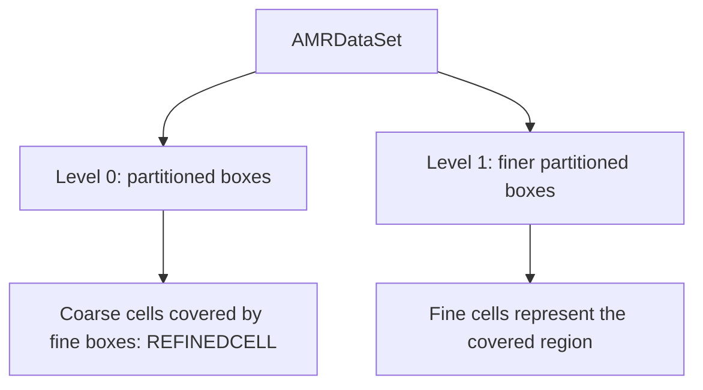

# AMR hierarchies

Block-structured adaptive mesh refinement covers a domain with boxes, and
some regions with finer boxes, level after level. An `AMRDataSet` holds the
levels, each a `PartitionedDataSet` of structured boxes, and the refinement
ratio between them. It follows VTK's `vtkOverlappingAMR` and AMReX's design:
the hierarchy is defined in index space alone -- a box is its first cell's
index in its level (its topology's `offset`) and its cell counts -- so a box
can be an image, a rectilinear grid or a curvilinear grid.

Making the hierarchy marks what a finer level supersedes:

- `REFINEDCELL` on each cell a finer box covers;
- `REFINEDPOINT` on each point at whose location a finer level has a point,
  the edge of a refined region included;
- `DUPLICATEPOINT` on points two sibling boxes share, owned by the first.

So every region and location belongs to one box, at the finest level holding
it, and reductions over the hierarchy count it once. Filters run per box, and
those that make cells leave refined cells out.

Read [Collections and Partitions](collections-and-partitions.md) for the
ownership vocabulary. Refinement describes physical resolution; device and
MPI placement describe where the boxes are processed.

## Requirements

Boxes of a level may not overlap, and each fine box, coarsened, must lie
within its coarser level's boxes (proper nesting). A level's image boxes
share one spacing and lie on one lattice, as VTK's model has it; rectilinear
and curvilinear boxes have no such constraint. Ratios may differ per axis.

## VTK

`vtk_to_dataset` takes a `vtkOverlappingAMR`, and `dataset_to_vtk` gives one
back for images and rectilinear grids; a hierarchy with curvilinear boxes goes
to VTK as a `vtkPartitionedDataSetCollection` of a partitioned dataset per
level. `amr_gaussian_pulse` makes VTK's Gaussian pulse hierarchy, for tests.

## Work at the finest available resolution

Probing chooses the finest cell holding each query. Reductions leave out
covered coarse values. Ghost generation can fill from siblings or coarser
boxes; refreshing ghosts and averaging down are explicit operations, not
automatic consequences of changing a source array. The
[adaptive-data recipes](adaptive-data.md) show those operations and their checks.

## Not here

Crack-free contouring across levels, periodic domains, tagging and regridding,
and conservative interpolation are not part of Tack yet.

Continue with [Analyze Adaptive Data](adaptive-data.md#construct-and-filter-an-amr-hierarchy)
or compare the [octree representation](11-octrees.md).

??? info "Related detailed sections"
    These topics are developed in their own chapters.

    
    [Ghost cells](adaptive-data.md#ghost-cells).

    
    [Probe and resample](adaptive-data.md#probe-and-resample).

    
    [In pieces](adaptive-data.md#in-pieces).
