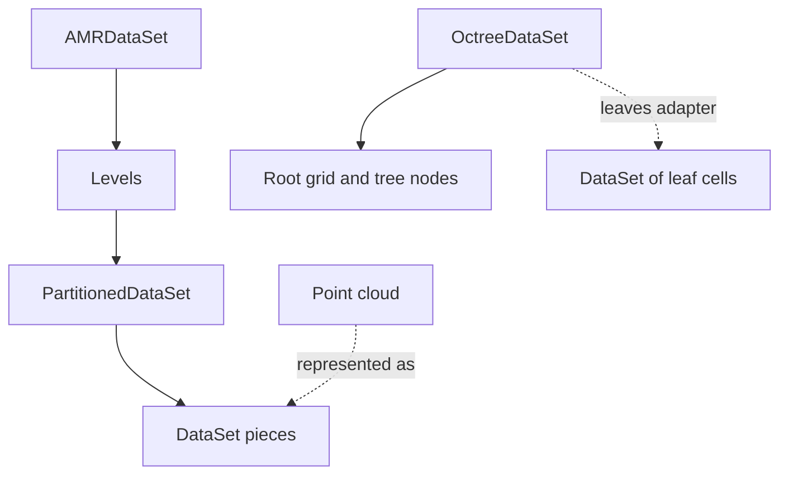

# Collections and partitions

One dataset describes a mesh or cloud. A collection describes relationships
among several objects. Physical subdivision, adaptive refinement and
placement over devices or ranks are different choices.

| Object | Holds | Meaning |
|---|---|---|
| `DataSet` | Topology, geometry, fields and sets | One mesh or cloud |
| `PartitionedDataSet` | Pieces | A domain represented by several datasets |
| `AMRDataSet` | Levels of partitioned structured boxes | Fine boxes supersede covered coarse regions |
| `OctreeDataSet` | Root grid and refinement nodes | Leaves give the finest available regions |

These are composition and conversion relationships, not an inheritance tree.
An octree and block AMR are different representations of refinement.

## Ownership, duplication and visibility

A shared point or halo can occur in several pieces. One copy owns the
physical entity; duplicates must not count again in a global summary.
Supported algorithms use ghost marks and global ids to retain ownership.

| Condition | Meaning |
|---|---|
| Duplicate entity | Another piece owns it |
| Hidden entity | Its data is not valid for processing |
| Refined coarse entity | A finer region supersedes its contribution |
| Ghost layer | Neighbor data retained for a local operation |

A covered coarse cell can have a stored value while being excluded from a
finest-resolution reduction. A ghost can hold valid stencil input while being
excluded from a count. Ghost generation and value refresh are explicit operations.

## Physical pieces and distributed execution

A partitioned domain can live on one device in one process. Distributing
pieces across devices or MPI ranks changes placement, not physical meaning.
Frames, units and time must satisfy the collection's consistency rules.
Neighbor-dependent operations can require more than independent per-piece filters.

[Data in Pieces](07-partitioned.md) explains splitting, ghosts and merging.
[Pieces and Blocks](14-communication.md) explains communication. Neither is
required before understanding refinement on one machine.

## Refinement introduces another relationship

[AMR](10-amr.md) uses levels of boxes, while [octrees](11-octrees.md) use
parents, children and leaves. Both need care when weighting summaries: a
tiny cell and a large cell have different volumes. The
[adaptive recipes](adaptive-data.md) check ownership, weighting and probing.

Choose the representation matching your source, then its task. These
chapters are alternatives, not prerequisites to filtering one ordinary dataset.
