# Gallery

What Tack's filters make of each kind of cell. Every picture is a script in
`docs/gallery/` that builds its data, runs Tack's filter, and draws the result
through VTK: Tack makes everything drawn -- the result's polygons, their normals
(`surface_normals(..., weights="area")`), and the outline, each cell edge as lines
(`extract_edges(..., subdivision=12)`, which follows a curved geometry) -- and VTK
only draws linear polygons and lines. Run one alone
(`uv run python docs/gallery/contour.py curved --arch metal`), or all of them with
`docs/gallery/build.py`.

The kinds of cells, left to right:

- **Polyhedra**: Voronoi cells of random points extruded through the cube, a
  polyhedral topology whose faces have up to a dozen points; the field is point
  data, linear on each cell's sub-tetrahedra.
- **Tetrahedra**: the cube's 8 x 8 x 8 hexahedra cut into tetrahedra, the field
  linear in each.
- **Order 4 on straight cells**: 27 hexahedra, the field `H1` of order 4. The
  cuts curve inside the cells: they are cut on linear sub-cells, 6 a side, with
  each crossing placed on the field itself.
- **Order 3 on curved cells**: the same 27 hexahedra twisted and bowed by an
  order-3 geometry, the field `H1` of order 3 on it.

Some sections show other data where it makes their point:

- **Hexahedra**, jittered (cell quality), and an **image** (pieces).
- **A mixed mesh** (cell quality, pieces): the cube's hexahedra, a third kept, a
  third split into wedges and a third into pyramids, every face between two cells
  the same in both.
- **Curved tetrahedra and wedges**, order 2 (subdivide).

Each cuts the same field, Schwarz's P surface: `cos 2πx + cos 2πy + cos 2πz`.

??? example "The datasets"

    ```python
    --8<-- "docs/gallery/_scene.py:datasets"
    ```

## Contour

The P surface (zero) and the levels -1 and 1, each colored by its level.

<div class="grid cards" markdown>

-   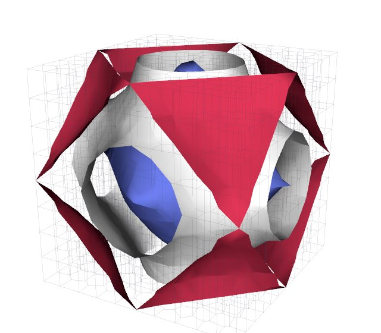{ loading=lazy decoding=async width=640 height=560 }

    Polyhedra

-   { loading=lazy decoding=async width=640 height=560 }

    Tetrahedra

-   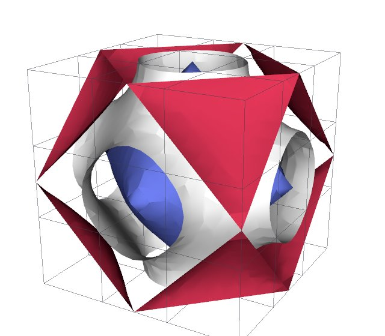{ loading=lazy decoding=async width=640 height=560 }

    Order 4 on straight cells

-   { loading=lazy decoding=async width=640 height=560 }

    Order 3 on curved cells

</div>

```python
--8<-- "docs/gallery/contour.py:contour"
```

## Slice

Three planes, colored by the field. On the curved cells the planes are cut through
the twisted geometry, not through its corners.

<div class="grid cards" markdown>

-   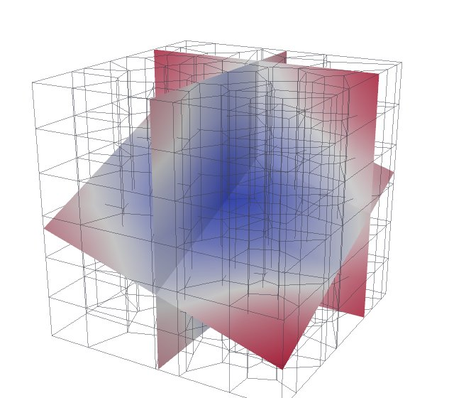{ loading=lazy decoding=async width=640 height=560 }

    Polyhedra

-   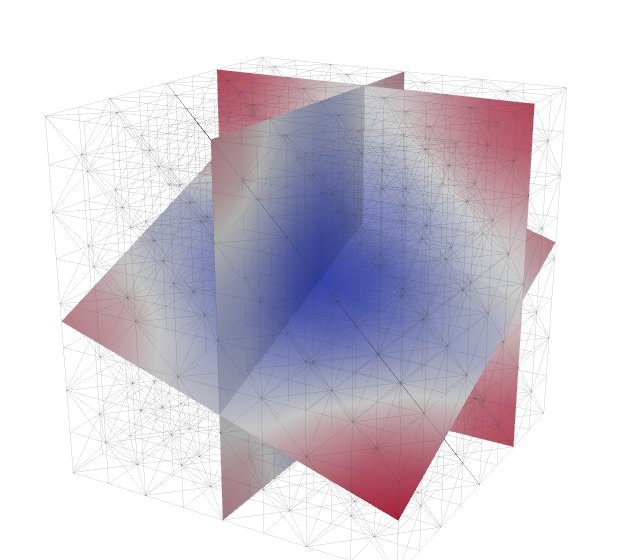{ loading=lazy decoding=async width=640 height=560 }

    Tetrahedra

-   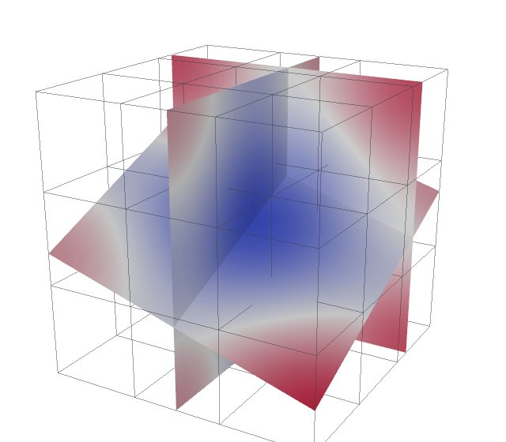{ loading=lazy decoding=async width=640 height=560 }

    Order 4 on straight cells

-   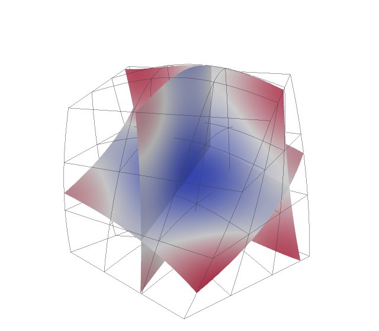{ loading=lazy decoding=async width=640 height=560 }

    Order 3 on curved cells

</div>

```python
--8<-- "docs/gallery/slice.py:slice"
```

## Clip

A ball about the cube's near top corner taken out, the kept part's surface
colored by the field. Polyhedra are clipped cell by cell into polyhedra; on the
high-order and curved cells, the cells wholly kept stay whole and only the cut
ones are cut on sub-cells. An implicit function is cut as the geometry carries
it: on the 27 straight hexahedra the ball is trilinear in each cell, a coarse
ball, while on the order-3 curved cells it is cubic, round to the eye. The
boundaries are shaded flat, since a clipped solid has sharp edges.

<div class="grid cards" markdown>

-   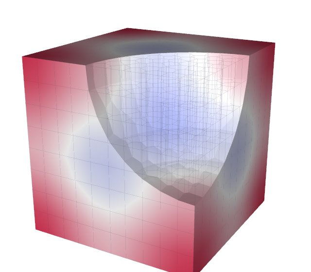{ loading=lazy decoding=async width=640 height=560 }

    Polyhedra

-   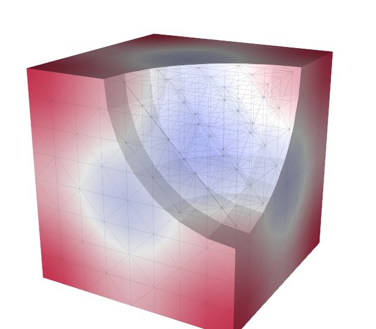{ loading=lazy decoding=async width=640 height=560 }

    Tetrahedra

-   { loading=lazy decoding=async width=640 height=560 }

    Order 4 on straight cells

-   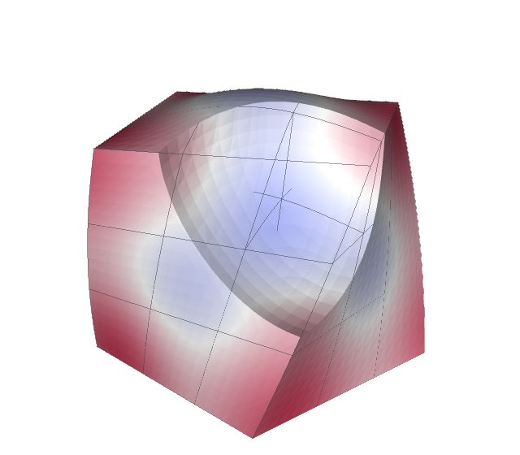{ loading=lazy decoding=async width=640 height=560 }

    Order 3 on curved cells

</div>

```python
--8<-- "docs/gallery/clip.py:clip"
```

## Threshold

The cells where the field is at least 1: blobs about the cube's corners, joined
along its edges where the field stays above 1. Threshold keeps cells, never parts
of them: on the high-order and curved cells the cells whose field's bounds lie in
the range are kept whole, the others on their linear sub-cells, which is why
their surfaces come in steps.

<div class="grid cards" markdown>

-   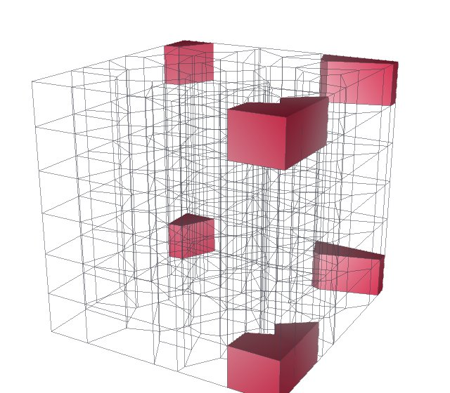{ loading=lazy decoding=async width=640 height=560 }

    Polyhedra

-   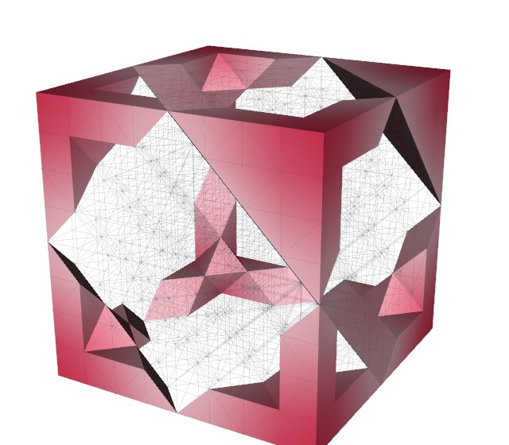{ loading=lazy decoding=async width=640 height=560 }

    Tetrahedra

-   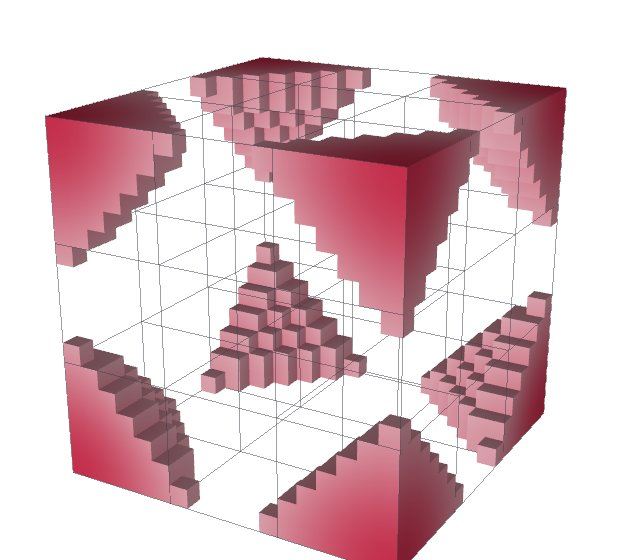{ loading=lazy decoding=async width=640 height=560 }

    Order 4 on straight cells

-   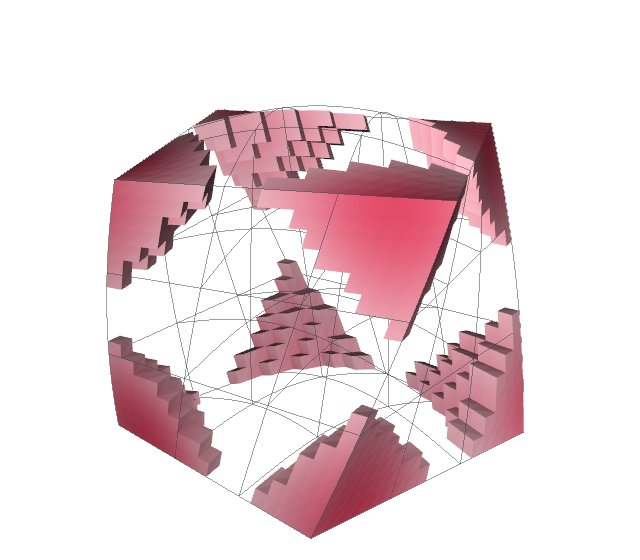{ loading=lazy decoding=async width=640 height=560 }

    Order 3 on curved cells

</div>

```python
--8<-- "docs/gallery/threshold.py:threshold"
```

## Surfaces and feature edges

The clip section's cube with a ball taken out: its boundary, and its feature
edges -- where two faces turn by 30 degrees or more -- in red. On the curved cells
the surface is subdivided, and the feature edges follow the cube's curved edges
and the ball's rim, not the sub-faces between them.

<div class="grid cards" markdown>

-   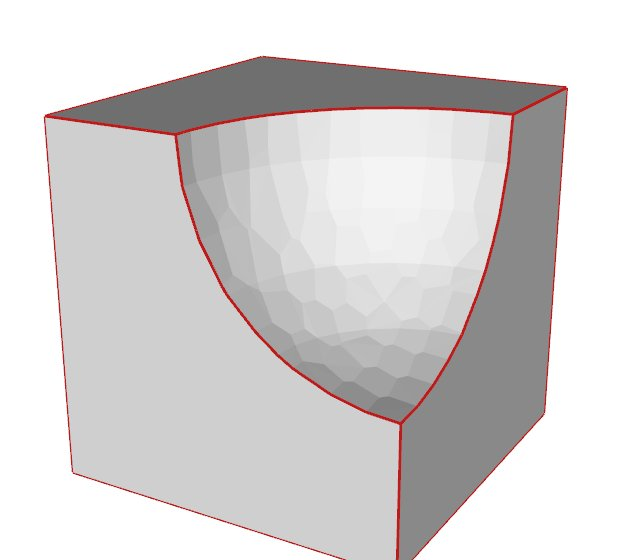{ loading=lazy decoding=async width=640 height=560 }

    Polyhedra

-   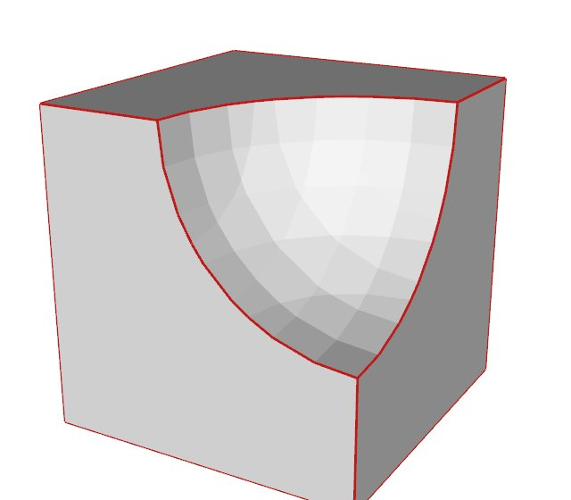{ loading=lazy decoding=async width=640 height=560 }

    Tetrahedra

-   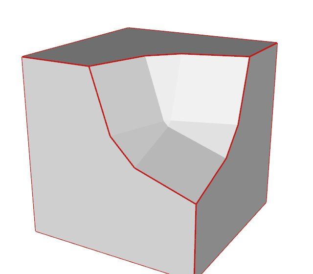{ loading=lazy decoding=async width=640 height=560 }

    Order 4 on straight cells

-   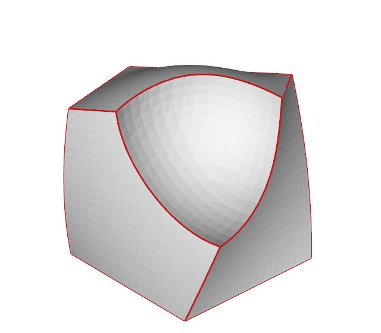{ loading=lazy decoding=async width=640 height=560 }

    Order 3 on curved cells

</div>

```python
--8<-- "docs/gallery/surfaces.py:surfaces"
```

## Cell quality

Each cell's scaled Jacobian, red where poor (0 degenerate, below 0 inverted) and
blue where ideal (1), on meshes whose inner points are moved at random, with the
cells about a corner taken out. On the curved cells it is the least over the
geometry's own Jacobian's samples. Polyhedra are left out: with no reference
element, theirs is measured by the tetrahedra fanning them, on another scale (a
cube as a polyhedron scores 0.58), and is read as a validity check -- positive
when the cell is star-shaped -- comparing polyhedra only with each other.

<div class="grid cards" markdown>

-   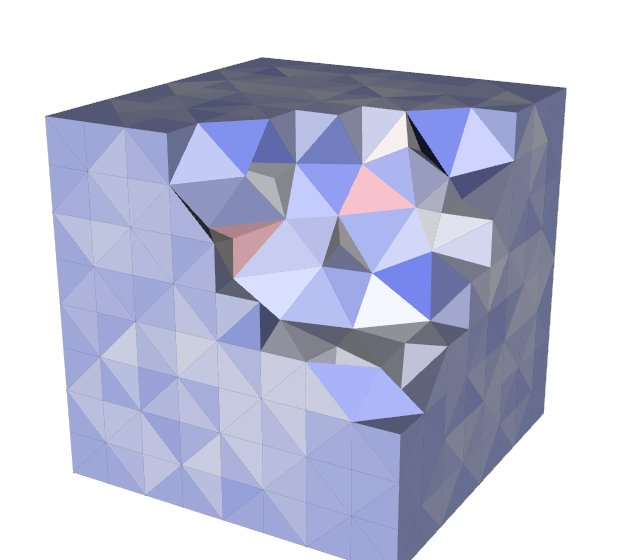{ loading=lazy decoding=async width=640 height=560 }

    Tetrahedra

-   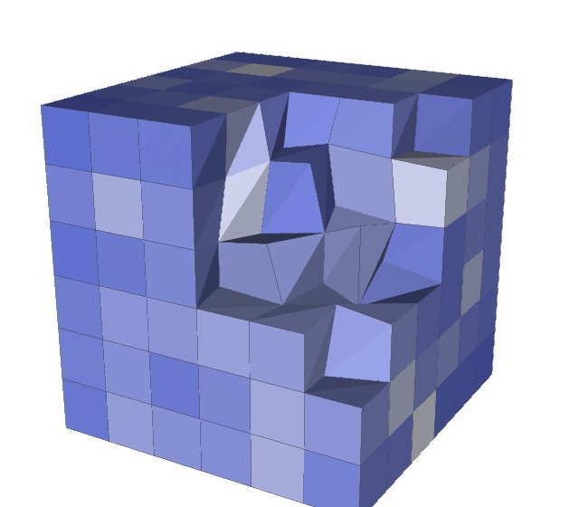{ loading=lazy decoding=async width=640 height=560 }

    Hexahedra

-   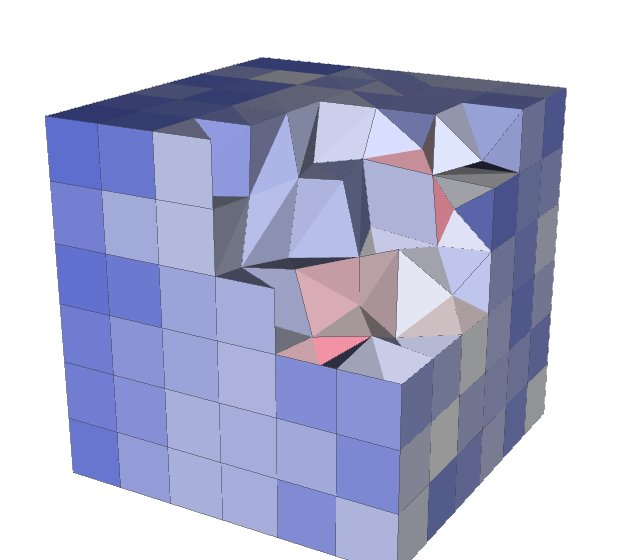{ loading=lazy decoding=async width=640 height=560 }

    Hexahedra, wedges and pyramids

-   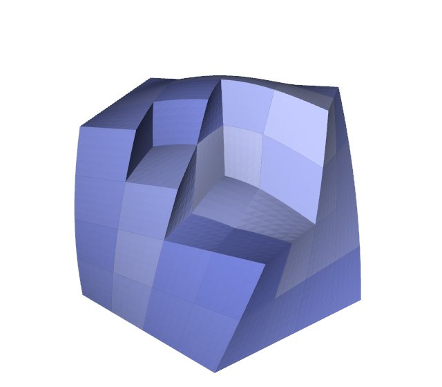{ loading=lazy decoding=async width=640 height=560 }

    Order 3 on curved cells

</div>

```python
--8<-- "docs/gallery/quality.py:quality"
```

## Gradients

The P surface colored by the length of the field's gradient. A linear field's
gradient is averaged to the points; a high-order field's is taken at the nodes of
an `L2` space of its order (`gradients(data, field, at=L2(...))`), exact there, so
the surface keeps its peaks, which averaging to the points flattens.

<div class="grid cards" markdown>

-   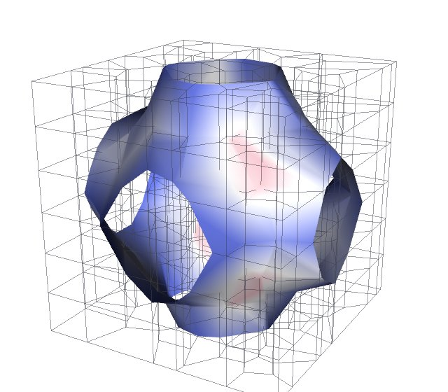{ loading=lazy decoding=async width=640 height=560 }

    Polyhedra

-   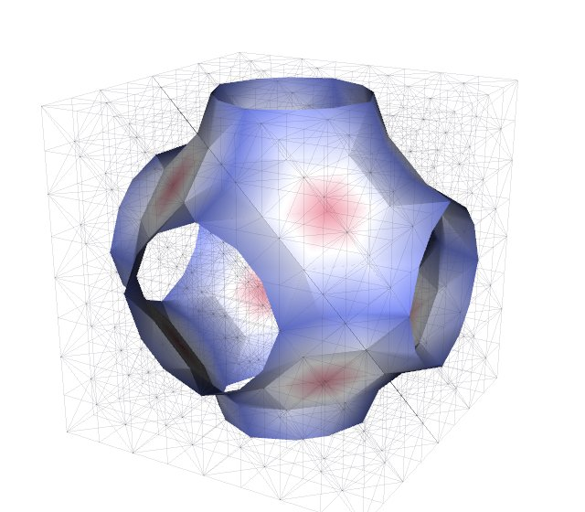{ loading=lazy decoding=async width=640 height=560 }

    Tetrahedra

-   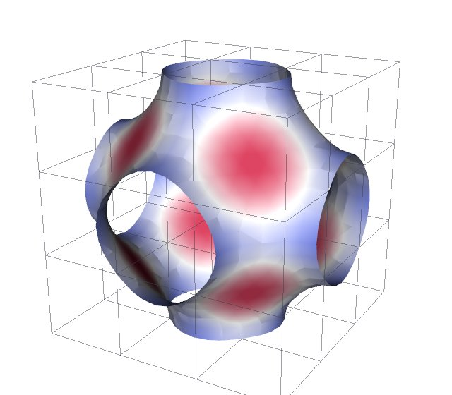{ loading=lazy decoding=async width=640 height=560 }

    Order 4 on straight cells

-   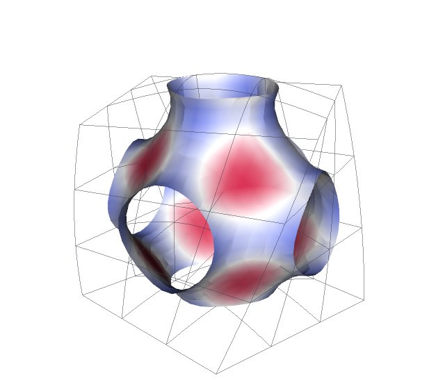{ loading=lazy decoding=async width=640 height=560 }

    Order 3 on curved cells

</div>

```python
--8<-- "docs/gallery/gradients.py:gradients"
```

## Probe

The field sampled at the points of an image plane tilted through the cube and
wider than it, the points no cell holds left out (`valid` 0). Each point's cell is
found through the cell locator, a curved cell inverted by Newton's method from
its own geometry, so on the curved cells the plane's edge follows the curved
boundary. The plane is an image turned by `transform`, which keeps it an image.

<div class="grid cards" markdown>

-   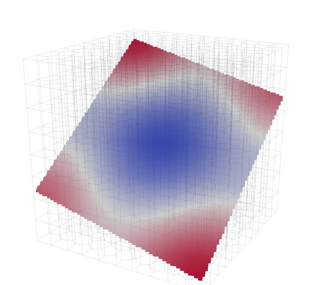{ loading=lazy decoding=async width=640 height=560 }

    Polyhedra

-   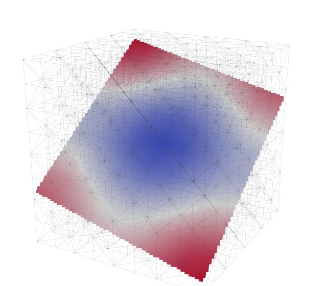{ loading=lazy decoding=async width=640 height=560 }

    Tetrahedra

-   { loading=lazy decoding=async width=640 height=560 }

    Order 4 on straight cells

-   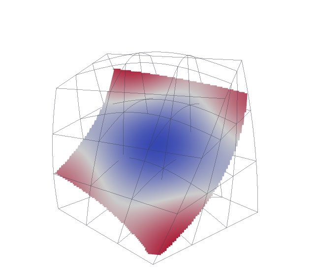{ loading=lazy decoding=async width=640 height=560 }

    Order 3 on curved cells

</div>

```python
--8<-- "docs/gallery/probe.py:probe"
```

## Subdivide

High-order and curved cells as the linear sub-cells the cutting filters cut and
VTK can draw, 4 a side, every sub-cell's edges drawn: hexahedra into hexahedra,
tetrahedra into Freudenthal's tetrahedra, wedges into layers of them. A lattice
point shared by cells is computed once, from the edge or face it lies on.

<div class="grid cards" markdown>

-   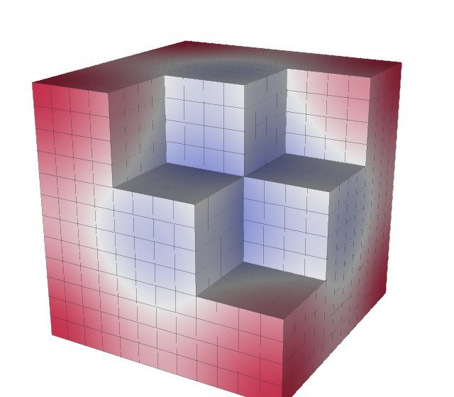{ loading=lazy decoding=async width=640 height=560 }

    Order 4 on straight cells

-   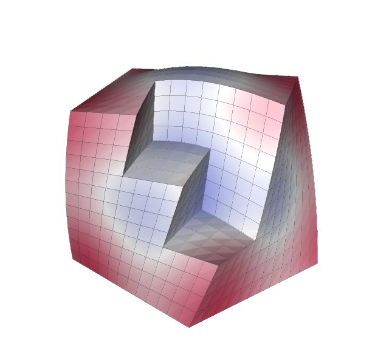{ loading=lazy decoding=async width=640 height=560 }

    Order 3 on curved cells

-   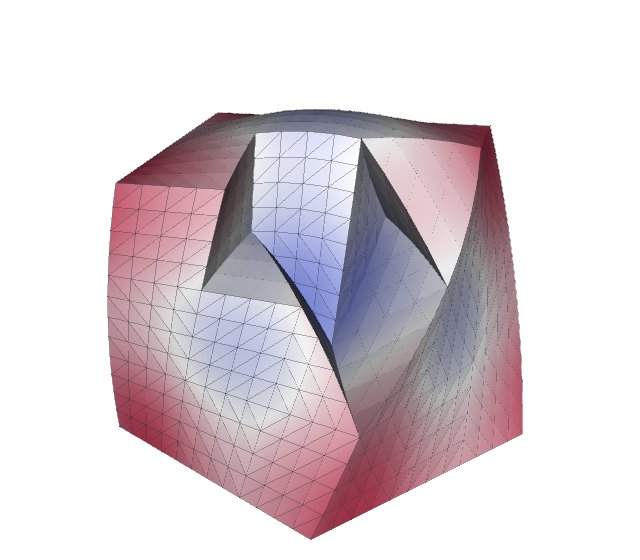{ loading=lazy decoding=async width=640 height=560 }

    Order 2 on curved tetrahedra

-   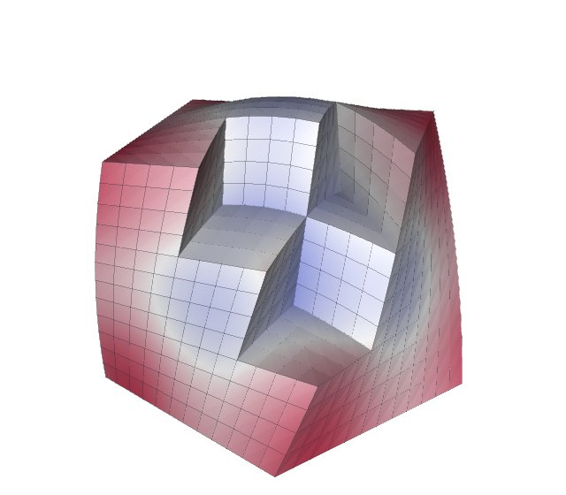{ loading=lazy decoding=async width=640 height=560 }

    Order 2 on curved wedges

</div>

```python
--8<-- "docs/gallery/subdivide.py:subdivide"
```

## Pieces and ghost cells

Each mesh in eight pieces, one an octant of the cube (an image split into eight
blocks), each given a layer of its neighbours' cells as ghosts, and drawn pulled
apart: a piece's own cells in its color, its ghosts faint, reaching into the
pieces around it. Polyhedra are not shown, since `ghost_cells` does not take
polyhedral pieces yet, nor curved and high-order cells, whose geometry and
fields ghost cells do not carry yet (it refuses them).

<div class="grid cards" markdown>

-   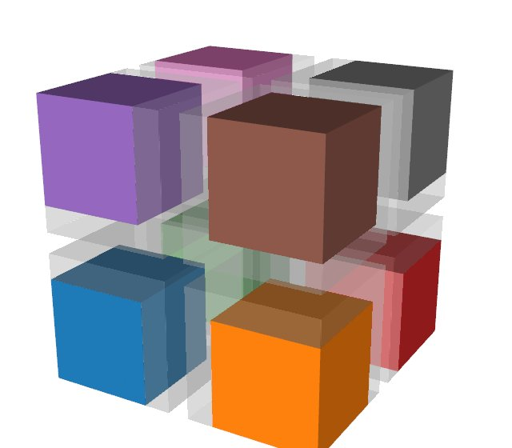{ loading=lazy decoding=async width=640 height=560 }

    An image

-   { loading=lazy decoding=async width=640 height=560 }

    Tetrahedra

-   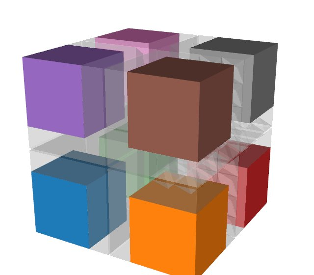{ loading=lazy decoding=async width=640 height=560 }

    Hexahedra, wedges and pyramids

</div>

```python
--8<-- "docs/gallery/pieces.py:pieces"
```

## Flow

The flow sections carry particles through a swirl inside the cube:
divergence-free, its velocity along every face and never through one, so paths
wind round rather than leave. The velocity is interpolated into each kind's
space -- `H1` of order 4 on the straight cells, order 3 on the curved ones --
and evaluated there, the curved cells inverted from their own geometry. Lines are
drawn as tubes and vectors as arrows that Tack makes: `tubes` (VTK's
`vtkTubeFilter`) and `glyphs` (`vtkGlyph3D` with its arrow).

??? example "The swirl"

    ```python
    --8<-- "docs/gallery/_scene.py:swirl"
    ```

### Streamlines

Paths from 25 seeds across the cube, RK45 with its steps measured along the path,
each stopped at length 1.4 (about one turn), as tubes colored by the time taken.

<div class="grid cards" markdown>

-   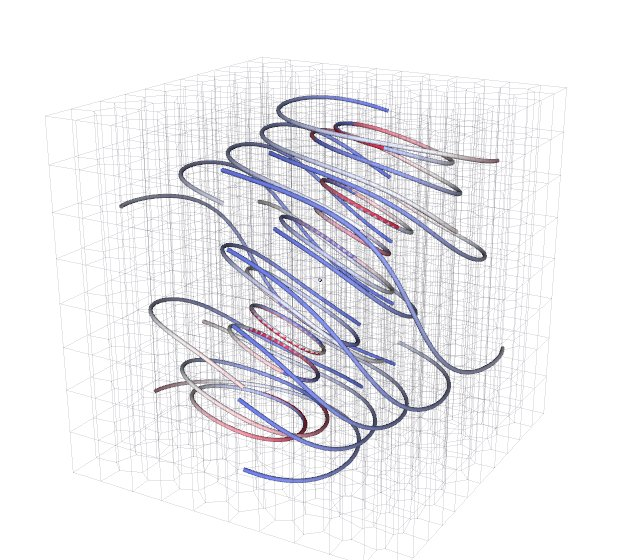{ loading=lazy decoding=async width=640 height=560 }

    Polyhedra

-   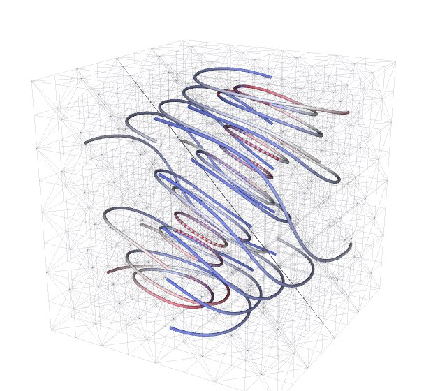{ loading=lazy decoding=async width=640 height=560 }

    Tetrahedra

-   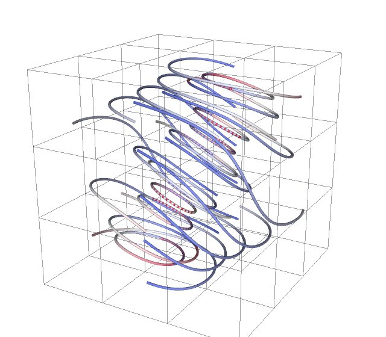{ loading=lazy decoding=async width=640 height=560 }

    Order 4 on straight cells

-   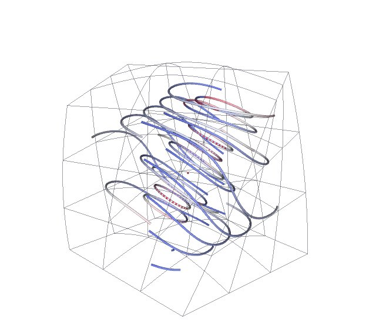{ loading=lazy decoding=async width=640 height=560 }

    Order 3 on curved cells

</div>

```python
--8<-- "docs/gallery/streamlines.py:streamlines"
```

### Glyphs

The velocity as arrows on a 12 x 12 lattice across the cube's middle, sampled by
probe, over the slice there colored by speed.

<div class="grid cards" markdown>

-   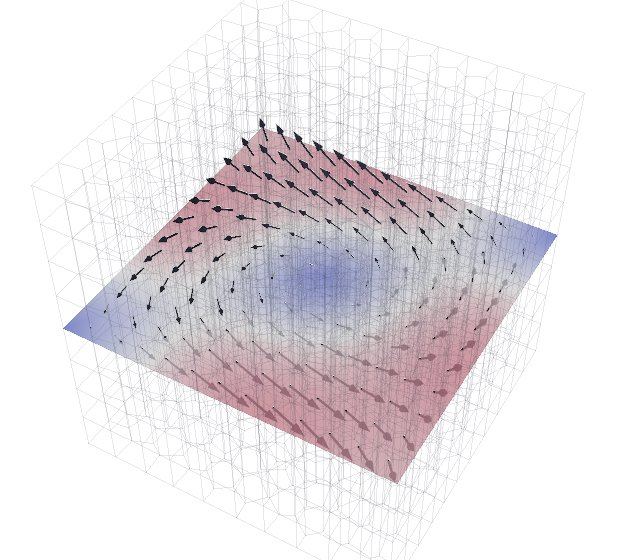{ loading=lazy decoding=async width=640 height=560 }

    Polyhedra

-   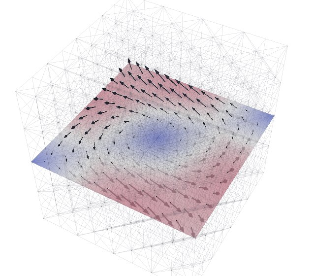{ loading=lazy decoding=async width=640 height=560 }

    Tetrahedra

-   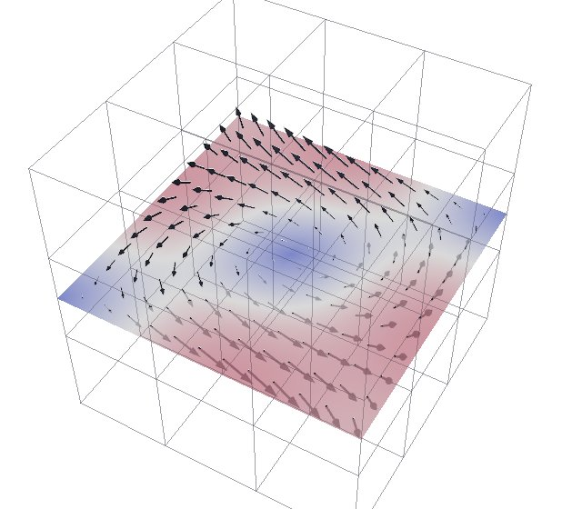{ loading=lazy decoding=async width=640 height=560 }

    Order 4 on straight cells

-   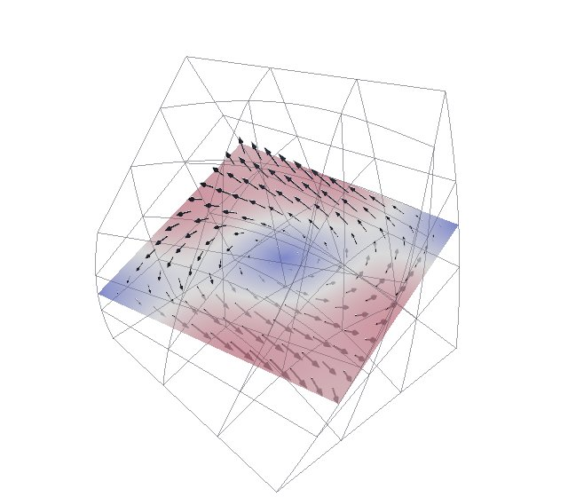{ loading=lazy decoding=async width=640 height=560 }

    Order 3 on curved cells

</div>

```python
--8<-- "docs/gallery/glyphs.py:glyphs"
```

### Pathlines

Particles through an unsteady swirl, its second part's weight rising from 0 to 1
and back over 60 steps: the temporal filter `Pathlines` takes each step's dataset
and moves every particle to the step's time, the velocity linear in time between
steps. Each path is a tube colored by time.

<div class="grid cards" markdown>

-   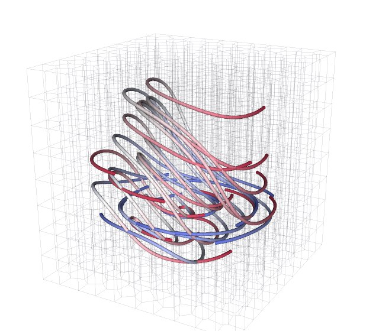{ loading=lazy decoding=async width=640 height=560 }

    Polyhedra

-   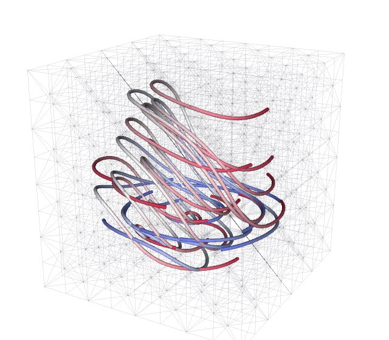{ loading=lazy decoding=async width=640 height=560 }

    Tetrahedra

-   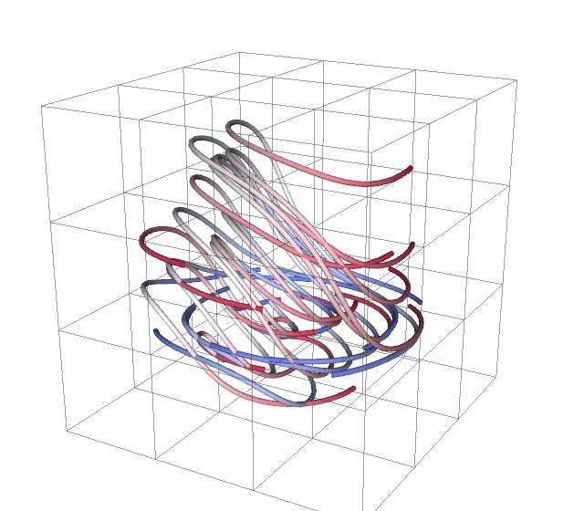{ loading=lazy decoding=async width=640 height=560 }

    Order 4 on straight cells

-   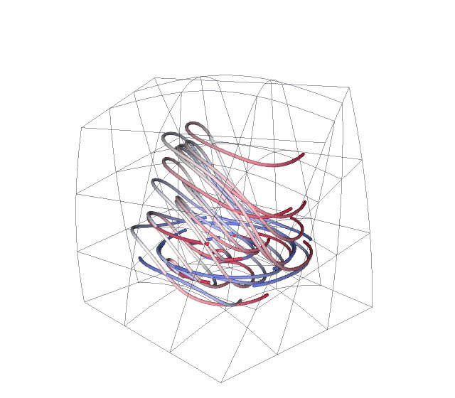{ loading=lazy decoding=async width=640 height=560 }

    Order 3 on curved cells

</div>

```python
--8<-- "docs/gallery/pathlines.py:pathlines"
```
