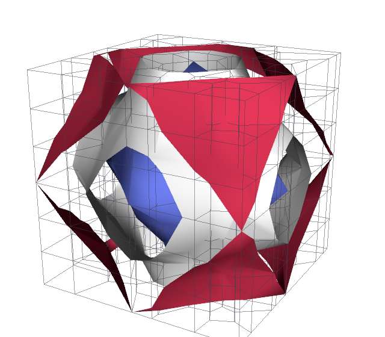
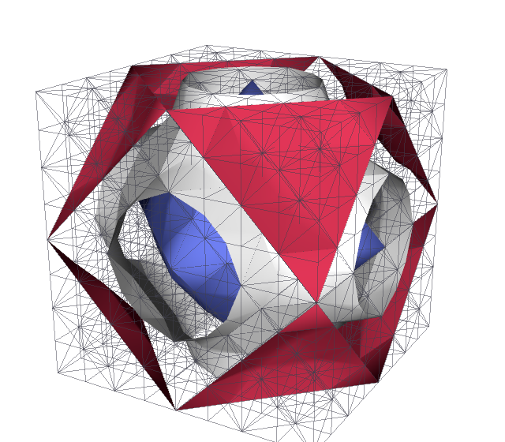
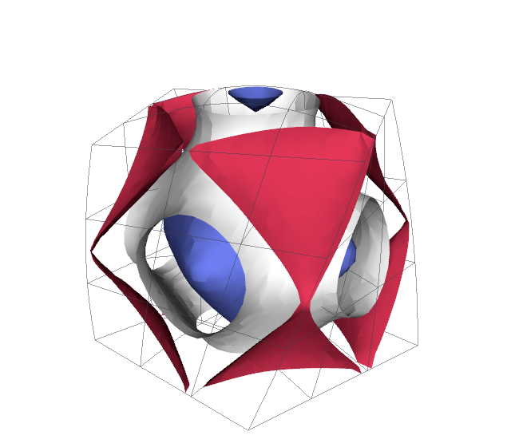
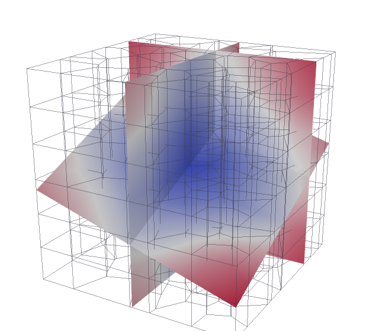
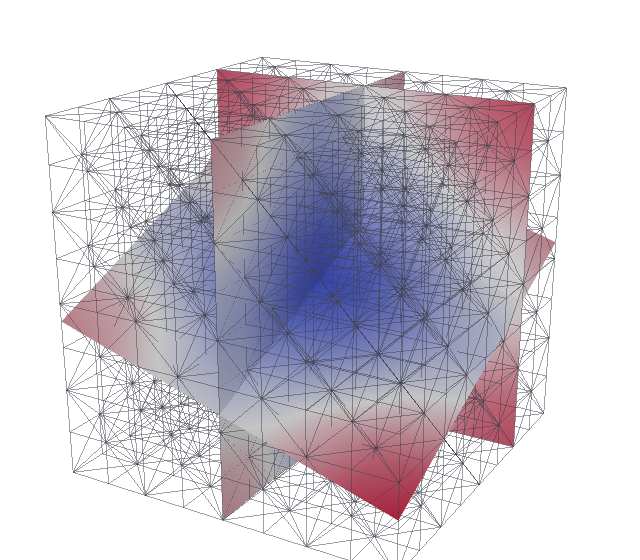
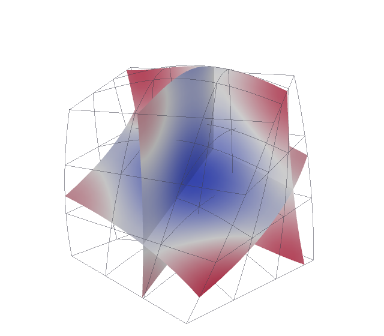
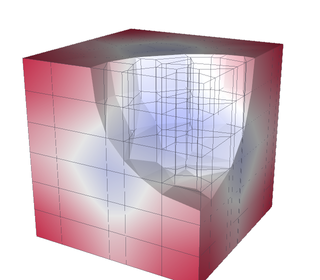
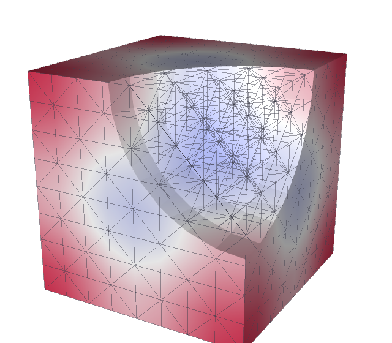
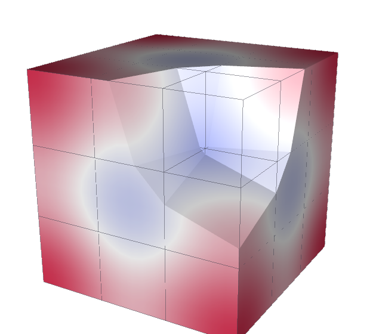
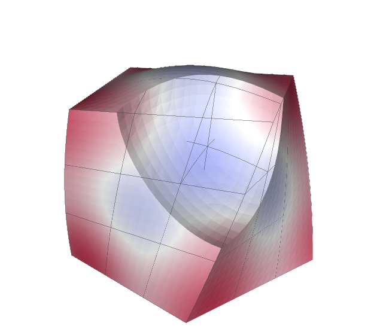

# Gallery

What the cutting filters make of each kind of cell. Every picture is a script in
`docs/gallery/` that builds its data, runs Tack's filter, and draws the result
through VTK: Tack makes everything drawn -- the result's polygons, their normals
(`surface_normals(..., weights="area")`), and the outline, each cell edge as lines
(`extract_edges(..., subdivision=12)`, which follows a curved geometry) -- and VTK
only draws linear polygons and lines. Run one alone
(`uv run python docs/gallery/contour.py curved --arch metal`), or all of them with
`docs/gallery/build.py`.

The kinds of cells, left to right:

- **Polyhedra**: Voronoi cells of random points extruded through the cube, a
  polyhedral topology whose faces have up to a dozen points; the field is point
  data, linear on each cell's sub-tetrahedra.
- **Tetrahedra**: the cube's 8 x 8 x 8 hexahedra cut into tetrahedra, the field
  linear in each.
- **Order 4 on straight cells**: 27 hexahedra, the field `H1` of order 4. The
  cuts curve inside the cells: they are cut on linear sub-cells, 6 a side, with
  each crossing placed on the field itself.
- **Order 3 on curved cells**: the same 27 hexahedra twisted and bowed by an
  order-3 geometry, the field `H1` of order 3 on it.

Each cuts the same field, Schwarz's P surface: `cos 2πx + cos 2πy + cos 2πz`.

??? example "The datasets"

    ```python
    --8<-- "docs/gallery/_scene.py:datasets"
    ```

## Contour

The P surface (zero) and the levels -1 and 1, each colored by its level.

<div class="grid cards" markdown>

-   { loading=lazy }

    Polyhedra

-   { loading=lazy }

    Tetrahedra

-   { loading=lazy }

    Order 4 on straight cells

-   { loading=lazy }

    Order 3 on curved cells

</div>

```python
--8<-- "docs/gallery/contour.py:contour"
```

## Slice

Three planes, colored by the field. On the curved cells the planes are cut through
the twisted geometry, not through its corners.

<div class="grid cards" markdown>

-   { loading=lazy }

    Polyhedra

-   { loading=lazy }

    Tetrahedra

-   { loading=lazy }

    Order 4 on straight cells

-   { loading=lazy }

    Order 3 on curved cells

</div>

```python
--8<-- "docs/gallery/slice.py:slice"
```

## Clip

A ball about the cube's near top corner taken out, the kept part's surface
colored by the field. Polyhedra are clipped cell by cell into polyhedra; on the
high-order and curved cells, the cells wholly kept stay whole and only the cut
ones are cut on sub-cells. An implicit function is cut as the geometry carries
it: on the 27 straight hexahedra the ball is trilinear in each cell, a coarse
ball, while on the order-3 curved cells it is cubic, round to the eye. The
boundaries are shaded flat, since a clipped solid has sharp edges.

<div class="grid cards" markdown>

-   { loading=lazy }

    Polyhedra

-   { loading=lazy }

    Tetrahedra

-   { loading=lazy }

    Order 4 on straight cells

-   { loading=lazy }

    Order 3 on curved cells

</div>

```python
--8<-- "docs/gallery/clip.py:clip"
```
