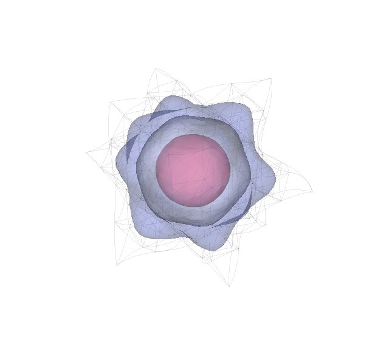
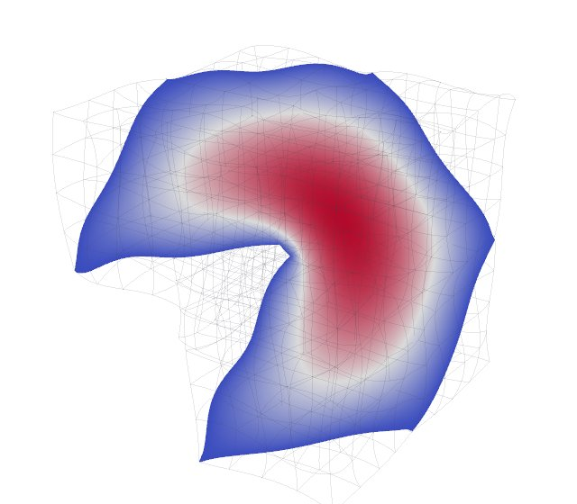
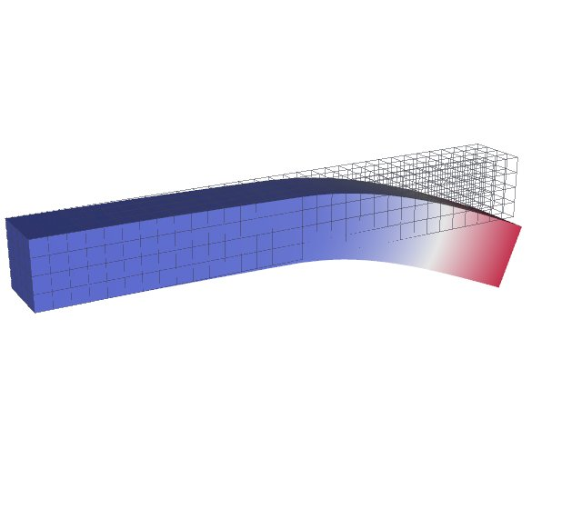
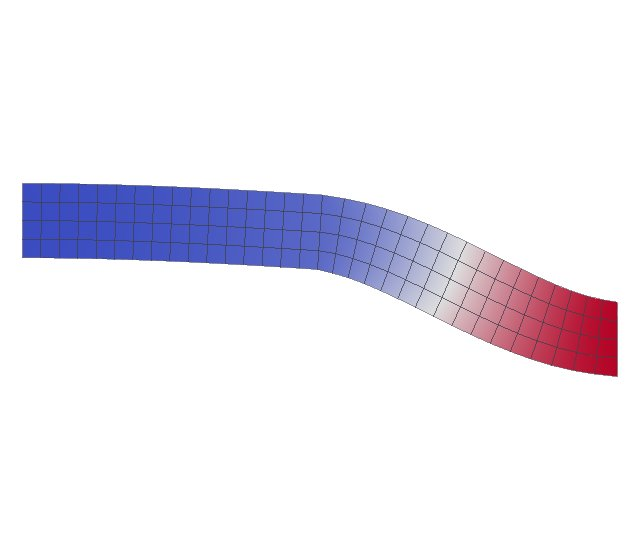
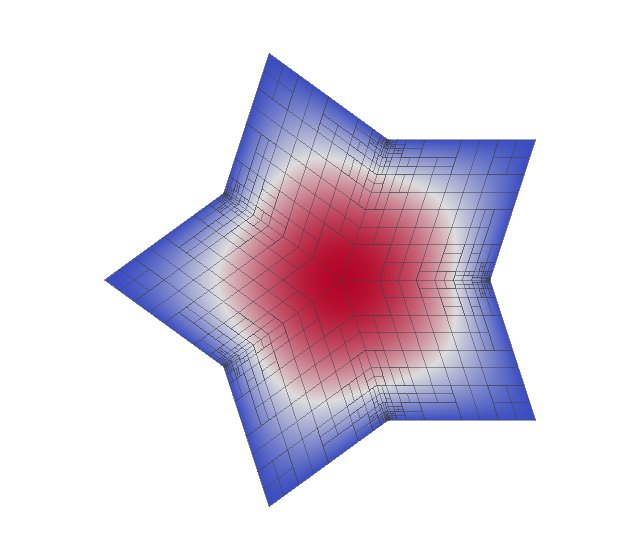
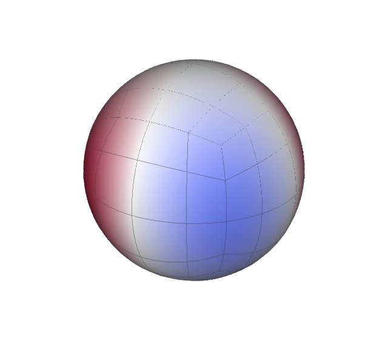
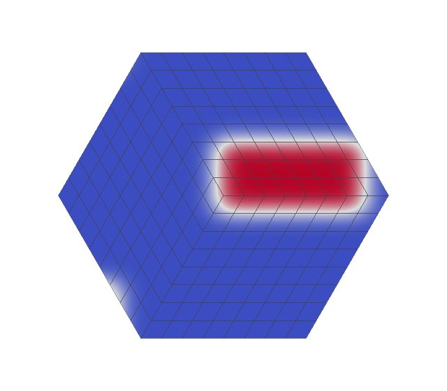

# MFEM Gallery

MFEM's examples, through Tack. Each problem is solved with PyMFEM on MFEM's own
meshes: curved tetrahedra and hexahedra of order 3, nonconforming meshes from
adaptive refinement, a curved surface, periodic meshes, and DG fields. Tack imports
the mesh and solution with `tack.interop.mfem.mfem_to_dataset`, then runs its
filters on them.

Tack makes everything drawn: contours and slices cut on sub-cells of the curved
cells, curved and discontinuous meshes subdivided into linear cells, and each
cell's edges as lines that follow the geometry. VTK only draws linear polygons
and lines.

The pictures come from `docs/gallery/mfem_examples.py`, which needs the
`interop` extra. The problems are in `docs/gallery/_mfem.py`, MFEM's examples
written out. tack-examples' MFEM ports (`tack_examples/mfem/`) run the same
problems and hold Tack to MFEM's evaluation of them: values at random points of
every element, gradients, DG jumps face by face, and integrals.

## Poisson on curved cells

MFEM's ex1, -Δu = 1 with u = 0 on the boundary, in `H1` of order 3:

- **The Escher knot** (left): curved tetrahedra of order 3. The three
  isosurfaces nest, the outer two translucent.
- **The Fichera corner** (right): curved hexahedra of order 3, sliced through
  the re-entrant corner. The slice's edge follows the curved cells.

<div class="grid cards" markdown>

-   { loading=lazy decoding=async width=640 height=560 }

    Curved tetrahedra (ex1, `escher-p3.mesh`)

-   { loading=lazy decoding=async width=640 height=560 }

    Curved hexahedra (ex1, `fichera-q3.mesh`)

</div>

=== "The Escher knot"

    ```python
    --8<-- "docs/gallery/mfem_examples.py:escher"
    ```

=== "The Fichera corner"

    ```python
    --8<-- "docs/gallery/mfem_examples.py:fichera"
    ```

## Elasticity

MFEM's two-material beam, fixed at one end:

- **ex2** (left): pulled down at the other end. The displacement is in `H1` of
  order 2. `warp` lifts the straight beam into the displacement's space, so the
  displaced beam is curved. The undisplaced beam's edges are drawn too.
- **ex17** (right): displaced by DG of order 2. MFEM moves the mesh's nodes into
  the DG space, so the geometry is a curved, discontinuous `L2` geometry: each
  cell has its own nodes.

<div class="grid cards" markdown>

-   { loading=lazy decoding=async width=640 height=560 }

    Warped by an order-2 displacement (ex2)

-   { loading=lazy decoding=async width=640 height=560 }

    An order-2 `L2` geometry (ex17)

</div>

=== "ex2"

    ```python
    --8<-- "docs/gallery/mfem_examples.py:beam"
    ```

=== "ex17"

    ```python
    --8<-- "docs/gallery/mfem_examples.py:dg-beam"
    ```

## Adaptive refinement and curved surfaces

- **ex6** (left): the star, refined where the error estimate is largest. The
  mesh is nonconforming: the hanging nodes show in the cells' edges. The
  values agree across each T-junction, so the picture has no cracks, but
  face-based algorithms treat the T-junctions as boundary for now
  ([Nonconforming meshes](16-cells-and-bases.md#reading-and-writing-other-formats)).
- **ex7** (right): the cube's quads snapped onto the sphere, as curved cells of
  order 3, with the solution of a surface PDE on them.

<div class="grid cards" markdown>

-   { loading=lazy decoding=async width=640 height=560 }

    A nonconforming mesh (ex6)

-   { loading=lazy decoding=async width=640 height=560 }

    Curved quads of order 3 (ex7)

</div>

=== "ex6"

    ```python
    --8<-- "docs/gallery/mfem_examples.py:star"
    ```

=== "ex7"

    ```python
    --8<-- "docs/gallery/mfem_examples.py:sphere"
    ```

## DG advection on a periodic mesh

MFEM's ex9 carries a bump across the periodic hexagon in DG of order 3. Part of
the bump has crossed the seam: it shows at the bottom left.

A periodic mesh keeps its nodes per element, as an `L2` geometry. Cells on the
two sides of the seam share points in the topology but sit apart in space, so
`subdivide` gives each cell its own lattice points.

<div class="grid cards" markdown>

-   { loading=lazy decoding=async width=640 height=560 }

    A periodic mesh (ex9)

</div>

```python
--8<-- "docs/gallery/mfem_examples.py:advection"
```
