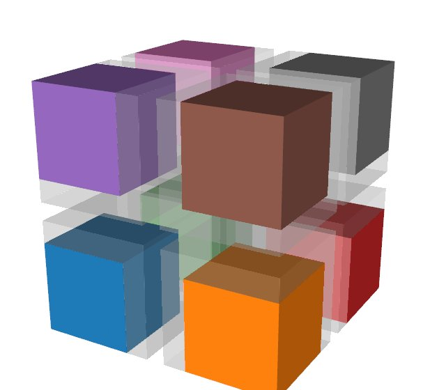
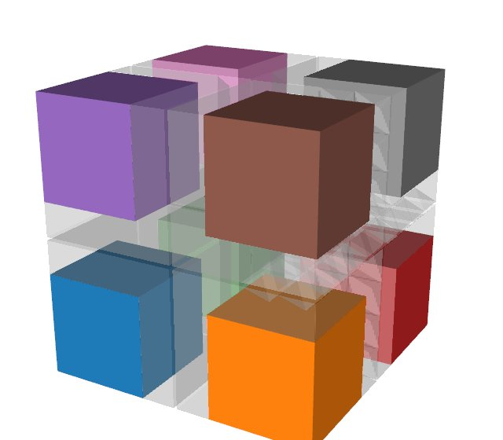

# Filters over pieces

Data often comes in pieces: a reader's partitions, a simulation's blocks, the
share of each GPU or MPI rank. The analysis should still give the whole
dataset's results, whether the pieces are on one process or on many ranks.
Tack runs filters on each piece and combines the pieces only where an answer
needs all of them. The sections below show what changes when filters run on
pieces, how to add ghost cells and global ids, which algorithms combine the
pieces, and how to merge the pieces back into one dataset.

Tack keeps each piece a whole dataset, and a
[`PartitionedDataSet`](../reference/glossary.md) holds them, as VTK's
`vtkPartitionedDataSet` does. [Ghost marks](../reference/glossary.md) say
which cells and points of a piece another piece owns.
[Data in pieces](../data/pieces.md) explains the container, the marks and
owners, and global ids. This page shows what the algorithms do with them.

```python
--8<-- "docs/examples/vis2_pieces.py:first"
```

```text
9261 points over the pieces, 9261 in the whole
```

The four pieces hold more points than the grid, since neighbouring pieces
share some and each has a layer of its neighbours' cells. Each shared point
has one owner, and the reduction counts it there alone.

## What changes with pieces

Three rules cover every algorithm:

- **Work on one piece takes the piece.** Filters, analyses and `for_each`
  take a dataset, as everywhere else, and you loop over the pieces. There is
  no wrapper that applies a filter to every piece, because the loop says
  what it does.
- **Algorithms whose answer needs every piece take the container.** These are
  the reductions, `extract_surface`, `probe`, particle tracing, connected
  regions, the point-cloud algorithms of this page, `merge_pieces`, and the
  algorithms that make ghosts and global ids.
- **Filters carry the ghost marks** to what they make, as VTK's filters do.
  With a layer of ghost cells, the owned part of a filter's output over all
  pieces is the whole's output, cell for cell and point for point.

The algorithms that take pieces are:

| Task | Algorithm | VTK or Viskores counterpart |
|---|---|---|
| Cut a structured grid into pieces | [`split`](../vis-guide/reference/algorithms.md#tack.dataset.algorithms.split.split) | none |
| Add layers of neighbours' cells | [`ghost_cells`](../vis-guide/reference/algorithms.md#tack.dataset.algorithms.ghost_cells.ghost_cells) | `vtkGhostCellsGenerator` |
| Add neighbours' points to point clouds | [`ghost_points`](../vis-guide/reference/algorithms.md#tack.dataset.algorithms.ghost_points.ghost_points) | none |
| Refresh ghost values from their owners | [`update_ghosts`](../vis-guide/reference/algorithms.md#tack.dataset.algorithms.ghost_cells.update_ghosts) | none |
| Drop a piece's ghost cells | [`remove_ghosts`](../vis-guide/reference/algorithms.md#tack.dataset.algorithms.remove_ghosts.remove_ghosts) | `vtkRemoveGhosts`; Viskores' `GhostCellRemove` |
| Number points and cells across pieces | [`generate_global_ids`](../vis-guide/reference/algorithms.md#tack.dataset.algorithms.generate_global_ids.generate_global_ids) | `vtkGenerateGlobalIds` |
| Merge the pieces into one dataset | [`merge_pieces`](../vis-guide/reference/algorithms.md#tack.dataset.algorithms.merge_pieces.merge_pieces) | `vtkMergeBlocks`; Viskores' `MergeDataSets` |
| Summarize a field | [`statistics`](../vis-guide/reference/algorithms.md#tack.dataset.algorithms.statistics.statistics), [`entropy`](../vis-guide/reference/algorithms.md#tack.dataset.algorithms.entropy.entropy) | `vtkDescriptiveStatistics`; Viskores' `Statistics`, `Entropy` |
| The whole's surface | [`extract_surface`](../vis-guide/reference/algorithms.md#tack.dataset.algorithms.extract_surface.extract_surface) | `vtkDataSetSurfaceFilter`; Viskores' `ExternalFaces` |
| Probe at points | [`probe`](../vis-guide/reference/algorithms.md#tack.dataset.algorithms.probe.probe) | `vtkProbeFilter`; Viskores' `Probe` |
| Trace particles | [`advect`](../vis-guide/reference/algorithms.md#tack.dataset.algorithms.advect.advect), [`streamlines`](../vis-guide/reference/algorithms.md#tack.dataset.algorithms.streamlines.streamlines) | `vtkStreamTracer`; Viskores' `ParticleAdvection`, `Streamline` |
| Label connected regions | [`connected_components`](../vis-guide/reference/algorithms.md#tack.dataset.algorithms.connected_components.connected_components) | `vtkConnectivityFilter`; Viskores' `CellSetConnectivity` |

## How filters carry ownership

Filters process the ghost cells too. What a filter makes takes the owner of
what it came from:

| Output | Owner |
|---|---|
| a cell: a contour's triangle, a clip's piece, a kept cell | its source cell's |
| a point a filter keeps | its own |
| a point on an input edge, such as a contour's crossing | the owner of the edge's smallest point |
| a point inside a cell, such as a clip's centroid | the cell's |
| a surface face | the cell it is a side of |
| a face two cells share, an edge, a vertex | the owner of its smallest point |

"Smallest" goes by position, so every piece holding a shared edge decides
alike, with no communication. With a ghost layer, the piece that owns a point
holds every cell around it, so its filters see what the whole would. That is
why each piece's point gradients at its own points are the whole grid's in
the first example. The ghost part of the output is what the next filter near
a piece's edge needs.

## Reduce over the pieces

`statistics(pieces, name)` takes each piece's moments on its own device and
combines them pairwise, in the pieces' global order. `entropy(pieces, name,
bins)` sums each piece's histogram over the whole's range. Both count only
what each piece owns, so the statistics of the pieces' isosurfaces are the
whole grid's isosurface's.

`extract_surface(pieces)` gives the whole's surface, a piece each. A piece's
own surface includes the faces it shares with its neighbours, since it cannot
tell them from the boundary. Given the container, the faces two pieces hold
are matched by their points and left out.

## Remove the ghosts at the end

Before rendering, writing one file, or handing a piece to code that does not
know ghost marks, take the ghost output away:

```python
--8<-- "docs/examples/vis2_pieces.py:remove"
```

`remove_ghosts` drops the duplicate and hidden cells and the points no
remaining cell uses, as VTK's `vtkRemoveGhosts` does. The points it keeps
keep their marks, so reductions over the result are unchanged. A point the
piece owns stays even when only ghost cells used it. A structured piece
whose remaining cells form a block stays a structured grid. `dataset_to_vtk`
keeps the marks too, so pieces with ghosts can go to VTK as they are, and
VTK leaves the ghosts out when it renders.

## Pieces without ghost cells

Without ghost cells, a piece cannot tell what its neighbours make on the
cells, faces and edges they share. A contour point on a shared edge belongs
to the owner of the edge's smallest point, and that piece may have no cell
holding the edge. Tack does not guess. Such outputs record that they lost
their marks, and reductions refuse them:

```python
--8<-- "docs/examples/vis2_pieces.py:no-ghosts"
```

`generate_global_ids` of the outputs marks them. It matches their points by
position, so a point several pieces made belongs to the lowest of them. The
marked outputs then reduce to the whole's. That costs one exchange of the
outputs' points, where ghost cells cost a layer of cells in every piece
before filtering.

What does not depend on neighbours works on pieces without ghost cells as
they are:

- reductions of the pieces themselves, and `extract_surface` of the
  container;
- filters that keep the cells and points: `warp`, `transform`,
  `cylindrical`, `spherical`, `shrink`, `as_polyhedra`, `as_polygons`, and
  `probe`'s target;
- filters that choose points by their own values: `threshold_points`,
  `extract_points`, `mask_points`.

## Add ghost cells

`split(data, n, ghost_layers=1)` cuts a structured grid and adds the layer
itself. Pieces from elsewhere, such as a partitioner, a reader or VTK's
redistribution, get one from `ghost_cells`, as VTK's `vtkGhostCellsGenerator`
would give them:

```python
--8<-- "docs/examples/vis2_pieces.py:ghost-cells"
```

Pieces neighbour where they share points at exactly the same position.
`tolerance=` matches points a little apart, for pieces whose copies of a
shared point differ in their last bits. A shared point belongs to the lowest
piece holding it. `ghost_cells` takes unstructured, polyhedral or structured
pieces, all of one kind. Structured pieces stay structured, each its block
grown by the layers. `as_polyhedra` makes shaped pieces polyhedral, for a
reader that gives both kinds.

<div class="grid cards" markdown>

-   { loading=lazy width=240 height=210 }

    **An image**, split into eight structured blocks

-   { loading=lazy width=240 height=210 }

    **Tetrahedra**, extracted by octant

-   { loading=lazy width=240 height=210 }

    **Hexahedra, wedges and pyramids**, extracted by octant

</div>

Each mesh of a unit cube is cut into eight pieces, one an octant, and
`ghost_cells` gives each piece one layer. The pieces are drawn pulled apart.
A piece's own cells have its color, and its ghost cells are faint, reaching
into the pieces around it.

A filter that needs each entity's neighbours is right on what a piece owns,
but wrong on the rim of the ghost layer, whose neighbours the piece lacks.
Before a second such filter reads those values, copy them from their owners:

```python
--8<-- "docs/examples/vis2_pieces.py:update"
```

`ghost_cells` keeps its exchanges, so each `update_ghosts` is one copy per
neighbour, not a new matching. Two layers (`layers=2`) avoid the refresh for
two neighbour filters in a row, at the cost of more cells.

## Number points and cells across pieces

Each piece numbers its points and cells from 0.
[Global ids](../reference/glossary.md) number them across all the pieces,
the same id wherever a point or cell is held. VTK's `GlobalIds` arrays
become them, and `generate_global_ids` makes them, as `vtkGenerateGlobalIds`
does:

```python
--8<-- "docs/examples/vis2_pieces.py:global-ids"
```

`piece.global_ids.points` and `.cells` are `i64` arrays. Filters keep the
ids of the points and cells they keep, such as `threshold`, `extract_cells`
and `remove_ghosts`. What they make has none. With global ids on every
piece, `ghost_cells` matches points by id rather than position, and
`connected_components` numbers regions as on the whole dataset.

## Probe, trace and label across pieces

Three algorithms follow points or regions from piece to piece:

```python
--8<-- "docs/examples/vis2_pieces.py:across"
```

- `probe(pieces, points)` evaluates each point in the piece one of whose own
  cells holds it, and returns the values in your points' order. The values
  equal those of probing the whole. Ghost cells are not needed.
- `advect` and `streamlines` hand particles from piece to piece. With a
  ghost layer wider than a step, the paths are the whole mesh's up to
  rounding. A particle that ends a step in a ghost cell goes to the cell's
  owner. Without ghost cells it crosses at the boundary by a shortened step.
  Each piece of `streamlines`' result holds the stretches it traced, and each
  stretch after the first starts at a point marked as a duplicate.
- `connected_components(pieces)` labels cells connected through shared
  points, numbering each region once across all the pieces.

## Point clouds in pieces

A point cloud's pieces share no points, so a filter over a point's
neighbours needs copies of the nearby points other pieces hold.
`ghost_points` appends them, marked as ghosts: every point within `radius` of
the piece, or exactly those among its owned points' `k` nearest. The
neighbour filters of [Points and particles](points-and-particles.md) then run
per piece, and each owned point gets the whole's answer. Clustering,
statistical outliers, voxel downsampling, deposits and halo catalogues need
every piece, so they take the container:

<!-- tack-check: pieces-points -->
```python
import numpy as np

import tack
import tack.dataset as td

tack.set_default_device("cpu")

# Clumps in a periodic box, and the same cloud cut into four pieces.
rng = np.random.default_rng(4)
box = 10.0
x = np.concatenate([c + rng.normal(0.0, 0.3, (400, 3)) for c in rng.uniform(1, 9, (12, 3))]
                   + [rng.uniform(0.0, box, (2000, 3))]) % box
x = x.astype(np.float32)
whole = td.point_cloud(x, origin=(0.0, 0.0, 0.0))
parts = np.array_split(x, 4)
pieces = td.PartitionedDataSet([td.point_cloud(part, origin=(0.0, 0.0, 0.0))
                                for part in parts])

# Per piece, after copying in each owned point's 10 nearest from elsewhere.
ghosted = td.ghost_points(pieces, k=10)
normals = np.concatenate([td.point_normals(piece, k=10).fields["normals"].values.numpy()
                          [:len(own)] for piece, own in zip(ghosted, parts)])
expected = td.point_normals(whole, k=10).fields["normals"].values.numpy()
assert np.abs(normals - expected).max() < 1e-3

# Over the pieces: the whole's clusters, numbered as the whole numbers them.
groups = td.connected_components(pieces, radius=0.15, min_size=50, periodic=box)
labels = np.concatenate([p.fields["point_region"].values.numpy() for p in groups])
assert np.array_equal(labels, td.connected_components(
    whole, radius=0.15, min_size=50, periodic=box).fields["point_region"].values.numpy())
print(labels.max() + 1, "clusters")
```

A piece's own points come first in `ghost_points`' result, in their order,
which is why `[:len(own)]` picks them. After a filter that is right only on
a piece's own points, `update_ghosts` brings the copies' values from their
owners: SPH densities before an interpolation that reads them, for
instance. `deposit` of pieces gives every rank the whole grid, and
`halo_catalog` of pieces a catalogue piece per piece. In a periodic box the
copies across a face are images, moved by the box's side, so run per-piece
filters on `ghost_points`' result without `periodic`.

## Merge the pieces into one dataset

`merge_pieces` gives the pieces back as one dataset, each cell and point
once, ghosts dropped: to write one file, or for code that knows no pieces.

```python
--8<-- "docs/examples/vis2_pieces.py:merge"
```

```text
StructuredTopology 8000 cells
```

Structured pieces that tile a box come back as one structured grid. Others
give an unstructured dataset, numbered as `generate_global_ids` numbers it.
Across MPI ranks the result is on the root rank, `root=0` by default, and
`None` elsewhere.

## Pieces from VTK

`vtk_to_dataset` turns a `vtkPartitionedDataSet` into a `PartitionedDataSet`,
and `dataset_to_vtk` turns it back. VTK's filters cut an unstructured mesh
with ghost cells, with no MPI needed:

<!-- tack-check: pieces-vtk -->
```python
from vtkmodules.vtkFiltersParallelDIY2 import (
    vtkGhostCellsGenerator,
    vtkRedistributeDataSetFilter,
)
from vtkmodules.vtkImagingCore import vtkRTAnalyticSource

import tack
import tack.dataset as td
from tack.interop.vtk import vtk_to_dataset

tack.set_default_device("cpu")

mesh = vtkRTAnalyticSource(whole_extent=(-10, 10, -10, 10, -10, 10))()
cut = (vtkRedistributeDataSetFilter(number_of_partitions=4,
                                    preserve_partitions_in_output=True)
       >> vtkGhostCellsGenerator(number_of_ghost_layers=1, build_if_required=False))
pieces = vtk_to_dataset(cut(mesh))                 # four unstructured pieces, marked
assert td.statistics(pieces, "RTData").n == mesh.number_of_points
```

[VTK](vtk.md) covers the conversions in full.

## Pieces on several devices

A piece is a dataset, so it can live on any device, and each piece's work
runs where the piece is. Reductions reduce each piece on its own device:

```python
--8<-- "docs/examples/vis2_pieces.py:devices"
```

[Data on devices](../data/devices.md) explains where a dataset lives and how
`to_device` moves it.

## Across MPI ranks

Over MPI, each rank holds its own pieces, and the container's
[world](../reference/glossary.md) says where the others are. A world is a
`tack.communication.World`, made from an mpi4py communicator or, without
one, for this process alone. The algorithms that take the container then
communicate. The per-piece loops do not change:

```python
--8<-- "docs/examples/vis2_pieces.py:mpi"
```

```bash
mpiexec -n 4 python script.py
```

The same script runs in one process and on many ranks. Tack imports no MPI
module: you make the communicator, and mpi4py must be built against your MPI
(`uv sync --extra mpi`). Results that sum over pieces add in the pieces'
global order, so they have the same bits however the pieces are shared out.
With an MPI that reads device memory, `tc.World(comm, gpu_aware=True)` sends
device arrays without staging them through the host. Make the rank's device
(`tack.device("cuda:N")`) before importing `mpi4py.MPI`, which starts MPI.
[MPI](../communication/mpi.md) covers worlds and transports, and every
algorithm here is written on the [communication layer](../communication/index.md),
so one of your own can be too.

## Details

**Hidden cells.** Filters never process cells marked hidden, since their data
are not valid there. Every filter that makes cells or points leaves them out,
and so do `probe`, `advect` and `streamlines` in their source dataset.
Algorithms whose output is on the same cells, such as gradients and
projections, still compute there, and the marks stay. Faces or edges chosen
by id and a reused `CellLocator` are refused on data with hidden cells.

**Fields the marks cannot place.** An `L2` field goes by its cells' marks.
A field on faces or edges, or of order 2, is refused by reductions on a
dataset with marks, since who owns those values is not decided yet.

**Not here yet.** Rebalancing pieces and asynchronous exchange are not
planned for now.

## Where to go next

- [Data in pieces](../data/pieces.md) explains the container, owners and
  marks behind this page.
- [Write a filter](write-a-filter.md) shows how a filter of your own carries
  the marks.
- [The communication layer](../communication/index.md) is what these
  algorithms are written on.
