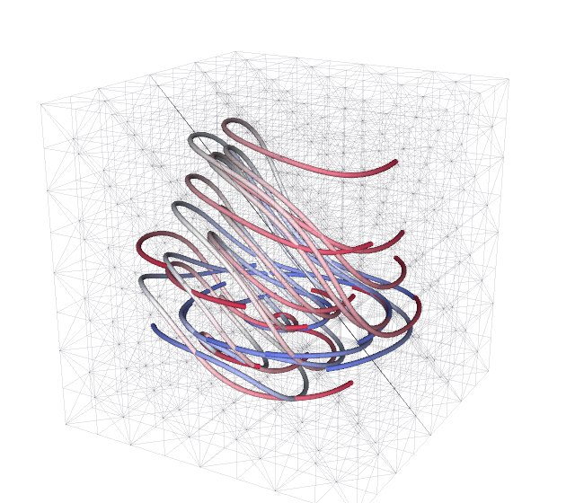
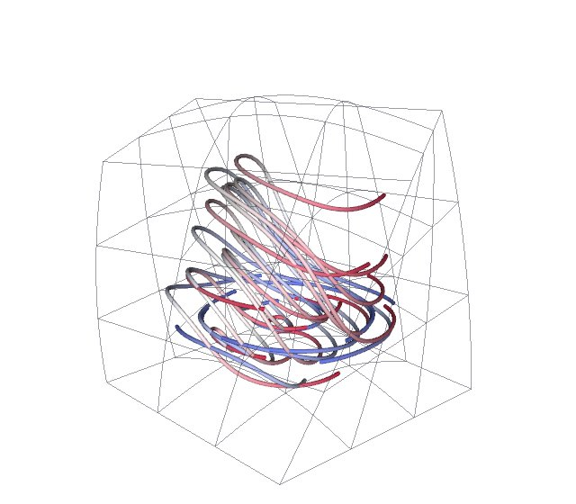

# Steps over time

A simulation produces its time steps one after another, in situ or as a
series of files. An analysis of them should receive each step once and keep
only what it needs of earlier ones. Tack's temporal filters work that way.
They keep running statistics over the steps, take time derivatives, carry
particles through a velocity field that changes in time, and build pathlines
and streaklines.

Tack keeps no series of steps. Each step is a dataset at its own time,
`data.time` in `data.time_unit`, and every filter keeps that time on what it
makes. Stateless filters, such as a contour or a threshold, treat each step
like any dataset. Filters that need more than the current step are small
objects, temporal filters, that you feed one step at a time. Their
`update(data)` returns that step's output, and the object keeps what it
needs of earlier steps. [Coordinates, units and time](../data/units-coordinates-time.md)
explains a dataset's time and units.

<!-- tack-check: time-first -->
```python
import numpy as np

import tack
import tack.dataset as td

tack.set_default_device("cpu")

stats = td.RunningStatistics("T")       # per point, over the steps so far
rate = td.TimeDerivative("T")           # since the previous step

for step in range(5):
    # A simulation's step: its mesh, a temperature field and the time.
    data = td.uniform_grid((8, 8, 8), spacing=(0.1, 0.1, 0.1), unit="m")
    data.time, data.time_unit = 0.5 * step, "s"
    x = data.positions()
    temperature = 20.0 + 5.0 * np.sin(x[:, 0] * 3.0 + 0.4 * step)
    data.fields["T"] = td.Field(td.H1(data), tack.array(temperature.astype(np.float32)),
                                unit="degC")

    summary = stats.update(data)        # the step, with T_mean, T_variance, T_min, T_max
    change = rate.update(data)          # the step with T_dt; None on the first step
    hot = td.threshold(summary, "T_max", 24.0, 30.0)      # filters as on any dataset

print(stats.count, "steps;", summary.fields["T_variance"].unit, change.fields["T_dt"].unit)
assert summary.time == 2.0 and change.fields["T_dt"].unit == "K/s"
assert np.all(summary.fields["T_min"].values.numpy() <= summary.fields["T_mean"].values.numpy())
```

```text
5 steps; K**2 K/s
```

## The temporal filters

| Filter | What `update(data)` returns | VTK or Viskores counterpart |
|---|---|---|
| [`RunningStatistics`](../vis-guide/reference/data-model.md#tack.dataset.RunningStatistics) | the step with each field's mean, variance, minimum and maximum so far | `vtkTemporalStatistics` |
| [`TimeDerivative`](../vis-guide/reference/data-model.md#tack.dataset.TimeDerivative) | the step with each field's rate of change since the previous step | none |
| [`Advection`](../vis-guide/reference/data-model.md#tack.dataset.Advection) | the particles at the step's time | `vtkParticleTracer` |
| [`Pathlines`](../vis-guide/reference/data-model.md#tack.dataset.Pathlines) | a polyline per particle through its positions so far | `vtkParticlePathFilter`; Viskores' `Pathline` |
| [`Streaklines`](../vis-guide/reference/data-model.md#tack.dataset.Streaklines) | a polyline per seed through the particles it released | `vtkStreaklineFilter` |

[`extend_paths`](../vis-guide/reference/data-model.md#tack.dataset.extend_paths)
is a function, not an object. It joins one step's particles onto the paths so
far.

Two rules hold for all of them. Feed the steps in increasing time. And feed
every step through the same object, since the object is the memory between
steps.

## Keep running statistics

`RunningStatistics(fields)` takes a name or a list of names. Each update adds
the step's values, per point or per cell, and returns the step with four
fields beside its own:

| Field | Meaning | Unit |
|---|---|---|
| `<name>_mean` | the mean over the steps so far | the field's |
| `<name>_variance` | the population variance | the field's squared |
| `<name>_min`, `<name>_max` | the extremes so far | the field's |

The sums are kept on the device by Welford's method, in double precision
where the device has it. Vector fields are taken component by component.
`count` is the number of steps added. The variance of a field in degrees
Celsius is in kelvin squared, since a difference of temperatures is in
kelvin.

The filter keeps only its sums, so nothing of earlier steps is copied. The
steps must be on one mesh. That means the same topology, or one of the same
kind, sizes and arrays, as a simulation gives that builds a new dataset each
step over the same mesh. A step on another mesh is refused. Remesh it onto
the first step's mesh first, by probing onto it, say.

## Take time derivatives

`TimeDerivative(fields)` returns the step with `<name>_dt`, the backward
difference `(value - previous) / (time - previous time)` per point or cell.
Its unit is the field's over the time unit, so a field in degrees Celsius
gives kelvin per second. The first step has no previous one, and its update
returns `None`. The steps must be on one mesh and in increasing time. Times
in two units, such as seconds and then minutes, are converted.

## What a filter keeps of earlier steps

A filter that needs an earlier step's values keeps a copy of them. In situ, a
simulation's arrays often reach Tack without a copy, through DLPack, and the
simulation overwrites them at the next step. A reference would then see the
new values. `copy=False` keeps references instead, when you know the buffers
are not reused between steps. Each filter keeps only what it reads: a field,
and the positions where the mesh moves. An image's coordinates or a constant
field, which nothing writes, are kept as they are.

## Carry particles through the steps

`Advection(field, seeds)` carries particles through a velocity field that
changes in time. Each update moves every particle from its time to the
step's time. The velocity between two steps is linear in time, from the
previous step, which the filter keeps, to this one. The update returns the
particles at their current positions: a point cloud at the step's time.

<!-- tack-check: time-advection -->
```python
import numpy as np

import tack
import tack.dataset as td

tack.set_default_device("cpu")


def step(t):
    """A wind along x that strengthens with time: the simulation's step at t seconds."""
    data = td.uniform_grid((11, 11, 2), spacing=(1.0, 1.0, 1.0), unit="m")
    data.time, data.time_unit = t, "s"
    v = np.zeros((data.num_points, 3), np.float32)
    v[:, 0] = 0.5 + 0.1 * t
    data.fields["v"] = td.Field(td.H1(data), tack.array(v, tack.vec3()), unit="m/s")
    return data


particles = td.Advection("v", seeds=[[1.0, 5.0, 0.5], [1.0, 2.0, 0.5]], step_size=0.25)
paths = None
for t in range(6):
    if t == 2:
        particles.inject([[1.0, 8.0, 0.5]], time=2.0)    # a third particle, from 2 s
    now = particles.update(step(float(t)))              # the particles at this step's time
    paths = td.extend_paths(paths, now)                 # joined into polylines by seed

x = now.world_positions()[:, 0]
print(x, now.fields["release"].values.numpy())
# x(t) = 1 + 0.5 t + 0.05 t^2: exact, since the velocity is linear in time.
assert np.allclose(x[:2], 1 + 0.5 * 5 + 0.05 * 25, atol=1e-4)
assert np.isclose(x[2], 1 + (0.5 * 5 + 0.05 * 25) - (0.5 * 2 + 0.05 * 4), atol=1e-4)
assert paths.num_cells == 3
```

```text
[4.75       4.75       3.54999995] [0. 0. 2.]
```

The particles' fields are:

| Field | Meaning |
|---|---|
| `seed` | each particle's number |
| `source` | the seed point it came from, or -1 |
| `release` | its release time |
| `time` | its current time |
| `status` | [`ParticleStatus`](../vis-guide/reference/algorithms.md#tack.dataset.algorithms._advection.ParticleStatus) bits, as `advect` gives them |

`seeds` are released at the first step's time. `inject(points, time=)`
releases more particles at any time from the last step's on. Without `time`,
they are released at the last step's time. A particle released after the
coming step waits for a step that reaches it. A time before the last step is
refused, since that interval has been integrated.

The main options:

- `integrator` is `"rk4"` (the default) or `"euler"`.
- `step_size`, in the steps' time unit, bounds each substep. By default there
  is one substep from step to step.
- `copy=False` keeps a reference to the previous step instead of a copy.

The velocity at each substep is a [probe](sample-and-trace.md) of both steps'
own meshes, so the mesh may change between steps. A particle that leaves the
mesh stops where it last was, marked `SPATIAL_BOUNDS`. Times convert between
the steps' unit and the velocity's, so steps in minutes with a velocity in
metres per second work.

## Build pathlines and streaklines

A [pathline](../reference/glossary.md) is one particle's path through a field
that changes in time. A [streakline](../reference/glossary.md) is the line
through every particle released from one point over time, as dye released
continuously traces it.

<!-- tack-check: time-pathlines -->
```python
import numpy as np

import tack
import tack.dataset as td

tack.set_default_device("cpu")


def step(t):
    """A swirl that speeds up: a simulation's step at time t (seconds)."""
    data = td.uniform_grid((21, 21, 3), spacing=(0.5, 0.5, 0.5), unit="m")
    data.time, data.time_unit = t, "s"
    x = data.positions().astype(np.float64) - [5.0, 5.0, 0.0]
    v = np.stack([-x[:, 1], x[:, 0], np.zeros(len(x))], axis=1) * (0.2 + 0.1 * t)
    data.fields["v"] = td.Field(td.H1(data), tack.array(v.astype(np.float32), tack.vec3()),
                                unit="m/s")
    return data


seeds = np.array([[7.0, 5.0, 0.5], [5.0, 8.0, 0.5]])
pathlines = td.Pathlines("v", seeds, step_size=0.1)
streaklines = td.Streaklines("v", seeds[:1], releases=4)
for t in np.arange(0.0, 3.01, 0.5):
    data = step(t)
    if t == 1.0:
        pathlines.inject([[3.0, 5.0, 0.5]])          # released at the last step's time
    paths = pathlines.update(data)                   # every particle's path so far
    streak = streaklines.update(data)                # the line of the seed's particles

print(paths.num_cells, "paths,", paths.num_points, "points;", streak.num_points, "in the streak")
radius = np.linalg.norm(paths.world_positions()[:, :2] - [5.0, 5.0], axis=1)
assert np.allclose(radius[paths.fields["seed"].values.numpy() == 0], 2.0, atol=1e-3)
assert paths.num_cells == 3 and streak.num_cells == 1
```

`Pathlines` is `Advection` and `extend_paths` together. It takes
`Advection`'s arguments and returns the current pathlines every step: a
polyline per particle, with `seed` and `time` on its points. A particle's
first point stays alone, in no line, until the particle has moved.

<div class="grid cards" markdown>

-   { loading=lazy width=240 height=210 }

    **Tetrahedra**: the velocity linear in each cell

-   { loading=lazy width=240 height=210 }

    **Order 3** on curved hexahedra

</div>

Each picture follows 16 particles through 60 steps of a swirl that changes
in time, inside a unit cube. Each path is drawn as a tube colored by `time`.
The [gallery](../vis-guide/gallery.md#pathlines) shows two more kinds of cell.

`Streaklines(field, seeds, releases=1)` releases `releases` particles at each
seed every step, at times spread evenly over the interval since the previous
step. It returns a polyline per seed through its particles still in the mesh,
newest first, with `source`, `release` and `time` on the points.

`extend_paths(paths, particles)` stands alone. Given `None` or its last
result, and an `Advection`'s output, it appends each particle's new point and
joins the points of each particle into a polyline by `seed`. Particles
written to files step by step can be joined into paths afterwards this way.

## Steps in pieces

A `PartitionedDataSet` streams piece by piece. Each piece keeps its own
state, so every step must bring the same pieces, and the output is pieces
too. Over MPI ranks each rank feeds its own pieces. The statistics and
derivatives need nothing from other ranks. `Advection` over pieces probes
each point on the rank whose cells hold it, so particles stay on the rank
that released them. [Filters over pieces](over-pieces.md) explains pieces
and ranks.

## Details

**How many particles.** The particles live on the host in double precision.
Each substep probes both steps for every particle. Point location runs on the
device, but each probe is its own set of launches, so `Advection` and the
line filters suit thousands of particles more than millions. For a steady
field, `advect` and `streamlines` run every particle on the device, one
thread each; see [Sample and trace](sample-and-trace.md).

**Pieces and hierarchies at one time.** The pieces of a
`PartitionedDataSet` and the boxes of an AMR dataset must share one time, in
units that convert. An octree's time is its roots'.

## Where to go next

- [Sample and trace](sample-and-trace.md) covers probes, streamlines and
  `advect` in a steady field.
- [Coordinates, units and time](../data/units-coordinates-time.md) explains
  a dataset's time and the units these filters derive.
- [Filters over pieces](over-pieces.md) runs the same loops on many ranks.
