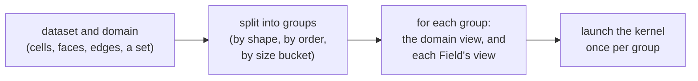

# Views: how a kernel sees a dataset

A kernel that works on a mesh asks questions in mesh terms. Which points does
this cell have? Where are they? What is the field's value here? A dataset
answers from arrays, and the arrays differ from one kind of mesh to the next.
A **view** stands between the two. It is a small object that holds a dataset's
arrays and answers those questions, and it is compiled into the kernel. Every
algorithm you write sees its dataset through views, so they come first: what a
view is, where views come from, and what a kernel may rely on. The tutorials
[Write a mesh algorithm](write-a-mesh-algorithm.md) and
[Write a filter](write-a-filter.md) then put views to work.

The page assumes [kernels](../core/kernels.md) and
[device classes](../core/device-classes.md) from the Core layer, and a
dataset's [fields](../data/fields.md) from the Data layer. Tack's terms are
in the [glossary](../reference/glossary.md).

## One kernel, every mesh

This kernel averages a field over each cell's corners. It does not know what
kind of mesh it runs on:

<!-- tack-check: views-one-kernel -->
```python
import numpy as np

import tack
import tack.dataset as td

tack.set_default_device("cpu")


@tack.kernel
def corner_mean(cells, u, out):
    for c in cells:
        total = 0.0
        for j in range(cells.NUM_POINTS):
            total += u.corner_value(c, j)
        out[cells.entity_id(c)] = total / cells.NUM_POINTS


# A unit cube (a hexahedron) and, beside it, a wedge sharing its x = 1 face.
points = np.array([[0, 0, 0], [1, 0, 0], [1, 1, 0], [0, 1, 0],
                   [0, 0, 1], [1, 0, 1], [1, 1, 1], [0, 1, 1],
                   [2, 0, 0], [2, 0, 1]], np.float32)
topology = td.UnstructuredTopology(
    types=np.array([td.shapes.HEXAHEDRON, td.shapes.WEDGE], np.uint8),
    offsets=np.array([0, 8, 14]),
    connectivity=np.array([0, 1, 2, 3, 4, 5, 6, 7, 1, 8, 2, 5, 9, 6]),
    num_points=10)
data = td.DataSet(topology, points)
T = points[:, 0] + 2 * points[:, 1] + 3 * points[:, 2]
data.fields["T"] = td.Field(td.H1(data), tack.array(T))

means = tack.zeros((data.num_cells,), tack.f32)
td.for_each(corner_mean, data, "cells", data.fields["T"], means)
assert np.allclose(means.numpy(), [3.0, 3.5])        # 8 corners, then 6

# The same kernel on an image: no connectivity, positions computed, not stored.
image = td.uniform_grid((3, 3, 3))
image.fields["T"] = td.Field(td.H1(image), tack.array(image.positions()[:, 2]))
image_means = tack.zeros((image.num_cells,), tack.f32)
td.for_each(corner_mean, image, "cells", image.fields["T"], image_means)
assert np.allclose(image_means.numpy(), [0.5] * 4 + [1.5] * 4)
```

`td.for_each` runs the kernel over the dataset's cells. Its first argument,
`cells`, is a **domain view**: the cells of one shape. The field `T` arrives as
`u`, a **field view**: `T` read through its [space](../reference/glossary.md)
for the same cells. On the mixed mesh the kernel ran twice, once for the
hexahedron, where `NUM_POINTS` is 8, and once for the wedge, where it is 6. On
the image it read no connectivity and no stored positions, and its loop
variable `c` was an `(i, j, k)` index rather than an integer. The source is the
same in every case.

## A dataset is arrays; a view answers in mesh terms

Take the question "which point is corner `j` of cell `c`?". Each kind of
[topology](../reference/glossary.md) answers it differently:

- An `UnstructuredTopology` stores VTK's flat form: every cell's point ids one
  after another, starting at `offsets[c]`. Its view reads each cell's ids from a
  table of rows, one row per cell of the shape.
- A `StructuredTopology` stores nothing. The point id is arithmetic on the
  cell's `(i, j, k)` index.
- A `PolyhedralTopology` derives each cell's distinct points from its faces the
  first time a view needs them.

"Where is that point?" may read a stored array of positions, or compute the
position from an image's origin and spacing. "What is the field's value
there?" depends on the field's space, its order and how its values are
[stored](../data/storage-and-layouts.md).

A view hides all of this behind methods: `cells.point_id(c, j)`,
`cells.corner_position(c, j)`, `u.corner_value(c, j)`. A view is an ordinary
[device class](../core/device-classes.md) holding the arrays it reads, so its
methods are inlined into the kernel. A method costs what the array reads it
stands for cost, and nothing more.

## Three kinds of view

| View | Made from | Answers |
|---|---|---|
| **Domain view** | `"cells"`, `"faces"`, `"edges"`, or the name of a set | the entities' points, positions, faces, sides and neighbours, and the shape's constants |
| **Field view** | a `Field` passed to `for_each` | the field's value at a corner or at parametric coordinates, its parametric gradient, and where each of its values is stored |
| **Node view** | a space passed to `for_each` in place of a domain | each of the space's nodes once, with where its value goes and where it lies |

Domain views and field views go together. A field view reads the entity the
domain view's loop is at, so `u.corner_value(c, j)` is the value at
`cells.point_id(c, j)`. One kernel can take any number of field views, one per
field it reads. Each is its own argument: a view is never nested inside a
dataset object, which keeps a kernel's arguments explicit.

Node views stand alone, and are how a field is filled. A kernel over a space's
nodes visits each node, and so each stored value, exactly once, whether cells
share it or not. [Write a mesh algorithm](write-a-mesh-algorithm.md#fill-a-field-at-its-nodes)
shows one.

## Where views come from: groups and launches

One compiled kernel serves cells that agree on everything compiled into it:
the shape, and the spaces' orders. Tack calls such a set of cells a **group**.
`td.for_each(kernel, data, domain, *args)` works through the groups:



1. **It splits the domain into groups.** On a shape-based topology each shape
   is a group. A group is split further by anything that changes the generated
   code: an `L2` field whose order varies from cell to cell, or the size
   buckets of polyhedra.
2. **It makes the views for each group.** The domain view comes first. Each
   `Field` among `args` becomes its view for the same group. Anything else, a
   plain array or a number, passes through unchanged.
3. **It launches the kernel once per group.**

The same steps are public, for an algorithm that needs to control them. With
the mesh above:

```python
--8<-- "docs/examples/vis3_mesh_algorithm.py:groups"
```

`data.launch_groups(domain, fields)` gives the groups a kernel reading those
fields launches over. `group.shape` is the cell shape and `group.count` the
number of cells in the group. `data.domain_view(domain, group)` and
`field.view(group)` make the views. This is the loop `for_each` runs.

## What is compiled in, and what is not

A view's **class constants** are compiled into the kernel: `NUM_POINTS`,
`NUM_FACES`, `DIMENSION`, a field's `ORDER` and `NODES`. That is why
`range(cells.NUM_POINTS)` is a loop of known length, 8 for a hexahedron, and
why a kernel is compiled once per shape. Tack keeps each compiled form, so a
second dataset of the same kind compiles nothing.

A view's **arrays** (connectivity, positions, values) are ordinary runtime
arguments. New data of the same kind runs the compiled kernel again without
recompiling. Changing a field's values, or the positions, never recompiles.

Cells without a fixed shape have no such constants. A polyhedron's view gives
`num_points(c)` and `num_faces(c)` as runtime counts instead. Methods that walk
a cell's faces, such as `side_point_id(c, k, j)`, work on every kind of
topology, so a kernel written with them runs on hexahedra and polyhedra alike.

## The loop variable belongs to its view

`for c in cells` gives `c` in the form the view understands. On unstructured
cells it is an integer, the cell's row in its group. On structured cells it is
an `(i, j, k)` index vector. Pass it to the view's methods, and nowhere else.

To index an output array that covers the whole mesh, use `cells.entity_id(c)`,
the entity's global id. On a mixed mesh, a group's first cell is not cell 0 of
the dataset, so `out[c]` would write to the wrong place.

## Method names

A view's methods follow one rule per kind of answer, so a name says what
comes back:

| Name | Gives | Examples |
|---|---|---|
| ends in `_id` | a global id | `entity_id(c)`, `point_id(c, j)`, `face_id(c, k)`, `side_point_id(c, k, j)` |
| ends in `_position` | a position | `position(c, pc)`, `corner_position(c, j)`, `side_position(c, k, j)` |
| ends in `_corner` | a shape's local corner number | `edge_corner(e, k)`, `face_corner(f, k)` |
| starts with `num_` or `NUM_` | a count | `NUM_POINTS`, `num_faces(c)`, `side_num_points(c, k)` |

A field view adds `corner_value(c, j)`, `value(c, pc)` at parametric
coordinates `pc`, and `parametric_gradient(c, pc)`. Parametric coordinates are
a location in the cell's reference element, not a world position. The
[Dataset API reference](../vis-guide/reference/dataset-api.md#what-views-offer)
lists every method by kind of entity.

## A field seen at its nodes

A field view also numbers its own cell's nodes, whatever its space, order or
shape:

- `NODES` is how many nodes a cell has. It is a class constant, so a loop over
  them unrolls.
- `node_parametric(k)` is node `k`'s parametric coordinates.
- `dof(c, k)` is its value, and `dof_index(c, k)` is where that value is stored
  in the field's array.

This is enough to compute one field from others of different spaces without
projecting first. An `H1` field of order 2 on a hexahedron has 27 nodes, an
`L2` field its own nodes in each cell, a `Constant` field one at the cell's
centre. [Write a mesh algorithm](write-a-mesh-algorithm.md#work-at-a-fields-nodes)
adds an order-1 field to an order-2 one this way.

`NODES` belongs to the field, not to the shape. A view also has the shape's
`NUM_QUADRATIC` and `quadratic_node(k)`, the quadratic element's nodes, which
is a different count for an order-1 or an order-3 field.

## How a view is put together

A view's class is generated for its group from parts. Each part is a small
class of methods:

- the **entity kind**: cells, faces or edges;
- the **shape**: its constants, corner tables and shape functions;
- the **addressing**: how a cell finds its points, by connectivity or by
  structured index;
- the **storage**: how values are read, whether stored, implicit or by
  `(i, j, k)`;
- for a domain view, the **geometry**, and for a field view, the **space**
  (`H1`, `L2`, `Constant`, of its order and basis).

The parts share one namespace. A view refuses to build if two of them define
the same name differently, so every method has one meaning.

A group keeps what its views read. On a mixed unstructured mesh, that is a
copy of each shape's connectivity as rows. On a mesh of one shape whose
offsets step evenly, the rows are the connectivity itself, reshaped. Each
cell's faces and edges, with how the cell meets each one, are derived the
first time a view needs them: for a face kernel, or for a field with values on
edges and faces.

## Details

- **Names of generated classes are not an interface.** A view's class name
  lists its parts, and may appear in error messages. Kernels depend on the
  methods above, not on those names. The design note
  [View storage and composition](../vis-guide/design/view-composition.md)
  records how groups and classes are built today.
- **There is no `"points"` domain.** An operation on each value of a field
  alone, such as scaling it, needs no mesh: pass `field.values` to an ordinary
  kernel and loop over `range(len(values))`. That is also how to loop over
  points. A point set's ids are read the same way.
- **Shared values agree.** Every cell around an edge or a face reads the same
  stored entry for it. Above order 2, an edge's or a face's several values are
  read in the edge's or the face's own frame, so cells that meet it from
  different directions agree on which value is which.
- **Polyhedra, polygons and polylines** have no reference element. Their views
  locate a point in sub-tetrahedra, in triangles or on segments, and evaluate
  fields there; see [Polyhedra and polygons](../data/polyhedra.md).

## Where to go next

- [Write a mesh algorithm](write-a-mesh-algorithm.md): kernels over cells,
  faces and nodes, step by step.
- [Write a filter](write-a-filter.md): whole filters that return new
  datasets, written with the public pieces the built-in filters use.
