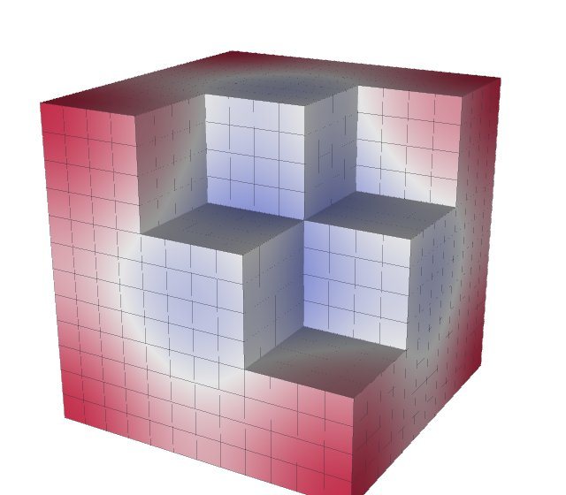
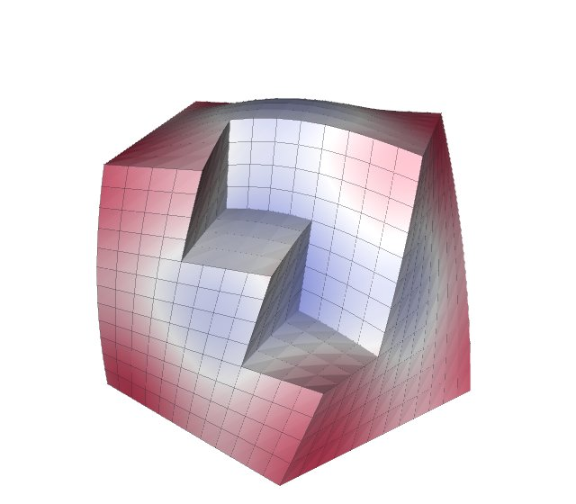

# VTK

Tack does not read most file formats, and it does not render. VTK does both,
so most workflows read with VTK, compute with Tack and draw or write with VTK.
Moving a dataset between the two takes one call each way. The two can share
memory instead of copying it, and Tack's filters can sit in a VTK pipeline
beside VTK's own. VTK's higher-order cells and cell grids convert too. Tack's
terms are in the [glossary](../reference/glossary.md).

Install VTK with Tack's `interop` extra (`uv sync --extra interop`). Tack needs
VTK 9.7.1 or later and uses VTK's pythonic API throughout.

## Convert a dataset both ways

<!-- tack-check: vtk-both-ways -->
```python
import pathlib
import tempfile

import numpy as np
import vtkmodules.vtkCommonDataModel  # registers VTK's pythonic constructors
from vtkmodules.vtkImagingCore import vtkRTAnalyticSource
from vtkmodules.vtkIOXML import vtkXMLUnstructuredGridReader, vtkXMLUnstructuredGridWriter

import tack
import tack.dataset as td
from tack.interop.vtk import dataset_to_vtk, vtk_to_dataset

tack.set_default_device("cpu")

image = vtkRTAnalyticSource(whole_extent=(-10, 10, -10, 10, -10, 10))()
data = vtk_to_dataset(image)                 # an image in Tack too
assert isinstance(data.geometry.values, tack.arrays.UniformCoordinates)

surface = td.contour(data, "RTData", 160.0)
grid = dataset_to_vtk(surface)               # a vtkUnstructuredGrid of triangles
path = pathlib.Path(tempfile.mkdtemp()) / "surface.vtu"
vtkXMLUnstructuredGridWriter(file_name=str(path))(grid)

again = vtk_to_dataset(vtkXMLUnstructuredGridReader(file_name=str(path))())
assert again.num_cells == surface.num_cells == grid.number_of_cells
assert np.allclose(again.fields["RTData"].values.numpy(), 160.0, atol=1e-3)
```

`vtk_to_dataset` makes a Tack `DataSet` from a VTK dataset, and
`dataset_to_vtk` makes a VTK dataset from a Tack one. Both copy by default.
Point data becomes `H1` fields of order 1, and cell data becomes `Constant`
fields; both are [fields](../data/fields.md) of the Data layer. An image stays
an image: its positions are computed from its origin and spacing, never stored.

## What converts to what

| VTK | Tack |
|---|---|
| `vtkImageData` | `StructuredTopology` over `UniformCoordinates` (its direction matrix kept) |
| `vtkRectilinearGrid` | `StructuredTopology` over a `CartesianProduct` of its axes |
| `vtkStructuredGrid` | `StructuredTopology` with explicit positions |
| `vtkUnstructuredGrid` of shaped cells | `UnstructuredTopology` |
| `vtkUnstructuredGrid` with polyhedra | `PolyhedralTopology`, every cell a polyhedron of its faces |
| polygons, polylines | `PolygonalTopology`, `PolylineTopology` |
| `vtkPolyData` | the unstructured grid of its cells; triangle strips as their triangles |
| point data, cell data | `H1` fields, `Constant` fields; a point and a cell array of one name are two fields |
| `vtkGhostType` | the ghost marks, `data.ghosts` |
| `GlobalIds` attributes | the global ids, `data.global_ids` |
| an array's `UNITS_LABEL` | the field's unit |
| `DATA_TIME_STEP` | `data.time` (its unit unknown) |
| `vtkConstantArray`, `vtkAffineArray` | `ConstantArray`, `CountingArray`, still implicit |
| `vtkPartitionedDataSet` | `PartitionedDataSet`, piece by piece |
| `vtkPartitionedDataSetCollection` | a `dict` of `PartitionedDataSet`s, by block name |
| `vtkOverlappingAMR` | `AMRDataSet` ([AMR and octrees](../data/amr-and-octrees.md)) |
| `vtkHyperTreeGrid` | `OctreeDataSet` |
| `vtkCellGrid` | `DataSet` with `H1`, `L2` and `Constant` fields (below) |

Going back, `dataset_to_vtk` makes the matching VTK type. Fields VTK keeps
nowhere are left out: `L2` fields, which would need duplicated points, and
values on faces or edges. A 3-vector point field named `normals` or `Normals`
becomes VTK's active normals.

Positions are kept relative to an [origin](../data/units-coordinates-time.md)
in Tack. `vtk_to_dataset(grid, origin=...)` takes one. Without it, a grid
converted to single precision whose points are far from zero for their size
gets an origin chosen for it, so its coordinates keep their precision.
`dataset_to_vtk` writes world positions.

## Share memory instead of copying

`copy=False` shares arrays where both sides store them alike:

<!-- tack-check: vtk-share -->
```python
import numpy as np
import vtkmodules.vtkCommonDataModel  # registers VTK's pythonic constructors
from vtkmodules.vtkImagingCore import vtkRTAnalyticSource

import tack
import tack.dataset as td
from tack.interop.vtk import dataset_to_vtk, vtk_to_dataset

tack.set_default_device("cpu")

image = vtkRTAnalyticSource(whole_extent=(-10, 10, -10, 10, -10, 10))()
data = vtk_to_dataset(image, dtype=None, copy=False)   # VTK's own arrays
rt = data.fields["RTData"].values
np.asarray(image.point_data["RTData"])[0] = -1.0        # VTK writes ...
assert float(rt[0]) == -1.0                             # ... and Tack sees it


@tack.kernel
def double(v):
    for i in range(v.shape[0]):
        v[i] = 2.0 * v[i]


surface = td.contour(data, "RTData", 160.0)
grid = dataset_to_vtk(surface, copy=False)              # Tack's arrays, in VTK
double(surface.fields["RTData"].values)                 # Tack writes ...
assert np.allclose(np.asarray(grid.point_data["RTData"]), 320.0, atol=1e-3)  # ... VTK sees it
```

From VTK, `copy=False` shares points, data arrays, cell types, offsets,
connectivity, ghost marks and global ids, wherever an array is one contiguous
block of the type Tack keeps it in. `dtype=None` keeps each floating-point
array at its own precision, so an f64 array is shared rather than converted
to f32. The shared arrays are read-only to Tack: a kernel that would write one
is refused. They keep VTK's arrays alive. What cannot be shared is copied:
positions with an origin to subtract, a type to convert, triangle strips,
polyhedra.

To VTK, `copy=False` shares the CPU arrays: points (when there is no origin),
field values, cell arrays, ghost marks and global ids. Writes on either side
reach the other. Arrays on a GPU are copied. On Apple silicon, Metal arrays are
shared too, since their memory is the host's: launches that use a shared
buffer finish before returning, so VTK reads what Tack wrote.

Sharing a single array, rather than a dataset, goes through
`tack.interop.vtk.vtk_to_array` and `array_to_vtk`. They need a VTK built with
`vtkmodules.util.dlpack_support`, which the PyPI wheel lacks; see
[Share arrays](../core/share-arrays.md).

## Put Tack's filters in a VTK pipeline

`tack.interop.vtk.algorithms` wraps Tack's filters as VTK algorithms. They
connect with `>>` like any VTK algorithm:

<!-- tack-check: vtk-pipeline -->
```python
import vtkmodules.vtkCommonDataModel  # registers VTK's pythonic constructors
from vtkmodules.vtkFiltersCore import vtkContourFilter
from vtkmodules.vtkImagingCore import vtkRTAnalyticSource

import tack
from tack.interop.vtk.algorithms import Contour, Gradients, Tetrahedralize

tack.set_default_device("cpu")

source = vtkRTAnalyticSource(whole_extent=(-10, 10, -10, 10, -10, 10))
gradients = Gradients(field="RTData", at="points", name="gradient")
contour = Contour(field="RTData", value=160.0)
surface = (source >> Tetrahedralize() >> gradients >> contour)()
assert contour.error is None
assert sorted(surface.point_data.keys()) == ["RTData", "gradient"]

# The same isosurface by VTK.
theirs = vtkContourFilter(compute_scalars=False)
theirs.SetValue(0, 160.0)
theirs.SetInputArrayToProcess(0, 0, 0, 0, "RTData")
reference = (source >> Tetrahedralize() >> theirs)()
assert surface.number_of_cells == reference.number_of_cells
```

Each algorithm converts its input with `copy=False`, runs the Tack filter
where the input's memory is (or on `device=`), and hands its result back to
VTK with `copy=False`, so no array is copied where both sides store it alike.
Parameters are properties, given to the constructor or set later; setting one
marks the algorithm modified, so the pipeline runs again. Every argument of
the Tack filter is a parameter, with the filter's default, except the data
and what the algorithm supplies itself (the device, a locator, the
communicator): `Contour(field="p", value=0.5, merge_points=False)`.

Every algorithm of the [reference](../vis-guide/reference/algorithms.md) has
one, named as the Tack function in CamelCase, but for the finite-volume
operators that take values on faces (`net_flux`, `divergence`, `perot`), which
VTK keeps nowhere. "Fields" means the input's
type, shallow-copied, with the new arrays added; "faces" means every face as a
polygon (a 2D mesh's edges as lines), or every edge as a line, the new values
their cell data.

| Group | Algorithms | Output |
|---|---|---|
| Cells kept whole | `Threshold`, `ExtractCells`, `ExtractGeometry`, `Mask` | `vtkUnstructuredGrid` |
| | `ExtractExtent` | the input's structure |
| Cutting | `Contour`, `Slice`, `SlicePlane`, `Clip` | `vtkUnstructuredGrid` |
| Surfaces and edges | `ExtractSurface`, `BoundaryFaces`, `ExtractEdges`, `FeatureEdges`, `SurfaceNormals` | `vtkUnstructuredGrid` |
| Shapes for drawing | `Tubes`, `Glyphs` | `vtkUnstructuredGrid` |
| Connectivity and winding | `ConnectedComponents` | the input's type, with `region` arrays |
| | `CheckWinding` | fields: `inconsistent` on the cells |
| | `MergePoints` | `vtkUnstructuredGrid` |
| Changing cell types | `Tetrahedralize`, `Triangulate`, `AsPolyhedra`, `AsPolygons`, `Shrink`, `Subdivide` | `vtkUnstructuredGrid` |
| Moving the geometry | `Transform` | the input's structure (an image stays an image) |
| | `Warp`, `Cylindrical`, `Spherical` | a structured grid for a structured input, else `vtkUnstructuredGrid` |
| Measures and quality | `CellGeometry`, `CellCenters`, `CellQuality`, `Elevation`, `ImplicitValues`, `CellIds`, `PointIds` | fields |
| | `FaceGeometry`, `FaceCenters`, `EdgeLengths` | faces (edges) |
| Fields from fields | `Gradients`, `FlowQuantities`, `Project`, `ValuesAtCenters`, `Interpolate`, `Magnitude`, `Dot`, `Cross`, `Composite`, `LogValues` | fields |
| | `Convert` | the input's structure |
| Finite volumes | `Jump`, `UpwindFlux` | faces |
| Summaries | `Statistics`, `Entropy` | `vtkTable`, a row per field (and component) |
| | `Integrate` | `vtkUnstructuredGrid` of one vertex, as `vtkIntegrateAttributes` |
| Probing, sampling and particles | `Probe` (the source on port 1), `SphInterpolate` (the particles on port 1) | the input's structure, with the source's fields |
| | `Voxelize` | `vtkImageData` (the `grid` parameter's) |
| | `Streamlines`, `Advect` (seeds on port 1, or `seeds=`) | `vtkUnstructuredGrid` |
| Point clouds | `ExtractPoints`, `ThresholdPoints`, `MaskPoints`, `Outliers`, `VoxelDownsample`, `HaloCatalog` | `vtkUnstructuredGrid` |
| | `PointNormals`, `SphDensity` | fields |
| | `Deposit` | `vtkImageData` (the `grid` parameter's) |
| Pieces and ghosts | `GhostCells`, `GenerateGlobalIds`, `MergePieces`, `GhostPoints` | over every piece of a `vtkPartitionedDataSet` |
| | `Split` | a `vtkPartitionedDataSet` |
| | `RemoveGhosts` | the input's structure |
| AMR hierarchies | `AverageDown` | `vtkOverlappingAMR` |

A `vtkPartitionedDataSet` input runs the filter on each piece and gives a
`vtkPartitionedDataSet`. The algorithms whose Tack filter answers for the
pieces together take them together: `GhostCells`, `GenerateGlobalIds` and
`MergePieces`; `ExtractSurface`, which leaves out the faces pieces share;
`ConnectedComponents`, whose regions join across pieces; `Streamlines` and
`Advect`, whose particles go from piece to piece; and the point-cloud and
sampling ones (`Voxelize`, `Outliers`, `VoxelDownsample`, `Deposit`,
`HaloCatalog`). See [Filters over pieces](over-pieces.md). Particles are handed
from piece to piece after whole steps where the pieces have a layer of ghost
cells (`GhostCells`); without one, each crossing costs a shortened step.

Readers of Exodus, IOSS, CGNS, EnSight and OpenFOAM files give trees of
datasets: a `vtkMultiBlockDataSet` or a `vtkPartitionedDataSetCollection`. The
algorithms take them as they are and give a tree of the same shape, with the
blocks' names and a collection's data assembly. Each partitioned dataset in the
tree, a `vtkMultiPieceDataSet` block too, is filtered as a whole, so
`GhostCells` and `GenerateGlobalIds` see all its pieces together, and each
block that is one dataset is filtered on its own.

Over MPI ranks, each rank's pipeline holds its own pieces, and the algorithms
whose answer needs every piece take the other ranks' too. They take the ranks
from VTK, as VTK's own parallel filters do: VTK's global controller
(`vtkMultiProcessController.GetGlobalController()`, which `pvbatch` sets, or a
script with `SetGlobalController`), its communicator made mpi4py's by VTK's
`vtkMPI4PyCommunicator`. `tack.interop.vtk.world()` gives that `World`. VTK's
wheels have no MPI, so with them give the ranks yourself, an mpi4py
communicator or a `World`: `GenerateGlobalIds(world=MPI.COMM_WORLD)`. Over
ranks, `MergePieces` gives the whole to its `root` rank and an empty dataset
to the others.

A field is named as a string, or with where VTK keeps it when a point array and
a cell array share the name: `field=("p", "cells")`. Or choose it as VTK's own
filters do, with `SetInputArrayToProcess`, numbering the algorithm's field
parameters in order. Where Tack takes an implicit function (`Clip`'s `by`),
VTK's `vtkPlane`, `vtkSphere`, `vtkBox`, `vtkCylinder`, `vtkPlanes` and
`vtkImplicitBoolean` work as Tack's. They are the same functions, so a clip
at any value matches, except that a `vtkPlane`'s normal is made a unit vector.

<!-- tack-check: vtk-pipeline-trees -->
```python
import vtkmodules.vtkCommonDataModel as dm
from vtkmodules.vtkImagingCore import vtkExtractVOI, vtkRTAnalyticSource

import tack
from tack.interop.vtk.algorithms import Clip, GenerateGlobalIds, Threshold

tack.set_default_device("cpu")

image = vtkRTAnalyticSource(whole_extent=(-8, 8, -8, 8, -8, 8))()
halves = dm.vtkPartitionedDataSet()
for extent in [(-8, 0, -8, 8, -8, 8), (0, 8, -8, 8, -8, 8)]:
    halves.append(vtkExtractVOI(voi=extent)(image))
tree = dm.vtkPartitionedDataSetCollection()
tree.SetNumberOfPartitionedDataSets(1)
tree.SetPartitionedDataSet(0, halves)
tree.GetMetaData(0).Set(dm.vtkCompositeDataSet.NAME(), "wavelet")

numbered = GenerateGlobalIds()(tree)          # the two halves numbered together
assert numbered.GetMetaData(0).Get(dm.vtkCompositeDataSet.NAME()) == "wavelet"

threshold = Threshold(lower=150.0, upper=250.0)
threshold.SetInputArrayToProcess(0, 0, 0, dm.vtkDataObject.FIELD_ASSOCIATION_POINTS,
                                 "RTData")
ball = Clip(by=dm.vtkSphere(center=(0, 0, 0), radius=6.0), inside=True)
inside = (threshold >> ball)(tree)
assert isinstance(inside, dm.vtkPartitionedDataSetCollection)
```

An exception in a filter is VTK's error. It is printed, the output is left
empty, and the algorithm's `error` attribute keeps the exception for Python
callers. `error` is `None` after a run that succeeded, so a script checks it
after `Update()` or a pipeline call.

The summaries reduce all their input to one answer, as VTK's
`vtkDescriptiveStatistics` and `vtkIntegrateAttributes` do: every dataset of a
partitioned dataset or a tree, on every MPI rank, and every rank gets the
answer. A point that pieces share counts once where its copies' owner is
marked: run `GhostCells` or `GenerateGlobalIds` first (pieces cut without
either, such as `vtkExtractVOI`'s, count it in each). `Statistics` and
`Entropy` take `fields` (by default every field) and give a row per field, a
vector field's components one by one; the statistics keep Tack's names
(`kurtosis` is not the excess). `Integrate` puts its one point at the input's
centroid, each field's integral on it, and the measure as `Length`, `Area` or
`Volume`; integrals are by quadrature through each cell's map, so curved and
higher-order cells exactly.

An AMR hierarchy, a `vtkOverlappingAMR`, is one Tack `AMRDataSet` (see
[AMR and octrees](../data/amr-and-octrees.md)), each box marked with what a
finer box covers. The algorithms whose Tack filter takes a hierarchy take it
whole: `Probe` as its source (each point at its finest box, as
`vtkAMRResampleFilter` samples), `Statistics`, `Entropy`, `Integrate`,
`Voxelize`, `GhostCells` and `AverageDown`. A region that a finer box covers,
and a point that a sibling box holds, counts once. `GhostCells` grows each box
within its level and gives a `vtkOverlappingAMR` of the input's boxes whose
blocks are the grown ones. `AverageDown` puts the finer levels' values of one
field into the coarse cells and points they cover and leaves its input as it
was.

The other algorithms run box by box, as Tack's filters do on AMR, each level's
boxes taken as the pieces of a partitioned dataset and the cells a finer box
covers left out. One that computes fields (`Elevation`, `Gradients`,
`Project`, ...) gives the hierarchy back with them. One that makes a dataset
(`Contour`, `Clip`, `Slice`, `Threshold`, ...) gives a
`vtkPartitionedDataSetCollection` with a partitioned dataset per level, named
`level0`, `level1`, and so on. Contours and slices of different levels do not
join where the levels meet ([Adaptive data](adaptive-data.md) has the limits),
and `Gradients` at a box's edge needs `GhostCells` first, as for any pieces.
`GenerateGlobalIds`, `Streamlines` and `Advect` refuse a hierarchy, since box by
box their answers would mislead: ids repeated from level to level, paths
ending where a finer box begins. Over MPI ranks, each rank holds its own blocks, the others'
empty, as VTK spreads a hierarchy, and the ranks convert it together
(`vtk_to_dataset(amr, world=...)` does the same).

<!-- tack-check: vtk-pipeline-amr -->
```python
from vtkmodules.vtkFiltersAMR import vtkAMRGaussianPulseSource

import tack
from tack.interop.vtk.algorithms import AverageDown, GhostCells, Statistics, Threshold

tack.set_default_device("cpu")

pulse = vtkAMRGaussianPulseSource(dimension=3)()       # a box, two finer ones in it
once = Statistics(fields=["Gaussian-Pulse"])(pulse)    # covered cells counted once

grown = GhostCells(layers=1)(pulse)                    # blocks grown by a layer
assert grown.GetDataSetAsCartesianGrid(1, 0).number_of_cells > 4 * 6 * 10
again = Statistics(fields=["Gaussian-Pulse"])(grown)   # ghosts count nowhere
assert again.GetColumnByName("n").GetValue(0) == once.GetColumnByName("n").GetValue(0)

averaged = AverageDown(field="Gaussian-Pulse")(pulse)  # fine values in the coarse box

kept = Threshold(field=("Gaussian-Pulse", "cells"), lower=0.0, upper=1.0)(pulse)
assert kept.GetNumberOfPartitionedDataSets() == 2       # a level each, box by box
```

## Write your own VTK algorithm

Subclass `TackAlgorithm` and give it `compute(data)`, a Tack dataset from a
Tack dataset. One algorithm can run several Tack filters, with no conversion
between them:

<!-- tack-check: vtk-own-algorithm -->
```python
import vtkmodules.vtkCommonDataModel  # registers VTK's pythonic constructors
from vtkmodules.vtkImagingCore import vtkRTAnalyticSource

import tack
import tack.dataset as td
from tack.interop.vtk.algorithms import Parameter, TackAlgorithm

tack.set_default_device("cpu")


class Skin(TackAlgorithm):
    """The boundary of the cells whose field lies in a range."""

    field = Parameter(None, "the point field's name")
    lower = Parameter(float("-inf"), "the lowest value kept")
    upper = Parameter(float("inf"), "the highest value kept")

    def compute(self, data):
        inside = td.threshold(data, self.field, self.lower, self.upper)
        return td.extract_surface(inside)


source = vtkRTAnalyticSource(whole_extent=(-10, 10, -10, 10, -10, 10))
skin = Skin(field="RTData", lower=200.0)
boundary = (source >> skin)()
assert skin.error is None and boundary.number_of_cells > 0

skin.upper = 250.0                     # marks the algorithm modified
assert (source >> skin)().number_of_cells != boundary.number_of_cells
```

`compute` runs once per piece of a partitioned input. An algorithm whose
answer needs every piece overrides `execute(data)` instead. `OUTPUT` names
the output's VTK type for a dataset input: `"vtkUnstructuredGrid"` by
default, or `None` for the input's own type. A filter of your own
([Write a filter](write-a-filter.md)) goes into `compute` the same way.

To wrap a `tack.dataset` function as it is, name it instead: `FUNCTION =
"threshold"` gives the class a parameter for each of its arguments and a
`compute` that calls it. `FIELDS` names the parameters that are fields, which
then take `("p", "points")` and `SetInputArrayToProcess`, and `IMPLICIT` the
ones that take VTK's implicit functions. The built-in algorithms are written
so.

## Read meshes with polyhedra, repeated points or inside-out cells

`vtk_to_dataset` takes options for meshes as simulation codes write them:

| Option | Does | Use it for |
|---|---|---|
| `polyhedral=True` | reads every cell as a polyhedron of its faces | a mesh to treat as polyhedra throughout |
| `polyhedral="split"` | gives a `PartitionedDataSet` of two pieces over the same points: the shaped cells, and the polyhedra | a large mesh with a few polyhedra, so the shaped cells stay shaped |
| `merge_points=True` (or a tolerance) | merges coincident points before anything else is read | a mesh written per processor and put together without merging, such as OpenFOAM's `foamToVTK` of a decomposed case |
| `orient=True` | turns inside-out cells outward, and repairs inconsistently wound polyhedra | meshes from converters that write cells in the reverse of VTK's order |
| `id_dtype` | the topology's id type; by default `i32`, unless the grid is too large for it | choosing the id width yourself |

A topology holds either shaped cells or polyhedra for now, which is why a grid
that has any polyhedra reads as polyhedra. With `polyhedral="split"`, each
point is owned by one of the two pieces, so reductions count it once; see
[Pieces](../data/pieces.md).

Inside-out cells are found on every read and named in a warning. Wedges are
the usual case: VTK's documentation long described the wedge's corner order
the reverse of how its code uses it, and writers that followed the
documentation wrote every wedge inside out. Read as polyhedra, such cells make
the faces they share refused, so a mesh with them needs `orient=True` there.
CGNS polyhedra from VTK's reader can be inconsistently wound too.

Merge points while reading, not after a split read. `merge_points=True` decides
each piece's points on the merged mesh, so every point is owned once. Merging
the pieces afterwards would decide ownership on the copies.

## Read and write higher-order cells

VTK's Lagrange and Bezier cells read as `H1` fields of the grid's largest
order, in any mix of shapes and orders ([Higher order](../data/higher-order.md)).
`dataset_to_vtk(data, higher_order=True)` writes them:

<!-- tack-check: vtk-higher-order -->
```python
import numpy as np
import vtkmodules.vtkCommonDataModel  # registers VTK's pythonic constructors

import tack
import tack.dataset as td
from tack.interop.vtk import dataset_to_vtk, vtk_to_dataset

tack.set_default_device("cpu")


@tack.func
def x_times_y(x):
    return x[0] * x[1]


grid = td.uniform_grid((3, 3, 3))
grid.fields["f"] = td.interpolate(grid, x_times_y, td.H1(grid, order=2))

lagrange = dataset_to_vtk(grid, higher_order=True)
assert set(np.asarray(lagrange.cell_types)) == {72}    # VTK_LAGRANGE_HEXAHEDRON
assert lagrange.number_of_points == 5 ** 3              # every order-2 node, once

again = vtk_to_dataset(lagrange)
assert again.fields["f"].space.order == 2
```

| VTK cells | Read as |
|---|---|
| Lagrange (68-73: curve, triangle, quadrilateral, tetrahedron, hexahedron, wedge) | equispaced `H1` of their order |
| Bezier (75-80) | `H1(basis="bernstein")` |
| quadratic edge, triangle, tetrahedron (21, 22, 24) | `H1` of order 2 |
| quadratic quad, hexahedron, wedge (23, 25, 26) | serendipity `H1` of order 2, or the full order-2 space beside other cells |
| biquadratic quad, triquadratic hexahedron, biquadratic-quadratic wedge (28, 29, 32) | `H1` of order 2 |
| quadratic-linear quad and wedge, biquadratic-quadratic hexahedron (30, 31, 33) | `H1` of order 2, exactly |
| biquadratic triangle (34), cubic line (35) | `H1` of order 3, exactly |
| quadratic, triquadratic, Lagrange and Bezier pyramids (27, 37, 74, 81), quadratic polygons (36) | refused |

`higher_order` chooses what to write. `True` writes Lagrange cells, Bezier
cells for a Bernstein field, and VTK's classic quadratic cells for a
serendipity field. `"lagrange"`, `"bezier"` and `"quadratic"` choose one.
Without `higher_order`, a higher-order field goes to VTK as its values at the
points, on linear cells.

To draw a higher-order dataset with VTK's linear cells and keep its shape,
subdivide it first. `td.subdivide(data, n)` cuts each cell into `n` linear
sub-cells along each axis and evaluates the fields at the new points, as
VTK's `vtkCellGridToUnstructuredGrid` does. A point that cells share is
computed once.

<div class="grid cards" markdown>

-   { loading=lazy width=240 height=210 }

    **Order 4** on straight hexahedra

-   { loading=lazy width=240 height=210 }

    **Order 3** on curved hexahedra, the sub-cells following the curves

</div>

Each picture is `td.subdivide(data, 4)` of a unit cube's 27 hexahedra, with
the cells about one corner left out so the inside shows. The sub-cells'
edges are drawn, and the color is the field. The
[gallery](../vis-guide/gallery.md#subdivide) shows curved tetrahedra and
wedges too.

## Read and write cell grids

A `vtkCellGrid` holds VTK's discontinuous-Galerkin cells, read from `.dg` files
by `vtkCellGridReader`. `vtk_to_dataset` takes one, and
`dataset_to_vtk(data, cell_grid=True)` makes one. Both need a VTK newer than
9.7.1.

| Cell grid basis | Read as |
|---|---|
| `HGRAD C1`, shared | `H1` of order 1, copied |
| `HGRAD C1`, per cell | `L2` of order 1, copied |
| `constant` | `Constant` |
| `HGRAD C2`, `I2`, `A` (any order), `G`, Bezier | resampled by VTK onto Tack's equispaced space of that order, exactly: `H1` if shared, `L2` per cell |
| `HCURL`, `HDIV`, and pyramids' bases other than `C1` | left out, with a warning |

Writing uses `C1` at order 1 and VTK's arbitrary-order `A` basis above it,
whose nodes are Tack's equispaced nodes in Tack's order.

## Details

- **`L2` geometry.** A dataset whose geometry is an `L2` field, with
  positions per cell corner, has no VTK form. `td.shrink` makes one, and so
  does a periodic MFEM mesh. `td.subdivide(data, 1)` gives each cell its own
  points first.
- **VTK's implicit arrays** go across as implicit arrays both ways. A
  contour's cell types come out as a `vtkConstantArray` and its offsets as a
  `vtkAffineArray`.
- **Level Zero.** A Level Zero pointer means something only in the context
  that allocated it. To share device arrays with a VTK that holds Level Zero
  memory (its own device arrays, or Viskores on Kokkos' SYCL backend), start
  Tack with `tack.interop.vtk.init_level_zero()` instead of
  `tack.set_default_device("level_zero")`.
- **The full signatures** are in the
  [Data Model reference](../vis-guide/reference/data-model.md#interoperability).

## Where to go next

- [MFEM, Warp and others](mfem-warp-and-others.md): finite-element data from
  MFEM, and datasets shared with NVIDIA Warp.
- [Write a filter](write-a-filter.md): a filter of your own, to wrap as a VTK
  algorithm.
